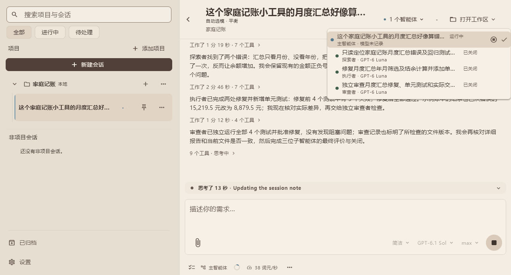
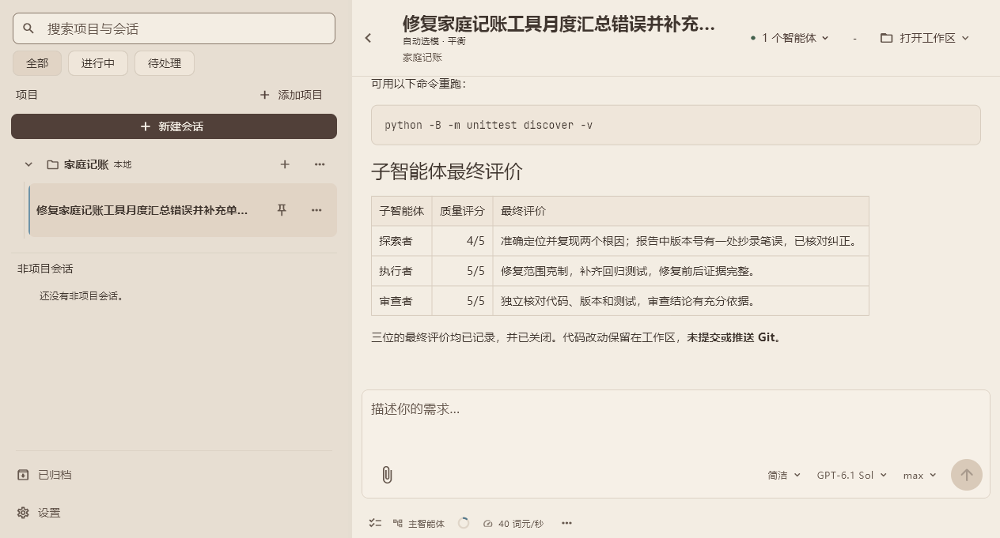
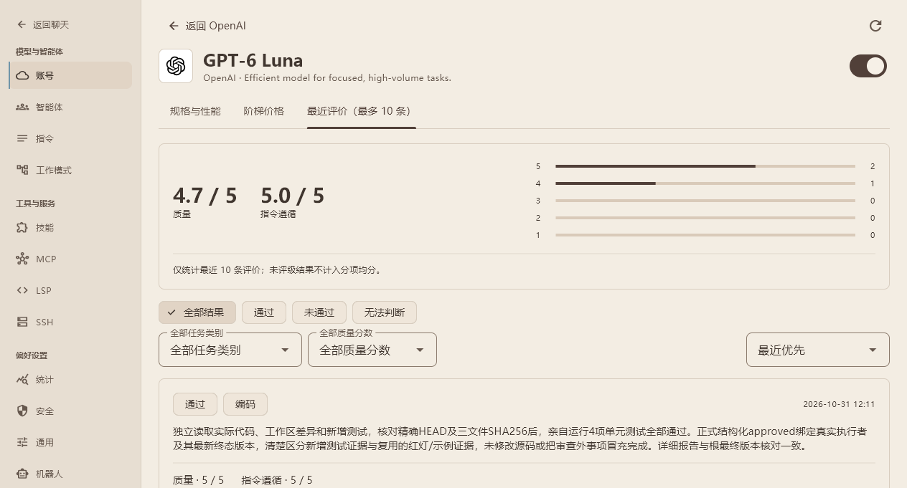
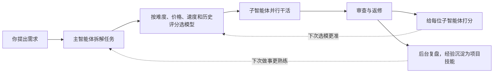
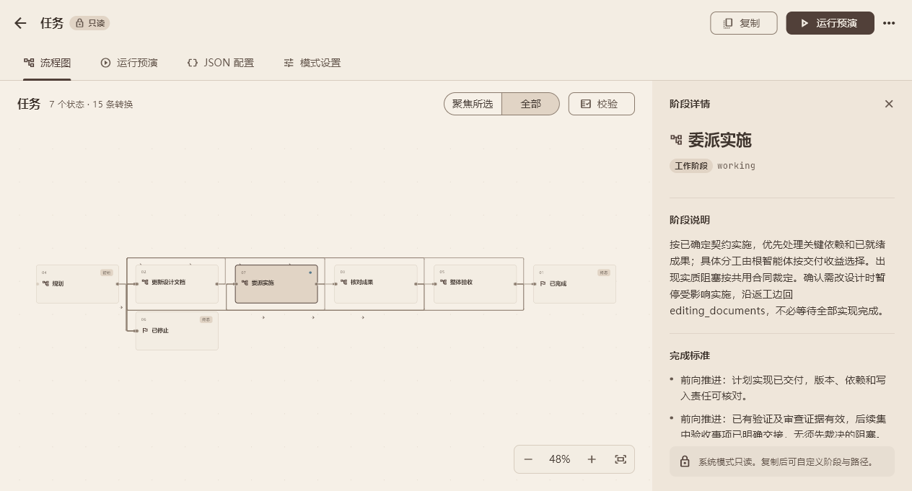
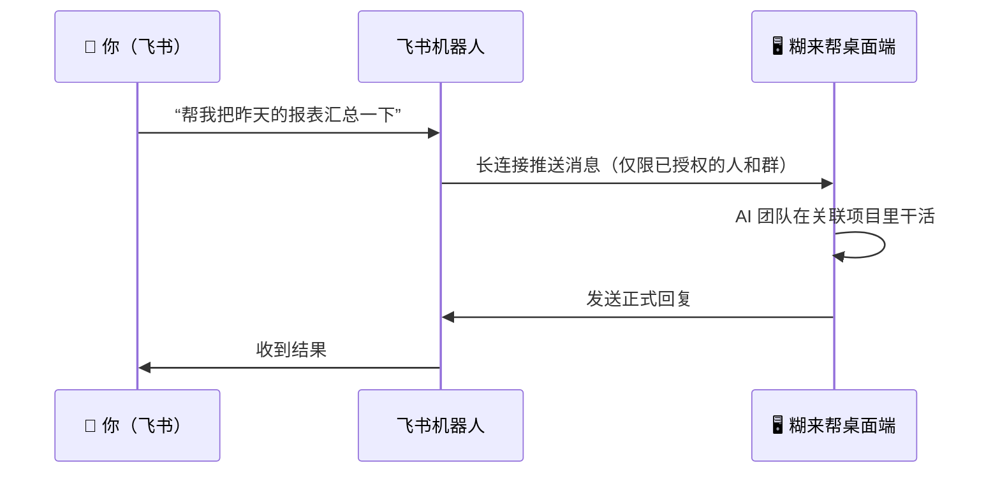

<div align="center">
  
  <h1>糊来帮 · anywork</h1>
  <p><strong>一支会自己挑模型、越用越懂行的 AI 团队，住在你的桌面上</strong></p>
  <p>
    🧬 自进化多智能体 · 🪶 无浏览器内核、轻快省内存 · 🧩 可视化编排工作流 · 💬 飞书远程派活
  </p>
  <p>
    <a href="https://github.com/ZR233/pure-lang/releases/latest">下载 Windows 安装包</a> ·
    <a href="#-快速开始">快速开始</a> ·
    <a href="design/README.md">设计文档</a>
  </p>
</div>

---

你只需要像对同事一样说出想法，糊来帮会先弄清楚要做什么，再把活儿分给最合适的“队员”：有人查资料、有人动手改、有人负责挑毛病。每次交付后它都会给队员打分，下次派活就更准、更省钱。

<div align="center">
  
  <p><em>实机截图：让它修一个记账小工具的 bug，主智能体自动选模，依次派出探索者、执行者、审查者，顶部下拉可查看每位子智能体的任务和所用模型</em></p>
</div>

## 🌟 一眼看懂四大特色

| | 特色 | 用一句大白话说 |
| :---: | :--- | :--- |
| 🧬 | **自进化的多智能体团队** | 简单活交给便宜快的模型，难活交给强模型；每次干完打分，越用越清楚谁擅长什么，还会把好经验总结成技能 |
| 🪶 | **无浏览器内核，轻快省内存** | 不是“套壳网页”，原生界面 + Rust 内核，应用本体只有一个进程，空载内存约 180 MB，安装包约 45 MB |
| 🧩 | **自定义工作流，拖拽式编排** | 把“先规划→再实施→后验收”这样的流程画成流程图，AI 严格按你画的步骤推进 |
| 💬 | **飞书远程控制** | 人不在电脑前？在飞书里给机器人发条消息，家里/公司的电脑就开始干活，并把结果回给你 |

---

## 🧬 特色一：自进化的多智能体团队

### 像项目经理一样派活

糊来帮里有一位**主智能体**负责和你沟通、拆解任务、统筹全局，另外还有几类各司其职的**子智能体**：

| 角色 | 擅长 |
| :--- | :--- |
| 🔍 探索者 | 只看不改，快速摸清项目和资料 |
| 🛠️ 执行者 | 在指定目录里动手修改、运行验证 |
| 🌿 工作树执行者 | 在独立的 Git 工作树里并行干活，互不打扰，不弄乱你正在用的目录 |
| 🧐 审查者 | 独立检查成果和风险，严把质量关 |

你还可以在设置里添加自己的角色。

### 按速度和价格自动选模型

开启“**自动选模**”后，主智能体每派一个子任务，都会先查一遍你已启用的模型：价格、是否包月/免费、实测速度（首字延迟、每秒输出词元）、上下文长度，以及**这个模型过去在本机干活的评分**，再按任务难易挑出最合适的那一个。你只需选一种偏好：

- **经济**：保证质量的前提下优先用包月、不另计费和高性价比的模型，简单活不浪费贵模型；
- **平衡**（默认）：综合能力匹配、近期评价、成本和耗时；
- **快速**：在质量和审查不打折的前提下，优先缩短整体完成时间。

### 有评价体系，越用越熟悉模型

每个子智能体交付、审查、返修全部结束后，主智能体会给它打一次**最终评价**：通过 / 未通过 / 无法判断，外加“成果质量”和“指令遵循”两项 1～5 分和一句点评。评价按“账号 + 模型”长期积累、跨会话可查，下一次选模时会作为参考——**用得越久，它越清楚哪个模型适合干哪类活**。

<table>
  <tr>
    <td width="50%"></td>
    <td width="50%"></td>
  </tr>
  <tr>
    <td align="center"><em>任务结束后，主智能体给探索者、执行者、审查者逐一打分</em></td>
    <td align="center"><em>评分按模型长期积累，下次自动选模时作为参考</em></td>
  </tr>
</table>

### 自动总结技能

一轮任务顺利完成后，糊来帮会在后台复盘：把验证有效的做法整理成当前项目的**技能（Skill）**，或补充到已有技能里。下次遇到同类任务自动照章办事，不用你一遍遍交代团队习惯。复盘只读写项目技能，不碰你的代码，也不记录一次性细节和隐私偏好。



---

## 🪶 特色二：无浏览器内核，轻快省内存

很多 AI 桌面应用其实是“装在窗口里的网页”，要随身带一整套浏览器内核，开起来就是好几个进程。糊来帮不一样：

- **原生界面**：用 Flutter 直接绘制界面，不内置 Chromium / WebView；
- **Rust 内核**：模型调用、会话调度、工具编排和存储都在应用自身进程里的 Rust 运行时完成，不依赖浏览器或 Node.js 运行时；
- **实测轻量**：Windows 发行版在全新数据目录下启动，约 **0.5 秒**出现可用界面，空载常驻内存约 **180 MB**；安装包约 **45 MB**。

> [!NOTE]
> 以上为本机实测参考值（Windows x64，`dist/anywork-release`，空数据目录），实际内存会随打开的会话数量与历史长度增长。

---

## 🧩 特色三：自定义工作流与可视化编排

“工作模式”决定 AI 按什么流程干活。内置两种：

- **简洁模式**：即问即答，适合日常问答和小修改；
- **任务模式**：按“规划 → 更新设计文档 → 委派实施 → 核对成果 → 整体验收”的阶段推进，复杂任务先出计划，你确认后再动手；发现设计有问题还能退回重来。

觉得不合适？打开**设置 → 工作模式**，复制一份内置流程或从零开始，在**流程图画布**上拖拽节点、连线，为每个阶段写清要求、完成标准和跳转条件；也可以切到 JSON 视图直接编辑。保存前会自动校验流程是否走得通，还能**运行预演**一遍——不调用模型、不产生费用。新会话选上你的工作模式，AI 就严格按图推进。

<div align="center">
  
  <p><em>工作模式编辑器：每个方框是一个阶段，连线是允许的跳转；右侧显示选中阶段的说明和完成标准。内置模式只读，点“复制”即可改成自己的流程</em></p>
</div>

---

## 💬 特色四：飞书远程控制

把糊来帮接入飞书机器人后，你可以在手机或任何一台电脑上的飞书里给它发消息，消息会进入关联项目的会话，由桌面端的 AI 团队执行，最终回复再发回飞书。



- **扫码即可接入**：在 **设置 → 机器人** 里扫码创建飞书自建应用，或连接已有应用；直接使用飞书官方接口，不需要额外安装 Node.js 或网关；
- **谁能用由你说了算**：只有本机批准过的联系人和群才能触发执行；陌生人私聊只会生成待批准的配对请求，群聊还需单独授权并真正 `@` 机器人；
- **桌面端看得见**：设置页可以查看机器人连接状态、浏览会话、查询历史消息，为机器人指定使用的模型，并以机器人身份手动发送。

> [!WARNING]
> 远程消息可能触发本机的完全访问工具，**关联项目不等于系统沙箱**，请只授权可信的人和群。飞书应用的权限审核与发布需要在飞书后台自行完成，详见[机器人接入设计与边界](design/27-bots.md)。

---

## 🧰 还有这些好用的能力

- **多家模型随意搭配**：内置 OpenAI（含 ChatGPT 订阅登录）、DeepSeek、xAI、智谱（API / Coding Plan）、小米 MiMo（API / Token Plan）账号模板，也能接入任何兼容 OpenAI 协议的云服务或本地模型（Ollama、vLLM、LM Studio 等）。
- **先对齐、再动手**：任务模式下 AI 先写实施计划，你可以一键批准或提修改意见。
- **本地与 SSH 远程一致体验**：像打开本地文件夹一样打开远程服务器上的项目，读写和命令都在远端原生执行。
- **工具箱开箱即用**：文件读写与精确补丁、全文检索、LSP 代码导航、终端命令、联网搜索、MCP 扩展；内置 Word / PowerPoint / Excel 办公技能与界面设计技能。
- **花多少钱一目了然**：实时显示上下文占用、会话费用估算、缓存命中率、账号余额与套餐用量，以及每个模型的实测速度。
- **断线、重启不丢活**：会话、待确认的计划和独立工作树都能原样恢复；Windows 关闭窗口会隐藏到托盘，后台任务继续跑。

---

## 🚀 快速开始

### 1. 安装

- **Windows**：从 [Releases](https://github.com/ZR233/pure-lang/releases/latest) 下载 `anywork-<版本>-windows-x86_64-setup.exe` 安装，应用内支持检查更新。
- **从源码运行（Windows / Linux）**：在仓库根目录执行

  ```bash
  # 构建并启动桌面端
  cargo xtask run-gui

  # 不配置 API Key，先看看界面
  cargo xtask run-gui --demo

  # 构建发行版到 dist/anywork-release
  cargo xtask build-gui
  ```

  Linux 需要 Clang、CMake、Ninja、pkg-config 与 GTK 3 开发包，详见 [AGENTS.md](AGENTS.md#桌面-gui)。

### 2. 三步开始第一个任务

1. **设置 → 账号 → 添加账号**：选择账号模板，填入 API Key（或使用 ChatGPT 订阅登录）。
2. 左侧边栏 **+ 添加项目**：选择本地文件夹，或通过 **SSH** 打开远程服务器上的目录。
3. 在输入框下方选择工作模式（简洁 / 任务）和是否启用独立工作树，说出你的想法即可。想让它自动挑模型，在 **设置 → 通用 → 子智能体分发** 把默认分发模式设为“自动选模”并选择经济 / 平衡 / 快速偏好；也可以在输入框的“会话设置”里只为当前新会话单独指定。

### 3. 连接飞书机器人（可选）

1. 先配置好**简洁模式**使用的模型，并添加要关联的项目。
2. 打开 **设置 → 机器人 → 添加机器人**，阅读风险说明后选择扫码创建或连接已有自建应用。
3. 在飞书后台确认机器人、长连接、`im.message.receive_v1` 事件与所需权限，完成管理员审批和应用发布。
4. 启用连接，等界面显示“已连接”后再发第一条消息；陌生联系人需要在本机批准配对后重发。

### 4. 数据存在哪里？

- **配置**：`~/.anywork/config.toml`（Windows 为 `%USERPROFILE%\.anywork\config.toml`），密钥保存在系统凭据库；可用 `--studio-home` 或 `ANYWORK_HOME` 指定独立数据目录。
- **会话与统计**：`<studio-home>/data/` 下，由应用管理，请勿手工编辑。
- **AI 的临时文件**：放在项目内 `.anywork/sessions/<会话>/` 的 `temp/` 与 `artifacts/`；归档会话时只清理临时目录。
- **用户技能**：只读标准目录 `~/.agents/skills/`；项目技能和内置技能各自独立。

升级时，受支持版本的账号配置、凭据关联、v2 会话与统计会自动迁入当前布局，原件和迁移备份保留；更早的数据不导入也不删除。详见[存储契约](design/17-studio-storage.md)与[配置契约](design/20-config.md)。

---

## 📖 延伸阅读

- **[架构与设计文档索引](design/README.md)**：完整的产品契约、运行时设计、存储结构与界面细节。
- **[多智能体协作与自动选模](design/12-collaboration.md)**：角色、工作树隔离、分发模式与最终评价。
- **[工作模式与工作流编辑器](design/11-thread-mode.md)**：状态图协议、内置模式与离线预演。
- **[项目级技能与自动学习](design/10-skills.md)**：技能目录、召回与后台复盘。
- **[外部机器人与飞书接入](design/27-bots.md)**：首配、最小权限、发送结果与安全边界。
- **[项目协作与开发规范（AGENTS.md）](AGENTS.md)**：开发命令、构建要求与贡献指南。
