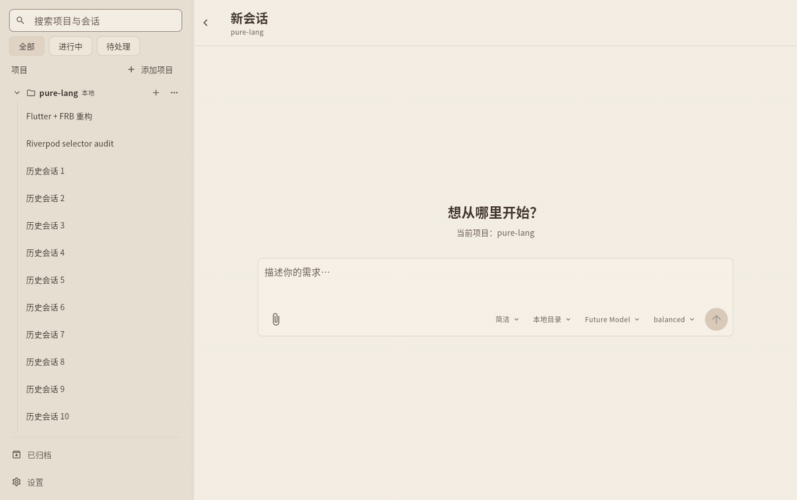
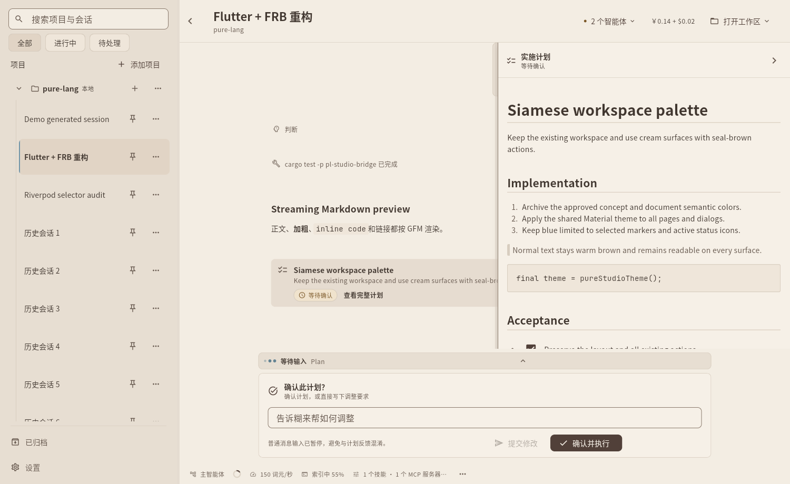
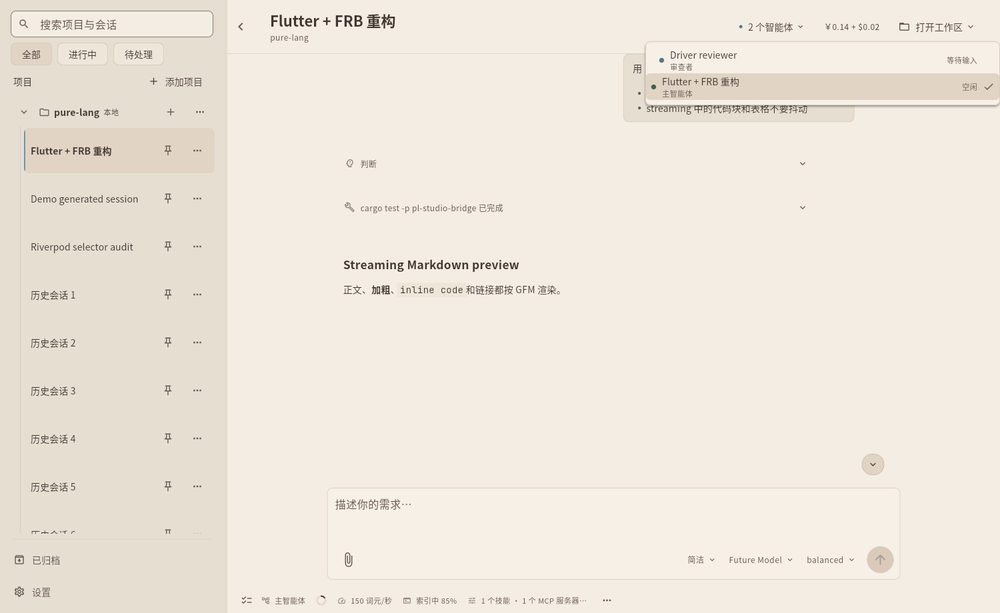
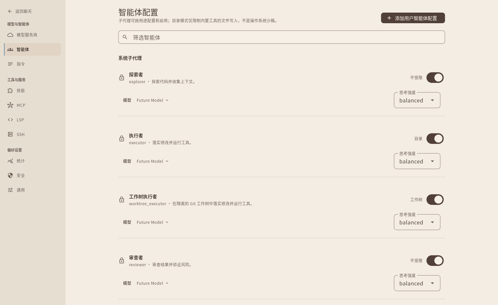
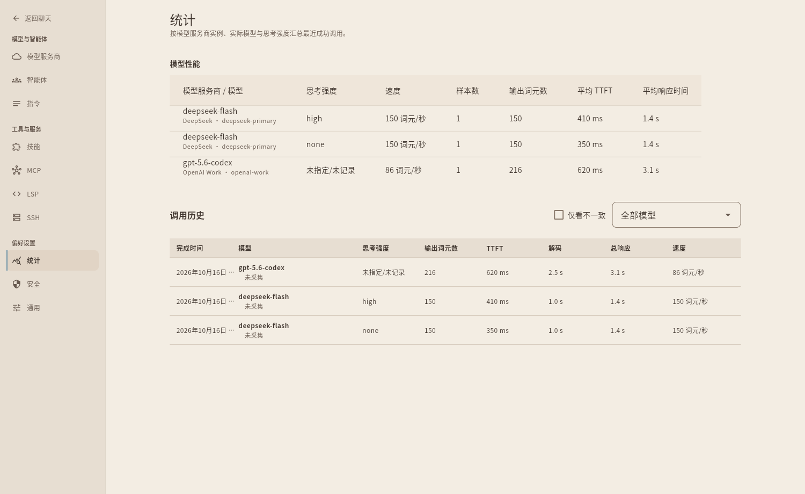

<div align="center">
  
  <h1>糊来帮 · anywork</h1>
  <p><strong>把自然语言想法，变成清晰计划与可靠交付的桌面智能体工作台</strong></p>
  <p>
    多模型账号混搭 · 双模式任务流 · 交互式计划确认 · 多智能体团队与 Worktree 隔离 · 本地/SSH 全栈工具箱 · 项目级技能
  </p>
</div>

---

**糊来帮（anywork）** 是一款专为开发者与知识工作者打造的原生桌面智能体工作台。它不止是一个聊天窗口，而是一支支持多家主流模型账号混搭、懂你项目上下文、先对齐计划再动手执行，并能在独立工作树或远程服务器上自主验证交付的智能体协作团队。

<div align="center">
  
  <p><em>实机录制：从新建任务、切换模式、流式思考推理、终端命令执行到生成结构化交付结果</em></p>
</div>

---

## ✨ 为什么选择糊来帮？

### 1. 🧭 先对齐、再动手：双模式工作流与交互式计划

在糊来帮中，你可以根据任务复杂度随时切换工作方式：
- **简洁模式**：即问即答、干净利落，适合日常问答、代码解释与轻量修改。
- **任务模式**：面对复杂特性或跨模块重构，智能体不会“收到一句话就盲目改代码”，而是先调研现场并起草一份结构化的**实施计划**。

计划生成后，工作台会并排展开**实施计划审阅面板**。你可以对照代码与验收清单，一键**确认并执行**，或直接在下方输入调整意见让智能体重新打磨方案——始终把方向盘握在自己手里。

<div align="center">
  
  <p><em>实施计划并排审阅面板：支持对照完整 Markdown 方案一键批准执行，或直接输入修改意见</em></p>
</div>

---

### 2. 🤝 主从协同的智能体团队，原生 Git Worktree 隔离

复杂工程不再由单个上下文硬扛到底。糊来帮内置主从分工的智能体协作体系：
- **主智能体**：负责与你沟通意图、拆解计划、统筹全局并汇报最终结果。
- **探索者（Explorer）**：只读深入代码库与文档，快速摸清模块边界与现场事实。
- **执行者（Executor）**：在受控的项目目录内落实边界明确的修改与验证。
- **工作树执行者（Worktree Executor）**：在**独立的 Git Worktree 工作树**中并行实施修改与运行测试，物理隔离、互不踩踏，绝不污染你正在编辑的主工作区。
- **审查者（Reviewer）**：独立审查代码改动、测试结果与潜在风险，严把交付质量关。

你还可以在设置中自定义专属角色，并在主工作台顶部随时切换查看任意子智能体的实时进度。

<div align="center">
  
  <p><em>主工作台全景：顶部一键切换主从智能体视图、实时显示多币种费用与工作区入口，时间线流畅呈现思考、工具调用与 Markdown 正文</em></p>
</div>

<div align="center">
  
  <p><em>智能体团队配置：为不同职能的子智能体独立配置工作区隔离策略（不受限 / 目录 / Git 工作树）、模型与思考强度</em></p>
</div>

---

### 3. 🌐 开放的多模型账号支持，按角色灵活混搭

糊来帮不绑定单一厂商，支持从系统账号模板创建多个接入账号，并能**按会话模式**（简洁 / 任务）或**按智能体角色**（主智能体、探索者、执行者、审查者）分别指派最合适的账号、模型与思考强度——例如让强推理模型负责架构规划与代码审查，让高吞吐模型负责快速代码检索，兼顾质量、速度与成本。

账号表示一份具有稳定 ID 的接入配置；同一模板可创建多个独立账号，默认名称跟随模板，也可自行命名。模型列表按账号分组，修改显示名不会拆分模型统计或凭据关联。当前内置账号模板包括：

| 账号模板 | 支持说明与特色 |
| :--- | :--- |
| **OpenAI** | 官方 Responses API 接入，支持 GPT 全系推理与编程模型、多模态输入及原生联网搜索 |
| **DeepSeek（深度求索）** | 官方推理与编程模型接入，支持思考强度调节、文件上传、多轮前缀缓存与原生联网搜索 |
| **xAI** | 官方 xAI Grok 系列模型接入，支持 Responses 协议与思考强度调节 |
| **智谱（Zhipu / Zhipu Coding Plan）** | 同时提供 **Zhipu BigModel API** 与 **Zhipu Coding Plan（编程套餐）** 两种账号模板，分别使用对应的 Chat / Responses 端点与目录，支持 GLM 系列文本与多模态视觉模型 |
| **小米 MiMo（MiMo API / MiMo Token Plan）** | 同时提供 **MiMo API** 与 **MiMo Token Plan** 两种账号模板，支持小米 MiMo 系列模型 |
| **OpenAI API 兼容（自定义账号）** | 支持接入兼容 OpenAI `Chat Completions` 或 `Responses` 协议的第三方云平台、企业内部模型网关，或本地推理服务（如 Ollama、vLLM、LM Studio 等）；实际能力以所选模型和端点声明为准 |

厂商协议适配通过组合复用 OpenAI 的 Chat / Responses 基础能力，同时保留各家的目录解析、推理参数、用量和原生能力；“OpenAI 兼容”不表示所有厂商具有相同功能。

---

### 4. 🛠️ 本地与 SSH 远程无缝衔接，开箱即用的全栈工具箱

无论项目在本地磁盘，还是在远端开发机、算力服务器或嵌入式构建主机上，糊来帮都提供一致的原生体验：
- **SSH 远程项目直连**：在设置中配好 SSH 服务器，即可像打开本地文件夹一样浏览并打开远端项目，所有文件读写与命令执行均在远端原生完成。
- **代码智能与终端闭环**：内置文件读写、精准补丁修改、全文检索、**LSP 代码语义导航**（跳转定义、查找引用、悬停类型与实时诊断）以及终端命令执行，让智能体改完代码后自己跑通编译与测试。
- **联网搜索与 MCP 扩展**：原生支持 DeepSeek 与 OpenAI 联网搜索，实时获取最新文档与资讯；同时支持接入自定义 **MCP（Model Context Protocol）** 扩展服务，无限延展工具边界。
- **外部编辑器一键联动**：在会话顶部随时用 VS Code、Zed 或系统终端打开当前会话所在的工作目录（包括独立的 Git Worktree 目录）。

---

### 5. 📚 越用越懂你的项目级技能体系（Skills）

糊来帮内置开箱即用的丰富技能库，并能随着你的使用不断进化：
- **预置办公与设计技能**：自带 Word（`.docx`）、PDF、PowerPoint（`.pptx`）、Excel（`.xlsx`）文档处理以及前端界面与画布设计等实用技能。
- **自动沉淀项目经验**：当智能体与你携手攻克复杂的调试、构建或架构任务后，可将验证有效的工作流提炼为当前项目的专属技能。下次遇到同类任务时自动按章办事，无需反复交代团队习惯。

---

### 6. 🐾 温润克制的暹罗猫桌面美学与全景透明掌控

<div align="center">
  
</div>

- **暹罗猫奶油暖棕主题**：专为长时间沉浸阅读与编码设计的暖米色界面与深海豹棕操作焦点，温润护眼、层次分明；流式输出代码块与表格不跳动，并支持精准的富文本与代码块框选复制。
- **成本与性能全景透明**：底部状态栏与统计面板实时展示上下文容量占用、多币种会话费用估算、缓存命中率、账号用量，以及按账号 ID 与配置模型 ID 汇总的 **首字延迟（TTFT）** 和 **生成速度（词元/秒）**，并保留组内不同思考强度的细分读数。
- **断线与重启无损恢复**：无论是隐藏到托盘、安全退出还是重启应用，正在推进的会话、待确认的实施计划与独立工作树现场都能原样恢复，随时接着往下干。
- **按数据目录单例**：Windows 与 Linux 重复启动同一数据目录时，会显示已有窗口；Windows 托盘隐藏或最小化时自动恢复。不同 `ANYWORK_HOME` 可独立运行，目录别名共用同一实例。
- **Windows 托盘常驻**：点击窗口关闭按钮会隐藏到系统托盘，后台会话、工具执行与保存继续运行；左键托盘图标恢复窗口，右键菜单可显示主窗口或安全退出。Linux 暂保留原有窗口关闭行为。

<div align="center">
  
  <p><em>统计面板：按账号与模型汇总真实输出速度（词元/秒）、平均首字延迟（TTFT），并展示思考强度细分与调用历史</em></p>
</div>

---

## 🚀 快速开始

### 1. 启动桌面端

在仓库根目录下，通过一条命令即可构建并启动当前系统的原生桌面端（支持 Windows 与 Linux）：

```bash
# 启动糊来帮桌面端
cargo xtask run-gui

# 若想在不配置 API Key 的情况下快速预览界面与交互演示
cargo xtask run-gui --demo
```

### 2. 配置模型并开始第一个任务

1. 点击左下角 **设置 → 账号 → 添加账号**，选择账号模板（**OpenAI**、**DeepSeek**、**xAI**、**Zhipu / Zhipu Coding Plan**、**MiMo API / MiMo Token Plan** 或 **OpenAI API 兼容**自定义入口），确认账号名称并填入 API Key。
2. 点击左侧边栏 **+ 添加项目**，选择本地代码仓库或通过 **SSH** 打开远程服务器上的项目目录。
3. 在输入框底部选择 **简洁** 或 **任务** 模式，以及是否启用 **独立工作树（Worktree）**，输入你的想法即可开始协作！

已有受支持版本的接入配置与凭据关联在启动时保全迁移，原账号 ID 和用户选择保持不变；本版本 v2 会话与统计继续保留。隔离的旧版会话目录不导入或删除。升级失败时保留原件和可恢复记录，不要通过清空数据或仅修改 schema 版本号修复；详见[配置契约](design/20-config.md)。

### 3. 打包发行版

```bash
cargo xtask build-gui
```

### 4. 数据与临时文件在哪里？

- **用户配置**默认位于 `~/.anywork/config.toml`（Windows 为 `%USERPROFILE%\.anywork\config.toml`），密钥保存在系统凭据库。可用 `--studio-home` 或 `ANYWORK_HOME` 指定独立数据根。
- **项目与会话数据**按稳定身份收在 `<studio-home>/v2/projects/<project-key>/sessions/<thread-key>/`；历史、附件和可靠工具输出随会话保存。归档不是删除历史，既有 v2 平铺会话通过可接续迁移整理到新目录。
- **智能体临时文件**位于实际工作区的 `.anywork/sessions/<thread-key>/scratch/`，待交付产物位于同级 `artifacts/`；SSH 会话使用远端工作区路径。系统提示词会给出本会话的准确位置，运行池内的忽略文件避免把临时产物误提交到 Git。

内部数据库和归属清单由应用管理，不要手工编辑。目录职责、迁移与 helper 传输边界详见
[存储契约](design/17-studio-storage.md) 和 [SSH 远程开发](design/22-ssh-remote.md)。

---

## 📖 延伸阅读

如果你希望深入了解糊来帮的内部设计或参与项目开发，欢迎查阅：

- **[架构与设计文档索引（design/README.md）](design/README.md)**：了解完整产品契约、运行时设计、存储结构与界面细节。
- **[项目协作与开发规范（AGENTS.md）](AGENTS.md)**：查看日常开发命令、构建要求与贡献指南。
