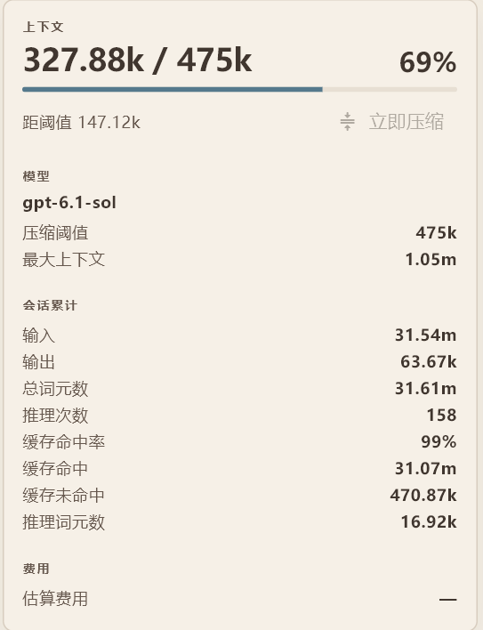
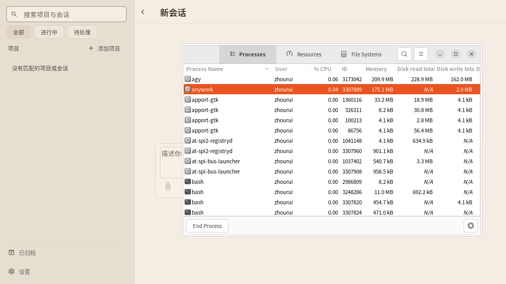
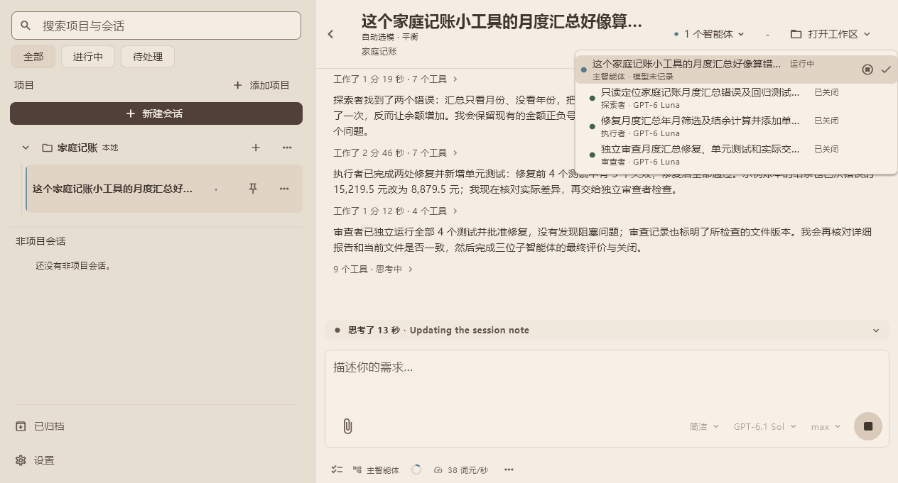
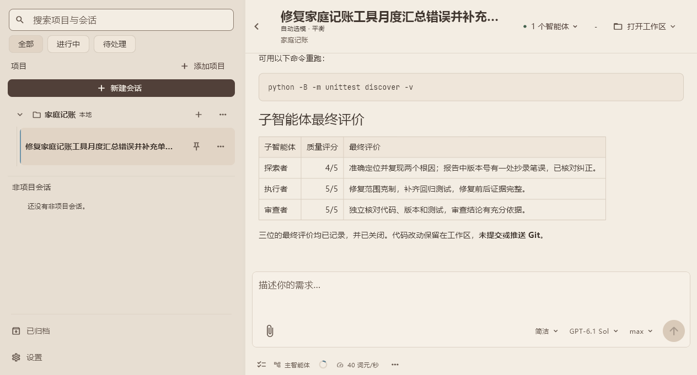
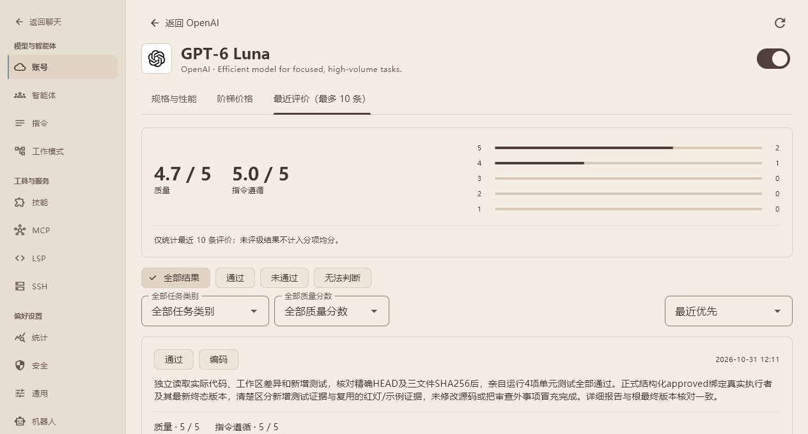
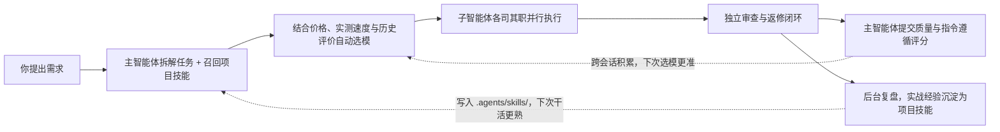
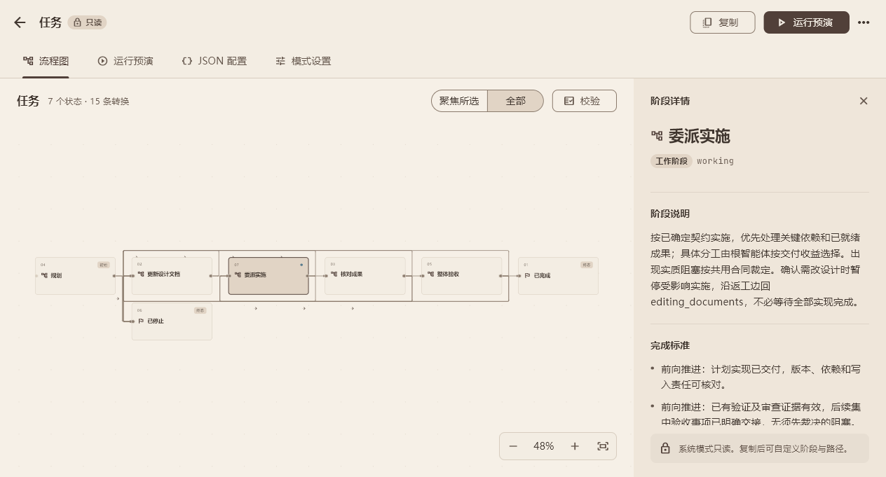

<div align="center">
  
  <h1>糊来帮 · anywork</h1>
  <p><strong>既省钱又轻快、会混搭多家订阅、还能在实战中自进化的原生桌面 AI 团队</strong></p>
  <p>
    💰 99% 极高缓存命中率 · ⚡ Rust + Flutter 原生极速低占用 · 🎭 多订阅智能编排派活 · 🧬 模型评价与技能自进化
  </p>
  <p>
    <a href="https://github.com/ZR233/pure-lang/releases/latest">下载安装包</a> ·
    <a href="#-快速开始">快速开始</a> ·
    <a href="design/README.md">设计文档</a>
  </p>
</div>

---

**糊来帮（anywork）** 是一款基于 **Rust + Flutter** 打造的原生桌面智能体工作台。你只需要像对同事一样说出目标，主智能体就会统筹全局，从你接入的多家订阅与 API 账号中挑出最合适的模型，派出探索者、执行者、审查者协同交付；每次干完活自动给模型打分、把项目经验沉淀为技能，越用越省、越用越懂行。

## 🌟 四大核心特点一览

| | 核心特点 | 为什么与众不同 |
| :---: | :--- | :--- |
| 💰 | **省：高达 99% 缓存命中率** | 稳定前缀设计 + 只追加上下文 + 阈值压缩 + 子智能体独立上下文，3100 万词元长会话实测 **99% 命中提示词缓存** |
| ⚡ | **快：Rust + Flutter 原生架构** | 告别臃肿的 Electron / 浏览器套壳，单进程无 Node.js 依赖，冷启动约 **0.5 秒**，日常运行 CPU 接近 **0%**、内存仅 **175 MB** |
| 🎭 | **多订阅混用：子智能体智能编排** | 同时混搭各家包月订阅与按量 API，主智能体按任务难易、价格、实测速度自动选模，**合适的任务交给合适的模型** |
| 🧬 | **自进化：模型评价 + 经验变技能** | 独创跨会话模型任务评价系统（质量 + 指令遵循双维打分），配合后台复盘将项目实战经验自动沉淀为可复用技能（Skill） |

---

## 💰 特点一：省 —— 99% 极高缓存命中率，精打细算每一分 Token

长周期开发与复杂工程动辄消耗数千万词元（Token）。很多工具因为频繁改写系统提示词或采用滑动窗口截断历史，导致每次请求的前缀不断变化、缓存频频失效。糊来帮从底层协议到上下文管线专为**高缓存命中率**而设计：

- **字节级稳定的请求前缀**：基础指令、角色指令、工作模式与按确定性顺序排列的工具声明固定在上下文首部；工作区状态变化仅以只追加（Append-Only）快照附在对话末尾，绝不原地篡改已发送的历史记录，最大化触发服务端提示词前缀缓存（Prompt Cache）。
- **按阈值压缩，拒绝滑动窗口破坏缓存**：不在每轮对话后剔除旧消息（那会让后续所有请求的前缀整体移位、缓存全部作废），而是持续复用缓存前缀，直到逼近安全压缩阈值（如 `475k`）或你手动点击**立即压缩**时才一次性整理上下文。
- **子智能体独立上下文分流**：大范围代码检索、日志排查与测试运行都交给拥有独立上下文的子智能体完成，只向主会话汇报精炼结论与关键证据，保持主会话上下文干净紧凑。

<div align="center">
  
  <p><em>实机长会话统计：累计推理 158 次、总输入 31.54m 词元，其中 31.07m 词元直接命中缓存，<strong>缓存命中率高达 99%</strong>（未命中仅 470.87k）</em></p>
</div>

---

## ⚡ 特点二：快 —— Rust + Flutter 原生技术栈，单进程超低资源占用

市面上不少桌面 AI 工具本质是“装在窗口里的网页（Electron / WebView）”，随身捆绑整套 Chromium 浏览器内核与 Node.js 运行时，一打开就是七八个进程、动辄吃掉上 GB 内存。糊来帮采用纯正的 **Rust + Flutter** 原生桌面技术栈：

- **Flutter 原生界面渲染**：直接通过 GPU 绘制桌面视图，不内置任何浏览器内核；时间线采用不可变完成记录与连续段索引，折叠工作组只读轻量代表，展开时才按需分页读取明细，长会话依然丝滑。
- **Rust 单进程内核**：模型流式编解码（SSE / WebSocket）、多智能体并发调度、Git 工作树生命周期管理、SQLite 持久化与工具执行全部在应用本体的 Rust 运行时内完成，无需额外部署 Node.js 或外部网关。
- **实测轻快省资源**：应用本体只有 **1 个 `anywork` 进程**，安装包约 **45 MB**，冷启动约 **0.5 秒**即可交互；日常运行状态下 CPU 占用接近 **0%**，常驻内存仅 **170～180 MB**。

<div align="center">
  
  <p><em>实机运行时资源占用：后台运行糊来帮原生桌面端，系统监视器中仅有一个 <code>anywork</code> 进程，CPU 占用 <strong>0.04%</strong>，内存占用仅 <strong>175.1 MB</strong></em></p>
</div>

---

## 🎭 特点三：多订阅混用 —— 子智能体智能编排，合适的任务给合适的模型

你手里可能同时有 **ChatGPT 订阅（Plus / Pro）**、**智谱 Coding Plan**、**小米 MiMo Token Plan** 等包月套餐，以及 **OpenAI**、**DeepSeek**、**xAI** 或本地 **Ollama / vLLM** 等 API 账号。如果所有事情都塞给同一个模型，要么简单查资料浪费了昂贵的强推理模型额度，要么复杂代码修改用了轻量模型导致反复返工。

### 1. 多家订阅与 API 账号同台混搭
糊来帮支持同时配置并启用多个订阅账号、免费/本地账号与按量计费 API 账号，统一追踪各账号的计费类别（包月订阅 / 不计费 / 按量计费）、套餐额度、余额以及每个模型的本地实测速度（首字延迟 TTFT、输出吞吐率 TPS）。

### 2. 主从分工的子智能体协作编排
主智能体像技术负责人一样与你对齐需求、拆解计划，再把具体工作派发给各司其职的子智能体：

| 角色 | 职责与工作区边界 |
| :--- | :--- |
| 🔍 **探索者（Explorer）** | 只读检索代码库、文档与网络资料，快速摸清模块边界与现场事实，不改动任何文件 |
| 🛠️ **执行者（Executor）** | 在指定的受控目录范围内动手修改代码、运行命令与测试验证 |
| 🌿 **工作树执行者（Worktree Executor）** | 在**独立的 Git Worktree 工作树**中并行实施修改与验证，物理隔离、互不踩踏，绝不弄乱你正在使用的主工作区 |
| 🧐 **审查者（Reviewer）** | 直接绑定被审执行者的实际工作区，独立核对代码改动、测试证据与潜在风险；发现阻塞问题可自动打回执行者返修 |

### 3. 按难度、价格、速度与战绩自动选模
除了为每个角色固定指派专属模型外，你还可以开启“**自动选模**”并选择调度偏好：
- **经济**：在满足任务能力与质量的前提下，优先调用包月订阅（`subscription`）、不计费（`noCharge`）账号及高性价比模型，简单探索绝不浪费高价额度；
- **平衡**（默认）：综合权衡任务难度、能力匹配度、历史评分、成本与交付耗时；
- **快速**：在保证质量与审查标准的前提下，结合本地实测首字延迟与吞吐率，优先缩短端到端完成时间。

<div align="center">
  
  <p><em>实机协作画面：主智能体（GPT-6.1 Sol · max）统筹全局，在“自动选模 · 平衡”模式下依次派出探索者、执行者、审查者，为不同子任务自动匹配合适的模型（GPT-6 Luna），顶部下拉可随时切换查看每位成员的实时进度</em></p>
</div>

---

## 🧬 特点四：自进化 —— 独特的模型任务评价系统 + 项目经验变成技能

大多数 AI 工具每次新开会话都像“第一天上班的新人”——既不记得哪个模型在你的项目里容易踩坑，也不记得你上次刚交代过的架构规约与排错套路。糊来帮通过**模型评价闭环**与**技能沉淀闭环**实现持续自进化：

### 1. 独特的模型任务评价系统：越用越清楚谁擅长什么
每个子智能体完成交付、独立审查与全部返修后，主智能体在关闭它之前必须提交一份结构化的**最终任务评价**：
- 给出明确的验收结论：**通过** / **未通过** / **无法判断**；
- 从 **成果质量（1～5 分）** 与 **指令遵循（1～5 分）** 两个维度定量打分，并附上具体验收评语；
- 所有评价按“**账号 + 模型**”跨会话长期保存与聚合。下一次主智能体自动选模时，会直接查阅各候选模型在本机同类任务上的真实得分与历史评语——**用得越久，选模越准**。

<table>
  <tr>
    <td width="50%"></td>
    <td width="50%"></td>
  </tr>
  <tr>
    <td align="center"><em>任务交付后，主智能体对探索者、执行者、审查者逐一打分点评</em></td>
    <td align="center"><em>模型详情页跨会话汇总质量（4.7/5）与指令遵循（5.0/5）历史评价</em></td>
  </tr>
</table>

### 2. 项目经验自动沉淀为技能：越用越懂你的项目
每当一轮任务顺利完成，糊来帮会在后台派生独立的复盘智能体，回顾本轮对话中验证有效的工程套路、构建命令、模块边界与排错经验，自动创建或增量更新到当前项目的 `.agents/skills/` 技能目录中：
- **按需精准召回**：后续会话遇到相关问题时，系统根据你的输入自动评分召回匹配的项目技能，按需加载完整指导文档与脚本模板，无需你一遍遍重复交代；
- **严格的安全边界**：后台自学习仅读写当前项目的技能目录，绝不触碰业务源码，也不会把一次性细节、临时报错或个人隐私写入技能。



---

## 🧩 还有这些强大的工程能力

### 可视化工作流编排
“工作模式”决定 AI 按什么流程推进。除开箱即用的**简洁模式**（即问即答）和**任务模式**（按“规划 → 更新设计文档 → 委派实施 → 核对成果 → 整体验收”推进，复杂任务先出计划、你批准后再动手）外，你还可以在 **设置 → 工作模式** 中打开**流程图画布**，拖拽节点与连线定制团队专属流程，并支持零成本离线**运行预演**。

<div align="center">
  
  <p><em>工作模式编辑器：可视化定义每个阶段的说明、完成标准与允许的跳转路径，保存前自动校验可达性并支持离线预演</em></p>
</div>

### 飞书机器人远程派活
在 **设置 → 机器人** 中扫码即可创建或接入飞书自建应用（直连飞书官方长连接接口，无需安装 Node.js 或额外部署公网网关）。人不在电脑前时，用手机飞书给机器人发消息，桌面端的 AI 团队就会在关联项目里开始干活并将结果发回飞书；只有经本机显式批准的可信联系人和群组才能触发执行。

AI 也能使用统一的文件展示工具，把明确选择的图片或文件发送到当前飞书会话；上传和消息发送分别记录结果，失败或结果未知时保留诊断。

> [!WARNING]
> 远程消息可能触发本机的完全访问工具，**关联项目不等于操作系统沙箱**，请仅授权可信的人和群。飞书应用的权限审核与发布需在飞书后台完成，详见 [机器人接入设计与边界](design/27-bots.md)。

### 全栈工具箱与本地 / SSH 一致体验
- **本地与 SSH 远程无缝切换**：像打开本地文件夹一样打开远程 Linux 服务器上的项目，文件读写、全文检索、Git 工作树与终端命令均通过随包分发的原生远程辅助进程在远端直接执行。
- **成果直接展示**：图片、Markdown 与其他文件可批量呈现在时间线，点击 Markdown 在侧栏阅读，支持自动换行、选择和复制；文件菜单可下载、另存为，或定位本地原件。
- **内置专业工具与技能**：自带文件精确补丁、ripgrep 全文检索、LSP 代码符号导航、受控终端命令、多源联网搜索、图像查看与生成、MCP 扩展协议，以及 Word / PowerPoint / Excel 办公文档与前端设计内置技能。
- **断线重启不丢进度**：会话历史、待确认计划、子智能体状态与独立工作树均支持断点冷恢复；Windows 下关闭窗口可最小化到系统托盘，后台长任务继续稳健运行。

---

## 🚀 快速开始

本地 Git 项目依赖系统 Git，SSH 远程项目还需系统 OpenSSH 客户端。Linux 的工具前置要求、Ubuntu 22.04 默认 Git 的能力限制，以及安装／首帧与业务验证的区别，见 [发布与更新](design/23-release-update.md#linux-debian-包与兼容边界)；构建镜像内的工具不会随 DEB 安装。

### 1. 安装与启动

- **Windows**：从 [Releases](https://github.com/ZR233/pure-lang/releases/latest) 下载 `anywork-<版本>-windows-x86_64-setup.exe` 安装，应用内支持检查更新。
- **Linux**：可从 Releases 下载 DEB 安装包；版本、安装布局与发行版兼容范围见 [发布与更新](design/23-release-update.md)。
- **macOS（Apple Silicon）**：稳定版 CI 提供包含完整 `.app` 的 ZIP 及 SHA-256，解压后放入 Applications。当前使用 ad-hoc 签名，未配置 Developer ID 或公证；系统信任与手动更新边界见 [发布与更新](design/23-release-update.md#macos-apple-silicon-归档与兼容边界)。
- **从源码运行（Windows / Linux / macOS）**：在仓库根目录执行

  ```bash
  # 构建并启动桌面端
  cargo xtask run-gui

  # 不配置 API Key，先看看界面
  cargo xtask run-gui --demo

  # 构建发行版到 dist/anywork-release
  cargo xtask build-gui
  ```

  macOS 本地构建需要完整 Xcode、Flutter 和 Swift Package Manager；生成当前宿主架构的 `dist/anywork-release/anywork.app`。SSH helper 的交叉构建可复用 Zig 与 `cargo-zigbuild`，也可使用既有预构建资源入口。稳定版与 RC 的 macOS CI 目标为 Apple Silicon；尚未配置 Developer ID 签名、公证或应用内更新。

  Linux 本地构建需要 Clang、CMake、Ninja、pkg-config 与 GTK 3 开发包（详见 [AGENTS.md](AGENTS.md#桌面-gui)）。Linux 开发者也可使用 [项目级 Docker 构建环境](docker/linux/README.md)，无需自行安装 Rust、Flutter 和原生开发依赖；本地构建与 CI 使用同一环境，Rust 配置来自根 `rust-toolchain.toml`。

### 2. 三步开始第一个任务

1. **设置 → 账号 → 添加账号**：选择账号模板（OpenAI / ChatGPT 订阅登录、DeepSeek、xAI、智谱 API / Coding Plan、小米 MiMo API / Token Plan 或 OpenAI 兼容端点），完成授权或填入 API Key。
2. 左侧边栏 **+ 添加项目**：选择本地文件夹，或通过 **SSH** 打开远程服务器上的目录。
3. 在输入框下方选择工作模式（简洁 / 任务）、是否启用独立工作树以及子智能体分发模式（如“自动选模 · 经济 / 平衡 / 快速”），说出你的想法即可；也可以在 **设置 → 通用 → 子智能体分发** 中设置全局默认偏好。

### 3. 连接飞书机器人（可选）

1. 先配置好**简洁模式**使用的模型，并添加要关联的项目。
2. 打开 **设置 → 机器人 → 添加机器人**，阅读风险说明后选择扫码创建或连接已有自建应用。
3. 在飞书后台确认机器人、长连接、`im.message.receive_v1` 事件与所需权限，完成管理员审批和应用发布。
4. 启用连接，等界面显示“已连接”后再发第一条消息；陌生联系人需要在本机批准配对后重发。

### 4. 数据与临时文件在哪里？

- **用户配置**：默认位于 `~/.anywork/config.toml`（Windows 为 `%USERPROFILE%\.anywork\config.toml`），密钥保存在系统凭据库；可用 `--studio-home` 或 `ANYWORK_HOME` 指定独立数据目录。
- **会话与统计**：位于 `<studio-home>/data/workspaces/<workspace-key>/sessions/<thread-key>/`，历史与可靠资源随会话保存。
- **会话清理**：临时文件归入实际工作区的 `.anywork/sessions/<thread-key>/temp/`，待交付产物放在同级 `artifacts/`；SSH 会话使用远端路径。归档在停止并确认保存后清理临时目录与专属工作树，保留宿主历史及可靠附件；工作树内文件随工作树删除。会话删除经独立确认永久清除整棵会话树的数据，不删除普通项目目录或 Git 分支；不设定时清理。完整边界见 [存储契约](design/17-studio-storage.md#1716-会话归档与临时数据清理)。
- **用户技能**：直接只读标准用户主目录 `.agents/skills/`；项目技能（`<项目根目录>/.agents/skills/`）和内置系统技能各自独立。

升级时，受支持版本的账号配置、凭据关联、v2 会话与统计会自动迁入当前布局，原件和迁移备份保留；更早的数据不导入也不删除。目录职责与迁移边界详见 [存储契约](design/17-studio-storage.md) 与 [配置契约](design/20-config.md)。

---

## 📖 延伸阅读

- **[架构与设计文档索引](design/README.md)**：完整的产品契约、运行时设计、存储结构与界面细节。
- **[模型层与提示词缓存策略](design/06-model.md)**：多厂商协议适配、稳定前缀缓存、上下文压缩与计量口径。
- **[多智能体协作与自动选模](design/12-collaboration.md)**：角色边界、工作树隔离、分发模式与最终任务评价。
- **[项目级技能与自动学习](design/10-skills.md)**：技能目录层级、确定性召回与后台复盘沉淀。
- **[工作模式与工作流编辑器](design/11-thread-mode.md)**：状态图协议、内置模式与离线预演。
- **[外部机器人与飞书接入](design/27-bots.md)**：扫码首配、最小权限、发送结果与安全边界。
- **[项目协作与开发规范（AGENTS.md）](AGENTS.md)**：开发命令、构建要求与贡献指南。
