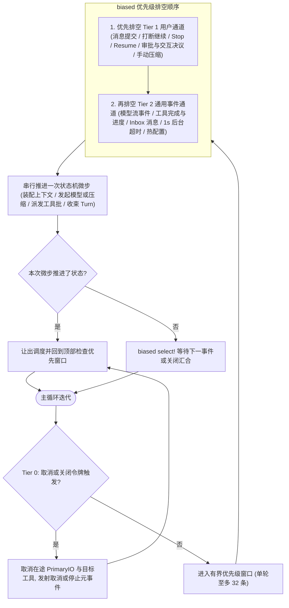

# 03 - 会话线程、轮次与条目流程

本文定义从输入受理到执行轮次（`Turn`）的通用流转过程、模型推理循环与交互（`Interaction`）模型。计划状态机、多智能体协作编排与工作流状态机分别在 [13](./13-plan.md)、[12](./12-collaboration.md) 与 [11](./11-thread-mode.md) 中详细定义，本文仅从执行流水线视角阐述其协作关系。

## 3.1 输入受理与执行轮次

### 提交与打断控制

Studio 与 `pl-core` 采用统一**纯立即消息（Immediate-only）**语义，不设内核级“排队模式”。每次提交绑定稳定的输入 ID，重复提交同一 ID 仅返回原受理回执，不会重复唤醒或打断当前步骤；同一时间窗口内连续到达的多条用户消息各自独立受理并保留严格递增序号（`ordinal`），按 FIFO 顺序各自作为独立的 `ContextSource::User` 上下文记录（`input:<input_id>`）写入模型上下文。

当活动轮次正在执行时收到新用户消息：
- **准备期 / API 流式输出中**：内核立即持久化并广播输入受理事实，随后通过双层取消令牌结构（Turn 级 `turn_cancel` 与 Step 子级 `step_preempt`）对当前模型步骤发起**软抢占（Soft Preemption）**——既不销毁当前 `Turn`，也不发射误导性的轮次中断回执；若流式输出已产生非空正文，则在模型上下文中保留无工具调用的纯文本部分记录（`{attempt_id}:partial`）并落盘为 `completed` 状态的非最终过程正文，随后在同一 Turn 内立即携带合并后的 FIFO 待消费用户消息开启下一推理步。
- **工具运行 / `wait` 等待中**：若当前在途为普通工具批次（`ToolBatch`），软抢占不会取消正在运行的常规工具调用；待该批工具自然完成结算或等待中的 `TaskAccess::wait` 因 `user_inputs_ready: true` 立即唤醒后，新用户消息在下一推理步准入时按 FIFO 顺序进入上下文。
- **显式停止与继续**：用户只能在根会话发起显式 `Stop` 或无内容 `Continue`；`Stop` 触发 `turn_cancel` 并中止在途执行与驱动，等待物理清理收束；无内容 `Continue` 为一次性 token 控制，即使没有待消费输入也可基于已提交上下文续接。控制准入与状态归并见 [16](./16-core-contracts.md) §16.1，产品回查见 [14](./14-runtime-host.md) §14.2。子会话的运行控制只有停止，其继续由主智能体通过显式消息调度（见 [12](./12-collaboration.md)）。

### 消息呈现属性与输入来源

`MessagePresentation`（取值为 `visible` 或 `hidden`）是所有消息共用的基础协议属性，独立于计划、交互或邮箱特例：
- **`visible`（默认值）**：正常生成界面时间线条目与事件通知。
- **`hidden`**：仍属于规范的线程上下文，必须完整持久化并发送给模型供应商，但产品投影器不为它生成界面条目或通知。上下文压缩摘要、压缩指令及系统合成的用户输入均使用 `hidden`。

呈现属性在输入创建时冻结，随输入记录持久化并原样进入轮次请求与消息事实，宿主与前端界面均不得在运行期重新推导。

可见输入的来源（用户 `user` 或父智能体 `parentAgent`）同样在创建输入时冻结并持久化。产品投影器将父智能体输入映射为独立的文本通道，Studio 不根据线程层级、消息正文或工具名称猜测输入来源；历史记录缺失该字段时按普通用户输入恢复。

### 轮次上下文装配与模型路由

每个轮次从同一份线程事实装配完整请求：根智能体基础指令、项目 `AGENTS.md`、当前工作模式（`Mode`）快照、可选的工作流阶段投影、普通技能（`Skill`）、工具快照以及模型路由。

每个根线程通过版本化的 `studio.model-route` 扩展独立保存自身的账号、模型与推理强度选择；正在执行的轮次使用启动时冻结的路由绑定，运行期间的路由修改从下一轮次起生效。工作模式不改变底层模型循环，但为新建线程与模式切换提供各自保存的默认路由选择；不得使用其他线程的选择或全局规划器（`planner`）路由覆盖既有线程的独立路由。

Native 会话由同一个所有者安装模型会话、上下文准备器、工具目录、对应的物理执行绑定和运行时事实。候选准备可以与旧轮次并行。请求拿到的工具声明及执行权限来自同一份已安装资源，旧请求沿用原冻结资源。已保存的模型选择器代表用户期望，成功打开并安装的模型才是实际执行模型。安装与退役条件见 [16](./16-core-contracts.md) §16.9。

内置通用基础指令将交流语言定义为跟随用户输入的动态规则，而非绑定固定语种：默认采用用户最近一次输入的自然语言，当用户切换语言时自动跟随切换，用户显式指定回复语言时则以指定语言为准。单次输出内部保持单一自然语言；代码、标识符、命令、文件路径、引用原文及既有英文文档按原样保留，既不计为语言混用，也不对其进行机械翻译。若当前输入无法判定语种且未显式指定，则沿用本会话已使用的交流语言。项目级指令与工作模式（`Mode`）仅补充领域约定，不得以固定默认语种覆盖该规则。

## 3.2 模型循环、优先级事件窗口与工具批处理

每个 Native Thread 的执行由单一串行 `ThreadLoop` 所有，外部耗时模型调用、上下文压缩与并发工具执行全部在独立的异步任务中运行，并通过类型化事件通道回流到主循环。主循环采用三层优先级事件窗口，确保用户交互和取消信号不被密集的流式增量淹没：

主循环通过单一元事件出口有序发出两类事实：需持久化并实时广播的规范业务事件（`Durable`），以及仅驱动内存实时状态栏与过程界面的瞬态流信号（`Ephemeral`）。循环执行期间严禁读取 `current.json` 或历史数据库；持久化对实时处理区严格只作为异步写沉与冷启动恢复来源（见 [15](./15-session-storage.md) 与 [26](./26-timeline-content.md)）。主循环的关闭状态机统一归属于 `LifecycleControl::{Open, Closing(CloseMachine), Closed}`，经 `CloseStage::{DrainExecution, JoinTasks, CloseModel, CloseTools, Flush, Finish}` 严格单步推进；`CloseMachine` 在各阶段仅于成功完成后前进并允许 `Preserve → Delete` 升级与并发等待者合并，失败保留当前阶段供精确续推，同时在 `Closing` 期间继续受理观察端事件槽重绑（`AttachEventSink`）以避免最终提交确认死锁。`drain_execution()` 通过统一停机原语中止包括轮次记录创建前（`Starting`/`Preparing`）在内的在途执行并等待完整排空。

模型流式响应依次生成助手条目、工具调用请求、工具执行结果以及下一步模型输入：
- **并发与独占批处理**：连续普通工具段共享快速窗口并并发派发（`Coexist`），前台工具形成顺序屏障，容量准入与公平性见 [09](./09-tool-runtime.md) §9.4；工作流状态转换工具声明为独占执行（`Solo`）——若同一模型响应中还包含任何其他工具调用，整批调用将被直接拒绝且不产生任何副作用；工作流查询工具仍为 `Coexist`。
- **工作流状态原子提交**：工作流变更在候选状态中校验，在同一次 owner 归并中接纳结果与合法业务变更。History 导出独立保留待写义务，保存慢或失败不回滚已确认事实，不重跑工具。业务 CAS 失败仍保留真实输出和失败事实，不应用无效控制。成功结果在同一轮次内提供新阶段约束，后续请求与压缩使用当前工作流事实（详见 [09](./09-tool-runtime.md) 与 [11](./11-thread-mode.md)）。
- **前台文件工具的顺序执行**：普通的 `write_file` 与 `apply_patch` 可在同一批次内共存，线程按模型给出的调用顺序依次等待前一个前台调用完成后再启动下一个。此机制仅保证线程内的调用顺序，不赋予工具结束轮次或修改扩展状态的控制权，也不构成跨进程的操作系统文件事务。`write_stdin` 使用普通后台任务策略：快速写入直接返回，持续背压时交付输入任务回执，模型可单独取消输入；同一进程的输入仍由既有输入锁串行处理，依赖输入完成的动作须等待该输入任务终态（见 [09](./09-tool-runtime.md)）。

## 3.3 交互模型（Interaction）

核心交互仅包含**通用用户输入（`UserInput`）**与**工具执行审批（`ToolApproval`）**两类：
- **计划提交与普通提问的边界**：计划生命周期由独立工具包 `pl-tool-plan` 的 `plan_*` 状态机管理（与工作流解耦，每个智能体各自持有独立实例）。主代理需请求用户审批计划时调用 `plan_transition(targetState: "awaitingConfirmation", content: ...)`（以一级 Markdown 标题开头的完整计划）；`request_user_input` 用于收集缺失信息、需求澄清与普通多选问答，禁止用于询问“是否开始实施、是否继续或是否批准完整计划”。两者底层均生成通用的 `UserInput` 交互，计划仅通过类型化用途（purpose）绑定计划状态机，不新增第三种交互类型（详见 [13](./13-plan.md)）。
- **交互续接（Continuation）与幂等决议**：交互请求可携带不可变的续接预设，声明交互决议后生成的用户消息来源与 `MessagePresentation` 属性，并纳入请求身份与持久化记录。Studio 对计划确认界面的特殊排版仅影响待决态的视觉呈现，不得用于反推续接消息的内容或可见性；未声明续接预设的 `UserInput` 不会隐式合成续接输入。待决交互随线程冷恢复保留，决议请求必须严格匹配交互身份与计划修订号（revision），且每个交互只能决议一次。

## 3.4 工作流生命周期（摘要）

配置了状态图的工作模式在首次收到根用户输入、发起模型请求前，自动创建工作流谱系（lineage）与运行实例（run）：
- **状态转换**：`workflow_transition` 通过运行实例 ID、修订号与当前阶段三重 CAS 校验完成当前阶段，并沿有向边进入下一阶段；到达终态阶段后该运行实例立即结束，但当前执行轮次仍可继续输出最终总结。
- **状态图演进与轮次收束**：若模式的状态图散列值发生变化，下一轮次会自动归档旧运行实例并在同一谱系下创建替代实例；正常到达终态后的新任务则自动开启新谱系。根智能体与子智能体均可通过自然生成最终回答或调用 `finish_turn({message})` 结束当前轮次；任务整体是否达成由根智能体核对业务目标与验证证据后决定。
- **职责解耦**：工作流状态机不持有代码、文件、Git 或智能体实例；任何工作流阶段均可调用普通工具。状态图与冻结的模式指令不构成运行时效果白名单或操作系统沙箱，产品工作流契约见 [11](./11-thread-mode.md)。

## 3.5 多智能体协作（摘要）

根智能体通过 `list_agent_profiles` 查询可用的智能体预设（`Profile`），并调用 `spawn_agent` 派生子智能体（`child`）：
- **创建期冻结**：派生时立即冻结子智能体的预设指令、模型路由与工作区分配策略（workspace assignment）。子智能体拥有标准会话线程、执行轮次与工具集，但不挂载根智能体专属的工作流工具。
- **消息可见性**：首次派发任务与后续补充指令均以 `visible` 且来源为 `parentAgent` 的输入写入子智能体的规范上下文与时间线。完整协作契约见 [12](./12-collaboration.md)。
