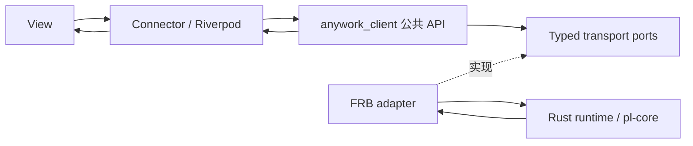

# 25 - Client、前端状态与资源生命周期

Rust 持有业务事实；应用实例持有纯 Dart Client；Riverpod 适配只读观察；Widget 呈现并发出意图。
本篇是客户端所有权、命令、草稿和导航的唯一权威契约。可靠历史与迁移见
[17](./17-studio-storage.md)，版本化流见 [07](./07-streaming.md)，领域和关闭见
[18](./18-studio-state.md)，呈现与阅读位置见 [19](./19-studio-ui.md)，验证边界见
[24](./24-testing.md)。规范不把源码实现或纯 Dart 测试等同于真实 native 与平台验收。

## 25.1 分层与应用实例

`anywork_client` 的运行依赖只有 Dart SDK，不依赖 Flutter、Riverpod、FRB、Ref 或
BuildContext。生成 DTO 和 native 句柄留在 adapter，Client 只消费 typed domain 契约。
feature 不导入生成代码、adapter、transport 或 Client 私有实现。应用装配入口同时认识
Client 与 adapter，其他层只认识各自的公共依赖。

每个 AppGraph 创建自己的 Client、transport 订阅登记、read models、命令板、草稿和附件
owner。禁止 module-level Client、业务 Map 和跨 ProviderContainer 共享的会话资源。
原生库的进程初始化与宿主退出仍归 native host，不能借此共享两个 Client 的观察句柄或草稿。
ProviderScope 借用注入的实例，只拥有自己的观察注册。

## 25.2 所有权与唯一写入

| 事实或资源 | 权威 owner | Dart owner / 唯一写入入口 | 身份与结束条件 |
| --- | --- | --- | --- |
| 项目、目录、配置、catalog、服务状态 | Rust 对应领域 | 各领域 read model reducer | 各自 ResourceStamp；领域关闭或应用退出 |
| Turn、activity、interaction、runtime、storage | Rust Thread | Client session 的状态 reducer | Thread 与 owner epoch；选择变化结束观察，不结束 Turn |
| 正文、saved、terminal、omitted、字段变更 | Rust Session / ChatView | ChatChannel 的 Reset/Patch reducer | ViewStamp；逻辑 demand 变化或退出 |
| 当前项目、会话与 Settings 导航 | Client 本地意图 | Workspace / Selection controller | 选择身份；旧异步命令不能覆盖新选择 |
| 输入、参数、route 与附件引用 | Client 草稿；受理后可靠附件由 Rust 持有 | Draft owner 与附件 ownership ledger | DraftStamp + OperationId；明确转移或放弃 |
| 提交、pending overlay 与未知结果 | Rust mutation owner / Client operation owner | MutationBoard | OperationId 与目标 stamp；真实结果分别记录 |
| 跨 view 的阅读意图与 item + pixel offset 锚点 | Client 会话 owner | Timeline 意图更新 | ThreadId；切换仅释放正文，显式跳到最新清除锚点 |
| 光标、composing、焦点、折叠与即时滚动几何 | Widget / UI controller | 局部 UI controller | draftId / reading generation；Widget dispose |

同一 canonical 资源只有一个 reducer。命令响应若携带该资源的权威 snapshot，进入同一个
reducer；命令状态和 overlay 不成为第二份 canonical。bootstrap 只负责启动恢复，不能在
命令成功后读取聚合状态掩盖缺帧。Demo 分领域发布 baseline/frame，不能把生产缺帧通过
本地成功回读补齐。可靠历史、SQLite、checkpoint 和 writer 始终由 Rust 持有。
Demo 的模式目录同样由独立、带版本的 catalog baseline 交付，组件不以本地默认列表补全缺失的能力。

启动的 loading、ready 与 typed failure 由 Client 持有并供只读观察。应用生命周期调用一次
bootstrap；目录与 catalog 均就绪后才显示可用 shell。首个 baseline 前的失败也必须显示其
typed code 与 correlation，不能困在 Widget 的局部等待标志里。显式重试复用同一 Client，
清除失败尝试后重新启动；路由重建和普通查询不自动重试启动。
启动成功后，目录观察失败保留最后有效目录与可用 shell，并显示该领域的显式重试入口；不能
退回无操作的启动页。Thread 状态流的同步状态与 ChatUiState 分别属于各自观察通道；正文
重连或预算阻塞不污染 runtime 同步状态，正文恢复也不能把仍失败的 runtime 标成 ready。

## 25.3 版本域

- ResourceStamp 由 ResourceKey、OwnerEpoch、Revision 组成。仅同资源同 owner 可比较。
- ViewStamp 由 ThreadId、ViewId、ViewEpoch、Version 组成。新 view 的版本不能与旧 view 比较。
- AttemptId 是一次客户端异步绑定身份，不能充当业务 owner epoch。
- OperationId 是一次业务提交身份，首次 await 前产生，未知结果不换 ID 自动重放。
- DraftStamp 是 DraftId 与字段或项目 revision，不能用窗口版本替代。

配置与 catalog 的 revision 独立；Thread model route revision 是 route extension 的 CAS，
不是 Thread 通知序号。`saved` 与执行终态独立。窗口版本相等只说明观察屏障到达，不能推导
Applied 或 NoChange。owner 更换后必须接受新 baseline，旧 epoch 的回执不能由新 epoch 满足。

## 25.4 观察与导航

观察 API 同步登记接收者并返回当前值，检查当前镜像与注册 predicate 之间不能有 await。
显示观察暂停时，每个观察者只保留最新快照；可靠事件仍使用有序交付，不套用 latest-only。
订阅取消只移除自己的观察，不能关闭跨路由 Session、ChatView、草稿或附件。

AppGraph 通过逻辑 demand 管理资源。进入 Settings、切换设置标签和 Widget 暂停不改变当前
ChatView demand，不清理新会话或 Thread 草稿。明确切换 Thread 才 retire 旧内容资源；关闭项目、
归档与应用退出显式结束相应需求。provider keepAlive 不能承担 native 资源所有权，也不能让
每个曾访问会话永久保留正文。轻量 owner 缓存、观察者和镜像均受预算约束。

## 25.5 ChatChannel 与关闭

transport 保留 open、initial、next 形态。一次 attempt 在第一次 await 前登记身份、
demand generation、原始 open Future、候选 handle、取消信号、pump、close/join 和预算 permit。
句柄返回后立即归该 attempt；每次 await 后校验 owner、attempt、demand 和 retired 状态。

initial 必须形成新 view 自己的首个 Reset，和后续 Reset/Patch 进入同一个 reducer，验证成功
后才 Ready。Opening、Ready、Reconnecting、Failed 明确区分；lastGood 可临时显示，不能成为
新 view 的 Patch baseline。同一 view 同时最多一个未完成 next，reduce 完后才取下一帧。
Patch.from 必须等于当前已交付版本，to 必须前进；缺口只 resync 当前 view。

load、focus、expand 返回 typed receipt，不直接替换 Dart baseline。
Applied / NoChange 来自后端操作本身。已观察到 receipt 的目标版本只表示观察完成；
帧先到和回执先到都必须收束，旧 attempt 的回包不能完成新 attempt 的操作。分页命令返回的
Future 等待该次操作收束（Applied 时等待对应目标版本的帧经 reducer 消化）后才完成，以便直接
驱动 `flutter_chat_ui` 的异步分页回调与锚点恢复。

正文补齐请求由 Session 关联当前 attempt 与独立请求身份。绑定退役后，旧请求的成功、
失败和清理只能结束自身，不修改新绑定同一条目的加载、等待或失败状态；内容仍由当前
ChatView 的同一 reducer 交付。内容连接失败或失去绑定时立即退役加载状态，只为正在打开或
就绪的当前绑定登记新请求。
首窗与历史焦点恢复只由 Client 的选择激活和 Session 绑定生命周期驱动；界面外壳不根据
“已有运行快照但尚无正文窗口”再次发起打开，资源退役也不生成新的打开意图。

阅读锚点及其像素偏移属于 Client；Reset 只替换内容和窗口能力，不根据服务端 focus 改写阅读
意图。每个新 attempt 在首 Reset 前登记主动历史阅读的 focus 恢复，控制操作等待该 view Ready，
并以相同内容泵观察回执目标版本。初始 latest 窗口没有锚点时，呈现层等待恢复或显示其失败，
不能据此丢弃历史阅读意图。查看条目仍遵循 [19](./19-studio-ui.md) 的 Latest 策略。
focus 请求另有 attempt 内的对象身份，旧 A 回包不能完成 A→B→A 的新 A；新的显式聚焦使旧
窗口操作退役。恢复等待、控制任务和句柄一起纳入 ChatChannel 的预算及关闭 join。

retire 同步拒绝旧回调、发送取消并 requestClose；finally 只清理自己捕获的资源。
close 等待 view-owned pump、FRB sink 和 native handle 的真实 ACK。失败或超时保留强 owner、
unresolved 记录和预算，不以 Map.clear 或 dispose 代替关闭。显式 retryCleanup 只重试资源收束。
关闭 ChatView 不关闭 Rust Session、Turn 或 history writer。

观察重连使用有界退避和显式 retry，不重放业务写入。active、opening、retiring、unresolved、
观察缓冲、草稿附件和 pending operation 均计入预算。耗尽时返回 typed failure，不能静默开更多
窗口或把缺失历史表现为空列表。资源计数上限不等同于字节/RSS 已证明有界，字节预算见
[15](./15-session-storage.md)。
Chat handle 容量被 retiring/opening owner 占满时保持 typed failure；逻辑 demand 仍有效时，
只在真实 permit 释放通知后恢复观察准入，不增加容量，也不轮询或重放业务提交。
退役或退出会取消容量等待；永不返回的 open 仍保留 unresolved owner 和原 permit。
Thread 状态流交付有效增量后才重置连续失败计数，分散的 lagged 不累积成永久失效；
仅收到首快照就再次 EOF/lagged 的循环仍受重试上限约束。显式 lagged 与封套连续性错误分别诊断。
已知 CAS 冲突通过 `resyncRuntime()` 只替换 runtime binding，等待新订阅首个 baseline 后才重试
原 OperationId，保留现有 ChatView。core 查询 revision 不得写入订阅通知的水位；取消等待与实际
资源收束分别处理，未完成的 binding 继续占用预算。

## 25.6 Read model 与呈现

设置、项目、目录、选择、Thread 轻状态、正文分别建 read model。状态流不转发正文；
ChatView 是所有内容与保存标记的唯一出口。read model 只能从所属资源的响应或 frame 更新。
ThreadWorkspace 首快照携带的 Thread 仅用于建立身份；标题、模式、状态和工作区元数据的
当前值统一从目录 owner 查询。Connector 与 Driver 将目录身份和 runtime/content 镜像组合，
不优先读取首快照里的旧元数据，也不通过 Turn 终态在本地推导目录状态。
状态流快照不反写目录行；`updatedAt` 不充当跨资源版本，尤其同秒晚到快照不能覆盖已交付的
目录终态。mode 等身份变更由 Rust 提交目录增量并推进所属水位。

普通问答回执由 ChatView 工具条目中的 typed 问答历史派生，沿用同一条目版本与正文生命周期；
adapter 保留问题、答案列表、脱敏标记及权威状态，不让 feature 重新解析工具载荷。composer
的 pending interaction 队列只服务仍待处理的交互，resolved 事件不得留在队列中，也不得由
Client 额外缓存回答以补齐历史。关闭、分页、重订阅和重开均由 canonical 内容窗口恢复回执；
用户主动展开/收起只改变局部展示，不写回业务状态。

正文窗口保留有界 orderedIds 与按身份索引的 immutable row，并由 Timeline 展示 owner 驱动
`TimelineChatController`（实现 `flutter_chat_core` 的 `ChatController`）：窗口壳层只观察会话身份、
Turn 状态、分页边界与错误态，行内容变化通过 `ChatController.updateMessage` 原位更新对应消息子树，
结构增删通过无动画的 `insertAllMessages`/`insertMessage`/`removeMessage` 驱动 `ChatAnimatedList`，
移出窗口的行随之释放。Timeline 的展示 owner 由 AppGraph 持有，直接观察选中 Thread 的 ChatView
窗口，按 threadId 管理展示 lease，并向该 Thread 派发分页、聚焦、正文补齐与锚点意图；切换 Thread
时显式关闭旧 lease，关闭只释放自己的投影、控制器与附件展示缓存，不关闭 Session、ChatView 或草稿。
Widget 不直接分页 SQL、轮询 native 或访问 FRB 附件；连接组件与纯显示组件的边界见 [19](./19-studio-ui.md)。

Connector 读取查询并调用稳定目标 action，向纯 View 传不可变 props。同一份业务值不能同时
经 props 与 provider fallback 读取。图像、菜单和输入法等平台依赖留在适配层或 UI controller。
阅读位置按 ThreadId、view 代次与窗口版本校验，滚动与渲染组件契约见 [19](./19-studio-ui.md)。

## 25.7 命令、观察与效果

首次 await 前冻结目标、expected revision 和 OperationId。停止命令捕获 ThreadId + TurnId，
不按排队执行时的当前选择重定向。同一资源的冲突写串行，不同资源可独立推进；停止不排在
长任务 FIFO 后。分页和正文查询不占用设置写 lane。

CommitReceipt 至少携带 OperationId、Applied/NoChange、目标 ResourceStamp 和 effect point。
接受、观察、生效、持久化是独立事实：Accepted、AwaitingObservation、Observed、Effective、Durable
不能彼此替代。模型配置可对下一 Turn 或未来新会话生效，收到配置响应不代表正在执行的
调用已经切换。durable 只由可靠保存确认推进。

身份型回执按 [18](./18-studio-state.md) 的 Turn/interaction 谓词观察，不伪造 revision 或
通过空目标绕过屏障。观察拥有预算，并在确认、失败或 owner close 时释放；草稿提交的保存
确认继续等待对应 input 的 `saved`，不能以 terminal 代替。观察未到达时阶段仍为
AwaitingObservation，已知 Effective/Durable 单独保留。

Rejected 表示明确未受理；UnknownOutcome 表示提交可能已执行但缺少确定结果；SyncFailed
表示已知结果的观察失败。未知结果的非幂等命令不自动重放。局部 conflict、lagged 或失败才做
对应领域 typed resync；正常成功不执行 readStudioState 或聚合 reload。

MutationBoard 分开保存每次真实结果与每个目标的 latest intent。旧 operation 不能清除新 overlay。
观察 predicate 原子检查当前镜像并注册，使帧先到和回执先到均不漏确认。观察水位只在相同
owner epoch 和资源域合并。

供应商详情模型列表的阈值编辑只拥有原始输入、短暂防抖与最新意图身份；canonical 默认、覆盖、
生效与安全上限仍由 Settings/catalog reducer 拥有。有效输入、拖动结束和恢复默认触发同一
provider 原子保存，Client 在串行写 lane 内从最新 canonical provider 应用目标模型变更，
CAS 重试也重新构造，不携带未改动字段的陈旧副本。其余模型的持久覆盖必须完整保留，包括
因在线目录暂时撤下而不可见的覆盖。旧响应可推进自身操作记录及 canonical 水位，不能覆盖
较新原始输入、清除较新 pending/error 或让不同模型的修改互相丢失。
页面离开前将已产生的有效意图交给 Client；已经提交或排队的操作由 Client 持有并参与退出 join，
不能由 Widget dispose 取消。输入无效时不提交、保留校验错误；已知保存失败允许显式重试，
未知结果按既有 UnknownOutcome 语义处理，不自动伪造成功。

阈值的持久覆盖由 Settings revision 所有，模型预设和容量由 catalog revision 所有；两者的
canonical 合并必须使用各自最新水位投影默认、安全上限与生效值。仅目录推进时也重算这些
派生读数，不沿用旧配置快照中的模型预算；较旧目录不能借配置响应回滚新读数。只读投影
保留原始覆盖 Option，即使目录默认暂时恰好等于覆盖也不删除选择；等默认归一化只发生在
显式写意图及 desired provider payload。模型撤下时仅保留其存量覆盖，派生预算均未知；
同 slug 重现时从新元数据重算并恢复该覆盖，不触发补偿回读或自动配置写入。

### 25.7.1 供应商用量需求

供应商标签的 feature 状态负责自动加载策略，Client 查询 owner 负责按实例启动、去重、
pending/error 和在途任务，额度事实仍只经 ProviderUsageStore 的唯一 reducer 接收 canonical
响应或事件。Riverpod 展示适配只观察 Client，不直接调用 transport，不以另一份 AsyncValue
缓存取代同一 canonical。焦点、筛选、选择、FormKey 和编辑草稿继续由局部 UI owner 管理。

标签首次可见为每个当前查询身份发起一次检查；每个实例完成即发布，不等待其它实例。
同 provider ID、同 `usageQueryRevision` 的重叠自动/手动检查合并，不同身份的旧结果不能清理
新 pending 或覆盖新结果。查询身份由 Rust 所有，定义见 [18.2](./18-studio-state.md#182-公共-snapshot)。
标签可见期间，新增或查询身份变化只补查对应实例；隐藏时停止产生新的自动请求，重新可见
只补查未加载或失效身份。失败也计入本轮已尝试，不由重建、默认值变化或自动重试形成请求
循环。页面状态真正重建允许再次加载，手动刷新可明确发起新尝试，刷新全部复用同一实例能力。

页面只声明需求，不能在每次 Widget build 中创建请求，也不在保存回调中等待额度。已有在途
请求由 Client 持有并在应用退出时 join，页面取消观察不丢弃任务；删除实例清理其需求及操作
身份，迟到响应不得复活删除项。保留的标签状态往返不重复检查，不清当前 Thread/ChatView
或草稿；跨 AppGraph 不共享请求、需求、加载集合或结果镜像。

## 25.8 草稿与附件

StartDraft 与 ComposerDraft 有独立逻辑寿命，不随页面 observer 消失。freezeForSubmit 在
同步阶段冻结 DraftStamp、项目/Thread 身份、文本、模式、工作区、完整 route 和附件 ID 集合。
新建 Thread 直接提交该 route，不先写全局默认设置再读取缓存。已有 Thread 提交携带所观察的
route extension revision，受理 CAS 的语义见 [18](./18-studio-state.md)。

markSubmitting、accepted、observed 和 durable 均关联同一 DraftStamp + OperationId。
提交期间可继续输入和修改草稿；旧 ACK 只清理仍属于该提交且 revision 相符的字段。
TextEditingController 保存 composing/selection，draftId 变化时替换；同一草稿的普通重建不反复
重写 controller.text，旧完成也不能直接清空当前 controller。

附件 ledger 分开记录逻辑草稿引用和冻结提交引用。提交成功只转移冻结引用，较新草稿继续
引用的相同附件 ID 仍有效。只有最后一个 owner 释放后才请求 native 删除；删除失败保留 owner、
诊断与预算。未知受理结果保留冻结引用，不因页面退出、放弃当前草稿或全局 orphan sweep 删除。
本地 clipboard 暂存和晚到 admission 也由同一 ledger 收束。关闭过程等待在途创建和清理，
不以销毁 provider 代替异步资源回收；可靠附件与旧数据保留规则见 [17](./17-studio-storage.md)。

## 25.9 应用退出

AppGraph.close 幂等，重复调用复用首次 close Future 和绝对 deadline。先封闭草稿生产者，
加入在途提交，再收束会话、topic、update operation 和附件任务；独立取消并发启动，共用剩余
预算。每个未解决 operation 和资源出现在 CloseReport，不释放仍未确认关闭的 permit。

StudioExitCoordinator 的应用实例状态不跨图共享；宿主出口只路由到当前协调器。Client 的
CloseReport 在 Rust finalizer 前并入 externalIssues，只有所有真实 ACK 和可靠保存均确认才可
报告 Clean。超时不得另起期限或在 runtime 宣布 Clean 后追加失败来掩盖提前释锁。

## 25.10 验证与删除项

验证层次、证据边界与正式门禁以 [24](./24-testing.md) 为准。纯 Client fake、Riverpod adapter、
真实 Flutter 路由、FRB DTO fake、真实 native 和各平台 GUI 不相互替代。Driver 只保留诊断与
可见投影，不维护另一套业务生命周期或可写 canonical。

已被新 owner 替代的 provider 资源租约、第二份正文 baseline、成功后聚合回读、全局附件清扫、
宿主 Timeline fallback 和直接 FRB feature 入口应随调用方迁移删除，不保留永久回退分支。
