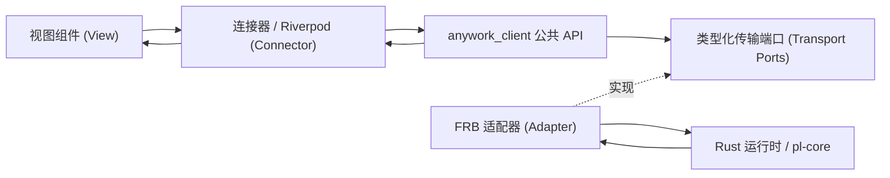

# 25 - 客户端、前端状态与资源生命周期

Rust 运行时持有业务权威事实；每个应用实例装配独立的纯 Dart 领域资源；`Riverpod` 组织呈现观察与视图模型，界面组件仅渲染与发出意图。性能统计采用 [§25.13](#2513-独立统计领域与呈现模块) 的独立模块，账号功能采用 [§25.14](#2514-账号分域与可预览呈现) 的分域仓储与纯呈现；其余领域保持现有客户端边界，不因局部演进要求全应用重写，也不为已迁移领域保留旧 Client 兼容入口。本文是客户端所有权、命令回执、输入草稿与页面导航的唯一权威契约。可靠历史与迁移见 [17](./17-studio-storage.md)，流协议见 [07](./07-streaming.md)，运行时与关闭见 [18](./18-studio-state.md)，界面见 [19](./19-studio-ui.md)，验证见 [24](./24-testing.md)。

## 25.1 分层架构与应用实例隔离



上图展示现有 Client 管辖领域的分层流向，统计领域的独立切片依赖方向见 [§25.13](#2513-独立统计领域与呈现模块)。`anywork_client` 的运行期依赖仅限 Dart SDK，不依赖 Flutter、`Riverpod`、FRB、`Ref` 或 `BuildContext`。FRB 生成的 DTO 与原生句柄封装在适配器（adapter）层内部，Client 仅消费类型化的领域契约；业务视图模块（`features/**`）不得导入生成代码、适配器、传输层或 Client 私有实现。唯有应用装配入口同时感知 Client 与适配器，其余各层仅依赖各自的公开契约。

每个应用实例（`AppGraph`）创建独立的 Client、传输层订阅登记表、只读模型（read model）、变更看板（`MutationBoard`）、输入草稿与附件所有者。严禁使用模块级全局 Client、全局业务字典或跨 `ProviderContainer` 共享的会话资源。原生动态库的进程级初始化与宿主退出仍归原生宿主管理，但不得借此在两个 Client 实例间共享观察句柄或草稿；`ProviderScope` 仅借用注入的实例并管理自身的观察注册。

## 25.2 状态所有权与唯一写入入口

各领域事实与前端资源遵循严格的单一所有者与唯一写入入口约束（机器人领域同样由 Rust 所有者持有业务事实，每个 `AppGraph` 的 Client 独立持有 `Bots` 主题、只读模型、配对/查询/发送动作与未完成操作，离开设置页不关闭物理机器人连接，详见 [27](./27-bots.md)）：

| 事实或前端资源 | 权威所有者 | Dart 侧所有者 / 唯一写入入口 | 身份标识与生命周期结束条件 |
| --- | --- | --- | --- |
| 项目、目录、配置、模型目录、服务状态 | Rust 对应领域所有者 | 各领域只读模型归约器（reducer） | 各自 `ResourceStamp`；领域关闭或应用退出 |
| 模型统计汇总、推理强度（`effort`）细分与调用历史 | Rust 统计所有者 | 独立 `StatisticsRepository` 归约器 | 所有者／统计材料来源；绑定页面可见需求与应用关闭（见 [§25.13](#2513-独立统计领域与呈现模块)） |
| 轮次、活动摘要、交互、运行时、存储状态 | Rust 会话（`Thread`）所有者 | Client 会话状态归约器 | 会话 ID 与 `owner epoch`；选择切换结束观察，不终止轮次 |
| 时间线正文、落盘确认、终态、省略标记、字段变更 | Rust 会话（`Session`） | 有界尾部归约器、历史分页与详情查询 | 内容订阅戳；逻辑需求（demand）变化或应用退出 |
| 当前选中项目、会话 | Client 本地选择意图 | 选择控制器（Selection controller） | 选择身份；旧异步命令结果不得覆盖较新的选择意图 |
| 输入文本、参数、路由与附件引用 | Client 草稿（受理后可靠附件归 Rust） | 草稿所有者与附件所有权账本（ownership ledger） | `DraftStamp + OperationId`；所有权明确转移或显式放弃 |
| 命令提交、待确认覆盖层（pending overlay）与未知结果 | Rust 变更所有者 / Client 操作所有者 | `MutationBoard` | `OperationId` 与目标资源戳；真实结果按操作独立记录 |
| 实时/历史模式（Live/History）与已加载消息集合 | 当前展示租约（display lease） | 展示控制器及成员的局部观察 | `ThreadId + 展示代次`；显式回到实时或切换会话时释放旧集合 |
| 光标、输入法组词（composing）、焦点、折叠态与滚动几何 | 组件 / 局部 UI 控制器 | 局部 UI 控制器 | `draftId` 或阅读代次；组件销毁（dispose）时释放 |

同一权威资源仅设一个归约器（reducer）。命令响应若携带该资源的权威快照，直接进入同一个归约器；命令待确认状态与覆盖层不构成第二份权威状态。引导快照（bootstrap）仅负责启动初始化恢复，严禁在普通命令成功后通过重读聚合状态来掩盖缺帧。演示模式（demo）同样按领域发布带版本的基线与增量帧，不在组件层用本地默认列表补全缺失数据。

启动阶段的 `loading`、`ready` 与类型化失败状态由 Client 持有并供只读观察。应用生命周期调用一次引导加载，待项目会话目录与主界面必需配置就绪后才展示主界面外壳（shell）；账号静态模板由对应领域按需加载，不再作为全应用启动屏障。若在首帧基线前发生失败，必须展示类型化错误码与关联 ID（`correlationId`），显式重试时复用同一 Client 实例清除失败尝试后重新启动。启动成功后，若某个目录观察失败，则保留最后有效目录与可用主界面并展示该领域的显式重试入口，不退回无操作的启动等待页。会话状态流的同步状态与聊天界面内容状态（`ChatUiState`）分属各自独立的观察通道，互不覆盖。

## 25.3 版本域与资源戳（Stamps）

前端状态管理严格区分五类不可混用的版本域标识：
- **`ResourceStamp`**：由 `(ResourceKey, OwnerEpoch, Revision)` 组成，仅在同一资源、同一 `OwnerEpoch` 下可比。所有者代次更换后必须采纳新基线，旧 `epoch` 的回执不得由新 `epoch` 满足。
- **`ViewStamp`**：由 `(ThreadId, ViewId, ViewEpoch, Version)` 组成，新视图代次的版本号不得与旧视图比较。
- **`AttemptId`**：单次客户端异步连接绑定身份，不得充当业务 `OwnerEpoch`。
- **`OperationId`**：单次业务提交身份，在首次 `await` 前分配；结果未知的非幂等操作不得更换 ID 自动重放。
- **`DraftStamp`**：由 `(DraftId, 字段或项目修订号)` 组成，不得以窗口版本替代。

设置配置与模型目录使用独立的修订号；会话模型路由修订号是路由扩展的 CAS 令牌，而非会话通知序号；历史落盘确认（`saved`）与轮次执行终态相互独立；历史分页查询不推进尾部订阅基线。

ACP 账号配置、ACP 认证观察（`acpAuth`，回执资源名 `acp-auth`）与 ACP 服务安装准备（`acpInstall`，回执资源名 `acp-install`）同样是各自独立的资源域：
- **保存并连接编排**：“保存并连接”须先确认配置保存已具有匹配回执、目标观察与持久化事实且无失败，再发起认证检查命令。Client 的 `AcpSaveAndConnectResult` 始终交回本次保存的 `OperationState`；仅保存已确认且同类型账号详情覆盖该保存目标水位时携带 `saved`，之后的检查错误独立进入 `checkFailure`。检查受理不等于已连接或已认证，检查失败不撤销已保存配置，也不清空后续新草稿。认证事件帧与命令响应进入同一归约器，按 `owner/revision`、连接修订号（`connectionRevision`）与 `OperationId` 收敛；一旦权威状态提供了当前操作身份，取消请求即可经独立通道提交，不受启动命令的本地忙碌标志阻塞。
- **保存结果交接**：保存尚未准入时保留原异常；已经准入后的拒绝、未知结果或同步失败以同一保存操作的失败快照返回，此时 `saved` 与 `checkFailure` 均为空。不返回无失败但尚未确认且缺少 `saved` 的中间结果，也不从同目标的最新意图反查本次身份。保存回执接受后的观察失败保留回执与已有事实并记为同步失败，不能降格成未写入的明确拒绝；已有失败分类不被外层编排覆盖。准入交接与确认观察由共享变更看板及 ACP owner 负责，观察保持到本次编排结束，owner 退役或服务关闭须结束等待并释放自身订阅；返回失败不取消领域仍承担的目标观察，不自动重发保存或补发检查。内部保存先消费本次返回的冻结失败，再决定是否等待确认，不能用随后变化的 live 状态替换失败结果。独立保存与其他共享账号／模型设置命令统一遵循 §25.7 的准入结果交接。
- **安装准备与草稿绑定**：安装准备结果按供应商、操作身份与草稿意图绑定，终态保留操作身份；仅匹配当前意图的准备结果可授予草稿保存资格（其他草稿须通过显式“使用已就绪安装”动作绑定，不按品牌或路径自动认领）。离开设置页仅释放页面自身的观察订阅，返回页面时重新读取当前基线；唯有运行时关闭才收束后台安装与认证任务（详见 [28](./28-acp.md)）。

用户选择 ACP 模板是显式准备意图，但必须先取得该供应商真实安装观察基线再决定动作，未观察不等于未安装。没有共享就绪结果时，该选择可以发起首次准备；已有共享就绪结果时，新编辑器保持未认领并提供“使用已就绪安装”，不能通过重新准备并自动认领绕过此选择。取消后的重试是独立显式动作；组件构建、重建或本地化变化不触发准备。

呈现层的意图代次用于隔离等待与迟到完成，不是后端准备次数或认领事实。即使等待初始观察导致本地代次前进，只要没有已认领操作，仍不得获得保存资格；显式“使用已就绪安装”需绑定同一就绪操作并推进当前编辑意图，不能以固定代次数值替代这些判断。

## 25.4 观察注册与页面导航

只读观察 API 在同步阶段完成接收者登记并立即返回当前镜像值，检查当前镜像与注册谓词（predicate）之间严禁插入任何 `await` 间隙，确保读取快照与注册观察之间到达的更新绝不漏帧。当显示观察处于暂停状态（如页面被路由覆盖）时，每个观察者仅保留最新显示快照；而可靠有序事件流仍严格按序归约，不套用丢弃中间帧的策略。取消观察订阅仅移除当前观察者，绝不关闭跨路由的会话、内容连接、输入草稿或附件。

GUI 展示需求统一按 §25.6 决定，会话与草稿资源的归属见 §25.15；飞书与 HTTP 的独立订阅不受 GUI 需求变化影响。

对话框、菜单、抽屉等短暂浮层仍使用 Flutter 官方机制及其局部关闭，不成为第二套页面导航。主工作区内选择项目、会话或子智能体仍属于 SDK 的 canonical selection，不为统一页面路由另造 URL 业务镜像。机器人聊天直接以路由参数中的 threadId 观察工作区和草稿，不修改主工作区的选择。目标不在已加载的目录分页内时，身份取自该目标的 canonical 会话；不补造目录记录，也不借用其他选择。路由不执行 bootstrap、异步选择或维护激活／错误／重试状态；目标加载及失败使用会话领域与时间线已有呈现。不存在的目标不会借用其他会话。SDK 不持有设置页状态或页面导航控制器。Driver 分别报告主工作区选择、当前呈现目标（包含准入失败）与实际可见订阅；当前展示的 workspace、草稿、修订与正文必须使用同一会话身份，隐藏时仍可独立观察主工作区的后台执行。

### 25.4.1 单一类型化页面导航

应用仅有一个 `GoRouter`，页面采用 [go_router 官方 Type-safe routes](https://pub.dev/documentation/go_router/latest/topics/Type-safe%20routes-topic.html) 与 [go_router_builder](https://pub.dev/packages/go_router_builder) 契约，由集中声明的 `GoRouteData` 与官方生成的类型化目的地定义。页面位置、账号目标与设置分区以已提交的路由为唯一事实源，不在 ViewModel、Provider 或 Connector 中再保存一份页面选择或页面栈。导航调用使用生成式目的地，不手拼路径、不维护命名路径映射、通用导航包装、去重队列或手写导航响应协议。

账号、工作模式与机器人页面层级属于同一应用路由树：

| 目的地 | URI 契约 | 身份与视图选择 |
| --- | --- | --- |
| Studio | `/` | 既有主界面 |
| 设置 | `/settings` | 类型化 `section` 查询参数，缺省为账号列表 |
| 新建账号 | `/settings/accounts/new` | 同一新建页内选择模板及维护独立编辑资源 |
| 账号详情 | `/settings/accounts/:kind/:accountId` | Native／ACP 类型与账号 ID；共享账号上下文 |
| 编辑账号 | 账号详情下的 `edit` | 可选 `focusModelId` 与 `addModel` 查询参数，仅表达入口意图 |
| 模型资料 | 账号详情下的 `models/:modelId` | 配置模型 ID 与类型化 `tab` 查询参数 |
| 工作模式工作区 | 设置下的 `modes/:modeId` | 必需 Mode ID，保留目录页进入的入栈行为 |
| 工作模式资料 | 工作模式工作区下的 `details` | 继承 Mode ID；`stage`、`edge` 为可空查询选择，缺失为 `null` |
| 机器人详情 | `/bots/:botId` | 必需 Bot ID；独立于设置匹配 |
| 机器人聊天 | `/bots/:botId/chats/:chatId/threads/:threadId` | 明确 Bot、Chat 与 Thread ID，不改变主工作区选择 |
| 机器人平台工具 | `/bots/:botId/chats/:chatId/platform` | 明确 Bot 与 Chat ID，不请求会话内容订阅 |

资源身份使用路径参数，由官方生成器编解码；不能用显示名定位或为地址转换改变业务输入范围。模型资料的三个标签以类型化查询参数选择，缺省为规格，切换替换当前目的地而不增加重复页面。设置分区与资料标签的控制器仅负责消费路由选择及显示动画，不能反向成为页面位置的事实源。账号与工作模式子路由分别归属对应设置分区；机器人详情、会话与平台工具直接归属 Studio，与设置匹配分离。背景设置目的地的缺省分区不能覆盖子路由归属；不从背景页面的控制器索引推断可见性。

工作模式与机器人页面保留主线的父子关系、入栈和恢复身份，入口统一消费同一生成式目的地，不并存第二份普通路由表。`settings`、`mode-workspace`、`mode-detail`、`bot-details`、`bot-conversation`、`bot-platform-tools` 的路由名称保持。工作模式目录使用现有领域所有者打开目标，语法有效而资源不存在时继续呈现领域错误，不以额外路由回退隐藏。入栈页面返回保留来源页面上下文；账号页面内部返回与取消继续使用已知的类型化父目的地。

带默认值的枚举查询参数须区分缺失与非法值：缺失采用声明默认值，空值或未知值进入官方路由错误处理。通过官方类型化查询编解码扩展复用生成器的枚举映射，不复制映射、规范化输入或在上层回退为有效页面。

编辑页的 `focusModelId` 与 `addModel` 是当前类型化目的地提供的非资源意图，不进入编辑入口或 Editor family 的身份，也不另存为编辑资源中的初始导航值。同一入口的查询变化消费最新意图，不重新初始化、分配编辑器或覆盖业务草稿。焦点只驱动现有纯 View 的定位；入口新增请求显式交给当前 Editor 的既有业务消费方法，每个 Editor 至多追加一次，重复构建或已删除该行均不自动补回。该操作保留已有行、凭据及未知结果防重锁，普通显式新增按钮的多次添加能力不变。加载就绪时只消费仍有效的最新请求，不排队重放旧查询；会发布状态的消费在框架允许阶段执行，并复核当前来源路由与资源所有者。

账号页面通过声明式目的地建立可预测的父子层级，页内显式返回和取消指向已知的类型化父目的地；设置侧栏的「返回聊天」则退出整个设置层级并指向 Studio，不能因当前位于账号子页而只退回账号列表。系统返回使用同一 Router 的官方移除路径。不得用保留来源编辑页的入栈跳转绕过退出守卫，或在返回失败时临时猜选其他页面。未知路由或非法枚举使用官方路由错误路径；已知地址中的资源不存在时展示领域目标缺失及明确返回，不静默选择其他账号或模型。

路由只携带资源身份和必要的视图选择，不携带凭据、可变草稿、业务所有者或来源页面快照。编辑编号属于本地编辑资源而非页面位置；每次真实重新进入取得新编号，同次新建的预留账号目标在部分成功和重试间保持稳定。模板切换是同一新建页内的受保护草稿替换，不另建页面导航；默认模板、地址恢复和组件构建不授予 ACP 准备或保存操作的显式意图。

编辑入口以不可变键关联其有限编辑资源，键区分新建与带类型目标的编辑，并绑定实际路由入口；它不是编辑编号或当前页面选择。仅改变聚焦模型等查询参数不得重新分配草稿或绕过退出检查。入口资源可以持有当前模板对应的编辑身份，但不决定显示哪个页面；退出守卫按同一键查找已存在资源，实际入口移除后结束其保留。

本地编辑编号的分配能力归应用呈现作用域持有，列表或单个入口资源销毁不会重置其已用编号；同一作用域内新编辑不复用已结束编号。它仅生成编号，不保存页面选择、草稿或已分配身份清单，不建立进程级可变单例；应用作用域整体结束后不承诺跨进程持久身份。不同应用的领域所有者与操作身份继续各自隔离。

### 25.4.2 退出决策与资源退役

账号退出决策由对应类型化页面的 `onExit` 承担，不同时挂接按钮预检查、设置页全局账号兜底和全局进入守卫。同一路径定义中的实际账号目标变化须退出旧匹配；仅改变资料标签查询参数不结束账号上下文。页面被覆盖但仍保留在路由树中不等于移除，不能假定所有入栈操作都会触发退出守卫。

非账号设置草稿也不能因分区地址化而失去既有保护：仍保留设置匹配的分区切换与真正移除设置匹配分别在官方进入、退出边界处理，互不重复同次决策。按钮不再自行补做相同保护；账号草稿仍只归上述账号退出边界，不扩为全局进入守卫。

工作模式编辑草稿继续由 Client 生命周期的原所有者持有，不因页面销毁而结束。工作区实际退出由其路由退出边界保护，只确认与来源 Mode ID 匹配的编辑资源；资料子页仅处理其局部选择，不重复询问工作区草稿。父设置退出只复核尚未解决的草稿，同源已解决状态不再次弹窗，新输入或未决保存仍须阻止放行。工作区返回按钮只提交官方返回，目录在打开、创建或导入另一个目标之前的所有者切换决议继续保留，它不是重复的离页预检查。

官方路由进入回调的上下文不保证已经位于 Navigator 之下；需要界面确认时，使用同一 Router 已挂载的 Navigator 上下文并复核来源。取不到所需上下文时拒绝本次变化，不另建 Navigator 或以无保护跳转兜底。

新建／编辑页检查对应的已存在编辑资源，并统筹必要的当前模型阈值草稿；账号详情上下文检查真正离开该账号时的阈值草稿。子页和父上下文同时退出时，已解决的同一批草稿不重复询问或提交，仍有新输入或未解决状态则不能放行。详情与模型资料、资料标签之间共享同一账号模型所有者。守卫不为检查离页创建编辑器、详情资源或查询需求；具体草稿与保存语义见 [25.14](#2514-账号分域与可预览呈现)。

同批草稿的已决议令牌可随既有编辑入口资源有限保留，仅绑定捕获的编辑、模型所有者及修订。父上下文通过官方旧路由匹配确认该编辑子页负责本次共同退出时，只复核同一草稿决议，不重复提示；令牌变化或资源不存在不能凭旧决定放行。该令牌不包含目的地、页面历史或导航回执，不能授权其他资源或后续新草稿。显式放弃的本地清理在实际移除或替换提交时按冻结令牌执行，拒绝或尚未提交的跳转不丢失仍可见输入。

异步守卫捕获源资源、所有者及草稿令牌，返回后重核身份与修订；Router 不负责撤销其中已经准入的领域操作。守卫只交回允许或拒绝，不提前改变页面选择或退役编辑资源。只有实际路由移除或入口替换提交后，才释放对应本地保留与观察；模板替换则在决策仍有效且实际替换时退役旧草稿。被拒绝、被更新导航取代或尚未提交的跳转不能使当前编辑器提前失效，也不能用旧完成清理新编辑资源。

普通声明式路由的官方 `pageKey` 可按路径模板复用，因此 `AccountEditorEntryKey` 仅是有限资源定位符，不是一次挂载的所有者身份。关闭 keepAlive 或让 family 失效都不能替代业务所有者退役；旧 family 仍被合法观察或等待销毁时，实际重新挂载也必须取得全新资源与 `editorId`。同帧往返但实际 State 未移除、查询变化和页面覆盖不另算一次挂载。

现有 entry family 作为单活动所有者的有限定位壳；每个实际挂载的 Entry Connector 持有一次性 `AccountEditorSessionOwner`，而非直接把可复用 Notifier 的对象身份当作本次资源身份。定位壳只保留当前一个 owner，不保存路径历史、页面栈或导航决议；owner 承载原有编辑初始化、模板与源草稿决议，使用应用既有单调分配能力取得不可复用的 `ownerId`，初始化再分配本次 editor。接口边界为：

```dart
AccountEditorSessionOwner claimMount(Object mountOwner);
AccountEditorSessionOwner? currentOwner();
bool isCurrentOwner(AccountEditorSessionOwner owner);
void releaseMount(AccountEditorSessionOwner owner);
```

Notifier 的响应式呈现仍只通过 `state` 观察；命令侧捕获已有资源、资格、失败状态或草稿令牌时，使用同一时点求值的显式查询方法，不以公开 getter 暗示可响应式订阅，也不增加镜像状态或转发别名。上述 `currentOwner()` 以及 Editor／Models 的离页资格和令牌查询均属非响应式边界，跨异步步骤后仍须重新查询。未知结果的离页风险提示统一由实际 guard 使用官方本地化文案呈现，不在 VM 保留重复、仅供测试读取的警示文案出口。

同一实际 State 只认领一次，重建、查询更新与覆盖继续持有该 owner；新的 State 使用新的不透明挂载令牌，认领时封闭旧 owner 的继续资格并建立全新资源，不能重新启用旧实例或继承旧 raw。实际销毁只释放捕获的 owner；旧 State 迟到的释放不能清空定位壳中的新 owner，旧异步完成也不能借同一 Notifier 或重新挂载的 Ref 获得新资格。已准入的领域操作继续由 SDK 保责。

定位壳的 Freezed 呈现值携带对应 `ownerId`。认领和释放同步切换资格，状态发布遵守框架允许阶段；新 Connector 在其 owner 尚无匹配投影时呈现加载状态，不显示缓存的旧 editor、凭据或错误。所有 guard、父子联合决议与 Driver 诊断只查已有定位壳的当前 active owner，捕获并复核该业务 owner 与原令牌，不以“同 family 仍存在”代替当前资格，也不为检查初始化资源。该适配只管理编辑资源生命周期，不改变 Router 的进入、退出或错误语义，不增加路由注册表、Observer 映射、全局账号进入守卫或导航 ACK。

实际移除时同步封闭旧入口与迟到回调资格，资源清理不得在框架构建或销毁的禁止阶段同步发布 Provider 状态。必须发布的本地草稿变更在框架允许的阶段执行，并重新核对捕获的所有者、修订与本地等待状态；延后清理不能授权新草稿、延长旧导航资格或取消领域已准入操作。

纯 View 通过类型化回调表达导航意图，由 Connector 绑定生成式目的地；业务保存结果按操作事实结算，不能用页面返回值冒充保存确认。删除确认、候选选择和未保存提示的模态结果是局部界面协议，不是第二套页面导航。提交后的路由与展示需求映射见 §25.6，不反向保存或修补路由选择。

页面异步动作的后续界面副作用须同时复核官方来源路由仍为当前页面与捕获的业务所有者身份；仅有组件仍挂载不能授权旧删除、确认或保存完成后覆盖较新的导航。失去来源资格后不再发后续命令或跳转，已经准入的领域操作仍由原所有者保责。这种回调内的有限来源核验不保存目的地、页面历史或导航镜像，也不能用于重放失败动作。

## 25.5 时间线连接与退役收束

会话领域通过 [07](./07-streaming.md) §7.10 的类型化 `ConversationFeed` 推送消费状态和内容；按 [26](./26-timeline-content.md) 独立提供历史分页与详情查询，不由 Dart 逐帧调用 `next`。每次连接尝试（attempt）在首次 `await` 前登记逻辑需求、原始打开 Future、候选句柄、取消令牌、流消费者、在途查询、关闭汇合句柄与内存预算许可（permit）；每次异步返回后均核对会话身份、`attempt` 代次、逻辑需求与退役状态。

- **独立基线与代次隔离**：事件流首帧建立各域自己的版本基线；同一订阅只有一个有序消费者，完成转换与原子归约后才确认该帧。发生内容缺口时仅重同步对应域，不重放业务命令，也不将旧的 `lastGood` 快照当作新基线。历史分页与详情查询结果仅作用于发起时捕获的展示代次；在 `A → B → A` 快速切换场景下，第一次 `A` 的迟到成功、失败或 `finally` 回调均不得清空第二次 `A` 的加载状态或内容。
- **域内重同步与连接重建分开**：内容域的类型化 `Resync` 可以在同一订阅内采用该域的新基线，不因此重开整个连接或重置另一域的水位。显式重建组合会话连接则退役整个 attempt、取得新的订阅身份及各域基线，旧 attempt 的修订不能与新基线直接比较。两条路径都不清除逻辑可见需求、草稿或已受理操作，也不重发业务输入。
- **同步撤销立即生效**：可见需求变更即使发生在同步观察回调中，也必须在调用返回前使不再需要的旧展示所有者失去启动与发布资格；串行处理后续目标不能延迟这项撤销。重复请求同一目标不反复开关，快速离开再返回则建立新代次，既有退休任务仍由原所有者收束。
- **确定性退役收束（Retire）**：退役连接时先锁闭发布与查询准入，再发出取消与 `requestClose` 指令，等待事件泵、在途查询、数据汇（sink）与原生句柄返回真实确认（ACK）。若关闭失败则保留未解决所有者（unresolved owner）与预算占用；关闭内容连接仅回收前端流资源，不关闭 Rust 侧的 `Session`、活动轮次或持久化写入器。
- **订阅创建失败的收束顺序**：原生订阅创建已确定失败时，适配层必须先发布创建决策已结束，再等待 Dart 流关闭或消费端取消；取消链可以等待创建结束，但创建路径不得反向等待依赖该决策的取消确认。失败仍交付原有类型化诊断，迟到原生句柄仍由唯一 owner 取消并确认，不能以跳过取消、提前释放预算或隐藏错误消除循环等待。工作区恢复可读后，正常重试应能建立新订阅，旧失败尝试不得永久占用会话或阻止应用关闭。

## 25.6 只读模型（Read Model）与细粒度呈现

应用导航联合页面、宿主窗口可见性与 canonical selection 决定唯一展示需求，由会话 Repository 取得目标身份，在该目标首次具有 canonical workspace 后取得 SDK 草稿 owner；不存在的路由不会制造空草稿。Timeline 展示 owner 只观察 Repository 的实际 visibleThreadId，不再另存应用层可见目标或手动同步两份展示状态。资源预算拒绝使用既有 Timeline 失败呈现，并通过 ResourceBudget 的可用性观察在真实许可释放后重新受理；离页立即取消该观察，不能重新唤起隐藏会话。Timeline owner 不另行监听 selection 覆盖导航决定；设置页内发生 selection 变化也不能重新声明隐藏会话正文需求。隐藏或最小化宿主撤销展示需求，单纯失去输入焦点不等于隐藏。撤销目标先同步使旧展示代次失效，再退役正文连接；后台执行与保存不受影响。

页面可见性只消费根 `GoRouter` 已提交的最上层页面身份，不解析字符串地址猜测页面类别，也不由 Observer 维护平行页面栈。主工作区与机器人聊天页面声明需求，设置、机器人详情或平台工具页面遮盖会话时撤销需求；机器人聊天的需求直接取目的地指定的 Thread，不依赖主工作区选择。对话框、菜单等非页面浮层不改变所属页面的需求，未通过离页守卫的导航也不撤销当前会话；返回会话页面后仍由同一 AppGraph 建立新基线，不另建机器人专用订阅所有者。

同步观察回调可以引发新的导航或关闭。导航所有者必须先完成已发生离开的旧代次撤权，再按最新有效目标激活，不能因回调后目标字符串相同而复用旧订阅。内容所有者在首次发布打开中状态或调用观察回调之前登记稳定的任务完成责任；回调内同步关闭也须等待该任务及其清理，不以尚未赋值的任务快照提前报告未完成或遗留许可。

Repository 提供轻量、只读的可见目标观察，目标会话的镜像取得后才发布该可见目标；隐藏或关闭发布空目标。呈现 Provider 通过此信号重新查找已经存在的会话镜像，不因构建而创建 Session；缺失时保留未取得快照的状态，不伪造 ready。该信号不承载正文或另一份会话业务快照。内容公开诊断允许等待已退役观察的真实收束并取得报告，但不得借此刷新、重试失败、关闭当前观察或新增需求。

共享的最新值观察是有界快照而非可靠事件队列。监听器内同步发布更新值或关闭观察后，尚未收到旧发布的监听器不得再被旧值回写；暂停观察者也只保留当前最新值。注册与初值读取继续保持同一同步边界，不要求消费者通过忽略回调参数来弥补倒序通知。

设置、项目目录、会话目录、当前选择、会话轻量状态与时间线内容各自拥有唯一的归约器。会话状态流快照不反写会话目录行，业务时间戳 `updatedAt` 不充当跨资源版本号；工作模式等会话身份变更由 Rust 提交目录增量并推进目录水位（见 [18.11.1](./18-studio-state.md#18111-thread-身份的单一来源)）。

轮次载荷的 `revision` 来自所属 Thread 的权威提交序列，同一 Thread 中不同 Turn 的新旧按此修订比较，不能优先按 `updatedAt` 猜测；它不等于状态订阅信封的水位，也不能跨 Thread 比较。相同身份的终态保持单调；相同修订缺少额外顺序证据时，不凭时间戳替换已采用的轮次事实。当前活跃轮次身份仍由权威工作区快照给出，不为比较建立第二份轮次状态。

继续操作的结果未知时，原操作身份、目标继续点和首次冻结的路由修订共同构成同一待确认意图。只读回查不受后续执行阻塞影响；明确查无此操作后，重新核对访问、关闭、执行与存储准入，只有允许时才以原身份和原输入发送，不重新分配身份或采纳后来点击传入的路由值。暂时阻塞不删除该待确认意图；下次显式尝试仍先回查。结果未定期间保留有界的规范状态观察及其关闭责任，既不能遗漏先于回执到达的事实，也不能把同步重入变成第二次回查或发送。

同一会话的运行时状态、轮次、活动摘要与存储状态共用单条带水位的有序状态订阅；`Riverpod` 呈现层按明确的 `threadId` 派生不可变且按值相等的细粒度投影（如吞吐率投影、上下文容量投影与状态栏稳定字段投影），使高频吞吐率更新仅通知吞吐率消费者，不会连带重建上下文浮层、时间线列表或输入区。

普通用户问答回执、计划确认回执与图片展示卡片均由权威工具条目的类型化投影派生，复用同一会话附件缓存与内容源，不在视图层缓存原始字节或二次解析 JSON。SDK 内容归约与展示集合的分工见 §25.15。

附件显示字节由展示代次的显式资源 owner 共享，复用既有按原始条目引用计数的缓存语义：同会话、同附件的缩略图与原图借用同一次在途或成功读取，失败可显式重试。引用来自已加载原始条目，不随分组拆合、组件惰性卸载或折叠变化；最后一个条目引用消失或代次释放后清除相应缓存。迟到读取仍由原受管查询收束，不重新填回已释放代次或新引用；原图展示继续提供原调用的路径与结果详情入口。该 owner 不保存第二份正文或改变附件的业务所有权。

同修订条目的合并同时约束顶层生命周期与 descriptor 内的类型化状态：迟到的非终态不能覆盖已确认终态。字段预览仍只允许相容前缀扩展，`saved` 单调保留；无法证明 descriptor 与当前事实相容时显式重同步，不拼出顶层已结束但正文或工具仍运行的矛盾条目。

`Turn` 关联不属于条目稳定身份；同修订的权威 `Add` 或携带头部的 `UpdateItem` 也可更新该关联。流水线按已验证的交付顺序采用权威头部，历史页与当前尾部交错时由当前尾部事实覆盖迟到页的旧关联，不将正文修订当作关联修订的代理。

## 25.7 命令、观察屏障与变更看板（MutationBoard）

会话重同步请求的完成与失败绑定发起的请求及内容 attempt。同步状态通知可重入发起新请求，通知返回后的旧回调不得读取并结算新请求；只有具备对应代次资格的基线或失败才能完成该请求。合法提交回执先记录已受理事实，再判定观察证据冲突；冲突可以阻止观察、生效及保存确认，不能抹去已收到的合法回执。

所有业务命令在首次 `await` 前同步冻结目标资源标识、期望修订号（`expectedRevision`）与 `OperationId`（停止命令在点击当刻固定 `ThreadId + ExecutionId`，不随排队期间的选择切换而偏移）。同一资源的冲突写入串行化，不同资源独立推进；停止命令与取消请求不排在长耗时任务队列末尾。
无内容继续与停止沿用同一冻结与观察边界：继续在点击当刻固定目标会话、继续点身份、操作编号与已观察的模型路由修订号，同一意图键只允许一个在途请求，重复点击复用同一 future 而不另发编号；停止固定目标执行编号，重复点击至多形成一个在途加一个排队重试，并在同一执行上合并。两者都只在收到受理回执后推进本地受理态，请求在途期间保持对应入口禁用而非显示已生效；失败、结果未知与已受理分别表达，结果未知不换编号重发。

会话目录同时是子成员停止的唯一入口：客户端从权威目录行的执行投影取得目标执行编号与可停止资格，不要求先打开或选中该子会话，也不把当前选中会话的轮次当作该行目标。成员数量与停止资格只统计未关闭成员，已关闭成员不计数。

呈现层将渲染时捕获的执行身份、继续点及路由修订原样传到命令边界，不在 ViewModel 内重新选择最新身份。停止的类型化结果区分已发出、无执行、不具资格与排队；继续、停止和交互决定的在途、已受理与失败从 SDK 命令事实及 canonical 状态派生，页面卸载不清除这些事实。同一主会话的交互命令按命令键和目标交互身份投影，动作入口同步拒绝重复派发；托管子交互的同一失败只在一个展示层呈现。

工作模式变更同样显式携带渲染时的目标会话，命令边界不回退读取全局选择。权限决定的本地原因文本绑定宿主、原交互身份与权限载荷语义；切换目标或载荷变化后不沿用旧原因，同一交互仅在途或错误状态变化时保留用户输入。交互停靠区替代普通输入区时，仍须从原会话命令事实呈现停止的在途、受理与失败，不因普通输入框卸载而丢失唯一错误出口。

子任务交互列表保留唯一 SDK 只读镜像，但读取事实与展示资格分开。会话 Repository 的可见目标变化同步推进展示代次，子交互读取在派发前捕获宿主、读取意图序号与该代次；迟到结果不得覆盖更新的读取意图。镜像可继续记录原查询的真实结果与命令观察事实，呈现仅接受宿主和展示代次均匹配的结果。离开、隐藏及 `A → B → A` 立即撤销旧结果的展示资格，不能等旧查询完成才失效；新一代读取失败时也不能回显旧一代卡片。展示代次是纯身份元数据，不创建第二份业务缓存、不激活子会话或额外正文订阅；原查询仍由 SDK 登记并参与关闭汇合。

子任务决定在取得合法回执后仍呈现“已受理，等待确认”，只有原操作的 SDK 身份观察成立后才显示已保存答案或权限已决议的说明。命令返回该次实际操作的观察身份，不让呈现层事后按“最新命令”猜测归属；视图模型仅观察原操作，不自行根据卡片消失或回调成功推导确认。当前展示代次可保留最近一次决定的中性完成说明，新决定或离开该代次替换、撤销该提示；提示不持有答案、权限参数或旧卡片正文，也不成为第二份业务账本。问答说明仍区分答案已保存与主智能体后续调度，权限说明仍区分原等待已决议与原调用是否获准继续。

命令提交回执（`CommitReceipt`）至少携带 `OperationId`、`Applied/NoChange`、目标 `ResourceStamp` 与生效点（`effect point`）。系统严格区分五个独立阶段：已受理（`Accepted`）、等待观察（`AwaitingObservation`）、已观察（`Observed`）、已生效（`Effective`）与已持久化（`Durable`），以及三类非成功结果：明确拒绝（`Rejected`）、结果未知（`UnknownOutcome`，严禁对非幂等命令自动重放）与观察同步失败（`SyncFailed`）。`MutationBoard` 分别保存每次操作的真实结果与每个目标资源的最新意图（latest intent），旧操作完成绝不清除较新意图的待确认覆盖层。

共享账号配置写入以成功登记操作为准入边界：登记之前的关闭、预算或所有者获取失败保留原异常；登记之后的成功与失败均通过本次 `OperationState` 交回。该边界涵盖 Native 账号创建、修改、删除、默认及计费，模型启用、阈值设置／清除、连接方式及手动模型删除，以及 ACP 配置保存和删除；目录同步、用量／性能读取、安装和认证命令不据此改变异常语义。正常返回不等于已保存，普通设置命令仍可等待观察；保存确认须同时具有回执、已观察、已持久化且没有失败。

已准入的同步初始化、准入中关闭和异步写入／归约失败都必须交回同一操作的结算，错误分类仍唯一归共享 SDK 写入所有者。失败快照保留原错误对象、目标、草稿和已接受回执事实，并固定为本次失败发布时的不可变值；即使同步观察回调重入并更新同 ID 的实时镜像，也不能替换这份返回结果。不得通过目标最新意图追认身份、添加包装异常或建立另一套结算状态。此返回契约替代已准入失败向公共调用方抛原异常的旧行为，消费者按状态结算；未准入异常与非共享命令不迁移。

返回失败不改变目标确认的生命周期：明确拒绝释放对应确认，未知及仍合法的同步失败保留领域观察；owner 退役只按原所有权规则结束，不用新 owner 的水位确认旧操作。一次性表单／阈值保存结算优先消费输入失败快照，无失败的在途结果才继续观察精确 ID。列表和详情动作的持续跟踪则可采用同 ID 后续权威确认解除 pending，不因一次性结算的冻结规则永久停掉跟踪。两者均不重发操作，也不把 Future 正常返回直接当作成功。

特殊领域的窄命令与局部状态遵循以下收敛规则：
- **模型启用开关、计费类别与手动模型删除**：三类窄命令均显式传递 `OperationId` 并在回执中原样核对。动作经对应领域 Repository 进入同一共享设置 CAS 通道；遇到 CAS 冲突时在最新权威账号状态上仅重新应用当次窄字段意图，不回传陈旧的整卡快照。
- **模型启用覆盖与目录默认值**：模型配置快照携带 `modelEnabledOverrides` 的明确开关意图，目录快照携带模型层解析的成员及启用状态。Client 按各自水位合并；仅将明确覆盖叠加到对应成员，缺项保留后端目录状态，不能把“未显式关闭”推导为启用，也不能在 Flutter 重建缺失的内置成员。来源与自动资格规则归 [06](./06-model.md)，旧响应或独立到达的目录事件不得抹除较新的显式意图。
- **智能体目录成员与导航意图抢占**：根会话的智能体切换菜单成员由权威 `AgentDirectory` 的根归属与父子关系唯一确定，不与侧栏分页窗口或热会话集合取交集；用户发起新的会话选择导航意图后，立即使此前尚未完成的按需冷会话读取失去发布选中态的资格，防止迟到回包篡改最新导航目标。
- **上下文压缩阈值内联保存与双水位合并**：账号详情模型阈值只在显式保存或恢复自动时提交目标模型的窄命令，输入与比例预设不提交；持久化覆盖归属 `settingsRevision`，最终上下文策略归属 `modelCatalogRevision`，对应领域按双时钟独立归并（见 [18](./18-studio-state.md) §18.11），不因旧配置响应回滚新目录解析策略。

### 25.7.1 账号用量需求

账号呈现模块声明可见额度需求，独立用量领域 Repository 按查询身份发起检查、去重并登记任务；响应与观察帧进入该领域唯一归约器。查询阶段、错误及最近成功值以 Rust 用量所有者发布的事实为准，用户最新刷新意图的呈现不反写 canonical。旧 Client 用量 store 与页面请求旁路在迁移后删除。

当账号标签页首次可见时，为各账号的 `usageQueryRevision`（见 [18.2](./18-studio-state.md#182-公共快照)）并行检查，逐账号发布。同一账号同一查询身份的自动与手动请求合并；新增账号或查询输入变化仅补查受影响实例。隐藏停止新增自动请求，返回只补未尝试或身份已变化者；失败计入已尝试，不循环重试。在途任务归领域所有者并参与应用退出汇合，页面取消观察不丢任务，删除或身份变化拒绝迟到结果。

账号配置与模型设置命令迁移后由对应领域 Repository 提交；共享设置写协调只负责同一配置 CAS 域的顺序，不复制业务状态。压缩阈值采用目标模型窄意图，不再通过整卡保存；配置覆盖与目录最终策略仍按独立水位归并。旧配置响应不能回滚新目录，旧操作不能清除新意图，其他领域已观察的水位不能冒充本领域内容已到达。

## 25.8 输入草稿与附件所有权账本

提交所有者在发布提交中状态、调用外部准备回调或派发命令之前同步登记真实完成 Future，重入提交与关闭都必须看到同一在途工作。输入法之外的程序化用户编辑（如 Shift+Enter 插入换行）与键入沿同一草稿变更入口更新；canonical 回写不是新的用户编辑。

输入效果与保存观察在派发前按冻结 `inputId` 登记，而非等待 RPC 回执。会话领域只从已验证并归约的内容事实提供目标输入的最小轮次证据（会话、输入、轮次身份及状态、`saved`），不复制正文，也不为该观察单独打开隐藏会话正文订阅。新建会话尚无 `threadId` 时先按输入身份收集，回执到达后校验并绑定真实会话；已知会话同时约束其身份。回执前已到达的保存事实须保留到绑定与结算，最后一个内容 patch 不能冒充当前快照。记录只属于已登记的在途输入，按资源预算受限，观察结束或所属资源关闭后释放；明确拒绝、准备失败与未知结果继续遵循各自的提交及附件责任，不通过自动重发补偿。

起始页草稿（`StartDraft`）与会话输入草稿（`ComposerDraft`）拥有独立的逻辑生命周期，不随页面观察者销毁而重置。调用 `freezeForSubmit` 时，系统在同步阶段一次性冻结 `DraftStamp`、项目或会话身份、提示词文本、工作模式、工作区模式、完整模型路由、解析后的子智能体分发模式与偏好以及附件 ID 集合。提交过程中用户可继续输入与修改草稿（递增草稿修订号）；当旧提交的确认回执到达时，仅清理仍归属该次 `DraftStamp + OperationId` 且修订号匹配的字段，绝不清空用户新输入的内容或重置 `TextEditingController` 的光标与组词区间。

新建根会话提交后的环境准备进度属于该次冻结提交的临时展示状态，由 `StartDraft` 所有者按 `inputId`、项目身份与提交身份维护唯一镜像，在创建成功进入对话后移除，或在创建失败时原位保留失败阶段、原因及原始草稿。

附件所有权账本（attachment ownership ledger）分别记录逻辑草稿引用与冻结提交引用：提交成功后仅转移冻结提交引用，若较新的草稿仍引用同一附件 ID 则继续保持有效；唯有当某个附件的最后一个所有者释放引用后，才向原生层请求物理删除。结果未知（`UnknownOutcome`）的提交保留其冻结附件引用，不因离开页面或放弃当前草稿而误删。剪贴板图片粘贴暂存与两阶段预览字节补齐同样纳入同一账本统一收束。

恢复准入只消费后端声明的 `advisory | executionBlocked | accessBlocked` 及实际目标范围，不从问题类别或文案推导。导航使用访问影响，新提交/继续使用执行影响；根会话不继承 child 的故障。Client 对外错误保留具体 issue、owner、原因和恢复动作，存储暂停单独表达；提交前拒绝不产生受理事实，不消费草稿或附件。

智能体菜单与会话侧栏分别呈现 canonical 生命周期状态和恢复诊断：运行、空闲、关闭或失败状态不得被恢复文案或图标替换。`advisory` 使用提示级视觉，执行或访问阻断使用错误级诊断；影响严重程度不改写任务状态，真实执行错误仍独立可见。恢复提示保留具体原因和后端授予的操作，历史导航仍仅按访问阻断裁决，不把执行阻断扩大为无法查看历史。

Client 与后端使用一致的精确对象匹配：有 `threadId` 的操作只匹配全局问题和该 Thread 的问题，不直接继承同 `projectId` 的 Project 问题；无 `threadId` 的项目操作和新根草稿匹配全局及对应 Project 问题。已有会话依赖的项目资源故障由后端以 Thread 问题声明，Client 不用 bot ID、路径、迁移标记或问题类别自行推断例外。导航和执行的中间步骤不能重新套用项目级闸门，把已经精确匹配的 Thread 操作再次扩大到整个项目。排队后的准入复核、未发送错误保真、草稿及附件保全继续适用。

Client 提交命令的公开错误契约以 `SubmissionNotSent` 明确表达“尚未调用传输端、确定未受理”，由 `models.dart` 的唯一公开模型入口导出，保留原始 `error` 对象及其结构化诊断，不将该类型藏为公开方法可能抛出的内部实现异常。直接调用者可识别这项未发送事实，再按原始 `StudioFailure` 等类型读取原因；草稿所有者据此拒绝本次操作并释放冻结引用，保留可原样重试的草稿与附件。该标记仅在真实传输调用之前产生；传输调用后的存储、网络或取消异常不能仅凭错误码转换为未发送，仍按已有回执与结果未知契约处理。运行时明确的新会话失败事件仍保留其原始身份与阶段，不用 Client 的未发送标记改写已发出的请求。

最终关闭的子会话继续使用原完整历史内容连接和按需读取接口，不引入 `History | Archive` 来源联合或精简归档专用 owner。持久关闭事实控制执行只读，不能把 `Inactive`、空运行时或读取连接结束当作新的执行许可；浏览历史不重新激活模型。迟到页、详情与会话切换仍受原需求代次及资源预算保护。界面组件释放观察不能关闭业务会话，工作树清理结果独立于历史内容和读取 owner，不据此声称历史或附件已删除。
新会话的本地文件、剪贴板图片与远端 URL 准入在意图发生时同步冻结草稿当前解析出的完整模型路由，并通过 `newThread` 准入上下文的必填 `route` 传递；该路由与提交共用同一解析规则，不重新采用工作模式默认模型，也不因暂存或排队期间的选择变化而改变。已有会话继续使用后端保存的会话模型路由。提交时仍按最终冻结的路由重新校验附件，切换模型不会使先前准入结果绕过能力限制。

不支持的模态、来源、媒体类型或超出模型限制的附件返回带明确安全提示的 `invalidArgument`，不伪装为配置损坏；文件读取与内容解析失败保留内部原因供关联诊断使用，对外不暴露路径、凭据或远端 URL。已知拒绝释放本次预留资源，保留草稿文本与已有附件，允许后续合法附件继续准入。

模型路由等共享设置写入同时遵守目标恢复准入与设置所有者生命周期；等待、CAS 重试或权威所有者变化后，在实际调用传输端前重新核对两者。恢复检查不能绕过设置写入所有权，所有者检查也不能代替精确目标准入。请求已发出后的失败仍保留受理及结果未知语义，不因刷新或后续恢复检查失败改写为确定未发送。

当前根会话归档不依赖工作树检查或清理，也不删除或重建工作树；工作树的执行故障不能被问题类别推导成访问阻断并误挡归档。真正匹配 Application 或目标 Thread 的 `accessBlocked` 仍按读取准入处理。恢复卡片仅在后端授予清理动作且物理检查可用时显示清理入口；分支、HEAD、文件状态未知须如实展示，不能以空值伪造 detached 或干净。

## 25.9 应用退出协调

`AppGraph.close` 具备幂等性，重复调用直接复用首次创建的关闭 Future 与首次绝对期限。独立的 `StatisticsRepository` 与现有 Client 均由 `AppGraph` 统一装配并负责关闭，统计模块的未决任务一并汇入同一个 `CloseReport`，确保不会因统计模块独立于 Client 而遗漏原生推送流或读取作用域的收束。关闭流程先锁闭草稿生产者并汇合在途提交，再并发收束会话内容连接、各领域主题订阅、统计仓储、更新操作与附件任务，将任何未确认收束的操作与资源记入 `CloseReport` 并保留其预算许可。

`StudioExitCoordinator` 的状态严格按应用实例隔离。Client 的 `CloseReport` 在调用 Rust 终态关停前并入 `externalIssues`；唯有当所有外部取消确认与后端可靠保存全部完成时，最终关停报告才可判定为 `Clean`。手动触发更新安装时，待安装包准备与进度流真实完成后再将“更新后重启”意图移交同一退出协调器（若当前窗口隐藏于系统托盘，则先在原期限内恢复显示主窗口，并为失败提示留出一次渲染及最多 `1.2 秒` 阅读时间）。退出提示界面在 `MaterialApp.builder` 层级直接替换整个路由子树（Router subtree），促使当前页面及被覆盖的后台页面真实卸载并释放展示租约。

账号配置、模型、用量及 ACP 领域与共享设置写协调也由 `AppGraph` 独立注入并纳入同一退出期限。先封闭新业务准入，再汇合已登记写入、打开、查询、观察消费和原生取消；页面卸载只释放自身观察。超时或失败保留原任务、句柄与预算责任，不能用重建 Repository 掩盖未收束资源。

## 25.10 验证层级与冗余清理

公开的清理重试沿所有者链传递同一绝对期限；期限到达返回真实未解决项，仍保留原任务、句柄与许可。重试不能无限等待已过期的期限，也不能取消或替换原工作来伪造收束。

客户端与前端状态的证据边界见 [24](./24-testing.md) §24.1.1，不构成固定验证流程。随着单向数据流架构演进，凡已被新所有者替代的旧观察租约、第二份正文基线、命令成功后的聚合状态回读、全局孤儿附件清扫、宿主时间线回退分支以及视图层直连 FRB 的入口均须彻底移除，不在代码库中保留兼容死分支。

## 25.11 模型目录一致性

后端目录同时发布完整模型成员及文本类型资格匹配结果：会话、工作模式、系统角色与用户智能体模板的模型选择菜单统一消费后端发布的文本资格筛选结果并排除禁用模型，账号设置管理页则展示完整模型目录。既有路由若因模型被撤下或禁用而不满足筛选条件，仍原样保留路由并展示不可用原因，绝不自动切换至其他模型。模型选择、性能统计顶层筛选与模型资料查询统一以 `(accountId, 配置的 modelId)` 复合身份为准，不以显示名称充当键；其中统计领域的 `AccountModelKey` 归属独立统计领域模块，不通过旧版 Client 的混合模型包重新导出。统计模块先按账号与配置模型接收权威汇总，推理强度（`effort`）作为组内细分维度，实际发送模型与上游返回模型则作为冻结诊断字段保存；未知的历史模型身份不得由当前目录回填篡改。

## 25.12 工作模式编辑草稿与远端目录游标

每个 `AppGraph` 的 Client 独立持有自定义工作模式编辑草稿、原始 JSON 文本以及最多 **64 步**撤销/重做（undo/redo）历史栈；流程图画布与 JSON 编辑器是同一份编辑资源的两种同步视图。画布控制器仅持有节点展示坐标与交互投影，不构成第二份业务事实源。离开存在未保存修改（dirty）的草稿时必须提示用户选择保存、放弃或取消；保存操作携带读取时的模式目录修订号执行 CAS 校验。读取定义、JSON 校验、运行预演与 Schema 查询共享同一命令通道的并行查询登记；Client 关闭时先锁闭查询准入，等待在途查询与串行保存真实完成后才释放草稿许可。

### 25.12.1 远端目录查询资源

`RemoteActions` 持有 SSH 远端目录浏览的分页游标，类型化目录列表返回的 `nextCursor` 是唯一的续页依据，前端页面不按偏移量重新扫描目录。切换目录、切换服务器或销毁选择器时立即释放旧游标，并通过请求代次拒绝迟到回包；Client 关闭时先锁闭查询准入、等待已接纳请求完成交接，再并行关闭所有仍持有的远端目录游标。

## 25.13 独立统计领域与呈现模块

统计模块的数据流向固定为：`Rust 统计所有者 → 强类型统计端口 (Port) / FRB 适配器 → StatisticsRepository → ViewModel / ViewState → Connector → 纯视图组件 (View)`。`StatisticsRepository` 是当前应用实例内唯一的统计权威归约器（Reducer），直接持有可见观察需求、分页物化读取、错误状态与资源收束责任，不经由旧版 Client、聚合 `Settings`、通用产品通道或另一个外部存储转发。后端计费所有者与有效的 HTTP 订阅消费者继续共享同一份 Rust 侧权威事实，但这不构成桌面 GUI 回退至旧链路的理由。统计事实来源与不可变读取契约见 [18.2.2](./18-studio-state.md#1822-统计观察与不可变读取)，FRB 推送与关闭边界见 [7.8](./07-streaming.md#78-统计-frb-推送与关闭)。

模块内部按领域层、数据层、适配层与呈现层独立组织：

- **清晰的公开契约边界**：领域层公共入口仅暴露不可变值对象、复合身份、只读状态与 `StatisticsRepository` 接口契约；传输端口（Port）与构造能力仅供适配层与应用装配层调用，内部归约器、可写数据源与原生句柄一律不对外公开。统计领域值仅保留唯一一条规范公共导入路径，不保留旧版混合模型包的重导出或类型别名；观察登记、内存预算与关闭报告直接复用中立的底层基础设施，不依赖旧版 Client 的私有实现。
- **应用级注入与呈现解耦**：每个 `AppGraph` 注入独立的 `StatisticsRepository` 实例并负责在应用退出时将其关闭。设置页面外壳仅负责挂载统计入口并传递标签页可见性，统计功能模块（Feature）不感知 `AppGraph`、全局 Client 或其他业务模块的私有提供者（Provider）。生成式 `ViewModel` 消费注入的 `StatisticsRepository`，持有模型、推理强度（`effort`）与模型不匹配（`mismatch`）筛选条件及不可变呈现状态；`Connector` 绑定状态与强类型回调，纯视图组件（`View` / `Widget`）不直接读取 Provider、传输层或生成 DTO。
- **观察生命周期与可见性租约**：注册观察时同步返回当前状态值，取消观察仅移除当前监听器。页面可见性需求通过独立租约管理：当最后一个可见性需求释放时，立即封闭旧观察代次并取消、等待推送流（Feed）与在途读取收束；若收束失败则保留原所有权责任与预算占用。重新进入统计标签页时拉取新基线，加载期间保留最近一次有效数据及其原始来源，但不将其冒充为新所有者的已就绪状态。销毁局部组件不会关闭应用级 `StatisticsRepository`，也不影响会话线程、时间线、输入草稿或会话费用；快速隐藏并重开页面时必须先收束旧连接，防止迟到的打开、分页、错误或 `finally` 回调污染新代次。
- **内部连续物化与原子发布**：统计数据页由 `StatisticsRepository` 在内部连续拉取物化，不向界面暴露翻页交互；唯有当同一来源下的全部分页完整读取成立后，才原子发布当前有界统计窗口。读取失败时保留最近一次有效内容并暴露错误提示，不发布残缺的半份集合或空状态。未发生变化的汇总或历史材料直接复用同一领域值，仅状态标记变化时不重复拉取材料；筛选项的失效清理必须由完整权威集合证明，不得依据尚未读取完毕的分页推断某筛选项已被删除。`ViewState` 仅派生界面显示属性，不在组件 `build` 过程中发起请求或篡改权威数据。
- **退出排空与旧链路清理**：关闭时先封闭可见性需求与读取准入，等待已登记的流打开、帧消费、分页读取、ACK 确认与底层关闭全部完成；所有异步任务在首次 `await` 前即绑定所属尝试（Attempt）。超时或关闭失败时保留未决记录（Unresolved），后续显式清理重试继续等待原资源，不新建连接掩盖未关闭句柄；只读诊断直接读取 `StatisticsRepository` 公共快照。架构迁移后彻底删除旧版 GUI 统计引导字段、常驻旧主题、Client 侧存储／通道、旧 Provider、混合视图入口及旧 FRB 分支；演示模式（Demo）与单元测试统一实现相同的统计端口契约。

统计材料只在实际变化时冻结为不可变集合；状态头部更新共享原材料，不重新复制全量历史。呈现层在历史材料与筛选条件均未变化时复用筛选结果，调用行以真实 Thread/调用复合身份保持稳定，不按模型与列表索引猜身份。原因、用途和观测来源消费类型化领域值，不解析原始日志或调用 ID 字符串。

## 25.14 账号分域与可预览呈现

账号重构采用分域 SDK 与功能优先的呈现架构：`Rust 既有所有者 → typed 端口 / adapter → 对应领域 Repository → 生成式 AsyncNotifier / Freezed ViewState → Connector → 纯 View`。这是账号及必要共享消费者的局部演进，不移植全应用架构或统计专用分页、读取作用域与 ACK 协议。

### 数据域与共享消费者

账号配置仓储持有身份、默认关系与配置编辑；模型领域持有目录、能力、来源、同步和资料；用量领域持有查询身份、阶段、最近成功值与错误；ACP 安装/认证继续由既有所有者经窄端口提供。各域封装自己的归约、查询、命令与资源，不将所有职责堆入万能账号仓储，也不以新门面转发旧 Client 私有状态。SDK 内区分不可变领域契约与数据实现，Flutter 不另建同构仓储；每项事实只有一个可写镜像，跨域组合由呈现层消费只读值。

`accounts.dart` 为账号消费入口，`accounts_ports.dart` 仅供适配与装配；模型、用量和 ACP 保留独立的规范公共路径。适配器转换生成 DTO 和错误，不维护第二份 canonical。Native 与 ACP 身份必须携带类型判别，模型始终使用账号与配置模型 ID 复合键；凭据内容不进入读模型、日志或预览。原生与演示实现相同端口，演示数据不得由生产视图补齐。

用量查询的客户端传输失败与供应商查询健康分别表达：前者按账号及当次查询身份保留只读诊断，不据此改写 Rust canonical 阶段；另一个账号的成功不能清除此失败。结果未知的已受理操作仍承担观察责任，直到对应终态、查询身份失效或应用退出完成，不能把本地请求返回错误当作后端操作已经停止。

Native 账号列表与独立详情上下文分别持有同一用量仓储的显示观察需求；列表隐藏不能让仍在展示的详情失去自动查询及“不支持查询／缺少凭据”的规范分类。详情中的模型资料、标签切换与编辑覆盖保留账号上下文的同一需求，真实更换账号或移除详情时只释放自身租约。仓储继续按查询身份去重，不因页面重建或多个显示需求重复提交，也不因显示需求结束取消已经准入的查询。

公共设置、聊天、模型选择、Profile/Mode 与有效 HTTP 消费者仍使用原 Rust canonical 事实；共享选择器通过领域只读契约取值，不反向读取账号页面，也不保留旧账号管理整卡。迁移后删除原账号管理 store、命令旁路、Provider、旧 FRB 分支及兼容转发；域内观察和命令响应必须汇入同一归约器，不能相互回写或成功后重读聚合 bootstrap。

通用设置域继续拥有一般设置与路由配置，但不再保存供账号管理使用的 Native/ACP 整卡或模型目录副本。已有公共设置、目录或命令回执在传输边界带回多个领域时，按事实归属分别交给同一组领域归约器；共享选模与按账号模型详情使用模型领域的同一只读内容，不因全量目录帧和目标详情帧来自不同入口而创建双份可写状态。账号摘要不从全模型目录派生，展示用量变化也不重新运输或物化模型目录。

通用设置中的角色路由值是配置所有者解析后的有效投影，不等同于显式持久化覆盖表；未配置的系统角色按既有规则继承 `mode.simple`。界面或 Driver 不能从同值、字段名称或 canonical 标签推断是否显式配置，也不能为维持旧有效值而回写继承项。账号设默认仍只提交对应窄意图，显式覆盖与已创建会话的冻结选择保持各自所有权。

轻摘要包含列表动作归属所需的身份元信息：ACP 摘要透传现有认证所有者的连接修订号 `acpConnectionRevision`，Native 摘要该字段为空，不从配置版本、名称或品牌推算。该修订号与带类型账号身份及当前所有者生命周期共同绑定列表待确认动作和错误；连接被替换、目标消失或所有者切换后，旧操作不得覆盖新行通知或清除新待确认动作。列表仍只观察摘要，不为获取此身份逐行打开详情，也不把连接修订号用作跨领域新鲜度时钟。

设置 CAS 顺序、当前配置水位与操作记录由应用实例共享的中立协调能力维护，账号配置、模型设置、ACP 配置及原有设置写入复用同一顺序，不另建竞争队列。协调能力不拥有页面状态或业务快照。通用资源水位不能证明具体账号内容已被消费：涉及目标内容的命令必须同时满足对应身份、来源、owner epoch 与修订屏障；另一个账号的高水位、通用设置首帧或模型目录水位均不能代替本目标观察。回执中的实际目标内容可经领域归约后满足屏障，不额外重读 bootstrap，也不在 SDK 将受理回执伪装成网络查询完成。

所有者代次切换由应用装配或重连所有者取得的权威运行时身份授权，不能由任意不同 epoch 的迟到数据帧触发。切换后旧观察退役、目标水位重新建立，新所有者基线允许接管；为连续展示保留的旧值须显式标记为过期，不能满足新回执的观察屏障或冒充当前就绪。静态模板保留自身目录版本与观察状态，账号摘要已加载不代表模板已加载；只读诊断对未观察模板的版本、可用性和列表表达未知，不以空初始化值伪造已加载的不可用事实，也不为补齐诊断主动加载业务资源。

应用内写入归属绑定一次具体所有者生命周期，而不只绑定 epoch 字符串；切走后再次遇到同名 epoch 也不恢复旧操作的观察资格。旧回执的持久化、有效性等真实事实可以保留，但替代生命周期的任何后续水位都不能将其补成已观察或抹除未同步失败。归约与水位发布还须遵守同步通知的可重入边界：观察者在通知中触发权威重连后，外层旧读取不能继续以当前身份发布剩余事实或 CAS 水位。

所有者切换的失效与退役范围必须在首次可重入通知或关闭调用之前统一确定，后续仅作用于当时捕获的旧值与旧资源。通知中即使没有再次更换所有者，而是为本次正在采纳的新所有者交付基线，该新基线及新建立的资源也不属于外层切换的失效范围；不能依靠要求更高修订、重投同一基线或清除新目标水位恢复就绪。

### 呈现状态与资源分离

账号离页决策同时覆盖账号表单与必要的当前模型阈值草稿，先取得一致的保存、放弃或取消决定；页面提交及实际资源退役遵循 [25.4.2](#2542-退出决策与资源退役)，不以守卫返回代替路由已提交。取消不销毁任一编辑器；保存分别执行已有窄命令，部分成功不伪装成原子事务，任一失败或出现新输入时仍停留并保留剩余草稿。切换新建模板的意图在首次等待前绑定源编辑身份、所属入口与草稿令牌，仅仍有效的同页编辑资源可以完成替换；已经离页或被较新选择取代的旧请求不得建立新草稿或发起准备。

阈值保存的本地提交／观察等待与已返回的未知结果、同步失败分别表达，不用领域操作的 `isPending` 代替本地等待状态。等待中不允许重复保存或丢弃正在结算的草稿；返回未知或同步失败后继续禁止对同一冻结意图保存、重试或恢复自动，但用户可在明确获知「放弃本地编辑不撤销已发送保存，结果仍可能更新」后放弃草稿并离开，沿用账号表单的既有语义。界面观察解绑不关闭或取消 SDK 持有的操作，不据相同配置值推断该操作成功。明确拒绝的清除覆盖可通过保存／重试重新提交同一清除意图；普通目录查询代次变化只使资料读取失效，不改变设置写入 owner 或丢失草稿。真正 owner 代次变化后的旧草稿保留并标为过期，禁止自动重放；用户显式放弃后可从当前权威基线开始新的编辑。

列表、账号详情、编辑、模型阈值与按需资料各有适度拆分的呈现责任，不为每个 Widget 创建 VM。生成式 AsyncNotifier 仅依赖领域公共 API 与不可变 Freezed 呈现值；初次无值可以加载或失败，后续刷新和局部错误必须保留已有内容。VM 处理过滤、投影、校验和用户命令，不决定页面位置，不依赖 Widget、BuildContext、数据库、FRB 或具体 adapter；构建阶段不发业务写入。

编辑身份包含账号类型、目标和独立编辑编号，绑定实际页面入口的有限资源生命周期；列表不再保存供选页使用的编辑或详情选择。raw、dirty、校验与保存基线唯一归 Editor VM。新建时切换模板须先解决旧草稿，再创建新的编辑身份与默认值，不继承旧模板凭据或模型声明。模型阈值的原始输入、比例填写辅助、校验、dirty 与最新意图归对应呈现所有者；输入不触发防抖或自动提交，显式保存与恢复自动分别调用既有设置／清除窄命令。已受理保存由领域继续负责，保存只结算冻结的身份、owner 与草稿修订，新的输入不能被旧成功清除；失败保留草稿，结果未知不得自动重发。保存后设为默认或 ACP 连接各自报告真实成功、失败或未知，不虚构组合事务。页面导航必须先完成编辑离页决策，业务取消与页面隐藏分开。

Native 与 ACP 编辑呈现中的 `accountKey` 表达已经确认存在的账号，而非创建操作预留的目标。新建尚未得到保存的权威确认时该呈现字段为空；编辑身份仍持有预留目标，用于命令、观察屏障与迟到结果归属，不因展示为空而重新分配身份或允许重发未知操作。已有账号及创建已确认后的部分成功状态保留实际账号身份，供标题、提交文案和高级账号 ID 呈现使用。Native 创建后设为默认的剩余意图仍属于原创建编辑上下文，其可见性不随已创建身份的呈现而消失。ACP 安装就绪或认领准备结果只授予保存资格，不代表账号已创建；新建提交保持「保存并连接」语义，保存确认后的检查失败仍保留原账号身份和创建编辑上下文，后续配置保存不重复创建或自动重发检查。

Native 编辑呈现已确认的 `accountKey` 与当前编辑目标一致时，可见编辑上下文声明该账号既有模型呈现资源的业务需求；包括创建已确认、设默认等后续步骤失败而仍停留新建页的部分成功阶段。该需求不以最初路由属于新建还是编辑判断，不为尚未持久化的本地草稿或本地行移除初始化模型资源。保留绑定实际编辑实例，查询、覆盖与重建不重复认领，实际编辑器替换或销毁只释放自己捕获的需求；模型就绪前保留表单输入并拒绝未满足资格的已保存行删除，不恢复 SDK 旁路。此业务需求不授权离页守卫或诊断创建资源，也不自动保存、准备或认领账号。

Native／ACP 表单、模型阈值及编辑器内手动模型删除共用一次性操作结算规则：输入快照已有失败时按该冻结失败结算，无失败的在途操作才继续观察精确 ID。ACP 创建先结算保存操作，再采用同一结果中的已确认账号，不能因同 ID 迟到状态把缺少 `saved` 的失败结果升级为成功。明确拒绝保留输入并允许修正；未知或同步失败保留草稿和未确认提示，禁止再次保存、重试、恢复自动或重复删除，继续修改 raw 或默认选项也不解除约束。放弃仅结束本地编辑，不能撤销已准入的领域责任。提示沿用操作阶段语义，原错误保留于 SDK 结果；不能为旧文案或重试断言把未知错误改判为明确拒绝。

账号删除与已保存手动模型删除只在该账号模型上下文清洁时准入：已有阈值草稿、本地提交／观察等待、未知或同步失败，以及冲突的模型写入均阻止删除；手动模型删除复用账号级草稿资格，不另设逐行草稿协议。删除确认不兼作放弃草稿或取消未决操作，用户先通过现有保存或明确风险的离页决议解决本地编辑。确认前后须复核同一官方来源、已有模型所有者与草稿令牌；原先没有模型资源时，也须复核确认期间没有产生新的资源，不为删除检查初始化资源。不满足资格时不发送删除，也不追加第二套未保存提示。

删除准入与在途输入资格必须连续：由原有领域命令与操作所有权阻止同账号的新阈值输入、预设、保存／清除及冲突模型命令，既约束呈现也约束命令入口；不能只禁用按钮，或先删除再检查新增草稿。账号删除的阻塞来自该账号原有删除操作，新模型呈现所有者也须遵守，不由 Connector 维护忙碌镜像或公开通用租约。明确拒绝或准入前失败仅结束本次删除的阻塞，保留原路由和输入；未知或同步失败继续由原操作保责并禁止重发，不能根据一个布尔失败返回提前解锁。迟到完成只结算捕获的操作，不清新所有者的资格或草稿。

账号删除的操作归属与反馈以带类型账号及其有效领域所有权为边界，不将 ACP 连接修订变化当作新的账号所有者。同一所有权内的连接更新、陈旧标记或呈现观察变化不退役原删除、不授予再次删除，也不能将原操作的未决责任隐藏为已经结束；原操作的冻结结果仍按其准确身份结算。真实所有权退出后，旧完成不得影响新的账号资源。此删除边界不扩大到普通非删除动作，其原有连接资格与反馈隔离保持不变。

跨 ViewModel 的既有不可变 `AccountActionPresentation` 通过带类型账号键关联反馈，并以必填 `bool removing` 表达原命令的删除类别；该字段只投影现有命令尝试，不是独立忙碌状态或授权令牌。反馈保留原 `ownerEpoch` 与 `acpConnectionRevision` 来源事实，不改写成新连接操作。详情消费删除反馈时仍须匹配账号和领域所有权，且实际已观察的 ACP 详情与当前摘要连接一致；仅删除反馈不再要求其发起连接修订与当前连接相等。普通非删除反馈仍同时匹配原反馈、已观察详情与摘要的连接修订，不借此放宽旧详情或其他动作的资格。

删除类别和已知操作身份附着于现有命令尝试，不建立独立删除仓储、全局历史表或从目标字符串反推命令类别。模型呈现的实际业务资源单向依赖唯一账号命令所有者，通过框架正常依赖取得命令初值及后续通知，既有摘要观察需求的保留随该模型业务资源结束，不创建第二 Client、规范快照或聚合查询。账号命令所有者不反向依赖模型呈现；账号删除通过一次同步、不保存的资源资格检查衔接草稿检查与原命令准入，不反向创建或订阅模型资源。冲突范围包括已经准入的模型写入、目录同步准入与探测，不扩大到只读资料或筛选；仅删除在途关闭对应写入资格，不把其他普通账号动作一概变成模型编辑锁。编辑器中删除已保存手动行也使用同一模型删除所有权及冻结操作结算，本地未保存行移除仍是原草稿操作。

账号删除资格同步读取已绑定的原命令所有者，不缓存忙碌布尔值；来源缺失或失效时拒绝写入，不在查询或投影过程中动态连接、初始化来源或增建监听。后续通知绑定注册时的模型资源生命周期，在安全阶段重新派生当前数据，旧通知不能借新生命周期获得发布资格。正常业务依赖不使模型草稿因账号动作变化而重建；离页守卫与只读诊断仍只检查已存在的资源，不为检查补装业务需求。

每个未决删除仅保留其原有命令尝试与精确操作观察，至保存成功、明确拒绝、准入前失败或真实资源所有者退出时释放；同一账号同一所有者不并行准入第二次删除。未知结果在同一所有者生命周期内没有有限时间结算保证，阻塞可以持续至该真实所有者退出，不以定时解锁、暂时过期、普通查询刷新或界面观察者替换假造终态。真实边界为原应用资源作用域及权威所有者代次，不是可复用的路由键；退出本地呈现不取消 SDK 责任，也不允许旧尝试接管新代次。

账号删除的成功结算区分源操作身份与目标存在性：同一删除操作取得保存确认，并观察到目标规范缺席后才可导航；规范缺席不能单独冒充成功，也不能因目标已经消失就丢失仍在结算的删除所有权。成功删除时，同一准入作用域内不应产生新的未决阈值草稿，现有父退出守卫因此无需第二次决议；不通过绕过守卫、成功后清除后来输入或新增导航确认协议维持页面。失败、取消及失去来源资格均不发起后续跳转。

账号列表、创建／编辑、账号详情与模型资料统一使用 [25.4.1](#2541-单一类型化页面导航) 的应用路由，不保留功能内第二套页面选择状态机。模型资料身份包含带类型账号与配置模型 ID。详情和资料间共享该账号的模型呈现所有者及其未提交草稿，真正离开账号上下文前完成阈值草稿的保存、放弃或取消；保留具有明确结束点，不无限累积 provider family。完整资料复用模型领域已有的精确身份读取与目录／配置修订屏障，不从候选模型列表推导管理目录，不新增仓储、业务快照或查询旁路。价格与评价保留结构化展示字段，呈现所有者对真实最近样本执行筛选和排序，纯视图不反向解析格式化文本或补造缺失事实。

模型规格按模态与能力、上下文与预算、协议与身份三个语义组投影为不可变 `AccountModelSpecificationFacts`，由模型呈现的 `specificationFacts` 单一字段承载，替换旧的平铺规格事实。分类发生在 VM 读取结构化来源时；视图只消费已分类事实，不按本地化标签、格式化值或描述字符串推断组别。已有阈值、模型来源与连接呈现继续按其真实类型组合，不复制进新事实源，不引入账号目录同步状态或新的领域查询。

模型声明沿用结构化手动模型编辑：每行拥有稳定的编辑身份、模型 ID、显示名、可选预算与协议/连接设置，目录模型另按真实来源只读展示及执行窄动作。不额外引入自由文本声明语法或并行文本草稿；模型 ID 的字符范围不从账号 ID 校验推导，原始非法输入保留并报错，不静默删行或取整。移除已保存手动模型仍走有确认的窄删除，不能借替换整份草稿绕过此约束。

Connector 只观察、绑定动作及处理导航/对话框等界面副作用；纯视图只接不可变展示值、类型化回调及必要 UI-only controller，不接受业务所有者或任意 reducer 闭包。Freezed 状态不携带 Controller、Future、Stream、连接、permit 或 native handle。焦点、输入法 composing、动画、滚动几何与纯视觉展开可由局部 StatefulWidget/官方控制器持有；跨导航保留的编辑与搜索不依赖临时 Widget 存活。

页面由稳定职责的纯组件组合，账号身份、状态、列表元素、用量读数、模板选择、共同表单区域与操作栏、模型元素、阈值及资料子区在生产调用点复用。差异仅为布局／密度时使用展示枚举，携带不同内容时使用类型化变体，开放式内容使用纯 Widget 组合插槽；Widget、builder 与业务 reducer 不进入呈现值。变体由上层根据权威能力和数据选择，不按供应商名称或端点猜测，不将计费、查询健康与数据形态混为一类。保留真实的多币种、多额度及混合内容，不为每个叶子组件新增 VM 或参数转发层；替换后删除重复树及无消费者旧接口。

账号详情中的页面滚动、各折叠区（包括高级信息和模型）的展开状态与内部文本选择/输入滚动具有独立的局部状态身份，不得复用同一个页面存储条目。模型事实随观察刷新、恢复自动值、展开收起或宽窄布局切换时，内部文本控件不能把外层展开状态解释为滚动偏移；折叠区重建也不能读取页面滚动条目作为展开状态。隔离使用 Flutter 官方局部 UI 状态能力，保留文本可选择复制、折叠区展开与页面返回位置；不同账号的视觉状态互不覆盖，不把这些视觉状态迁入领域 Repository 或全局业务状态。

provider 销毁仅解绑自身观察、计时器和 UI helper，不关闭业务所有者或取消已受理操作。编辑期保留有明确结束点，不能无限累积 family；操作责任不以 keepAlive 或 mounted 保证。设置壳消费类型化路由选择并传递可见性，不维护第二份页面状态，`AppGraph` 只装配与协调生命周期。

### 独立组件预览

生产列表、详情、编辑、模型资料和每个有独立职责的公共呈现组件必须能通过独立的纯视图入口直接用于官方 Widget Previewer，并具有可发现的预览；私有布局辅助随父组件验证。该入口不连带依赖 Connector、Provider、AppGraph、FRB 或平台业务服务。薄预览包装复用生产主题、本地化与品牌资源，仅注入合成不可变展示值及本地动作，不装配 Client/Repository，不依赖 ProviderScope，不复制 UI 或加入生产业务假分支。复用场景工厂、统一 host 与官方多预览能力表达语义变体、宽窄及文字缩放，避免逐供应商复制组件树或建立平行预览应用。

官方预览按项目发现全部注册入口，任一入口引入原生应用聚合库都会污染整个 Web 编译。仅将满足独立纯视图边界的组件（如账号模块视图、时间线思考／工具活动组独立组件 `TimelineActivityGroupBlock` 以及输入框上方实时状态栏组件 `ConversationActivityBar`）注册为官方预览；原生工作区与完整时间线列表的装配继续通过既有 demo/Driver 观察，不保留依赖原生壳却无法独立编译的预览注册及无消费者的合成壳。

预览交互仅改变本地展示状态或记录动作，不访问真实凭据、文件、账号或网络。Web 预览的编译、热更新与截图可证明呈现解耦和布局，不能证明原生插件、真实数据与关闭行为（见 [24](./24-testing.md)）。官方组件可满足时不增设预览框架或平行应用；常规操作入口归工程文档维护。

## 25.15 会话与草稿分域

会话功能采用 `conversation` 与 `drafts` 两个 SDK 领域，分别区分不可变领域契约与数据实现；规范入口为 `conversation.dart` / `conversation_ports.dart` 及 `drafts.dart` / `drafts_ports.dart`。业务消费者只导入领域入口，端口及构造能力仅供适配与装配。既有账号、模型、统计和通用设置所有权不迁回会话领域。

`ConversationRepository` 拥有按会话订阅需求、状态与有界内容归约、查询作用域、操作记录和关闭责任；`DraftsRepository` 拥有起始草稿、会话草稿、冻结提交及附件引用账本。两者直接依赖窄类型化端口与已有中立预算/命令能力，不以新门面转发旧 `AnyworkClient` 的会话私有状态。迁移后删除旧会话/草稿写入入口和兼容重导出，必要共享消费者同时迁移。

应用 Client 通过 `conversations` 与 `drafts` 暴露这两个真实领域所有者。创建或读取某个会话的领域镜像不隐式增加消息订阅；导航所有者通过 `setVisibleThread` 指定唯一可见会话，离开会话页传入空需求，旧代次先失效并收束，返回后建立新基线。领域公开观察复用 `ValueObservation`，不向视图开放镜像的发布或关闭能力；草稿不随展示需求退役。

会话端口 `ConversationTransport.openConversationFeed(threadId)` 返回单消费者 `ConversationFeed`：只读会话/订阅身份、`events`、`acknowledge`、独立 `page` / `readDetail`、`requestClose` / `close`。`ConversationFrame` 携带会话、订阅、传输序号与封闭事件，事件区分状态、内容基线、内容增量、失败和关闭。传输终帧不占用数据确认额度；确认只在领域归约与有序交付完成后发出，无法解释的事实不确认成成功，也不在适配层拼回旧正文模型。

内容归约统一消费独立读取 DTO 的身份头部、封闭描述和字段预览；修订与字段完整性校验归 SDK，不留在 Flutter 消息载荷中。SDK 只持有有界尾部，已访问历史的展示集合由当前展示租约唯一持有；有界归约和按需展示是不同责任，不为每个曾访问会话驻留全量正文。

Flutter 会话功能按 `ViewModel / ViewState → Connector → View` 组织。生成式 AsyncNotifier 消费领域公共 API，Freezed 状态只保存不可变呈现值；控制器、流、句柄、Future、查询作用域和 permit 不进入 ViewState。Connector 绑定稳定回调与平台动作，纯 View 只接收展示值、类型化动作及 UI-only 控制器，不读取 Repository、Provider 或 FRB。功能模块只保留生成器拥有的 `part`，不以跨文件私有聚合隐藏业务与视图依赖。

时间线的应用呈现所有者持有展示租约而不承担业务字段归约；活动流状态按稳定消息身份定向通知，只保存当前活动流必要内容并在正文结束后释放。状态栏按执行、创作、配置、计量、上下文派生细粒度不可变投影，不为拆分视图另建五套可写业务状态。上层只借用所属代次的资源，卸载与真实关闭的次序继续遵循 §25.5 和 [26](./26-timeline-content.md)。
## 25.16 工作模式分域与全屏工作区

### 领域分域

工作模式（Mode）遵循 [§25.13](#2513-独立统计领域与呈现模块)/[§25.14](#2514-账号分域与可预览呈现) 的分域先例，Dart Client 侧归 `anywork_client/src/modes/` 领域：`domain/` 持有目录与编辑模型、`ModeEditorOwner`（草稿、64 步 undo/redo、CAS 保存与内置只读防护，契约见 [§25.12](#2512-工作模式编辑草稿与远端目录游标)）、目录 store 与文档不可变变换纯函数；`modes_ports.dart` 持有 `ModeEditorTransport` 类型化端口。文档变换以纯坐标 record 表达节点位置，SDK 不依赖 Flutter 类型。`AnyworkClient` 继续以 `modeEditor`/`modeCatalog` 字段作为唯一装配门面；旧 `models/mode_editor_models.dart`、`studio/mode_editor_owner.dart` 路径不保留转发。

### 呈现分层与路由

Flutter 侧归 `features/modes/`：`state/` 持有 Freezed 工作区视图状态（内容分区、选中、聚焦模式、校验请求与预演输入），`view_models/` 的生成式 Notifier 是其唯一 owner，`connectors/` 持有画布与详情共用的文档编辑动作，`views/` 为设置目录 tab、全屏工作区路由页与窄屏详情子路由页，`widgets/` 为画布、阶段/转换详情面板与 JSON/设置/预演面板（纯不可变 props + 类型化回调）。文档草稿仍唯一归 `ModeEditorOwner`，视图状态不复制任何业务事实。

页面级导航统一经应用唯一类型化路由树，父子层级、查询与退出职责遵循 [25.4](#254-观察注册与页面导航)。设置分区选择从已提交的类型化目的地派生，不保留独立的标签导航状态。工作区内部内容分区、详情选择、呈现槽位与模态对话框仍是各自职责内的局部状态；窄屏详情页返回时清除选中状态，下层工作区保持挂载以保留画布视口与缩放。

Mode 编辑会话保留打开或新建时的身份；可编辑 JSON 中的文档 ID 不决定离页守卫归属。复制创建新编辑会话后，旧路由只退出自己的草稿；正常编辑、保存与放弃不会改变打开身份，也不会因文档改名绕过守卫。
