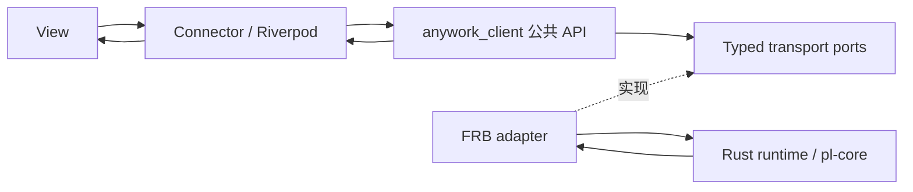

# 25 - Client、前端状态与资源生命周期

Rust 持有业务事实；应用实例持有纯 Dart Client；Riverpod 适配只读观察；Widget 呈现并发出意图。
本篇是客户端所有权、命令、草稿和导航的唯一权威契约。可靠历史与迁移见
[17](./17-studio-storage.md)，版本化流见 [07](./07-streaming.md)，领域和关闭见
[18](./18-studio-state.md)，呈现与阅读位置见 [19](./19-studio-ui.md)，验证边界见
[24](./24-testing.md)。规范不把源码实现或纯 Dart 测试等同于真实 native 与平台验收。

## 25.1 分层与应用实例

`anywork_client` 的运行依赖只有 Dart SDK，不依赖 Flutter、Riverpod、FRB、Ref 或
BuildContext。生成 DTO 和 native 句柄留在 adapter，Client 只消费 typed domain 契约。
feature 不导入生成代码、adapter、transport 或 Client 私有实现。应用装配入口同时认识
Client 与 adapter，其他层只认识各自的公共依赖。

每个 AppGraph 创建自己的 Client、transport 订阅登记、read models、命令板、草稿和附件
owner。禁止 module-level Client、业务 Map 和跨 ProviderContainer 共享的会话资源。
原生库的进程初始化与宿主退出仍归 native host，不能借此共享两个 Client 的观察句柄或草稿。
ProviderScope 借用注入的实例，只拥有自己的观察注册。

## 25.2 所有权与唯一写入

| 事实或资源 | 权威 owner | Dart owner / 唯一写入入口 | 身份与结束条件 |
| --- | --- | --- | --- |
| 项目、目录、配置、catalog、服务状态 | Rust 对应领域 | 各领域 read model reducer | 各自 ResourceStamp；领域关闭或应用退出 |
| Turn、activity、interaction、runtime、storage | Rust Thread | Client session 的状态 reducer | Thread 与 owner epoch；选择变化结束观察，不结束 Turn |
| 正文、saved、terminal、omitted、字段变更 | Rust Session | 有界尾部 reducer、历史页与详情 query | 内容订阅 stamp；逻辑 demand 变化或退出 |
| 当前项目、会话与 Settings 导航 | Client 本地意图 | Workspace / Selection controller | 选择身份；旧异步命令不能覆盖新选择 |
| 输入、参数、route 与附件引用 | Client 草稿；受理后可靠附件由 Rust 持有 | Draft owner 与附件 ownership ledger | DraftStamp + OperationId；明确转移或放弃 |
| 提交、pending overlay 与未知结果 | Rust mutation owner / Client operation owner | MutationBoard | OperationId 与目标 stamp；真实结果分别记录 |
| Live/History 与已加载消息 | 当前展示 lease | InMemoryChatController 展示项及其成员 Listenable | ThreadId + 展示代次；显式回实时或切会话释放旧集合 |
| 光标、composing、焦点、折叠与即时滚动几何 | Widget / UI controller | 局部 UI controller | draftId / reading generation；Widget dispose |

同一 canonical 资源只有一个 reducer。命令响应若携带该资源的权威 snapshot，进入同一个
reducer；命令状态和 overlay 不成为第二份 canonical。bootstrap 只负责启动恢复，不能在
命令成功后读取聚合状态掩盖缺帧。Demo 分领域发布 baseline/frame，不能把生产缺帧通过
本地成功回读补齐。可靠历史、SQLite、checkpoint 和 writer 始终由 Rust 持有。
Demo 的模式目录同样由独立、带版本的 catalog baseline 交付，组件不以本地默认列表补全缺失的能力。

启动的 loading、ready 与 typed failure 由 Client 持有并供只读观察。应用生命周期调用一次
bootstrap；目录与 catalog 均就绪后才显示可用 shell。首个 baseline 前的失败也必须显示其
typed code 与 correlation，不能困在 Widget 的局部等待标志里。显式重试复用同一 Client，
清除失败尝试后重新启动；路由重建和普通查询不自动重试启动。
启动成功后，目录观察失败保留最后有效目录与可用 shell，并显示该领域的显式重试入口；不能
退回无操作的启动页。Thread 状态流的同步状态与 ChatUiState 分别属于各自观察通道；正文
重连或预算阻塞不污染 runtime 同步状态，正文恢复也不能把仍失败的 runtime 标成 ready。

## 25.3 版本域

- ResourceStamp 由 ResourceKey、OwnerEpoch、Revision 组成。仅同资源同 owner 可比较。
- ViewStamp 由 ThreadId、ViewId、ViewEpoch、Version 组成。新 view 的版本不能与旧 view 比较。
- AttemptId 是一次客户端异步绑定身份，不能充当业务 owner epoch。
- OperationId 是一次业务提交身份，首次 await 前产生，未知结果不换 ID 自动重放。
- DraftStamp 是 DraftId 与字段或项目 revision，不能用窗口版本替代。

配置与 catalog 的 revision 独立；Thread model route revision 是 route extension 的 CAS，
不是 Thread 通知序号。`saved` 与执行终态独立。页查询不推进订阅基线，不存在用窗口版本猜测分页回执的语义。owner 更换后必须接受新 baseline，旧 epoch 的回执不能由新 epoch 满足。

ACP 账号配置与认证观察也属于独立资源。Client 的“保存并连接”先消费 canonical 配置回执，
再提交认证检查；后一步失败不得撤销前一步成功或清空草稿。认证帧与命令响应进入同一 reducer，
按 owner/revision 与 operation 身份收敛，不靠 Widget 的 loading 布尔值推断已登录。认证观察
投影到账号时还须匹配其 connection revision；跨资源帧乱序期间，不能把旧连接的成功用于新配置。
Client 必须实际持有相应 topic 订阅，不能以只观察本地 store 代替订阅建立。Accounts
可见需求只拥有 `acpAuth` 观察租约；离页、重建或返回不取消登录、不重启检查，重新观察读取
当前基线。交互呈现见 [19](./19-studio-ui.md)，认证语义见 [27](./27-acp.md)。
认证事件可先于 start 命令响应到达；一旦 canonical 状态提供当前 operation 身份，取消必须
可独立提交，不能被 start 的本地 busy 标志或命令队列阻塞。命令回执仍经同一 reducer 收敛。
已加载认证快照的水位同时参与 MutationBoard 的 `acp-auth` 资源观察，使用当前 runtime owner
epoch；topic 名 `acpAuth` 与回执资源名不混用。命令响应与先到事件都通过同一 canonical
观察满足回执，不能只更新画面而把已确认命令永久留在 awaiting-observation，也不能在退出时
直接丢弃 pending 操作或用人工成功标志伪造观察完成。

## 25.4 观察与导航

观察 API 同步登记接收者并返回当前值，检查当前镜像与注册 predicate 之间不能有 await。
当前活动 Session 的可用性由 Client 通过只读快照与观察入口发布，只引用同一资源 owner；创建或重试成功后通知
展示重新绑定，观察者登记时立即消费返回的当前快照，不等待下一条内容帧或强制刷新 provider。
显示观察暂停时，每个观察者只保留最新快照；可靠事件仍使用有序交付，不套用 latest-only。
订阅取消只移除自己的观察，不能关闭跨路由 Session、内容连接、草稿或附件。

AppGraph 通过逻辑 demand 管理资源。进入 Settings、切换设置标签和 Widget 暂停不改变当前
内容订阅 demand，不清理新会话或 Thread 草稿。明确切换 Thread 才 retire 旧内容资源；关闭项目、
归档与应用退出显式结束相应需求。account keepAlive 不能承担 native 资源所有权，也不能让
每个曾访问会话永久保留正文。轻量 owner 缓存、观察者和镜像均受预算约束。

## 25.5 Timeline 连接与关闭

内容连接保留 open、initial、next 生命周期，按 [26](./26-timeline-content.md) 提供尾部订阅、
无状态历史页和详情查询，不再提供 focus/load/expand 窗口回执。每次 attempt 在首次 await
前登记 demand、原始 open Future、候选句柄、取消、pump、查询、close/join 和预算许可。
句柄返回立即归属该 attempt，每次 await 后核对 Thread、attempt、demand 与 retired 状态。

initial 建立新订阅自己的基线；同一订阅最多一个 next，reduce 后才继续取帧。内容缺口只
重同步当前连接，不重放业务操作，也不把旧 lastGood 当新基线。状态流和内容订阅独立，
一方恢复不把另一方标为 ready。页／详情结果只作用于捕获的展示代次；旧 A→B→A 请求
成功、失败或 finally 均不能清新 A 的 loading、内容或错误。
FRB 的 initial、next、页和详情在异步返回后同样检查连接关闭状态；关闭后的迟到成功以
typed Cancelled 收束，不向直接消费者交付旧内容。重连成功清除旧连接错误，空游标按
当前代次的权威值发布，不能用上一代非空游标补齐。

retire 先封闭发布与查询准入，再取消并 requestClose，等待泵、在途查询、sink 与句柄真实
ACK。失败保留 unresolved owner 和预算；取消等待不等于资源关闭。返回过晚的 open 仍由原
attempt 收束。关闭内容连接不关闭 Rust Session、Turn 或 writer；account 只取消自己的观察。
Settings、标签页或 Widget 暂停不改变逻辑 demand，Thread 切换、项目关闭与退出才 retire。

观察重连采用有界退避和显式 retry；许可不足只在真实释放通知后恢复准入，不轮询或增加
容量。opening、active、retiring、unresolved 及查询等待均计入预算，失败不能用清空容器伪装
完成。已知 CAS 冲突只重建 runtime binding，保留独立的内容连接和草稿。

## 25.6 Read model 与呈现

设置、项目、目录、选择、Thread 轻状态和内容各有唯一 reducer。ThreadWorkspace 的 Thread
仅用于身份，目录元数据以 directory owner 为准；状态流不反写正文，保存与终态不互相推导。
状态流快照不反写目录行；updatedAt 不充当跨资源版本，同秒晚到快照不能回滚目录终态。
mode 等身份变更由 Rust 提交目录增量并推进所属水位。

同 Thread 的 runtime、turn、activity、storage 共用一条带水位的状态订阅，typed Runtime
事件独立更新其镜像；速度不另建 transport、reducer 或业务缓存。Riverpod 呈现层按明确
`threadId` 派生不可变、值相等的细粒度 projection，并由对应 Consumer 实际观察：速度、上下文
和状态栏稳定字段互不因无关值变化而重建。`select` 或值相等的派生 account 只筛选通知，
不拥有第二份业务事实。参数化呈现观察自动释放时只取消自身 observer 与许可，不能关闭
Session/ChatView 或清除草稿；完整样本的速度选择见 [18](./18-studio-state.md) §18.8。

普通问答与计划确认回执由 canonical 工具条目的 typed 问答历史派生，沿用同一身份与内容版本；
adapter 保留问题、答案列表、脱敏标记和权威状态，不让 feature 重新解析工具载荷。
composer pending interaction 队列只服务待处理交互，resolved 后不留队，不另建回答缓存。
页、尾部订阅和重开都从同一 Session 内容源恢复回执；局部展开不写回业务事实。敏感值
只接受后端脱敏投影，详情、摘要、复制和辅助语义均不得泄漏原值。

图片展示工具产生独立的图片卡片呈现项（presentation）：它只派生展示属性（所属调用、typed 附件、参数中的展示文案），图片字节仍由 Thread 附件缓存按身份读取；呈现层不缓存字节，也不因卡片存在而改写工具条目本身。

Client 只持有有界尾部基线及 typed 查询状态，当前 AppGraph 展示 lease 将内容投影为唯一
InMemoryChatController 消息集合；活动、图片与重连的 GUI 分组只持有逐条 canonical 预览，
不改变后端逐条保存。组内定向观察与展开意图由当前 lease 所有，不成为第二份正文缓存。
库负责列表与滚动；Live/History、消息稳定身份、分页、
详情及显示预算以 [26](./26-timeline-content.md) 为准。无服务端几何窗口镜像、跨层阅读锚点
或另一份完整历史 rows/body cache；页查询不改变尾部订阅基线。

Connector 读取查询并调用稳定目标 action，向纯 View 传唯一 props，不从 account fallback
重读同一业务值。features 不得穿透 Client 公共边界直连 FRB、transport 或 SQL。详情、图片和
菜单等平台交互归适配层或 UI controller。显式回实时或发送创建新列表代次；旧代次只在其
子树释放与资源收束后销毁。Thread 切换释放旧展示集合，Settings 往返不关闭展示 owner。

## 25.7 命令、观察与效果

首次 await 前冻结目标、expected revision 和 OperationId。停止命令捕获 ThreadId + TurnId，
不按排队执行时的当前选择重定向。同一资源的冲突写串行，不同资源可独立推进；停止不排在
长任务 FIFO 后。分页和正文查询不占用设置写 lane。

CommitReceipt 至少携带 OperationId、Applied/NoChange、目标 ResourceStamp 和 effect point。
接受、观察、生效、持久化是独立事实：Accepted、AwaitingObservation、Observed、Effective、Durable
不能彼此替代。模型配置可对下一 Turn 或未来新会话生效，收到配置响应不代表正在执行的
调用已经切换。durable 只由可靠保存确认推进。

身份型回执按 [18](./18-studio-state.md) 的 Turn/interaction 谓词观察，不伪造 revision 或
通过空目标绕过屏障。观察拥有预算，并在确认、失败或 owner close 时释放；草稿提交的保存
确认继续等待对应 input 的 `saved`，不能以 terminal 代替。观察未到达时阶段仍为
AwaitingObservation，已知 Effective/Durable 单独保留。

Rejected 表示明确未受理；UnknownOutcome 表示提交可能已执行但缺少确定结果；SyncFailed
表示已知结果的观察失败。未知结果的非幂等命令不自动重放。局部 conflict、lagged 或失败才做
对应领域 typed resync；正常成功不执行 readStudioState 或聚合 reload。

MutationBoard 分开保存每次真实结果与每个目标的 latest intent。旧 operation 不能清除新 overlay。
观察 predicate 原子检查当前镜像并注册，使帧先到和回执先到均不漏确认。观察水位只在相同
owner epoch 和资源域合并。

账号详情模型列表的阈值编辑只拥有原始输入、短暂防抖与最新意图身份；原始覆盖由 Settings reducer 拥有，
最终上下文解析结果由 catalog reducer 原样接收。有效输入和恢复自动触发同一
account 原子保存，Client 在串行写 lane 内从最新 canonical account 应用目标模型变更，
CAS 重试也重新构造，不携带未改动字段的陈旧副本。其余模型的持久覆盖必须完整保留，包括
因在线目录暂时撤下而不可见的覆盖。旧响应可推进自身操作记录及 canonical 水位，不能覆盖
较新原始输入、清除较新 pending/error 或让不同模型的修改互相丢失。
页面离开前将已产生的有效意图交给 Client；已经提交或排队的操作由 Client 持有并参与退出 join，
不能由 Widget dispose 取消。输入无效时不提交、保留校验错误；已知保存失败允许显式重试，
未知结果按既有 UnknownOutcome 语义处理，不自动伪造成功。

阈值的持久覆盖由 Settings revision 所有，最终上下文策略由 catalog revision 所有；配置 owner
在同一锁内读取二者，所有影响策略的配置及目录更新推进目录水位。Client 独立合并两个水位，
只接收后端最终策略，不从容量或原始覆盖重算。配置旧响应不能回滚较新的目录策略，撤下模型
的原始覆盖继续保留；只在 Rust 显式写边界归一化。设置返回后立即消费最新 canonical 结果。

### 25.7.1 账号用量需求

账号标签的 feature 状态负责自动加载策略，Client 查询 owner 负责按实例启动、去重、
pending/error 和在途任务，额度事实仍只经 AccountUsageStore 的唯一 reducer 接收 canonical
响应或事件。Riverpod 展示适配只观察 Client，不直接调用 transport，不以另一份 AsyncValue
缓存取代同一 canonical。焦点、筛选、选择、FormKey 和编辑草稿继续由局部 UI owner 管理。

标签首次可见为每个当前查询身份发起一次检查；每个实例完成即发布，不等待其它实例。
同 account ID、同 `usageQueryRevision` 的重叠自动/手动检查合并，不同身份的旧结果不能清理
新 pending 或覆盖新结果。查询身份由 Rust 所有，定义见 [18.2](./18-studio-state.md#182-公共-snapshot)。
标签可见期间，新增或查询身份变化只补查对应实例；隐藏时停止产生新的自动请求，重新可见
只补查未加载或失效身份。失败也计入本轮已尝试，不由重建、默认值变化或自动重试形成请求
循环。页面状态真正重建允许再次加载，手动刷新可明确发起新尝试，刷新全部复用同一实例能力。

页面只声明需求，不能在每次 Widget build 中创建请求，也不在保存回调中等待额度。已有在途
请求由 Client 持有并在应用退出时 join，页面取消观察不丢弃任务；删除实例清理其需求及操作
身份，迟到响应不得复活删除项。保留的标签状态往返不重复检查，不清当前 Thread／内容连接
或草稿；跨 AppGraph 不共享请求、需求、加载集合或结果镜像。

## 25.8 草稿与附件

StartDraft 与 ComposerDraft 有独立逻辑寿命，不随页面 observer 消失。freezeForSubmit 在
同步阶段冻结 DraftStamp、项目/Thread 身份、文本、模式、工作区、完整 route 和附件 ID 集合。
新建 Thread 直接提交该 route，不先写全局默认设置再读取缓存。已有 Thread 提交携带所观察的
route extension revision，受理 CAS 的语义见 [18](./18-studio-state.md)。

markSubmitting、accepted、observed 和 durable 均关联同一 DraftStamp + OperationId。
提交期间可继续输入和修改草稿；旧 ACK 只清理仍属于该提交且 revision 相符的字段。
TextEditingController 保存 composing/selection，draftId 变化时替换；同一草稿的普通重建不反复
重写 controller.text，旧完成也不能直接清空当前 controller。

新会话环境准备属于冻结提交的临时展示状态，由 StartDraft owner 按 `inputId`、项目及提交身份
维护唯一镜像。Widget 与 Riverpod 只读观察当前项目的镜像，Settings 往返或观察销毁不取消
创建命令。阶段来自同一次 typed 创建流，成功／失败终态只结算一次；终态前断流保留
UnknownOutcome，不自动重发。旧提交的进度和 finally 不覆盖新尝试或较新的草稿，成功结果
仅在导航意图仍属于原提交时自动选择新 Thread。成功移除准备镜像，失败保留原阶段和原因；
准备信息不成为目录事实或聊天历史，也不承担取消与工作树资源释放责任。

附件 ledger 分开记录逻辑草稿引用和冻结提交引用。提交成功只转移冻结引用，较新草稿继续
引用的相同附件 ID 仍有效。只有最后一个 owner 释放后才请求 native 删除；删除失败保留 owner、
诊断与预算。未知受理结果保留冻结引用，不因页面退出、放弃当前草稿或全局 orphan sweep 删除。
本地 clipboard 暂存和晚到 admission 也由同一 ledger 收束。关闭过程等待在途创建和清理，
不以销毁观察适配代替异步资源回收；可靠附件与旧数据保留规则见 [17](./17-studio-storage.md)。

## 25.9 应用退出

AppGraph.close 幂等，重复调用复用首次 close Future 和绝对 deadline。先封闭草稿生产者，
加入在途提交，再收束会话、topic、update operation 和附件任务；独立取消并发启动，共用剩余
预算。每个未解决 operation 和资源出现在 CloseReport，不释放仍未确认关闭的 permit。

StudioExitCoordinator 的应用实例状态不跨图共享；宿主出口只路由到当前协调器。Client 的
CloseReport 在 Rust finalizer 前并入 externalIssues，只有所有真实 ACK 和可靠保存均确认才可
报告 Clean。超时不得另起期限或在 runtime 宣布 Clean 后追加失败来掩盖提前释锁。

手动更新的请求状态归 Client，点击后同步发布 pending，页面只观察、不持有准备任务。已有后台
下载时复用同一次准备；准备操作与进度流真实完成后，才把更新后重启意图交给同一退出协调器。
首次退出固定普通退出或更新后重启意图及期限，后续请求只加入，不重新启动或改变意图。
退出结果分别承载关停报告与安装交接结果；安装器启动失败不能改写可靠保存的结论，也不能
被关停 Clean 隐藏。更新退出先在原期限内恢复既有主窗口，确保托盘隐藏时提示仍实际可见。
界面显示更新版本、停止会话和保存提示；关停失败与安装交接失败均在
首次退出的剩余期限内留出一次渲染和最多 1.2 秒阅读时间，随后按既有退出期限结束。

退出提示在 `MaterialApp.builder` 内替换整个 Router 子树，促使当前及被覆盖的页面真实卸载，
再由原展示 owner 等待 lease 的释放确认。被 Settings 覆盖的聊天页面可能因 Riverpod 的
`TickerMode` 暂停观察；不得依赖隐藏页面收到状态刷新才能退出，也不得在子树仍挂载时
提前销毁 controller 或伪造释放确认。退出提示与应用 owner 位于 Router 之外，持续负责
进度、失败提示和同一次有界关停。

## 25.10 验证与删除项

验证层次、证据边界与正式门禁以 [24](./24-testing.md) 为准。纯 Client fake、Riverpod adapter、
真实 Flutter 路由、FRB DTO fake、真实 native 和各平台 GUI 不相互替代。Driver 只保留诊断与
可见投影，不维护另一套业务生命周期或可写 canonical。

已被新 owner 替代的观察适配资源租约、第二份正文 baseline、成功后聚合回读、全局附件清扫、
宿主 Timeline fallback 和直接 FRB feature 入口应随调用方迁移删除，不保留永久回退分支。

## 25.11 模型目录一致性

目录同时发布完整成员与后端计算的类型匹配结果；Client 模型查询不传类型时返回全部，文本查询
用于所有新旧会话、Mode、内置角色与自定义 Agent Profile 的模型菜单，设置页仍展示完整目录。
GUI 不重复计算能力和预算条件。既有选择不满足筛选时保留路由并显示原因，不自动换模型；
未配置的草稿仅从合格集合初始化。候选资格与请求可用性分别表达，筛选不新增请求执行门槛。

所有会话与模式消费同一 canonical 模型目录，选择项按账号 ID 与 modelId 复合键去重，
候选使用上述统一文本类型，不附加工具或 Mode 能力门槛。配置与目录继续使用独立 revision；账号参数更新一次发布该账号的受影响路由，
旧响应不能回滚新目录。模型固有参数与路由价格均只读展示，缺价不代表模型未通过校验。

Client 使用同一 AccountModelKey 表达模型选择、统计顶层筛选和模型需求；显示名不是 key。
统计先按账号和配置模型接收 canonical 汇总，effort 是组内细分，发送及返回模型是冻结诊断。
未知历史身份不得由当前目录补写。账号模板只负责创建默认值，不参与已有账号或统计身份。

## 25.11 工作模式编辑草稿

每个 AppGraph 的 Client 拥有模式编辑草稿、原始 JSON 与最多 64 次撤销/重做历史；
图和 JSON 是同一编辑资源的两种视图。JSON 解析或保存失败保留输入，校验和预演结果由 Rust 返回。
图控制器只持有展示坐标与交互投影，不成为另一份业务事实源。离开脏草稿必须选择保存、放弃或取消；
保存采用读取时的目录 revision，冲突不覆盖草稿。页面销毁只取消观察，草稿由 Client 生命周期管理。
读取定义、JSON 校验、预演及 schema 查询复用同一命令通道的并行查询登记；关闭先封闭准入，
等待这些已受理查询和串行变更真实完成后才释放草稿许可，迟到结果不再发布编辑状态。
