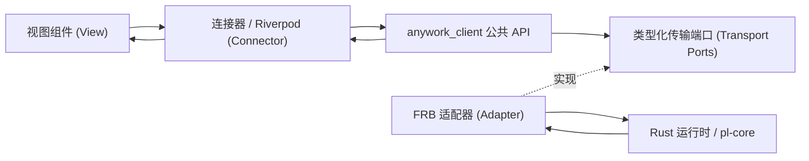

# 25 - 客户端、前端状态与资源生命周期

Rust 运行时持有业务权威事实；每个应用实例装配独立的纯 Dart 领域资源；`Riverpod` 组织呈现观察与视图模型，界面组件仅渲染与发出意图。性能统计采用 [§25.13](#2513-独立统计领域与呈现模块) 的独立模块，账号功能采用 [§25.14](#2514-账号分域与可预览呈现) 的分域仓储与纯呈现；其余领域保持现有客户端边界，不因局部演进要求全应用重写，也不为已迁移领域保留旧 Client 兼容入口。本文是客户端所有权、命令回执、输入草稿与页面导航的唯一权威契约。可靠历史与迁移见 [17](./17-studio-storage.md)，流协议见 [07](./07-streaming.md)，运行时与关闭见 [18](./18-studio-state.md)，界面见 [19](./19-studio-ui.md)，验证见 [24](./24-testing.md)。

## 25.1 分层架构与应用实例隔离

上图展示现有 Client 管辖领域的分层流向，统计领域的独立切片依赖方向见 [§25.13](#2513-独立统计领域与呈现模块)。`anywork_client` 的运行期依赖仅限 Dart SDK，不依赖 Flutter、`Riverpod`、FRB、`Ref` 或 `BuildContext`。FRB 生成的 DTO 与原生句柄封装在适配器（adapter）层内部，Client 仅消费类型化的领域契约；业务视图模块（`features/**`）不得导入生成代码、适配器、传输层或 Client 私有实现。唯有应用装配入口同时感知 Client 与适配器，其余各层仅依赖各自的公开契约。

每个应用实例（`AppGraph`）创建独立的 Client、传输层订阅登记表、只读模型（read model）、变更看板（`MutationBoard`）、输入草稿与附件所有者。严禁使用模块级全局 Client、全局业务字典或跨 `ProviderContainer` 共享的会话资源。原生动态库的进程级初始化与宿主退出仍归原生宿主管理，但不得借此在两个 Client 实例间共享观察句柄或草稿；`ProviderScope` 仅借用注入的实例并管理自身的观察注册。

## 25.2 状态所有权与唯一写入入口

各领域事实与前端资源遵循严格的单一所有者与唯一写入入口约束（机器人领域同样由 Rust 所有者持有业务事实，每个 `AppGraph` 的 Client 独立持有 `Bots` 主题、只读模型、配对/查询/发送动作与未完成操作，离开设置页不关闭物理机器人连接，详见 [27](./27-bots.md)）：

| 事实或前端资源 | 权威所有者 | Dart 侧所有者 / 唯一写入入口 | 身份标识与生命周期结束条件 |
| --- | --- | --- | --- |
| 项目、目录、配置、模型目录、服务状态 | Rust 对应领域所有者 | 各领域只读模型归约器（reducer） | 各自 `ResourceStamp`；领域关闭或应用退出 |
| 模型统计汇总、推理强度（`effort`）细分与调用历史 | Rust 统计所有者 | 独立 `StatisticsRepository` 归约器 | 所有者／统计材料来源；绑定页面可见需求与应用关闭（见 [§25.13](#2513-独立统计领域与呈现模块)） |
| 轮次、活动摘要、交互、运行时、存储状态 | Rust 会话（`Thread`）所有者 | Client 会话状态归约器 | 会话 ID 与 `owner epoch`；选择切换结束观察，不终止轮次 |
| 时间线正文、落盘确认、终态、省略标记、字段变更 | Rust 会话（`Session`） | 有界尾部归约器、历史分页与详情查询 | 内容订阅戳；逻辑需求（demand）变化或应用退出 |
| 当前选中项目、会话与设置导航 | Client 本地导航意图 | 工作区与选择控制器（Selection controller） | 选择身份；旧异步命令结果不得覆盖较新的选择意图 |
| 输入文本、参数、路由与附件引用 | Client 草稿（受理后可靠附件归 Rust） | 草稿所有者与附件所有权账本（ownership ledger） | `DraftStamp + OperationId`；所有权明确转移或显式放弃 |
| 命令提交、待确认覆盖层（pending overlay）与未知结果 | Rust 变更所有者 / Client 操作所有者 | `MutationBoard` | `OperationId` 与目标资源戳；真实结果按操作独立记录 |
| 实时/历史模式（Live/History）与已加载消息集合 | 当前展示租约（display lease） | `InMemoryChatController` 展示项及成员 `Listenable` | `ThreadId + 展示代次`；显式回到实时或切换会话时释放旧集合 |
| 光标、输入法组词（composing）、焦点、折叠态与滚动几何 | 组件 / 局部 UI 控制器 | 局部 UI 控制器 | `draftId` 或阅读代次；组件销毁（dispose）时释放 |

同一权威资源仅设一个归约器（reducer）。命令响应若携带该资源的权威快照，直接进入同一个归约器；命令待确认状态与覆盖层不构成第二份权威状态。引导快照（bootstrap）仅负责启动初始化恢复，严禁在普通命令成功后通过重读聚合状态来掩盖缺帧。演示模式（demo）同样按领域发布带版本的基线与增量帧，不在组件层用本地默认列表补全缺失数据。

启动阶段的 `loading`、`ready` 与类型化失败状态由 Client 持有并供只读观察。应用生命周期调用一次引导加载，待项目会话目录与主界面必需配置就绪后才展示主界面外壳（shell）；账号静态模板由对应领域按需加载，不再作为全应用启动屏障。若在首帧基线前发生失败，必须展示类型化错误码与关联 ID（`correlationId`），显式重试时复用同一 Client 实例清除失败尝试后重新启动。启动成功后，若某个目录观察失败，则保留最后有效目录与可用主界面并展示该领域的显式重试入口，不退回无操作的启动等待页。会话状态流的同步状态与聊天界面内容状态（`ChatUiState`）分属各自独立的观察通道，互不覆盖。

## 25.3 版本域与资源戳（Stamps）

前端状态管理严格区分五类不可混用的版本域标识：
- **`ResourceStamp`**：由 `(ResourceKey, OwnerEpoch, Revision)` 组成，仅在同一资源、同一 `OwnerEpoch` 下可比。所有者代次更换后必须采纳新基线，旧 `epoch` 的回执不得由新 `epoch` 满足。
- **`ViewStamp`**：由 `(ThreadId, ViewId, ViewEpoch, Version)` 组成，新视图代次的版本号不得与旧视图比较。
- **`AttemptId`**：单次客户端异步连接绑定身份，不得充当业务 `OwnerEpoch`。
- **`OperationId`**：单次业务提交身份，在首次 `await` 前分配；结果未知的非幂等操作不得更换 ID 自动重放。
- **`DraftStamp`**：由 `(DraftId, 字段或项目修订号)` 组成，不得以窗口版本替代。

设置配置与模型目录使用独立的修订号；会话模型路由修订号是路由扩展的 CAS 令牌，而非会话通知序号；历史落盘确认（`saved`）与轮次执行终态相互独立；历史分页查询不推进尾部订阅基线。

ACP 账号配置、ACP 认证观察（`acpAuth`，回执资源名 `acp-auth`）与 ACP 服务安装准备（`acpInstall`，回执资源名 `acp-install`）同样是各自独立的资源域：
- **保存并连接编排**：“保存并连接”先消费权威配置保存回执，再发起认证检查命令；认证检查失败不撤销已保存的账号配置，也不清空草稿。认证事件帧与命令响应进入同一归约器，按 `owner/revision`、连接修订号（`connectionRevision`）与 `OperationId` 收敛；一旦权威状态提供了当前操作身份，取消请求即可经独立通道提交，不受启动命令的本地忙碌标志阻塞。
- **安装准备与草稿绑定**：安装准备结果按供应商、操作身份与草稿意图绑定，终态保留操作身份；仅匹配当前意图的准备结果可授予草稿保存资格（其他草稿须通过显式“使用已就绪安装”动作绑定，不按品牌或路径自动认领）。离开设置页仅释放页面自身的观察订阅，返回页面时重新读取当前基线；唯有运行时关闭才收束后台安装与认证任务（详见 [28](./28-acp.md)）。

用户选择 ACP 模板是显式准备意图，但必须先取得该供应商真实安装观察基线再决定动作，未观察不等于未安装。没有共享就绪结果时，该选择可以发起首次准备；已有共享就绪结果时，新编辑器保持未认领并提供“使用已就绪安装”，不能通过重新准备并自动认领绕过此选择。取消后的重试是独立显式动作；组件构建、重建或本地化变化不触发准备。

呈现层的意图代次用于隔离等待与迟到完成，不是后端准备次数或认领事实。即使等待初始观察导致本地代次前进，只要没有已认领操作，仍不得获得保存资格；显式“使用已就绪安装”需绑定同一就绪操作并推进当前编辑意图，不能以固定代次数值替代这些判断。

## 25.4 观察注册与页面导航

只读观察 API 在同步阶段完成接收者登记并立即返回当前镜像值，检查当前镜像与注册谓词（predicate）之间严禁插入任何 `await` 间隙，确保读取快照与注册观察之间到达的更新绝不漏帧。当显示观察处于暂停状态（如页面被路由覆盖）时，每个观察者仅保留最新显示快照；而可靠有序事件流仍严格按序归约，不套用丢弃中间帧的策略。取消观察订阅仅移除当前观察者，绝不关闭跨路由的会话、内容连接、输入草稿或附件。

`AppGraph` 通过逻辑需求（logical demand）管理底层资源生命周期：进入设置页、切换设置标签页或组件暂停均不改变当前会话的内容订阅需求，也不清理新会话或已有会话的输入草稿；唯有用户显式切换会话、关闭项目、归档会话或退出应用时，才退役（retire）对应的旧内容资源。

## 25.5 时间线连接与退役收束

时间线内容连接维护 `open`、`initial`、`next` 生命周期，按 [26](./26-timeline-content.md) 提供有界尾部订阅、无状态历史分页查询与按需详情查询。每次连接尝试（attempt）在首次 `await` 前登记逻辑需求、原始打开 Future、候选句柄、取消令牌、事件泵（pump）、在途查询、关闭汇合句柄与内存预算许可（permit）；每次异步返回后均核对会话身份、`attempt` 代次、逻辑需求与退役状态。

- **独立基线与代次隔离**：`initial` 建立新订阅自身的版本基线；同一订阅同一时刻最多挂起一个 `next` 拉取，完成归约后才继续拉取下一帧。发生内容缺口时仅重同步当前连接，不重放业务命令，也不将旧的 `lastGood` 快照当作新基线。历史分页与详情查询结果仅作用于发起时捕获的展示代次；在 `A → B → A` 快速切换场景下，第一次 `A` 的迟到成功、失败或 `finally` 回调均不得清空第二次 `A` 的加载状态或内容。
- **确定性退役收束（Retire）**：退役连接时先锁闭发布与查询准入，再发出取消与 `requestClose` 指令，等待事件泵、在途查询、数据汇（sink）与原生句柄返回真实确认（ACK）。若关闭失败则保留未解决所有者（unresolved owner）与预算占用；关闭内容连接仅回收前端流资源，不关闭 Rust 侧的 `Session`、活动轮次或持久化写入器。

## 25.6 只读模型（Read Model）与细粒度呈现

设置、项目目录、会话目录、当前选择、会话轻量状态与时间线内容各自拥有唯一的归约器。会话状态流快照不反写会话目录行，业务时间戳 `updatedAt` 不充当跨资源版本号；工作模式等会话身份变更由 Rust 提交目录增量并推进目录水位（见 [18.11.1](./18-studio-state.md#18111-thread-身份的单一来源)）。

同一会话的运行时状态、轮次、活动摘要与存储状态共用单条带水位的有序状态订阅；`Riverpod` 呈现层按明确的 `threadId` 派生不可变且按值相等的细粒度投影（如吞吐率投影、上下文容量投影与状态栏稳定字段投影），使高频吞吐率更新仅通知吞吐率消费者，不会连带重建上下文浮层、时间线列表或输入区。

普通用户问答回执、计划确认回执与图片展示卡片均由权威工具条目的类型化投影派生，复用同一会话附件缓存与内容源，不在视图层缓存原始字节或二次解析 JSON。Client 仅持有有界尾部基线与类型化查询状态，由当前展示租约将内容投影为唯一的 `InMemoryChatController` 消息集合；连接器（Connector）从只读模型读取属性并绑定稳定动作回调后注入纯视图组件（View）。

## 25.7 命令、观察屏障与变更看板（MutationBoard）

所有业务命令在首次 `await` 前同步冻结目标资源标识、期望修订号（`expectedRevision`）与 `OperationId`（停止命令在点击当刻固定 `ThreadId + ExecutionId`，不随排队期间的选择切换而偏移）。同一资源的冲突写入串行化，不同资源独立推进；停止命令与取消请求不排在长耗时任务队列末尾。
无内容继续与停止沿用同一冻结与观察边界：继续在点击当刻固定目标会话、继续点身份、操作编号与已观察的模型路由修订号，同一意图键只允许一个在途请求，重复点击复用同一 future 而不另发编号；停止固定目标执行编号，重复点击至多形成一个在途加一个排队重试，并在同一执行上合并。两者都只在收到受理回执后推进本地受理态，请求在途期间保持对应入口禁用而非显示已生效；失败、结果未知与已受理分别表达，结果未知不换编号重发。

会话目录同时是子成员停止的唯一入口：客户端从权威目录行的执行投影取得目标执行编号与可停止资格，不要求先打开或选中该子会话，也不把当前选中会话的轮次当作该行目标。成员数量与停止资格只统计未关闭成员，已关闭成员不计数。

命令提交回执（`CommitReceipt`）至少携带 `OperationId`、`Applied/NoChange`、目标 `ResourceStamp` 与生效点（`effect point`）。系统严格区分五个独立阶段：已受理（`Accepted`）、等待观察（`AwaitingObservation`）、已观察（`Observed`）、已生效（`Effective`）与已持久化（`Durable`），以及三类非成功结果：明确拒绝（`Rejected`）、结果未知（`UnknownOutcome`，严禁对非幂等命令自动重放）与观察同步失败（`SyncFailed`）。`MutationBoard` 分别保存每次操作的真实结果与每个目标资源的最新意图（latest intent），旧操作完成绝不清除较新意图的待确认覆盖层。

特殊领域的窄命令与局部状态遵循以下收敛规则：
- **模型启用开关、计费类别与手动模型删除**：三类窄命令均显式传递 `OperationId` 并在回执中原样核对。动作经对应领域 Repository 进入同一共享设置 CAS 通道；遇到 CAS 冲突时在最新权威账号状态上仅重新应用当次窄字段意图，不回传陈旧的整卡快照。
- **智能体目录成员与导航意图抢占**：根会话的智能体切换菜单成员由权威 `AgentDirectory` 的根归属与父子关系唯一确定，不与侧栏分页窗口或热会话集合取交集；用户发起新的会话选择导航意图后，立即使此前尚未完成的按需冷会话读取失去发布选中态的资格，防止迟到回包篡改最新导航目标。
- **上下文压缩阈值内联保存与双水位合并**：账号详情模型阈值经过短暂防抖后提交目标模型的窄命令；持久化覆盖归属 `settingsRevision`，最终上下文策略归属 `modelCatalogRevision`，对应领域按双时钟独立归并（见 [18](./18-studio-state.md) §18.11），不因旧配置响应回滚新目录解析策略。

### 25.7.1 账号用量需求

账号呈现模块声明可见额度需求，独立用量领域 Repository 按查询身份发起检查、去重并登记任务；响应与观察帧进入该领域唯一归约器。查询阶段、错误及最近成功值以 Rust 用量所有者发布的事实为准，用户最新刷新意图的呈现不反写 canonical。旧 Client 用量 store 与页面请求旁路在迁移后删除。

当账号标签页首次可见时，为各账号的 `usageQueryRevision`（见 [18.2](./18-studio-state.md#182-公共快照)）并行检查，逐账号发布。同一账号同一查询身份的自动与手动请求合并；新增账号或查询输入变化仅补查受影响实例。隐藏停止新增自动请求，返回只补未尝试或身份已变化者；失败计入已尝试，不循环重试。在途任务归领域所有者并参与应用退出汇合，页面取消观察不丢任务，删除或身份变化拒绝迟到结果。

账号配置与模型设置命令迁移后由对应领域 Repository 提交；共享设置写协调只负责同一配置 CAS 域的顺序，不复制业务状态。压缩阈值采用目标模型窄意图，不再通过整卡保存；配置覆盖与目录最终策略仍按独立水位归并。旧配置响应不能回滚新目录，旧操作不能清除新意图，其他领域已观察的水位不能冒充本领域内容已到达。

## 25.8 输入草稿与附件所有权账本

起始页草稿（`StartDraft`）与会话输入草稿（`ComposerDraft`）拥有独立的逻辑生命周期，不随页面观察者销毁而重置。调用 `freezeForSubmit` 时，系统在同步阶段一次性冻结 `DraftStamp`、项目或会话身份、提示词文本、工作模式、工作区模式、完整模型路由、解析后的子智能体分发模式与偏好以及附件 ID 集合。提交过程中用户可继续输入与修改草稿（递增草稿修订号）；当旧提交的确认回执到达时，仅清理仍归属该次 `DraftStamp + OperationId` 且修订号匹配的字段，绝不清空用户新输入的内容或重置 `TextEditingController` 的光标与组词区间。

新建根会话提交后的环境准备进度属于该次冻结提交的临时展示状态，由 `StartDraft` 所有者按 `inputId`、项目身份与提交身份维护唯一镜像，在创建成功进入对话后移除，或在创建失败时原位保留失败阶段、原因及原始草稿。

附件所有权账本（attachment ownership ledger）分别记录逻辑草稿引用与冻结提交引用：提交成功后仅转移冻结提交引用，若较新的草稿仍引用同一附件 ID 则继续保持有效；唯有当某个附件的最后一个所有者释放引用后，才向原生层请求物理删除。结果未知（`UnknownOutcome`）的提交保留其冻结附件引用，不因离开页面或放弃当前草稿而误删。剪贴板图片粘贴暂存与两阶段预览字节补齐同样纳入同一账本统一收束。

新会话的本地文件、剪贴板图片与远端 URL 准入在意图发生时同步冻结草稿当前解析出的完整模型路由，并通过 `newThread` 准入上下文的必填 `route` 传递；该路由与提交共用同一解析规则，不重新采用工作模式默认模型，也不因暂存或排队期间的选择变化而改变。已有会话继续使用后端保存的会话模型路由。提交时仍按最终冻结的路由重新校验附件，切换模型不会使先前准入结果绕过能力限制。

不支持的模态、来源、媒体类型或超出模型限制的附件返回带明确安全提示的 `invalidArgument`，不伪装为配置损坏；文件读取与内容解析失败保留内部原因供关联诊断使用，对外不暴露路径、凭据或远端 URL。已知拒绝释放本次预留资源，保留草稿文本与已有附件，允许后续合法附件继续准入。

## 25.9 应用退出协调

`AppGraph.close` 具备幂等性，重复调用直接复用首次创建的关闭 Future 与首次绝对期限。独立的 `StatisticsRepository` 与现有 Client 均由 `AppGraph` 统一装配并负责关闭，统计模块的未决任务一并汇入同一个 `CloseReport`，确保不会因统计模块独立于 Client 而遗漏原生推送流或读取作用域的收束。关闭流程先锁闭草稿生产者并汇合在途提交，再并发收束会话内容连接、各领域主题订阅、统计仓储、更新操作与附件任务，将任何未确认收束的操作与资源记入 `CloseReport` 并保留其预算许可。

`StudioExitCoordinator` 的状态严格按应用实例隔离。Client 的 `CloseReport` 在调用 Rust 终态关停前并入 `externalIssues`；唯有当所有外部取消确认与后端可靠保存全部完成时，最终关停报告才可判定为 `Clean`。手动触发更新安装时，待安装包准备与进度流真实完成后再将“更新后重启”意图移交同一退出协调器（若当前窗口隐藏于系统托盘，则先在原期限内恢复显示主窗口，并为失败提示留出一次渲染及最多 `1.2 秒` 阅读时间）。退出提示界面在 `MaterialApp.builder` 层级直接替换整个路由子树（Router subtree），促使当前页面及被覆盖的后台页面真实卸载并释放展示租约。

账号配置、模型、用量及 ACP 领域与共享设置写协调也由 `AppGraph` 独立注入并纳入同一退出期限。先封闭新业务准入，再汇合已登记写入、打开、查询、观察消费和原生取消；页面卸载只释放自身观察。超时或失败保留原任务、句柄与预算责任，不能用重建 Repository 掩盖未收束资源。

## 25.10 验证层级与冗余清理

客户端与前端状态的验证层级、证据边界与 CI 正式门禁（`cargo xtask verify-client`）见 [24](./24-testing.md) §24.1.1。随着单向数据流架构演进，凡已被新所有者替代的旧观察租约、第二份正文基线、命令成功后的聚合状态回读、全局孤儿附件清扫、宿主时间线回退分支以及视图层直连 FRB 的入口均须彻底移除，不在代码库中保留兼容死分支。

## 25.11 模型目录一致性

后端目录同时发布完整模型成员及文本类型资格匹配结果：会话、工作模式、系统角色与用户智能体模板的模型选择菜单统一消费后端发布的文本资格筛选结果并排除禁用模型，账号设置管理页则展示完整模型目录。既有路由若因模型被撤下或禁用而不满足筛选条件，仍原样保留路由并展示不可用原因，绝不自动切换至其他模型。模型选择、性能统计顶层筛选与模型资料查询统一以 `(accountId, 配置的 modelId)` 复合身份为准，不以显示名称充当键；其中统计领域的 `AccountModelKey` 归属独立统计领域模块，不通过旧版 Client 的混合模型包重新导出。统计模块先按账号与配置模型接收权威汇总，推理强度（`effort`）作为组内细分维度，实际发送模型与上游返回模型则作为冻结诊断字段保存；未知的历史模型身份不得由当前目录回填篡改。

## 25.12 工作模式编辑草稿与远端目录游标

每个 `AppGraph` 的 Client 独立持有自定义工作模式编辑草稿、原始 JSON 文本以及最多 **64 步**撤销/重做（undo/redo）历史栈；流程图画布与 JSON 编辑器是同一份编辑资源的两种同步视图。画布控制器仅持有节点展示坐标与交互投影，不构成第二份业务事实源。离开存在未保存修改（dirty）的草稿时必须提示用户选择保存、放弃或取消；保存操作携带读取时的模式目录修订号执行 CAS 校验。读取定义、JSON 校验、运行预演与 Schema 查询共享同一命令通道的并行查询登记；Client 关闭时先锁闭查询准入，等待在途查询与串行保存真实完成后才释放草稿许可。

### 25.12.1 远端目录查询资源

`RemoteActions` 持有 SSH 远端目录浏览的分页游标，类型化目录列表返回的 `nextCursor` 是唯一的续页依据，前端页面不按偏移量重新扫描目录。切换目录、切换服务器或销毁选择器时立即释放旧游标，并通过请求代次拒绝迟到回包；Client 关闭时先锁闭查询准入、等待已接纳请求完成交接，再并行关闭所有仍持有的远端目录游标。

## 25.13 独立统计领域与呈现模块

统计模块的数据流向固定为：`Rust 统计所有者 → 强类型统计端口 (Port) / FRB 适配器 → StatisticsRepository → ViewModel / ViewState → Connector → 纯视图组件 (View)`。`StatisticsRepository` 是当前应用实例内唯一的统计权威归约器（Reducer），直接持有可见观察需求、分页物化读取、错误状态与资源收束责任，不经由旧版 Client、聚合 `Settings`、通用产品通道或另一个外部存储转发。后端计费所有者与有效的 HTTP 订阅消费者继续共享同一份 Rust 侧权威事实，但这不构成桌面 GUI 回退至旧链路的理由。统计事实来源与不可变读取契约见 [18.2.2](./18-studio-state.md#1822-统计观察与不可变读取)，FRB 推送与关闭边界见 [7.8](./07-streaming.md#78-统计-frb-推送与关闭)。

模块内部按领域层、数据层、适配层与呈现层独立组织：

- **清晰的公开契约边界**：领域层公共入口仅暴露不可变值对象、复合身份、只读状态与 `StatisticsRepository` 接口契约；传输端口（Port）与构造能力仅供适配层与应用装配层调用，内部归约器、可写数据源与原生句柄一律不对外公开。统计领域值仅保留唯一一条规范公共导入路径，不保留旧版混合模型包的重导出或类型别名；观察登记、内存预算与关闭报告直接复用中立的底层基础设施，不依赖旧版 Client 的私有实现。
- **应用级注入与呈现解耦**：每个 `AppGraph` 注入独立的 `StatisticsRepository` 实例并负责在应用退出时将其关闭。设置页面外壳仅负责挂载统计入口并传递标签页可见性，统计功能模块（Feature）不感知 `AppGraph`、全局 Client 或其他业务模块的私有提供者（Provider）。生成式 `ViewModel` 消费注入的 `StatisticsRepository`，持有模型、推理强度（`effort`）与模型不匹配（`mismatch`）筛选条件及不可变呈现状态；`Connector` 绑定状态与强类型回调，纯视图组件（`View` / `Widget`）不直接读取 Provider、传输层或生成 DTO。
- **观察生命周期与可见性租约**：注册观察时同步返回当前状态值，取消观察仅移除当前监听器。页面可见性需求通过独立租约管理：当最后一个可见性需求释放时，立即封闭旧观察代次并取消、等待推送流（Feed）与在途读取收束；若收束失败则保留原所有权责任与预算占用。重新进入统计标签页时拉取新基线，加载期间保留最近一次有效数据及其原始来源，但不将其冒充为新所有者的已就绪状态。销毁局部组件不会关闭应用级 `StatisticsRepository`，也不影响会话线程、时间线、输入草稿或会话费用；快速隐藏并重开页面时必须先收束旧连接，防止迟到的打开、分页、错误或 `finally` 回调污染新代次。
- **内部连续物化与原子发布**：统计数据页由 `StatisticsRepository` 在内部连续拉取物化，不向界面暴露翻页交互；唯有当同一来源下的全部分页完整读取成立后，才原子发布当前有界统计窗口。读取失败时保留最近一次有效内容并暴露错误提示，不发布残缺的半份集合或空状态。未发生变化的汇总或历史材料直接复用同一领域值，仅状态标记变化时不重复拉取材料；筛选项的失效清理必须由完整权威集合证明，不得依据尚未读取完毕的分页推断某筛选项已被删除。`ViewState` 仅派生界面显示属性，不在组件 `build` 过程中发起请求或篡改权威数据。
- **退出排空与旧链路清理**：关闭时先封闭可见性需求与读取准入，等待已登记的流打开、帧消费、分页读取、ACK 确认与底层关闭全部完成；所有异步任务在首次 `await` 前即绑定所属尝试（Attempt）。超时或关闭失败时保留未决记录（Unresolved），后续显式清理重试继续等待原资源，不新建连接掩盖未关闭句柄；只读诊断直接读取 `StatisticsRepository` 公共快照。架构迁移后彻底删除旧版 GUI 统计引导字段、常驻旧主题、Client 侧存储／通道、旧 Provider、混合视图入口及旧 FRB 分支；演示模式（Demo）与单元测试统一实现相同的统计端口契约。

## 25.14 账号分域与可预览呈现

账号重构采用分域 SDK 与功能优先的呈现架构：`Rust 既有所有者 → typed 端口 / adapter → 对应领域 Repository → 生成式 AsyncNotifier / Freezed ViewState → Connector → 纯 View`。这是账号及必要共享消费者的局部演进，不移植全应用架构或统计专用分页、读取作用域与 ACK 协议。

### 数据域与共享消费者

账号配置仓储持有身份、默认关系与配置编辑；模型领域持有目录、能力、来源、同步和资料；用量领域持有查询身份、阶段、最近成功值与错误；ACP 安装/认证继续由既有所有者经窄端口提供。各域封装自己的归约、查询、命令与资源，不将所有职责堆入万能账号仓储，也不以新门面转发旧 Client 私有状态。SDK 内区分不可变领域契约与数据实现，Flutter 不另建同构仓储；每项事实只有一个可写镜像，跨域组合由呈现层消费只读值。

`accounts.dart` 为账号消费入口，`accounts_ports.dart` 仅供适配与装配；模型、用量和 ACP 保留独立的规范公共路径。适配器转换生成 DTO 和错误，不维护第二份 canonical。Native 与 ACP 身份必须携带类型判别，模型始终使用账号与配置模型 ID 复合键；凭据内容不进入读模型、日志或预览。原生与演示实现相同端口，演示数据不得由生产视图补齐。

用量查询的客户端传输失败与供应商查询健康分别表达：前者按账号及当次查询身份保留只读诊断，不据此改写 Rust canonical 阶段；另一个账号的成功不能清除此失败。结果未知的已受理操作仍承担观察责任，直到对应终态、查询身份失效或应用退出完成，不能把本地请求返回错误当作后端操作已经停止。

公共设置、聊天、模型选择、Profile/Mode 与有效 HTTP 消费者仍使用原 Rust canonical 事实；共享选择器通过领域只读契约取值，不反向读取账号页面，也不保留旧账号管理整卡。迁移后删除原账号管理 store、命令旁路、Provider、旧 FRB 分支及兼容转发；域内观察和命令响应必须汇入同一归约器，不能相互回写或成功后重读聚合 bootstrap。

通用设置域继续拥有一般设置与路由配置，但不再保存供账号管理使用的 Native/ACP 整卡或模型目录副本。已有公共设置、目录或命令回执在传输边界带回多个领域时，按事实归属分别交给同一组领域归约器；共享选模与按账号模型详情使用模型领域的同一只读内容，不因全量目录帧和目标详情帧来自不同入口而创建双份可写状态。账号摘要不从全模型目录派生，展示用量变化也不重新运输或物化模型目录。

轻摘要包含列表动作归属所需的身份元信息：ACP 摘要透传现有认证所有者的连接修订号 `acpConnectionRevision`，Native 摘要该字段为空，不从配置版本、名称或品牌推算。该修订号与带类型账号身份及当前所有者生命周期共同绑定列表待确认动作和错误；连接被替换、目标消失或所有者切换后，旧操作不得覆盖新行通知或清除新待确认动作。列表仍只观察摘要，不为获取此身份逐行打开详情，也不把连接修订号用作跨领域新鲜度时钟。

设置 CAS 顺序、当前配置水位与操作记录由应用实例共享的中立协调能力维护，账号配置、模型设置、ACP 配置及原有设置写入复用同一顺序，不另建竞争队列。协调能力不拥有页面状态或业务快照。通用资源水位不能证明具体账号内容已被消费：涉及目标内容的命令必须同时满足对应身份、来源、owner epoch 与修订屏障；另一个账号的高水位、通用设置首帧或模型目录水位均不能代替本目标观察。回执中的实际目标内容可经领域归约后满足屏障，不额外重读 bootstrap，也不在 SDK 将受理回执伪装成网络查询完成。

所有者代次切换由应用装配或重连所有者取得的权威运行时身份授权，不能由任意不同 epoch 的迟到数据帧触发。切换后旧观察退役、目标水位重新建立，新所有者基线允许接管；为连续展示保留的旧值须显式标记为过期，不能满足新回执的观察屏障或冒充当前就绪。静态模板保留自身目录版本与观察状态，账号摘要已加载不代表模板已加载；只读诊断对未观察模板的版本、可用性和列表表达未知，不以空初始化值伪造已加载的不可用事实，也不为补齐诊断主动加载业务资源。

应用内写入归属绑定一次具体所有者生命周期，而不只绑定 epoch 字符串；切走后再次遇到同名 epoch 也不恢复旧操作的观察资格。旧回执的持久化、有效性等真实事实可以保留，但替代生命周期的任何后续水位都不能将其补成已观察或抹除未同步失败。归约与水位发布还须遵守同步通知的可重入边界：观察者在通知中触发权威重连后，外层旧读取不能继续以当前身份发布剩余事实或 CAS 水位。

所有者切换的失效与退役范围必须在首次可重入通知或关闭调用之前统一确定，后续仅作用于当时捕获的旧值与旧资源。通知中即使没有再次更换所有者，而是为本次正在采纳的新所有者交付基线，该新基线及新建立的资源也不属于外层切换的失效范围；不能依靠要求更高修订、重投同一基线或清除新目标水位恢复就绪。

### 呈现状态与资源分离

列表/导航、账号详情、编辑、模型阈值与按需资料各有适度拆分的呈现责任，不为每个 Widget 创建 VM。生成式 AsyncNotifier 仅依赖领域公共 API 与不可变 Freezed 呈现值；初次无值可以加载或失败，后续刷新和局部错误必须保留已有内容。VM 处理过滤、投影、校验和用户命令，不依赖 Widget、BuildContext、数据库、FRB 或具体 adapter；构建阶段不发业务写入。

编辑身份包含账号类型、目标和独立编辑编号；列表只保存该身份，raw、dirty、校验与保存基线唯一归 Editor VM。模型阈值的防抖与最新意图归对应呈现所有者，已受理保存由领域继续负责。保存只结算冻结的草稿修订，新的输入不能被旧成功清除；保存后设为默认或 ACP 连接各自报告真实成功、失败或未知，不虚构组合事务。页面导航必须先完成编辑离页决策，业务取消与页面隐藏分开。

模型声明沿用结构化手动模型编辑：每行拥有稳定的编辑身份、模型 ID、显示名、可选预算与协议/连接设置，目录模型另按真实来源只读展示及执行窄动作。不额外引入自由文本声明语法或并行文本草稿；模型 ID 的字符范围不从账号 ID 校验推导，原始非法输入保留并报错，不静默删行或取整。移除已保存手动模型仍走有确认的窄删除，不能借替换整份草稿绕过此约束。

Connector 只观察、绑定动作及处理导航/对话框等界面副作用；纯视图只接不可变展示值、类型化回调及必要 UI-only controller，不接受业务所有者或任意 reducer 闭包。Freezed 状态不携带 Controller、Future、Stream、连接、permit 或 native handle。焦点、输入法 composing、动画、滚动几何与纯视觉展开可由局部 StatefulWidget/官方控制器持有；跨导航保留的编辑与搜索不依赖临时 Widget 存活。

账号详情中的页面滚动、各折叠区（包括高级信息和模型）的展开状态与内部文本选择/输入滚动具有独立的局部状态身份，不得复用同一个页面存储条目。模型事实随观察刷新、恢复自动值、展开收起或宽窄布局切换时，内部文本控件不能把外层展开状态解释为滚动偏移；折叠区重建也不能读取页面滚动条目作为展开状态。隔离使用 Flutter 官方局部 UI 状态能力，保留文本可选择复制、折叠区展开与页面返回位置；不同账号的视觉状态互不覆盖，不把这些视觉状态迁入领域 Repository 或全局业务状态。

provider 销毁仅解绑自身观察、计时器和 UI helper，不关闭业务所有者或取消已受理操作。编辑期保留有明确结束点，不能无限累积 family；操作责任不以 keepAlive 或 mounted 保证。设置壳只传入口、可见性与受保护的导航请求，`AppGraph` 只装配与协调生命周期。

### 独立组件预览

生产列表、详情、编辑和关键组件必须能通过独立的纯视图入口直接用于官方 Widget Previewer；该入口不连带依赖 Connector、Provider、AppGraph、FRB 或平台业务服务。薄预览包装复用生产主题、本地化与品牌资源，仅注入合成不可变展示值及本地动作，不装配 Client/Repository，不依赖 ProviderScope，不复制 UI 或加入生产业务假分支。

官方预览按项目发现全部注册入口，任一入口引入原生应用聚合库都会污染整个 Web 编译。仅将满足独立纯视图边界的组件注册为官方预览；原生工作区与时间线的完整装配继续通过既有 demo/Driver 观察，不保留依赖原生壳却无法独立编译的预览注册及无消费者的合成壳。

预览交互仅改变本地展示状态或记录动作，不访问真实凭据、文件、账号或网络。Web 预览的编译、热更新与截图用于证明呈现解耦和布局；原生插件、真实数据与关闭行为仍须独立验收（见 [24](./24-testing.md)）。官方组件可满足时不增设预览框架或平行应用；常规操作入口归工程文档维护。
