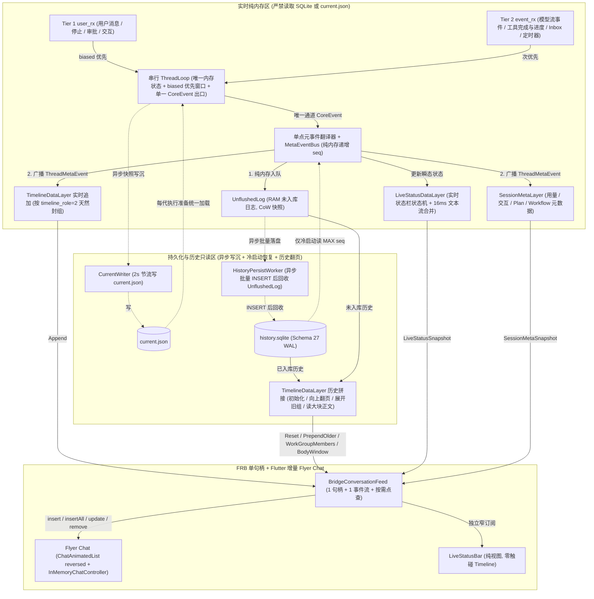
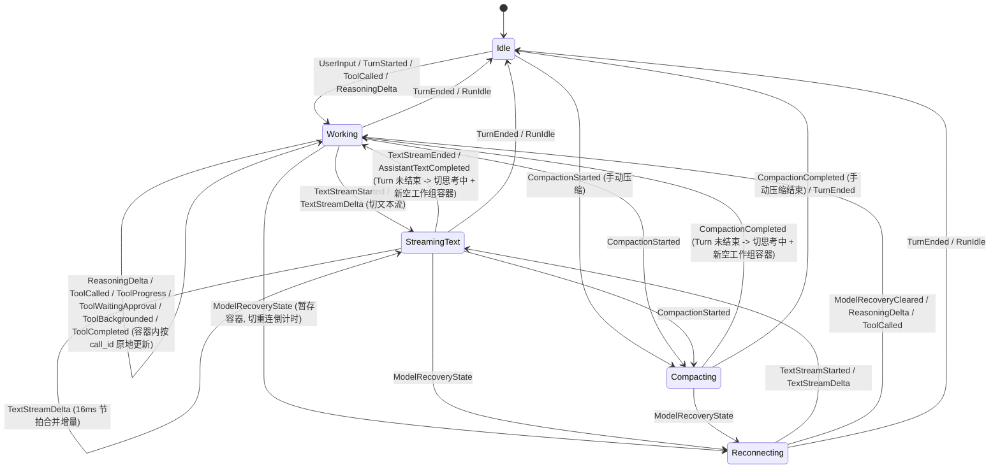
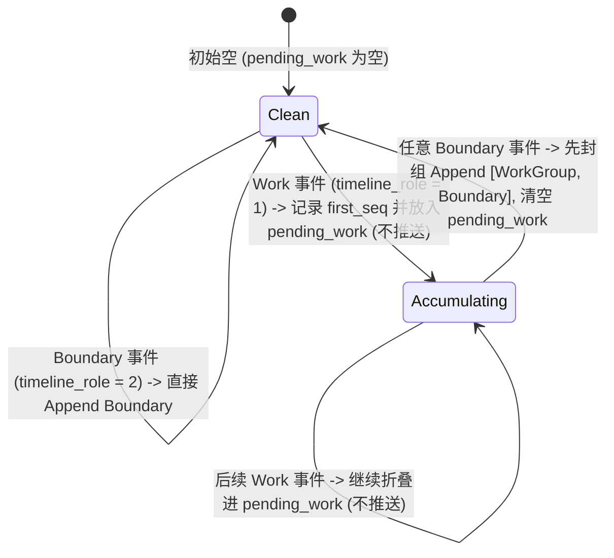

# 26 - Native 时间线、实时状态机与 Flyer Chat 增量接入

本文是 Native 时间线与实时状态栏架构的唯一权威源。线程主循环见 [03](./03-pipeline.md)，单一会话阅读流见 [07](./07-streaming.md)，存储与零读库边界见 [15](./15-session-storage.md)，Schema 27 物理结构见 [17](./17-studio-storage.md)，客户端资源归 [25](./25-frontend-state.md)，视觉规范见 [19](./19-studio-ui.md)。ACP 内容仍由其外部协议定义，不转换成这里的 Native 元事件。

## 26.1 架构全景与职责边界

Native 时间线将「未入库历史 + 已入库历史 + 实时流式广播」的拼接与状态机收敛在 Rust `pl-studio-runtime` 数据处理层中，经单一强类型 `ConversationFeed` 端口向 FRB / HTTP / Flutter 直接交付贴近 Flyer Chat `ChatOperation` 的增量补丁和实时状态栏快照：



## 26.2 `timeline_role` 作为唯一分组隔断定义（Schema 27 零迁移）

主时间线以历史事件的 `timeline_role` 分类决定展示与封组。实时路径直接使用进入内存日志的事件自带的分类和序号，禁止读取持久化信息或等待 SQLite 提交。冷启动和按需历史查询使用同一分类在历史记录上重建分组。Schema 27 沿用现有字段：

- **`timeline_role = 2`（`Boundary`，直接展示与天然隔断）**：用户输入（`input_accepted`）、助手可见完成正文（`text_completed`）、上下文压缩完成（`compaction_completed`）、计划公开决议（`plan_resolved`）、模型或 SSH 连接状态迁移（`connection_disconnected` / `connection_reconnected`）、轮次异常/中断回执（`turn_receipt_recorded`）以及具备独立展示资格的终态工具（问答回执、媒体展示等）。
- **`timeline_role = 1`（`Work`，折叠工作项）**：工具生命周期（`tool_called` / `tool_waiting_approval` / `tool_backgrounded` / `tool_cancel_requested` / `tool_completed`）、推理终态（`reasoning_completed`）、子智能体终态（`agent_completed`）与等待/技能/文件过程事件。不直接推送给主时间线。
- **`timeline_role = 0`（`Hidden`，内部审计与控制）**：`run_*`、`turn_*`、`source_*`、`usage_*`、`parent_report_recorded`、`review_delivery_recorded` 等。不进入主时间线，也不触发封组。

工作组稳定身份使用组内**第一条工作事件的单调序号 `work:<first_work_seq>`**，边界事件使用 `msg:<seq>`。实时和历史都以接下来的 `Boundary` 封组。最新边界之后尚未封口的工作保留为待封组事件，重开或重启时继续等待下一条边界。分页接缝按同一边界归属分组。

## 26.3 双状态机与天然封组时序

### 26.3.1 实时状态栏状态机（`LiveStatusDataLayer`）



Flutter 将 `StreamingText` 呈现为一个实时响应区。区内同一行显示阶段标题和计时，下方随增量更新正文预览。同一条响应按 `itemId` 复用布局。需要用户关注的停止、审批或故障提示由独立的状态处理。

### 26.3.2 主时间线天然封组状态机（`TimelineDataLayer`）



### 26.3.3 未入库与已入库零真空及封组时序图

```mermaid
sequenceDiagram
    participant Loop as pl-core ThreadLoop
    participant Bus as MetaEventBus
    participant Log as UnflushedLog + HistoryDB
    participant TL as TimelineDataLayer
    participant Live as LiveStatusDataLayer
    participant UI as Flutter (Flyer Chat + LiveStatusBar)

    Loop->>Bus: Durable: UserInputAccepted
    Bus->>Log: 1. 纯内存压入 UnflushedLog (分配 seq=10, 后台异步写 SQLite)
    Bus->>Live: 2. 广播 -> 切入 Working 容器
    Bus->>TL: 2. 广播 -> 发 Append UserMsg("msg:10")
    TL-->>UI: TimelinePatch::Append -> Flyer insertAllMessages (旧气泡 0 次重建)

    Loop->>Bus: Ephemeral: ReasoningDelta + Durable: ToolCalled..Completed(seq=11..14)
    Bus->>Log: 纯内存分配 seq=11..14 并入 UnflushedLog
    Bus->>Live: 广播 -> Working 容器按 call_id 原地更新成员
    Bus->>TL: 广播 -> 暂存 pending_work(first_seq=11), 不推送 Timeline

    Loop->>Bus: Ephemeral: TextStreamStarted
    Bus->>Live: 广播 -> 立即切入 StreamingText
    Live-->>UI: LiveStatusBar 切换流式正文 (Timeline 保持静止)

    Loop->>Bus: Durable: AssistantTextCompleted(seq=15) + TurnEnded(seq=16)
    Bus->>Log: 纯内存分配 seq=15..16 -> 后台批量落盘 SQLite 并回收已提交前缀
    Bus->>TL: 从内存事件立即识别 seq=15 为 Boundary
    Bus->>Live: 广播 -> 切回 Idle
    TL-->>UI: Append WorkGroup("work:11") 和 AssistantText("msg:15")
    Live-->>UI: LiveStatusBar 收起
```

## 26.4 混合正文、工作组折叠与单条回退

1. **16 KiB 混合正文**：单正文 `<= 16 KiB` 且单事件累计内联 `<= 16 KiB` 的有效 UTF-8 直接以内联文本交付，首帧直出；超限正文或二进制附件走 64 KiB 分段窗口 `read_body_window`。
2. **工作组展开折叠**：用户点击展开主时间线上的 `WorkGroup("work:<first_seq>")` 时，Rust 侧 `TimelineDataLayer::load_work_group_members` 在 `(history.sqlite ∪ UnflushedLog)` 区间内拉取全部 `timeline_role = 1` 原子事件，按 `call_id` / `entity_id` 折叠为最新态成员列表，并在同进程内对跨区间缺失 `tool_called` 的调用走 `idx_events_call` 补拉参数与契约，一次性交付强类型 `WorkGroupMember` 列表，消除跨 FFI 多次往返和 UI 线程 `jsonDecode`。
3. **单条独立降级**：未知工具契约回退内置 `generic@1` 适配器；未知事件 `kind`、未知 `payload_schema` 或损坏记录在单条原地转为 `Fallback` 卡片，绝不中断整页读取。
4. **复制按钮约定**：用户及上级智能体输入气泡外下方末端对齐显示复制图标；智能体输出中仅 `finish_turn` 成功交付的原始最终正文在下方起始侧显示复制图标（涵盖内联正文与分段正文）；思考项无独立复制按钮。

## 26.5 Flyer Chat 增量接入与零整表重刷约束

Flutter 侧 `TimelineSessionOwner` 与 `TimelineMessageController` 仅维持一个串行队列，将后端 `TimelinePatch` 1:1 映射为 Flyer `InMemoryChatController` 操作：

| 后端 `TimelinePatch` | Flyer `ChatController` 操作 | 已有历史消息重建次数 |
| --- | --- | --- |
| `Reset` | `setMessages(mapped, animated: false)`（并更换 `Chat` widget key） | 仅切会话 / lag 重建时触发 |
| `PrependOlder` | `insertAllMessages(mapped, index: 0, animated: false)` | **0**（反向列表顶部天然锚定不跳动） |
| `Append` | `insertAllMessages(mapped, animated: false)` | **0**（尾部插入仅构建新增行） |
| `Update` | `updateMessage(oldMsg, newMsg)` | **0**（仅目标单行重建） |
| `Remove` | `removeMessage(oldMsg, animated: false)` | **0** |

为根除整表重建，前端必须同时满足以下结构性约束：
- 外层壳体（`StudioShell`、`AgentWorkspacePane`、`SessionHeader`）只通过窄字段 `.select(...)` 订阅低频 `SessionMeta`，严禁把流式 token、`LiveStatus` 或高频用量变化传经包含 `TimelineView` 的父子树；
- `TimelineView` 缓存稳定的 `Builders` 实例，**禁止在 item 外层包装随消息实例变化的 `ObjectKey(message)`**，所有呈现值保持不可变值相等；
- 直接使用 `ChatAnimatedList(reversed: true, ...)`（ACP 会话继续沿用其既有 Flyer Chat 反向列表与内容投影）；用户上滑进入历史浏览模式时暂停应用新到的 `Append`，将其暂存在有界缓冲队列（上限 64 条）并点亮“回到最新”提示；回到底缘时若未溢出直接增量 `insertAllMessages` 补齐，溢出才调用 `reset_to_latest`；
- 时间线滚动条沿用 Flyer Chat 列表从 Flutter 滚动配置获得的桌面滚动条。用户滚动时显示滑块，停止后自动淡出，使用同一个列表滚动控制器。
- 保留全部内置工具适配器（`timeline/tools/items/` 独立实现 + `tool_item_registry.dart` 集中索引，未知工具回退 `generic@1`，`wait` 与 `sleep` 共用适配器管线）、单条未知/损坏 `payload_json` 原地降级回退、待确认 Plan 摘要卡、交互表单/回执、发送临时回显结算（按 `input_id` 消费 `InputPresented`）、子智能体只读底栏、以及底部 `LiveStatusBar`（直连 `LiveStatusSnapshot`，包括模型重试断连倒计时，零触碰主时间线）。
