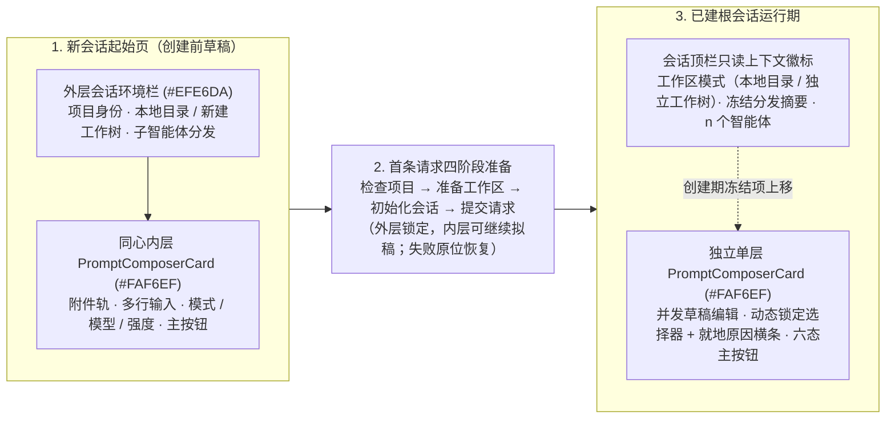

# 会话输入组件化、起始页环境栏与运行期配置锁定设计

状态：统一组件化交互概念稿已就绪（见 [新会话起始页](../prototypes/session-start/index.html)、[会话运行时输入框与配置锁定](../prototypes/session-composer/index.html)、[会话时间线与实时状态栏](../prototypes/live-status/index.html) 及共享实现说明 [conversation-shared](../prototypes/conversation-shared/README.md)）。整体视觉严格保持暹罗浅色主题（Siamese Light Theme）与 Material 3 轻量控件风格不变：其中起始页“外层会话环境栏 + 同心内层主输入卡”属于待桌面生产界面按 [19.2](../19-studio-ui.md#192-动态工作模式与工作流状态) 同步迁移的目标布局，运行期输入框选择器锁定、可见原因反馈、并发草稿编辑与唯一主按钮状态机则与 [19.2](../19-studio-ui.md#192-动态工作模式与工作流状态)、[19.6.1](../19-studio-ui.md#智能体切换菜单与自动标题更新) 及 [19.11](../19-studio-ui.md#1911-运行中发送消息与剪贴板粘贴) 的桌面交互契约保持一致。

## 1. 设计背景与人机工程痛点

在原有会话设计与概念稿组织中存在两类核心问题：

1. **跨页面会话外壳与输入框重复建设**：起始页与会话运行页各自维护独立的外壳、选择器菜单和输入卡片实现，容易在字号、圆角、模型分组菜单、附件芯片与按钮反馈上产生视觉与行为漂移。
2. **创建期一次性冻结配置与运行期动态可配边界缺乏清晰的空间演进**：
   - 会话工作区采用 `local`（直接使用项目目录）还是 `worktree`（新建独立 Git 工作树）以及子智能体分发策略在根会话创建时即永久冻结；原起始页将其藏于输入框左下角无文字图标的二级悬停子菜单中，既难以一眼确认当前空间隔离模式，又极易在斜向移动指针时滑脱子菜单。
   - 会话进入运行期（轮次执行中、上下文压缩中、图工作流活动阶段空闲、停止收束中、模型路由失效、外部机器人接管或切入子智能体只读视图）后，部分配置已永久冻结、部分配置暂时锁定、部分配置仍允许跨轮调整或原地自愈，界面需要明确的组件收敛与锁定反馈规则，避免用户面对“看似能点却毫无反应”或“满屏失效控件”的挫败感。

## 2. 统一会话组件架构：从双层创建台收敛为单层运行卡

设计稿将侧边栏、会话顶栏、时间线、实时状态栏与输入卡统一收敛为单一共享模块（`prototypes/conversation-shared/`），核心输入组件 `PromptComposerCard` 在整个会话生命周期内**复用同一组件结构与样式契约**，仅通过外层托盘的有无和选择器锁定投影表达创建期与运行期的职责转换：

- **创建期（双层同心包边容器，聚焦列宽 `760 logical px`）**：
  - **外层会话环境栏（创建时永久冻结，表面角色 `surfaceContainerLow` `#EFE6DA`，圆角 `12px`，左右下 `3px` 包边）**：左首展示项目文件夹锚点与可选 `SSH · <alias>` 主机徽标；紧随其后采用与整栏视觉语言一致的**紧凑无框下拉触发器**切换 `本地目录` 与 `新建工作树`（选中 `新建工作树` 时以 `#55798C` 眼眸蓝点缀分支图标，下拉菜单内提供选项说明与 `从仓库当前 HEAD 检出独立工作树隔离改动` 副标题，既外显当前工作区模式又节省横向空间）；右端常驻子智能体分发有效摘要下拉触发器（点击展开**单层双区分组菜单**，同层呈现「分发模式」与「自动选模偏好」，固定配置模板下偏好项可见置灰并保留原值，彻底消除二级悬停子菜单）。非项目独立会话（`standalone`）自动隐藏工作区下拉列表，展示不可交互的 `固定本地目录` 标签。
  - **内层主输入卡（每轮输入与主智能体路由，表面角色 `surfaceContainerLowest` / `#FAF6EF`，同心圆角 `9px`）**：
    - **图片缩略图与混合附件草稿轨**：剪贴板粘贴（`Ctrl+V`）或拖放/选择的图片在输入区上方以紧凑视觉缩略图（`86×60px` 圆角卡片，右下角附放大标识，右上角悬浮独立圆形 `×` 移除按钮）横向排布，非图片文件与远程链接保持紧凑文件名胶囊；点击任意图片缩略图即弹出模态大图预览层（展示文件名、来源与像素尺寸，支持适应窗口与 `1:1` 原始尺寸切换、多图 `← / →` 翻看及 `Esc`/点击遮罩关闭并归还焦点），提交进入时间线后的用户消息图片同样保留缩略图点击看大图能力。
    - **多行输入区与对称底部工具栏**：承载多行自适应文本输入区、就地状态说明行与底部对称工具栏（左端纯粹附件按钮 + 宽屏快捷键提示；右端等高 `30px` 排列「工作模式 · 主智能体模型 · 思考强度」三联选择器与 `34×34px` 主操作按钮）。
- **进入已建会话期（外层创建栏退役，单层输入卡圆角 `11px`，与时间线共享 `1040 logical px` 阅读列中心轴）**：
  - 首条请求完成环境准备进入会话后，外层暖米色创建环境栏自动退役，不在运行期输入区保留永远禁用的工作树切换器或分发菜单。
  - 已冻结的工作区事实（如 `独立工作树 · wt/session-a7fd` 或 `本地目录`）与子智能体分发摘要（如 `分发：自动 · 平衡`）作为只读上下文徽标投影在会话顶栏，与顶栏右侧的 `n 个智能体` 切换菜单和「打开工作区」入口形成完整的会话空间头部。

## 3. 会话运行期配置可配性矩阵与锁定交互准则

不同配置项拥有截然不同的状态所有权。运行期输入框遵循以下五条交互铁律：

1. **创建期永久冻结项移出输入卡并保持顶栏等高**：所属项目、工作区模式与子智能体分发在会话创建后不可变更，统一收敛至高 `46px` 会话顶栏中的 `28px` 等高只读标签（不附加冗余锁图标）；子会话「← 主会话」返回按钮置于顶栏左侧，右端 `n 个智能体` 与「打开工作区」按钮位置恒定（通过图标着色提示运行中子任务，不动态插拔圆点），确保主/子会话切换与子智能体启停时顶栏右侧控件零位移。
2. **运行期临时不可配项原位保留、等宽零位移不可交互态**：工作模式、主智能体模型、思考强度在运行期始终保留在输入卡右下角原位（思考强度设置最小定宽 `58px` 避免切换档位时抖动）。不可更改时，**省略锁图标、虚线框与底色块，同时保留与可交互态完全一致的内边距与下拉箭头（`⌄`）几何占位**，仅以无边框、无悬停高亮的柔和置灰不可交互形态（`is-disabled`）安静呈现，并通过悬停 `Tooltip` 说明不可更改原因，确保空闲与运行态切换时三联选择器位置 `0px` 偏移。
3. **活动工作流阶段仅置灰模式、不锁跨轮换模**：当任务模式等图工作流处于活动阶段（如「任务 · 实施」）且当前轮次已空闲时，仅将「工作模式」置为原宽不可交互态以保护工作流阶段图与已批计划；「主智能体模型」与「思考强度」保留正常悬停与点击交互，所选新路由在下一轮立即生效。
4. **模型能力与外部机器人托管精确表达**：当所选模型声明不支持推理强度时，仅「思考强度」单独以不可交互态显示 `—`（悬停提示由模型能力决定）；当会话由外部机器人（如飞书机器人）创建并托管时，模型与推理强度合并为单条只读不可交互标签 `由机器人统一设置`，仅工作模式在空闲且无活动工作流时允许调整。
5. **路由不可用阻断提交但保持换模自愈入口开放**：当前会话绑定的模型被停用或所属账号失效（`unavailable`）时，触发器保留原模型名称、不静默改选其他账号或模型，并在旁边展示显式告警按钮与卡内错误说明，同时禁用发送/继续；此时**主智能体模型选择器本身保持可点击**，用户打开菜单切换至任一可用模型后立即解除阻塞。

| 配置 / 输入项 | 新会话起始草稿 | 首条请求准备中 | 根会话空闲（无活动工作流） | 活动工作流阶段且当前空闲 | 轮次运行中 / 上下文压缩中 | 正在停止（清理收束中） | 已停止（含未消费继续点） | 绑定模型路由不可用（空闲） | 外部机器人托管会话（空闲） | 查看子智能体会话 |
| --- | --- | --- | --- | --- | --- | --- | --- | --- | --- | --- |
| **项目与工作区模式**（`local` / `worktree`） | 外层紧凑下拉可切（非项目固定 `local`） | 外层不可交互态 | 顶栏只读标签 | 顶栏只读标签 | 顶栏只读标签 | 顶栏只读标签 | 顶栏只读标签 | 顶栏只读标签 | 顶栏只读标签 | 顶栏与底栏只读展示绑定空间 |
| **子智能体分发策略** | 外层单层菜单可配 | 外层不可交互态 | 顶栏只读标签 | 顶栏只读标签 | 顶栏只读标签 | 顶栏只读标签 | 顶栏只读标签 | 顶栏只读标签 | 顶栏只读标签 | 不适用（子会话自身即受派成员） |
| **工作模式**（`modeId`） | 可切换（联动该模式默认路由） | 不可交互态 | **可切换** | **不可交互态**（保护活动工作流阶段） | **不可交互态**（悬停提示需等本轮结束） | **不可交互态** | 无活动工作流可切；有活动工作流不可交互 | 无活动工作流可切 | 无活动工作流可切 | 替换为子会话只读底栏 |
| **主智能体模型**（`modelRoute`） | 可切换 | 可预设后续草稿路由 | **可切换**（同步更新该模式默认路由） | **可切换**（下一轮生效，不重置流程） | **不可交互态**（悬停提示运行中不可换模） | **不可交互态** | **可切换** | **保持可切换（带 `⚠` 告警以原地换模自愈）** | **只读不可交互态**（由机器人统一设置） | 只读展示创建时冻结的模板路由 |
| **思考强度**（`effort`） | 按模型声明可切（无支持时不可交互 `—`） | 按模型声明可预设 | **按模型声明可切** | **按模型声明可切** | **不可交互态** | **不可交互态** | **按模型声明可切** | 随模型恢复后可切 | 随机器人路由统一管理 | 随冻结路由只读展示 |
| **多行提示词与附件草稿** | 可编辑 / 拖放 / 粘贴图片 | **可继续拟定下一条草稿** | **可编辑** | **可编辑** | **可并发编辑**（`DraftStamp` 隔离在途回执） | **可继续编辑草稿**（禁提交） | **可编辑**（可空草稿直接继续或补发指令） | **可编辑保留草稿**（换可用模型前禁提交） | **可编辑** | 不可输入（新要求回主会话下达） |

## 4. 并发拟稿与定宽唯一主操作槽位六态状态机

根会话输入卡右下角始终只保留**固定 `34×34px` 的唯一圆形主操作槽位**，不并列摆放多个互相竞争的按钮，也不在状态切换时变更为不同宽度的文字胶囊（过渡态与继续提示统一展示在底栏左侧辅助文字区），从而保证输入首个字符或点击停止/继续时底栏选择器**零水平重排**。主槽位完全由权威执行状态、未消费继续点（`Continuation`）、草稿内容与路由可用性确定性派生：

| 状态分支 | 触发条件 | 控件视觉形态（固定 `34×34px`） | 键盘与点击行为契约 |
| --- | --- | --- | --- |
| **1. 空闲禁用态** | 会话空闲、无未消费继续点且无文本与附件（或路由不可用 / 环境准备中） | `34×34px` 柔和暖灰禁用圆钮（`#D9CAB9` 上箭头 `↑`） | 不可点击；保留草稿编辑能力 |
| **2. 常规发送态** | 会话空闲、路由可用且存在非空文本或附件 | `34×34px` 海豹棕实心圆钮（`#514039` 上箭头 `↑`） | 点击或按未带修饰键的 `Enter` 同步冻结 `DraftStamp` 与路由并提交；`Shift+Enter` 换行 |
| **3. 运行中停止态** | 轮次运行中或正在压缩，且当前草稿文本与附件均为空 | `34×34px` 中性暖灰圆钮（`#D9CAB9` 实心停止方块 `■`） | 点击请求停止当前轮次；输入框聚焦时按 `Esc` 同样请求停止 |
| **4. 发送并继续态** | 轮次运行中**或**已停止待继续，且用户输入了新文本或添加了附件（路由可用） | `34×34px` 海豹棕实心圆钮（`#514039` 上箭头 `↑`） | 点击或按 `Enter` 提交补充消息并继续执行；运行中若只想停止不想发出草稿，按 `Esc` 停止且原样保留草稿 |
| **5. 正在停止收束态** | 停止请求已受理，后台正在终止工具/流并落盘检查点 | `34×34px` 禁用旋转指示圆钮 `◌`（左侧辅助栏提示 `正在停止收束当前执行…`） | 清理真正结束并发布权威空闲快照前，**既不提供继续也不允许提交**，防止竞态重入 |
| **6. 显式继续态** | 已停止且存在未消费继续点、路由可用、当前草稿与附件为空 | `34×34px` 海豹棕实心圆钮 **`▶`**（配卡内与左侧轻量提示，点击继续被中断工作） | **仅由显式点击按钮触发恢复**；空输入框按 `Enter` 不触发继续，防止误触；一旦输入文字或添加附件即原位零位移切入状态 4（`↑` 发送并继续） |

## 5. 特殊停靠态：待决问答暂存、四列对齐智能体目录与子会话只读底栏

- **待决问答 / 审批 / 计划确认停靠态**：当主会话或汇总上来的子智能体产生待决提问、工具审批或计划确认时，实时状态栏收起，输入卡位置切换为分步交互停靠面板。若用户在提问到达前已输入了一半草稿文本或挂有未发送附件，草稿在客户端原封不动暂存，并在问答面板底部显示轻量提示（“已暂存 N 条未发送草稿内容，提交或跳过问答后自动恢复”），决议确认后立即恢复原输入框与全部草稿。
- **四列定宽对齐的顶栏智能体目录与子会话只读底栏**：顶栏 `n 个智能体` 下拉目录采用固定四列网格（`16px` 选中对勾列 · 自适应双行标题与 `角色 · 模型 · 强度` 摘要列 · `56px` 右对齐状态列 · `26×26px` 固定尾部操作槽位）。运行中子智能体在尾部槽位内显示 `24×24px` 方形停止图标按钮 `■`，点击受理后原位变为旋转指示 `◌`、状态列更新为 `正在停止`，已完成或主智能体行保留相同槽位占位，确保任意成员状态流转时各列文字严整对齐、不跳动。切入任一子智能体会话时，底部整体替换为 `子智能体会话（只读）` 状态底栏，用户对子任务的补充指令统一回到主会话表达。

## 6. 响应式断点与人机工程指标

| 维度 | 设计指标与行为约定 |
| --- | --- |
| **双阶段同轴列宽** | 起始页双层创建台最大宽度 `760 logical px` 聚焦视线；进入会话后时间线、实时状态栏与单层输入卡共享 `1040 logical px` 居中阅读列中心轴 |
| **状态切换零位移几何契约** | 顶栏控件与徽标统一高 `28px`；外层与内层底栏选择器统一高 `30px`（不可配时省略锁标并保持相同内边距与箭头占位），主操作圆钮恒定 `34×34px`，输入区下方状态底栏恒高 `24px`，消除状态流转时的水平与垂直抖动 |
| **Material 3 组件与自动隐藏滚动条** | 按钮、卡片、导航项、分步进度、旋转活动指示、芯片与菜单全面对齐暹罗浅色 Material 3 视觉语义；时间线、实时状态栏工作组、侧栏、多行输入与菜单统一采用无常驻白底轨道、无箭头按钮的自动隐藏胶囊滚动条（静止隐藏，滚动或悬停滑块时浮现，停止后自动淡出，不挤压内容宽度） |
| **浮层自适应与焦点管理** | 外层顶栏菜单向下展开，底栏选择器菜单优先向上展开避免视口底边裁切；共享 `PromptComposerCard` 在场景与阶段切换中保持同一 DOM/控制器身份，打字过程中不丢失光标与选区 |
| **窄窗口与无障碍** | 窄于 `600px` 时隐藏键盘快捷键提示与分隔竖线，工具栏按语义组自然换行；所有下拉触发器具备 `aria-haspopup="menu"` / `aria-expanded` 状态，不可交互选择器标注 `aria-disabled="true"` 与悬停原因 `title`，遵循 `prefers-reduced-motion` |
