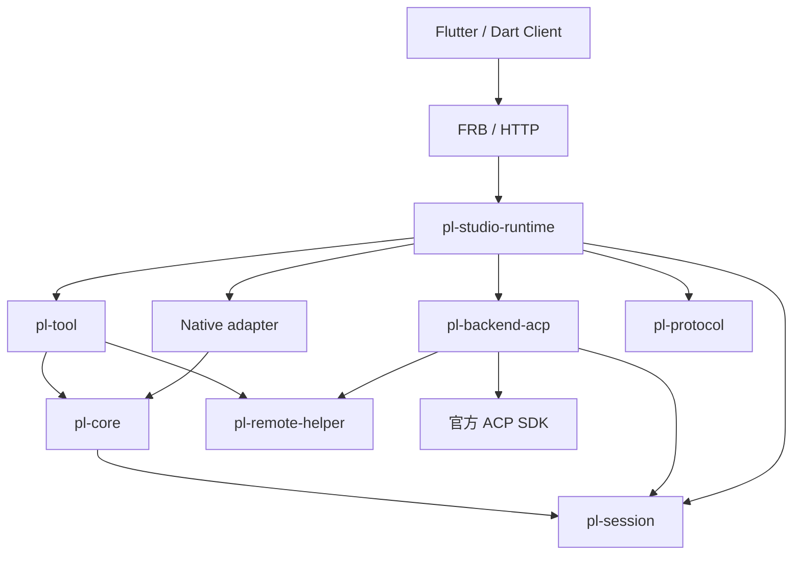
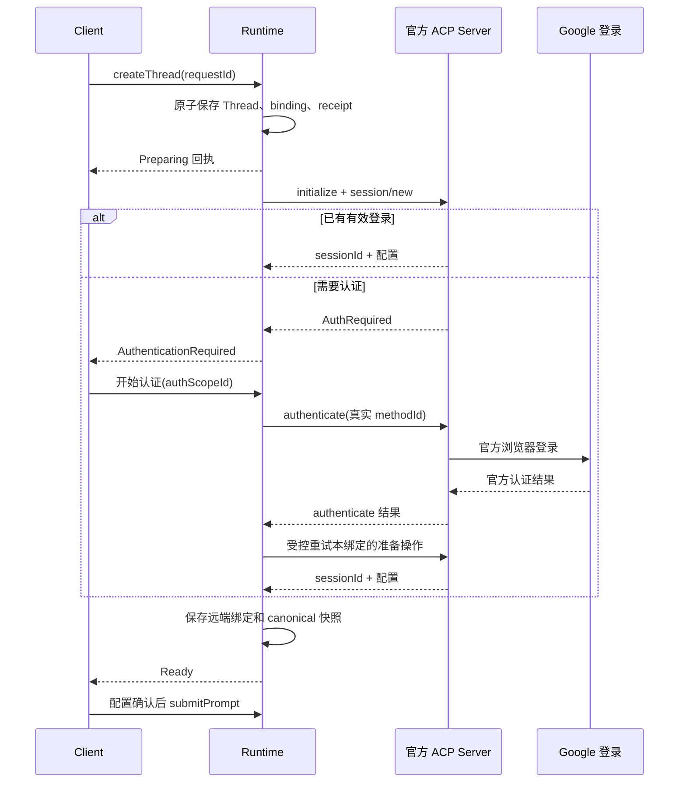

# anywork：Google Antigravity ACP 接入实施文档

**文档版本：1.0 · 交付日期：2026-10-21（Asia/Hong_Kong）**

| 项目 | 基线与约定 |
| --- | --- |
| 目标仓库 | https://github.com/ZR233/anywork |
| 源码基线 | `acf728e75f62a5ffddbb119bdf6b62dcd5491a06` |
| 基线包含 | #126 停止后切换模型；#127 统一退出、更新交接及 Settings 展示 lease 修复 |
| 接入对象 | Google 官方 Antigravity ACP Server；Registry ID 为 `antigravity-acp` |
| 审阅的 server 版本 | `1.4.1`；Registry manifest 固定在 `91d65c2075d644eb1ccc88f7cf6fd0f8507be2fb` |
| ACP 协议 | v1 stable；本期不启用 v2 draft 或 SDK 的 unstable 功能 |
| 官方 Rust SDK | `agent-client-protocol = "=3.4.0"`；实现前以该发布 tag 的 API 编译核对 |
| 已有 MCP SDK | 工作区 `rmcp = "=3.5.1"`，复用并按实际用途增加 server/transport features |
| 改造权限范围 | 允许必要的破坏性架构、协议与调用方重构；不删除用户数据 |
| 本文性质 | 可执行的实施规格和任务分解；没有宣称代码已经实现或 Google 登录已经实测通过 |
| 本期产品形态 | 本地用户直接操作的桌面 ACP 客户端；Windows、Linux 为产品验收目标 |
| macOS | 官方 server 有对应平台包；anywork GUI 的完整 macOS 产品支持不在本期承诺内，可独立验收 headless adapter |

> 本文把“当前源码事实”“本项目新增契约”“供应商尚待验证的行为”分开描述。新增类型、文件、命令和测试入口均是待实施项。Google server、账号认证及内置工具的实际行为由第 14 节的 M0 探针决定，不能把协议支持推定为具体产品已支持。
>
> 这是交接文档，不直接替代仓库设计事实源。建议归档为 `docs/implementation/google-antigravity-acp.md`。实施时把稳定契约分别回写 `design/02、09、15、17、18、20、24、25、26`；源码路径、任务拆分、版本快照和操作步骤保留在本文，遵守现有 `design/README.md` 的写作边界。

## 阅读与执行入口

实施负责人先读第 1–4 节，冻结边界；后端负责人按第 5–10 节实现；前端负责人按第 11 节实现；验收负责人按第 14–16 节执行。第 13 节给出 PR 顺序、依赖和交付物。所有人共同遵守下列决策，避免各自增加第二套会话、认证或工具事实源。

### 章节导航

- [1. 交付目标与冻结决策](#1-交付目标与冻结决策)
- [2. 当前代码中必须保留或改变的边界](#2-当前代码中必须保留或改变的边界)
- [3. 目标架构与所有权](#3-目标架构与所有权)
- [4. 领域合同与公共接口](#4-领域合同与公共接口)
- [5. 官方 Runtime、SDK、启动与配置](#5-官方-runtimesdk启动与配置)
- [6. Google 登录与认证生命周期](#6-google-登录与认证生命周期)
- [7. ACP 会话、配置、流式事件与恢复](#7-acp-会话配置流式事件与恢复)
- [8. 多模态输入、附件与资源](#8-多模态输入附件与资源)
- [9. 可复用 ToolRuntime 与宿主 MCP](#9-可复用-toolruntime-与宿主-mcp)
- [10. 公共内容、可靠存储、迁移与故障恢复](#10-公共内容可靠存储迁移与故障恢复)
- [11. 产品协议、Dart Client、前端与两种传输](#11-产品协议dart-client前端与两种传输)
- [12. 取消、退出、进程回收与打包](#12-取消退出进程回收与打包)
- [13. 实施任务、PR 顺序与并行分工](#13-实施任务pr-顺序与并行分工)
- [14. M0：固定官方 Server 的验真方案](#14-m0固定官方-server-的验真方案)
- [15. 验证策略与执行命令](#15-验证策略与执行命令)
- [16. 发布条件、运行配置与交付验收](#16-发布条件运行配置与交付验收)
- [17. 交接记录模板](#17-交接记录模板)
- [18. 主要依据与固定版本来源](#18-主要依据与固定版本来源)

## 1. 交付目标与冻结决策

### 1.1 要实现的完整用户旅程

1. 用户在设置中添加一个 Antigravity 后端配置，选择已经安装的官方 server。
2. 用户创建工作区会话并选择该后端；anywork 完成进程启动、ACP 握手和必要登录。
3. 从 server 返回的真实配置项中选择模型、模式或其他受支持选项。
4. 用户发送文字及经过能力校验的附件；界面持续展示文本、状态、工具活动和必要交互。
5. Agent 通过 anywork 注入的 MCP 服务使用宿主提供的读写、检索和命令能力；这些调用进入与 Native 后端相同的权限、执行和归档路径。
6. 停止、异常、切换页面、退出、重启和恢复均有明确结果；历史可在没有 Agent 进程、没有网络和没有有效登录时阅读。
7. 新会话切换 Native / ACP 后端，上层 Timeline、Client action 和产品 DTO 使用同一套接口。

“上层无感知切换”指业务调用和内容展示不依赖厂商分支，不承诺两种 Agent 具有完全相同的能力、内部上下文或计费方式。现有会话跨后端继续采用显式新建派生会话，不伪造私有上下文的无损迁移。

### 1.2 决策表

| ID | 必须采用的决定 | 目的 |
| --- | --- | --- |
| D01 | ACP 是完整会话后端，不能实现成 `pl-core::model::ModelSession` | 避免 Native 工具循环与外部 Agent 循环互相嵌套 |
| D02 | 新增 `pl-session` 与 `pl-backend-acp` 两个有明确职责的 crate | 分离公共会话合同与外部协议依赖 |
| D03 | 从现有 `pl-core::chat` 抽取通用内容 owner；不另建 ACP Timeline | 保留分页、尾部流、详情与一致性机制 |
| D04 | `pl-core` 保留 Native Thread 执行 owner；产品 SessionController 留在 Studio runtime | 不复制 Native 状态机 |
| D05 | `ToolRuntime` 留在 `pl-tool`，先解除其对 Native ThreadContext 的业务依赖 | Native 和 MCP 共用同一执行实现 |
| D06 | MCP 使用 stdio 描述；现有 helper 增加本地 IPC 字节桥；宿主运行 rmcp server | 复用标准 SDK，避免把工具暴露成公网服务 |
| D07 | 首版每个 Thread binding 独占一个 ACP 进程 | 硬取消、崩溃和资源回收不影响其他会话 |
| D08 | 认证按执行身份、provider namespace、credentialContextRef 协调；Google 凭据由官方程序管理 | 共享真实认证上下文的配置不重复弹登录，不把 profile ID 当账号隔离 |
| D09 | 创建空会话与提交首条消息分开；配置以会话返回值为准 | 不虚构预会话模型目录 |
| D10 | 同一会话同时最多一个在途 prompt；取消等待终态 | 防止无法归属的文本和重复工具执行 |
| D11 | 输出先按顺序进入统一 ingress，再通过终态屏障结束 Turn | 防止最后一段文本落到下一轮或丢失 |
| D12 | 现役存储 schema v2 数据保全迁移；冷历史不激活 Agent | 破坏性代码重构不等于数据断代 |
| D13 | 首版不宣称 Agent 只能使用宿主工具 | 没有证明就不能提供 confined / host-only 保证 |
| D14 | 不自动使用个人 OAuth 做子代理编排、账号池或共享服务 | 消费版 ACP 编辑器支持不能外推至所有产品形态 |
| D15 | 只使用官方 SDK/现有监督和存储基础设施 | 不自制 ACP/MCP codec，不解析 stderr 作为业务协议 |
| D16 | 结构化能力、错误、快照通过 FRB 与 HTTP 同构映射 | Flutter 不导入 ACP 类型或识别 `backend == google` |
| D17 | 进程启动使用 argv、明确 cwd、环境过滤和进程树监督 | 支持 Windows 路径及完整退出 |
| D18 | server 二进制独立安装；打包再分发须有单独依据 | 专有程序与 anywork 自有代码的发布边界分开 |

### 1.3 本期范围与能力限制

**本期完成：** 本地 server 连接、通用认证状态、文本流、协商后的图片/音频/resource 输入、动态配置、宿主 MCP 基础工具、权限交互、取消、可诊断失败、历史保存、能力允许的恢复、通用前端与现有退出流程接入。

**首版不提供：** 个人订阅下自动编排 Antigravity 子代理、共享账号服务、后台账号轮换、远端个人 OAuth 保证、导入任意外部 Antigravity 会话、运行中原地换后端、SDK unstable 功能、未验证的“关闭全部内置工具”、自动捆绑 Google server。

这些限制是明确的产品能力值。调用方请求不具备的能力时返回类型化错误；不静默降级、不自动改用 API key、不转到其他付费后端。

**主验收场景：** 本地目录项目的直接交互会话。SSH 项目、强约束只读工作区、容器内外混合路径若要求强制宿主独占读写，在相应能力未证明前拒绝 Antigravity 激活，继续使用已满足约束的 Native 后端。

## 2. 当前代码中必须保留或改变的边界

所有路径均相对上述固定提交。实际编辑前必须检查当前 HEAD 的同名符号与变更；不能用本次调研快照覆盖后续修复。

| 当前入口 | 当前责任/耦合 | 本期动作 |
| --- | --- | --- |
| `code/pl-core/src/chat/{session,history,item,tail}.rs` | 通用内容分页、尾部订阅、详情与有界缓存，但部分内容类型来自 core/model | 通用部分移动到 pl-session；Native 专有上下文辅助函数留 core |
| `code/pl-core/src/thread/` | Native Thread owner、模型/工具循环、checkpoint/effect | 保留执行职责；改为消费公共 Session 内容合同 |
| `code/pl-studio-runtime/src/thread_assembler.rs` | Native Thread 装配 | 保留 Native 工厂；新增统一 Backend 选择入口 |
| `code/pl-studio-runtime/src/studio/runtime/prompt_runner/` | 产品输入受理、激活、停止、交互 | 提取通用准入与控制；Native 逻辑通过 adapter 进入 |
| `code/pl-studio-runtime/src/studio/thread_projection/` | Native effect 到产品内容的唯一投影 | 保留单 owner；增加 ACP 输入事件适配，不另开页面专用投影 |
| `code/pl-studio-runtime/src/studio/storage/thread_writer.rs` | 每会话有序可靠队列、effect/checkpoint 原子保存 | 扩展为分后端提交联合体；沿用可靠队列和预算 |
| `code/pl-tool/src/{workspace_file,command,exec}/` | 物理文件、进程及工具控制 | 提取可脱离 Native Thread 调用的执行入口 |
| `code/pl-tool/src/mcp/` | 当前主要是 anywork 作为 MCP client 接外部工具 | 原有方向继续保留；新增 `mcp_server`，不能把 client 实现反过来复用 |
| `code/pl-remote-helper/src/process.rs` | 跨平台进程创建策略 | 扩展可监督的 stdin/stdout 管道能力，交官方 ACP SDK 使用 |
| `code/pl-remote-helper/src/main.rs` | 现有部分 worker/SSH 入口仅 Linux 可用 | 新增独立跨平台本地 MCP 字节桥入口；不借用 Linux-only worker |
| `code/anywork_client/lib/studio_ports.dart` | 产品 Client 的传输无关端口 | 新增后端配置、认证、能力和创建合同 |
| `code/anywork_client/lib/src/studio/drafts/start_session_draft_owner.dart` | 创建草稿依赖 Native account/model 选择 | 改为 backend selection；Native 路由仅 Native 分支必需 |
| `code/anywork/rust/src/api/studio/` | FRB 手写 DTO/handler 边界 | 映射新的产品合同，生成文件统一重生成 |
| `code/pl-studio-server/` | HTTP 产品适配，当前限制 loopback/same-origin | 保持现有网络边界；不随 ACP 接入开放公网 |
| `code/anywork/lib/src/app/studio_shutdown.dart` 等 | #127 类型化退出、更新准备和安装交接 | 把 ACP 与 bridge 纳入同一收束报告，保留 lease 回收 |
| `code/anywork/test/client/session_selector_sync_test.dart` | #126 停止后可切模型回归 | 保留行为：Turn idle 与 workflow active 分别判断 |

### 2.1 已有工程约束

- Rust 异步领域接口使用原生 RPITIT 并显式保证 `Send`，不引入 `async_trait` 或 `allow(async_fn_in_trait)`。
- 运行期异构后端只有 Native/ACP 两类，使用 enum 分派；不要把包含 RPITIT 的 trait 当成 `dyn Trait`。
- ID 的产品 wire 类型保持 String；时间为 Unix 秒 i64；serde 使用 camelCase。
- Dart Client 不依赖 Flutter/Riverpod/FRB；页面不依赖 transport 或 Client 私有实现。
- 所有生成输入修改通过 `cargo xtask generate-gui` 生成；不手改 FRB、Freezed、Riverpod、l10n 输出。
- 现有 AGENTS 与测试技能限制新增 Rust 测试的位置。第 13 节 PR-01 必须先同步 AGENTS、design/24 和 test-quality 的项目特例，再新增公共会话与 ACP adapter 的合同测试。不是默认放宽到任意 crate 私有测试。

### 2.2 证据级别

| 等级 | 本文含义 |
| --- | --- |
| S | 当前固定源码中可以定位的事实 |
| P | 官方协议、SDK 发布源码或 Google 正式文档明示的行为 |
| D | 本文为 anywork 确定的实现决定 |
| V | 需要对固定 server/platform/auth route 执行 M0 才能确认 |
| L | 发布许可或产品使用边界，需要与技术验收分开记录 |

不得用 P 代替 V：例如 ACP 定义了图片或 loadSession，不能证明 Antigravity 这个版本在该账号下支持它。

## 3. 目标架构与所有权

### 3.1 Cargo 依赖方向



图中箭头表示静态依赖，不表示网络消息方向。Native adapter 首版是 runtime 内部模块，不为简单转发额外建立 crate。既有 `pl-model → pl-core`、`pl-tool → pl-model` 保持；SDK 类型不得扩散到 pl-session、pl-protocol 或 Dart。现有 helper 对 pl-protocol 的依赖保持；新 bridge 不反向依赖 pl-tool/runtime。

抽取 chat 时，必须把 `pl-core::model` 内通用 ContentBlock、baseline、increment 等值类型一并抽入 pl-session；Native Model/Request/上下文转换仍留原生层。不能让 pl-session 为复用这些值反向导入 pl-core。全仓消费者迁移到真实类型拥有者，完成后删除旧路径转发别名。

### 3.2 各层职责

| 模块 | 唯一拥有的状态 | 明确不拥有 |
| --- | --- | --- |
| pl-session | 通用内容、分页/尾流/详情合同，后端中立的输入/事件/错误类型 | Google 配置、模型厂商凭据、工具实现、GUI 几何 |
| pl-core | Native Thread 执行、Native 模型上下文、Native checkpoint/effect | ACP 请求、Google 登录、产品后端选择 |
| pl-backend-acp | 活动 ACP 连接与远端 session handle、协议协商、事件映射、顺序屏障 | 产品数据库、持久 binding、Google token 解析、物理工具执行 |
| pl-tool | ToolRuntime、权限执行入口、工具结果和资源归档接口、MCP server 门面 | Agent 推理循环、产品页面状态 |
| pl-remote-helper | 进程监督与本地 IPC 字节桥 | MCP 工具语义、模型和项目权限决策 |
| runtime SessionController | 产品输入准入、持久绑定、后端命令调度、唯一产品投影和业务状态发布 | Native 内部模型循环、第二套 Timeline |
| runtime AuthCoordinator | 跨会话认证协调与结果可见性 | 官方 OAuth token/refresh 实现 |
| runtime storage writer | 可靠提交队列、数据库事务、水位与保存失败 | 重新执行工具、猜测外部 Agent 内部 checkpoint |
| Dart Client | 命令意图、草稿、观察范围、canonical snapshot reducer | 物理进程所有权或厂商协议解析 |

### 3.3 关键资源关系

- **产品 ThreadId**：继续使用现有产品身份；不再新增一层对外 ConversationId。
- **BackendProfileId**：用户配置的可复用后端实例，例如同一官方安装和认证环境。
- **BackendBinding**：某一 Thread 对某一配置快照和工作区的绑定。
- **BindingId**：逻辑绑定的稳定身份；同一绑定重启进程不更换它。
- **ConnectionEpoch**：每次启动或重新附着物理连接递增，先保存再准入；迟到回调必须校验。
- **IngressSeq**：仅在同一 `(bindingId, connectionEpoch)` 内比较的输入顺序，新连接可以重新起号。
- **RemoteSessionId**：Google/其他 ACP Agent 返回的不透明身份，独立于 ThreadId。
- **TurnId / InputId / ClientRequestId**：分别表达执行轮次、输入事实和调用方重试幂等性，不能混用。
- **ToolOperationId**：宿主接受一次物理工具动作的稳定身份，与 Agent 的展示用 toolCallId 分开。

同一 Thread 可以经历多次连接，但同一时刻仅一个有效 binding owner。首版创建后不原地更换 BackendProfile；显式“用另一后端继续”创建新的 Thread 并引用来源。

### 3.4 生命周期不变量

1. Runtime 是物理会话、进程及工具服务的 owner；页面订阅只是观察租约。
2. 每个 Thread 同时只有一个 prompt。停止过程中仍属于在途，不开放新 prompt。
3. 所有通知和终态经同一有序 ingress，按 epoch 和 seq 准入。
4. 所有历史事实只交给现有可靠 writer；缓存驱逐不删除事实。
5. 认证、权限询问、文件 I/O、进程等待不能阻塞 ACP dispatch loop。
6. 工具 gate 只为当前 binding 中仍有效、未进入取消/终态且准入 gate 开启的执行 Turn 接受新调用；WaitingInteraction 不是取消，合法权限回复仍可完成。
7. 取消先关新工具准入，再取消在途任务；已发生的动作保留结果或不确定状态。
8. 任何恢复都不能自动重新执行无法证明尚未执行的 prompt 或工具。
9. Google server 不在线不影响冷历史浏览；打开历史不触发登录。
10. 文本、工具、配置和状态的显示由同一产品合同承接，Flutter 不依据厂商名称分流。

## 4. 领域合同与公共接口

以下 Rust 是**接口形状伪代码**，用于固定所有权、合法状态和 future 语义；不是已编译补丁。实现时使用现有 ID、新类型及错误设施，不机械增加仅转发一层的 manager。全文 proposed DTO 以本节为准，后续章节细化行为。

### 4.1 产品创建合同与准备状态

`CreateThreadRequest/Reply` 归 pl-protocol；Native 路由 DTO 仍属于原生产品配置。runtime 的 `BackendSelection` 是校验、解析后的内部对象，不能和 wire DTO 混用。pl-session 不依赖 pl-core、pl-model、pl-protocol、runtime 或 ACP SDK。

```rust
// pl-protocol 产品 DTO；serde camelCase，所有公开 ID 为 String。
pub struct CreateThreadRequest {
    pub client_request_id: String,
    pub workspace: WorkspaceSelection,
    pub backend: NewThreadBackendSelection,
    pub host_workflow: HostWorkflowSelection,
    pub title: Option<String>,
}

pub enum NewThreadBackendSelection {
    Native { route: NewThreadModelRoute },
    Acp {
        profile_id: String,
        expected_profile_revision: u64,
    },
}

pub struct CreateThreadReply {
    pub client_request_id: String,
    pub thread_id: String,
    pub binding_id: String,
    pub preparation: ThreadPreparationState,
}

pub enum ThreadPreparationState {
    Preparing,
    AuthenticationRequired { auth_scope_id: String },
    Ready {
        capabilities: SessionCapabilitiesSnapshot,
        configuration: SessionConfigurationSnapshot,
    },
    Failed { failure: BackendFailureDetail },
}
```

Native 继续使用原有账号与模型路由 owner，不为统一外观再创建一份 Native BackendProfile。选择器展示两种 typed entry；Native 分支冻结并校验原生 route，ACP 分支冻结 profile ID/revision。进入通用 SessionController 后，业务命令、内容读取和状态流使用同一合同。

**创建回复表示本地持久化受理，不表示远端已准备完成。** 同一 catalog 数据库事务保存空 Thread、不可变 binding descriptor、冻结的 workspace/backend 选择以及 clientRequestId/digest/receipt，再返回。任何登录、远端 session/new 或用户选项确认都不能占住 FRB/HTTP 创建请求。相同 request ID/digest 返回同一 Thread/binding；同 ID、不同内容报冲突。

后台准备使用现有 Thread owner 和 `ThreadSnapshotFrame / ThreadNotificationFrame` 推进，不新建通用 OperationManager，也不增加公开 activationOperationId。HTTP 准备中可返回 202，FRB 返回相同语义的回执。Ready 才包含真实 canonical 配置；远端返回空集合时可显示“由 Agent 决定”，查询前不能伪造这个结果。

catalog 和每 Thread history DB 不是一个跨文件事务。不可变 descriptor 与 create receipt 在 catalog 原子提交；remoteSessionId、connectionEpoch、配置和执行事实由每 Thread writer 持久化。两处各有唯一权威字段，不复制第二份可写远端状态。创建受理后 history 尚未建立或准备失败，保留同一空 Thread 并报告 Preparing/Failed；不能删除后重新创建。更细的故障恢复见第 10 节。

HostWorkflow 与 Agent mode 分开。首版 Google 只允许直接交互的宿主工作流；不能将远端 plan/build mode 映射为 anywork 的子代理编排。创建 Thread、设置选项、提交首条 prompt 是三个可独立结算的命令；create 和 prompt 各持有自己的 clientRequestId。

### 4.2 内部绑定、身份与校验

```rust
// runtime 内部模型；向 pl-protocol 暴露单独的 typed view。
struct BackendBinding {
    binding_id: String,
    thread_id: String,
    connection_epoch: u64,
    workspace: WorkspaceBinding,
    backend: BackendBindingState,
}

enum BackendBindingState {
    Native(NativeBindingState),
    Acp(AcpBindingState),
}

struct AcpBindingState {
    profile_id: String,
    captured_profile_revision: u64,
    credential_context_ref: String,
    runtime_fingerprint: RuntimeFingerprint,
    remote_session_id: Option<String>,
}

// pl-session 的后端中立事件身份。
pub struct BackendEventEnvelope {
    pub thread_id: String,
    pub binding_id: String,
    pub connection_epoch: u64,
    pub ingress_seq: u64,
    pub turn_id: Option<String>,
    pub event: BackendEvent,
}
```

bindingId 稳定，connectionEpoch 在替换物理连接时递增，ingressSeq 仅在该连接代次内有序。旧 epoch 的更新、配置响应、工具完成和权限回复只能结算旧任务，不能写入新绑定。共享认证独立使用 authScopeId、scope revision、authAttemptId；某个 Thread 消失不使同 scope 的合法登录结果失效。

配置 stamp 至少含 bindingId、connectionEpoch 和 configurationRevision。submit 校验该 stamp；cancel 校验 bindingId/connectionEpoch/turnId；交互回复校验 interactionId/revision 及其绑定和 Turn；不接受只凭 ThreadId 发出的迟到操作。现有 Thread 状态 revision、Timeline version、item revision、saved 水位各保留原义。

跨后端继续必须新建 Thread 和 binding。可选 `sourceThreadId` 与用户确认的上下文转移记录表达来源；它不是 ACP session/fork，也不是 Native checkpoint 的跨引擎迁移。

### 4.3 能力合同

```rust
pub struct BackendCapabilities {
    pub input: InputCapabilities,
    pub configuration: ConfigurationCapabilities,
    pub restore: RestoreCapabilities,
    pub auth: AuthCapabilities,
    pub tools: ToolCapabilities,
    pub execution: ExecutionCapabilities,
}

pub enum CapabilityAvailability {
    Unknown,
    Unsupported { reason: CapabilityReason },
    AdvertisedUnverified,
    Available,
}

pub struct RestoreCapabilities {
    pub load: CapabilityAvailability,
    pub resume: CapabilityAvailability,
}

pub enum ToolAuthority {
    HostEnforced,
    BackendManaged,
    Unverified,
}
```

有效能力是**协议声明 ∩ 宿主实现 ∩ 当前会话事实 ∩ 已验收 profile 约束**。协议声明、验收结果和有效能力分别保存，UI 展示有效值及不可用原因。load/resume 可同时支持；本次实际采用哪种恢复方式、上下文是否完整，由恢复结果另行表达。

Google 初始 ToolAuthority 为 Unverified，要求宿主独占工具的 HostOnlyToolExecution 为 Unsupported；只有取得可强制执行且已验收的边界才可升为 HostEnforced。关闭 ACP fs/terminal、成功使用一次 MCP 或提示词要求“只用 MCP”均不足以升级。

未返回 usage/cost 用 unknown/unsupported 表达，不能填 0。模型选项来自 canonical config；没有选项不生成虚构目录。配置变更后重新计算附件与执行模式准入。

### 4.4 后端命令、工厂与观察

runtime 对 Native/ACP 用 enum 分派。领域异步 trait 使用 RPITIT + Send；不能直接把含 RPITIT 的 trait 当作 dyn Trait。需要局部对象擦除时显式定义 BoxFuture 边界，不能将其扩散为全仓默认。

```rust
pub trait BackendSession: Send + Sync {
    fn submit(
        &self, request: BackendPrompt,
    ) -> impl Future<Output = Result<DispatchReceipt, BackendError>> + Send;

    fn cancel(
        &self, turn: TurnIdentity,
    ) -> impl Future<Output = Result<CancelReceipt, BackendError>> + Send;

    fn configure(
        &self, patch: SessionConfigPatch,
    ) -> impl Future<Output = Result<SessionConfigSnapshot, BackendError>> + Send;

    fn respond_interaction(
        &self, response: BackendInteractionResponse,
    ) -> impl Future<Output = Result<InteractionResponseReceipt, BackendError>> + Send;

    fn close(
        &self, reason: CloseReason,
    ) -> impl Future<Output = Result<BackendCloseReport, BackendError>> + Send;
}

pub enum BackendEvent {
    TextDelta(TextDelta),
    ToolObservation(ToolObservation),
    InteractionRequested(InteractionRequest),
    ConfigurationChanged(SessionConfigSnapshot),
    UsageObserved(OptionalUsage),
    PlanChanged(PlanProgress),
    TurnTerminal(TurnTerminal),
    ConnectionFailed(BackendFailure),
}
```

submit 回执只表示本地调度/transport 阶段，不证明 Agent 已执行，也不表示 Turn 完成。产品 CommandReceipt 在 durable admission 后返回，最终结果通过唯一有序 ingress 归约。cancel 有独立优先路径，不排在等待完整 prompt 的 future 后面。drop 一个等待 future 不撤销已发生的外部动作；登记的 owner 继续收尾。

工厂分为 `SessionBackend::connect` 与 `BackendConnection::open_session(New | Restore)`。Connection 持有 transport/进程树和 close/join，Session 持有 Native handle 或 ACP remoteSessionId。Connection 的 Observation 使用关联类型：Native 保留现有 Arc<ThreadWrite> 交接，ACP 提交后端中立观察；runtime 统一投影。**不要求 Native 原始 effect 再复制成一套公共事件日志。**

ObservationSink 有界、可关闭、有背压；内容 owner/可靠 writer 的存活不依赖 UI 订阅。流式预览允许有界合并，执行事实、交互决议、终态、配置确认和保存回执不得被 UI 背压丢弃。扩展 JSON 只允许存在于明确的协议扩展或脱敏诊断边界。

HostServices 仅为 runtime 对已有 workspace lease、ToolRuntime、permission broker、resource store、supervisor 的组合。adapter 只收到中立端口和已验证的 launch/MCP specs，不导入 runtime 或 pl-tool。ToolService 端口归 pl-tool，runtime 实现；Native 物理工具适配继续使用原生 admission/fence。

### 4.5 错误与恢复动作

| 错误 | 产品显示/可用操作 | 自动处理限制 |
| --- | --- | --- |
| BinaryMissing / InvalidLaunch | 选择安装路径、重新检查 | 不自动下载另一个版本冒充修复 |
| ProtocolMismatch | 显示双方版本与支持范围 | 不自动启用 v2/unstable |
| AuthenticationRequired | 登录后继续受阻操作 | 不自动打开无限个浏览器 |
| AuthenticationCancelled | 保留草稿与会话，允许重试 | 不宣称凭据已撤销 |
| CapabilityUnsupported | 显示具体不支持的附件/配置/工作区约束 | 不丢弃输入或放宽约束 |
| Busy / Cancelling | 等待当前轮终态 | 不并发提交第二个 prompt |
| PermissionDenied | 保留拒绝事实与工具失败结果 | 不换工具重试同一被拒动作 |
| TransportClosed / ProcessExited | Turn 标记 Interrupted；提供恢复/新建 | 不把 EOF 当 Completed |
| DispatchOutcomeUnknown | 显示请求可能已执行，人工决定后续 | 不盲目重发 |
| ResourceLimitExceeded | 展示具体预算与诊断；按能力显式恢复/新建 | 不重置计数掩盖积压，不自动重发 |
| StorageBlocked | 暂停新推理/工具准入，保留可靠队列 | 不清库、不丢队列制造成功 |
| RemoteSessionUnavailable | 保留历史；显式新建继续 | 不生成新的 remote ID 后标“原会话已恢复” |
| ConfigurationConflict | 刷新 canonical 配置并保留草稿差异 | 不覆盖别人更新 |
| ShutdownDegraded | 进入既有退出报告 | 不标记 clean 或允许依赖 clean 的安装交接 |

对外错误包含稳定 code、phase、可恢复动作和脱敏 diagnosticId；原始 source 保留后端诊断，不把 token、授权码或完整输入拼入 error 字符串。

## 5. 官方 Runtime、SDK、启动与配置

### 5.1 固定版本与升级边界

| 对象 | 本次固定值 | 证据 |
|---|---|---|
| ACP wire protocol | v1，`protocolVersion = 1` | P：[初始化][PROTO-p-init]；官方将 v2 标为 Draft |
| ACP Rust SDK | `agent-client-protocol = "=3.4.0"` | P：[v3.4.0 发布][PROTO-sdk-release]；tag 对应 commit `4f82aef0e7559a50c2b95aff4f7ba60af10d9e04` |
| SDK schema 依赖 | `agent-client-protocol-schema = 1.12.0`，由 SDK 固定 | P：[SDK workspace Cargo][PROTO-sdk-cargo]；[schema v1.12.0][PROTO-schema-agent] |
| SDK 工具链下限 | Rust 1.88.0；SDK 使用 edition 2024 | P：[SDK Cargo][PROTO-sdk-cargo] |
| Antigravity 构件 | 官方 `antigravity-acp` 1.4.1 | P：[固定 registry manifest][PROTO-agy-registry] |
| registry 审阅基线 | `91d65c2075d644eb1ccc88f7cf6fd0f8507be2fb` | P：[manifest][PROTO-agy-registry] |
| 协议资料审阅快照 | `14edb4cd0ebbee9ae5837d4a5a8522236de5c067` | P：[官方协议仓库][PROTO-protocol-pin] |

这些是审阅固定版本，不是自动追踪 latest 的策略。更新 SDK、schema、server、registry、profile 配置或工具隔离策略，都必须生成新的兼容性记录。运行中的绑定继续使用启动时固定构件，禁止原地替换其二进制。

### 5.2 ACP v1 与 v2 Draft 分开

首版不启用 SDK 的 `unstable`、`unstable_protocol_v2`、`unstable_mcp_over_acp`、`unstable_session_fork` 等 feature。`session/list`、`session/resume`、`session/close`、`session/delete`、`logout` 只按 v1 各自能力启用；不要继续使用“这些一律 unstable”的旧判断。

v2 Draft 已改变认证方法名、prompt 完成判定、恢复、能力结构和 MCP 传输表示：例如 v2 的 prompt 响应表示接受请求，结束依赖状态更新；它不能套用下文 v1 的终态规则。v2 还移除了 v1 的客户端 fs/terminal 执行面，并调整 stdio/SSE 支持。这里只记录迁移边界，不实现兼容猜测。服务端若协商返回非 1 版本，断开并返回 `ProtocolVersionUnsupported`。未来 v2 应以独立 wire adapter 和完整验收接入。[P：[v2 migration][PROTO-p-v2]]

### 5.3 Cargo、执行器和 SDK 接线

建议初始依赖声明如下；其余 Tokio、process-wrap 依赖沿用 workspace，提交 lockfile。

```toml
agent-client-protocol = { version = "=3.4.0", default-features = false }
tokio-util = { version = "0.7", features = ["compat"] }
```

3.4.0 的实际集成形态是 `Client.builder()`、typed callback、`ConnectionTo<Agent>` 和 `ByteStreams`。该路线能使用 `Send` future；不要求旧版本的 `async_trait(?Send)`、`LocalSet` 或自建单线程 runtime。因此应遵守项目现有 RPITIT + `Send` 规则，不增加 `async_trait` 例外，也不假设 RPITIT trait 可以直接构造成 `dyn Trait`。运行时 backend 选择由`4.4 的 enum dispatch 完成。[P：[SDK API][PROTO-sdk-jsonrpc]、[官方连接说明][PROTO-sdk-connections]]

`ByteStreams::new(outgoing, incoming)` 的顺序不可反置：传入 agent stdin 写端及 stdout 读端；Tokio 端点分别使用 `compat_write()` 和 `compat()`。stderr 由 supervisor 独立消费，不能接入 ACP parser。核心 SDK 此路线无需 `process` 或 `stdio` feature。[P：[ByteStreams 源码][PROTO-sdk-jsonrpc]、[feature 定义][PROTO-sdk-package]]

以下是接口连接关系的设计伪码，省略项目错误与 actor 类型，不是已编译的实现：

```rust
let owned_child = supervisor.spawn(typed_launch).await?;
let transport = ByteStreams::new(
    owned_child.take_stdin()?.compat_write(),
    BudgetedRead::new(owned_child.take_stdout()?, profile_limits).compat(),
);

Client.builder()
    .name("anywork")
    .on_receive_notification(update_ingress, on_receive_notification!())
    .on_receive_request(permission_dispatch, on_receive_request!())
    .on_close(connection_closed)
    .connect_with(transport, binding_command_loop)
    .await
```

`binding_command_loop` 存活期覆盖整个绑定；不在第一次 initialize、new session 或 prompt 完成后直接返回。后台 EOF 会使未完成请求失败，但 `connect_with` 不会替应用取消所有无关 foreground 工作；实现必须消费关闭信号并结束自身 actor。[P：[连接生命周期][PROTO-sdk-connections]]

### 5.4 生产进程监督与启动规格

必须通过 `pl-remote-helper` 的现有进程设施实现 typed launch，使用其 owned wrapper 路线 `wrap_background_command`。它统一处理 Unix 进程组与 Windows Job Object 等策略。不要在 ACP crate 内复制 spawn 工厂、重复覆盖 Windows flags，或使用留给安装替换的 handoff 启动器。[P：[项目 process.rs][PROTO-anywork-process]]

SDK 的 `AcpAgent` 是官方便利 transport，可用于理解示例；**它不是本方案的生产或 M0 启动路径**。生产与验真都使用相同 supervisor、env 解析、cwd、stdio 管道、资源限制、关闭和子进程清理实现，避免“探针能用，产品不能用”的双轨结果。

typed launch 至少携带以下互相独立的信息：

| 字段 | 约束 |
|---|---|
| `program` | 从审阅构件目录解析出的绝对路径；不经 shell 寻址 |
| `args` | 字符串数组，精确保留 registry 参数；不拼接命令字符串 |
| `launchWorkingDirectory` | 明确的绝对目录；建议采用 workspace root，并在 M0 以此验证 |
| `sessionWorkingDirectory` | 发送给 new/load/resume 的绝对工作区路径；不能拿安装目录替代 |
| `environment` | 根据 profile 和项目环境策略解析；secret 用 secret 引用注入，不写日志 |
| `executionEnvironmentId` | agent 与 MCP gateway 的实际运行环境；首版不将本机路径当远程路径 |
| `artifactIdentity` | registry commit、server 版本、OS/arch、归档和可执行文件摘要 |
| `credentialContextRef` | 认证上下文的元数据引用，不含 OAuth secret；不由 thread/sessionId 推导 |

保留父环境中确有用途的桌面、证书、代理、keyring 环境；以项目已定义的 allowlist/secret policy 解析，不调用 shell profile 获取任意变量。不要为了配置 Google profile 改写进程级 `HOME`、用户 shell 文件或其他 agent 的变量。

### 5.5 官方平台构件与精确参数

下表逐项来自审阅固定 manifest；`program` 均先相对安装目录解析成绝对路径。表内命令是配置数据的可读表示，生产实现不通过 shell 执行。[P：[registry][PROTO-agy-registry]]

| 平台 | 官方 archive URL | program | args |
|---|---|---|---|
| macOS arm64 | [darwin-arm64.zip](https://dl.google.com/agy-extensions/releases/macos/agy-acp-server-1.4.1-darwin-arm64.zip) | `agy_acp_server.par` | `[]` |
| macOS x86_64 | [darwin-x86_64.zip](https://dl.google.com/agy-extensions/releases/macos/agy-acp-server-1.4.1-darwin-x86_64.zip) | `agy_acp_server.par` | `[]` |
| Linux arm64 | [linux-arm64.zip](https://dl.google.com/agy-extensions/releases/linux/agy-acp-server-1.4.1-linux-arm64.zip) | `agy_acp_server.par` | `["--uid="]` |
| Linux x86_64 | [linux-x86_64.zip](https://dl.google.com/agy-extensions/releases/linux/agy-acp-server-1.4.1-linux-x86_64.zip) | `agy_acp_server.par` | `["--uid="]` |
| Windows arm64 | [windows-arm64.zip](https://dl.google.com/agy-extensions/releases/windows/agy-acp-server-1.4.1-windows-arm64.zip) | `agy_acp_server.exe` | `[]` |
| Windows x86_64 | [windows-x86_64.zip](https://dl.google.com/agy-extensions/releases/windows/agy-acp-server-1.4.1-windows-x86_64.zip) | `agy_acp_server.exe` | `[]` |

Linux 的 `--uid=` 是一个带空值的完整参数，不能删去，也不能擅自替换成当前 UID。不要附加猜测的 `--acp`、`--stdio` 或 headless 参数。对运维手工检查，等价启动形式分别为 `'/absolute/path/agy_acp_server.par'`、Linux 再加 `'--uid='`、PowerShell 的 `& 'C:\absolute\path\agy_acp_server.exe'`；这些不替代产品 supervisor。

安装实现应使用不可变版本目录，防止归档路径穿越，保留原有配套文件与权限，记录 OS 构件验证结果。当前 manifest 未提供预期 SHA-256；工程不得填入臆造值，也不能把首次下载自己算出的 hash 当作独立来源认证。应记录实际归档及可执行文件摘要，结合官方分发域名、可用的平台签名和项目发布审核形成构件记录。安装、签名及启动在本文均未执行。

### 5.6 Google settings 的所有权

Google 记录的 ACP settings 路径为 `~/.gemini/antigravity-acp/settings.json`；设置 `GEMINI_HOME` 后，改为该目录下的 `antigravity-acp/settings.json`。Gateway 模式除注入环境变量外，还要求 `auth.type = "gateway"`；不能直接套用 CLI 仅靠 gateway URL 的行为。ACP gateway 的协议限制也应按该文档核对。[P：[Cloud ACP settings][PROTO-agy-gateway]]

实现两种显式配置模式，UI 显示所用模式和作用域：

| 模式 | 配置所有权 | 实现要求 |
|---|---|---|
| `ExistingUserProfile` | 用户及 Google 官方应用 | 只读使用现有配置，不覆盖全局 settings，不复制或扫描 token 文件 |
| `ManagedProfile` | anywork 拥有自己的配置目录 | 仅向该进程注入自有 `GEMINI_HOME`；原子写入 app 自有 settings；不改用户全局目录 |

例如应用管理的个人账号 profile 可以在自己的 settings 中设置 `{"auth":{"type":"oauth-personal"}}`。Google 的产品设置值与 ACP `AuthMethod.type`、`methodId` 是不同概念，禁止互相替代。企业、API key、gateway 仅在对应设置、secret 注入与验收具备时开放，不因源码存在字符串就暴露为可用。[P：[Google 认证配置][PROTO-agy-install]、[Zed 设置][PROTO-agy-zed]]

`GEMINI_HOME` 的已知保证是 settings 路径重定向；它是否隔离所有凭据、keyring、缓存和历史，需要 M0 验证，不能按目录名承诺多账号隔离。若未来开放多租户远程部署，必须使用独立的执行身份和明确凭据边界；单纯不同 profileId 或 sessionId 不够。

### 5.7 BackendProfile 持久模型

BackendProfile 只负责外部 Agent 的可复用启动与行为约束，不复制 Native 模型账号 owner。至少保存下列字段；凭据本体继续留在其真实 owner。

| 字段组 | 必须字段 / 约束 |
| --- | --- |
| 身份与并发编辑 | profileId、revision、displayName、enabled；保存使用 expectedRevision CAS |
| Agent 实现 | kind=Acp、registryId、agentVersion、registryCommit、artifactIdentity；安装状态与期望版本分开 |
| typed launch | executable 的绝对路径、argv 数组、launch cwd 策略、执行环境引用、显式 env policy |
| 配置模式 | ExistingUserProfile 或 ManagedProfile；managed 目录为 app 自有且与用户全局配置分离 |
| 认证引用 | providerNamespace、credentialContextRef；AuthScope 同时包含真实执行身份 |
| 可用性 | 目标平台、最近检查结果、verified capability record、ToolAuthority、原因及诊断身份 |
| 生命周期参数 | 启动/初始化/关闭期限、进程/消息/工具并发预算；不包含无限等待或无限缓存的隐式值 |

profile 修改只影响新绑定；已存在绑定保留捕获的 revision 与构件。执行文件被外部替换时 runtime fingerprint 变化，激活前重新检查，不能继续沿用旧验收结果。删除 profile 不删除历史、Google 登录文件或远端 session；活动绑定如何关闭由显式产品操作决定。

首版以用户已安装的官方构件为入口。“检查”只完成路径、构件、平台及显式探针工作，不顺便升级或登录。自动下载器、签名验证和捆绑发行均不作为基础接入已完成的假设。

### 5.8 SDK 输入预算：首版采用连接累计上限

SDK 3.4.0 的 ByteStreams/transport actor 本身不提供本项目需要的行长与待处理输入预算，内部 frame 传递使用 UnboundedSender。因此“产品 ingress 有界”不能证明 SDK 解析前及内部积压已经有界；不能把未存在的 SDK 限制写成配置项。[PROTO-sdk-jsonrpc]、[SDK-TRANSPORT-ACTOR]

首版在 stdout 交给 ByteStreams 之前包装一个 `AsyncRead` 字节 guard；只统计真实字节和物理行，不解析 JSON、不替换官方 codec。采用以下**D 级初始默认值**，以 M0/压力测试调整并写入 profile 记录：

| 参数 | 初始默认值 | 计数边界 |
| --- | --- | --- |
| maxInboundLineBytes | 4 MiB | 当前 NDJSON 物理行；无换行也持续受限 |
| maxConnectionInboundBytes | 64 MiB | 当前 connectionEpoch 累计原始入站字节 |
| maxConnectionInboundLines | 100,000 | 当前 connectionEpoch 累计物理行；空行同样计费 |
| guardReadChunkBytes | 8 KiB | guard 内部固定大小读取缓冲，不为检查而先分配整行 |

累计额度只增不减，不按 Turn、认证状态或 dispatch 回调重置。CRLF 按真实字节计费；空行、batch、malformed、EOF 前未换行尾部都不能绕过限制。一条物理行可能展开为多个 batch dispatch，部分错误响应也可能被 SDK 内部处理，故不能用“每次应用 callback 归还一行额度”的办法伪造消费确认。仅在旧 driver、队列和管道完全回收后，新物理连接的新 epoch 才重新计数。

超限时报告 `ResourceLimitExceeded`、关闭新 prompt/tool gate，按 `12 的连接级路径 fail-close。尚未结束的 Turn 标记 Interrupted/Unknown；已经取得有效终态的 Turn 不回写失败。用户历史保留，可按真实恢复能力显式恢复或新建；不得为轮换预算自动重放 prompt。

这是**连接累计输入寿命上限**，不是持续运行的精确背压或 RSS 上限。所有未处理交互、outgoing 请求、产品事件和资源仍有独立预算；解析对象的内存放大须在压力验收中记录。若将来去掉累计上限，需上游提供有界 frame queue/可靠消费确认，或审核最小 SDK 修改；首版不假设已有这些能力。

应用日志过滤必须禁止 SDK wire trace 和包含原始 line 的解析错误直接进入普通日志，即使用户打开详细诊断也只输出 allowlist 字段。Agent stdout 的日志来源不能成为意外的 prompt、文件或认证材料副本。

## 6. Google 登录与认证生命周期

### 6.1 官方凭据 owner 与 AuthScope

Google server 负责 OAuth、账号选择、token 持久化及刷新。anywork 负责方法发现、用户触发、等待、取消、结果展示与进程生命周期；不内嵌 Google 登录页，不抓取 cookie，不读取或搬运官方凭据文件，不实现另一个 Google OAuth client。

官方资料描述 App、CLI、IDE（包括 Zed）之间共享本机登录，并说明默认浏览器登录。因此可以把已有官方登录复用作为正常路径，但仍以本 server 实际返回为准。官方 CLI 的 SSH URL/验证码流程，不是独立 ACP server 远程登录能力的证明。[P：[Google authenticate][PROTO-agy-install]]

定义 `AuthScope`：`AuthCoordinator` key 为执行身份、provider namespace 和 `credentialContextRef`。后者只是凭据上下文的元数据引用，不含 OAuth secret。不同 BackendProfile 使用同一个 ExistingUserProfile 时，可能共享官方 keyring，必须指向同一真实认证上下文；ManagedProfile 的配置目录不同，也不能自动建立新凭据边界。`profileId`、`bindingId`、`sessionId` 不能单独表示账号隔离。同作用域多个绑定不应同时打开多个登录流。

### 6.2 连接、认证和绑定状态

| 状态对象 | 最小状态 |
|---|---|
| 连接 | Stopped → Starting → Initializing → Connected → Closing → Stopped；任意活动态可 Failed |
| 认证尝试 | Unknown、Required、Authenticating、WaitingExternal、CancelRequested、Authenticated、Failed |
| 公开 preparation | Preparing、AuthenticationRequired { authScopeId }、Ready { capabilities, configuration }、Failed { failure } |

认证状态是有时间和来源的观察结果，不是假定长期有效的账号真相。initialize 返回 `authMethods` 非空，只表示提供认证方法，不能据此认定“未登录”。首版不调用尚非稳定的 `auth/status` 来探测登录。[P：[authentication][PROTO-p-auth]、[auth state 草案][PROTO-p-auth-state]]

每次认证分配 String `authAttemptId`，以 `authScopeId + scope revision + authAttemptId` 校验共享认证结果。承载 authenticate RPC 的连接回调另外校验其 bindingId/connectionEpoch；每个等待绑定再按自身当前 epoch 继续准备。发起页面或某个等待 Thread 离开，不使仍有效的 scope 登录结果失效。过期 attempt 只能留下脱敏诊断，不恢复已取消的 prompt。

AuthCoordinator 持有认证 attempt 及其承载连接的受监管租约。显式关闭该连接时，必须取消并结算 attempt，向其他等待者发布可恢复的 AuthenticationRequired/Failed；不能让它们永久等待，也不能把同一个 RPC 偷换到另一连接。普通页面销毁只释放观察。应用退出仍遵守共同 deadline，不为认证额外等待五分钟。

### 6.3 agent 类型认证的准确流程

1. 通过生产 launcher 启动进程并 initialize，读取实际 authMethods。
2. 正常创建/恢复会话；若是已有登录，直接继续。也可由用户主动点击“登录”选择已发现的方法。
3. 任意认证相关操作返回 `AuthRequired`（`-32000`）时，在公开 preparation 中发出 `AuthenticationRequired { authScopeId }`，进入 coordinator。不要把可重试判断只写在 session/new。
4. 当前 scope 没有在途认证时创建一次 attempt；已有认证则注册等待者，不再打开第二个交互。
5. 对 agent 类型或省略 type 的方法，调用 `authenticate`，methodId 必须来自当前 initialize。UI 显示 agent 名称、方法、等待与取消；真正登录交给 server。
6. 收到成功响应后，将该 scope 的认证观察更新为 Authenticated；这不是向所有绑定广播永久 Ready。各连接都须重新执行自己的实际激活操作以确认可用。首次 new/load/resume 可在完成清理后受控重试一次；等待中的其他进程若缓存旧认证状态，则重新连接并协商。
7. 对已经发送的 prompt，不因登录成功自动重发：它可能已有输出或外部副作用。保留原 turn 结果，由用户明确重试，创建新的 turnId。
8. 登录失败返回可恢复错误；不循环自动 authenticate。账号权限、组织策略、配额与网络错误保留各自类别，不一概转换为“请登录”。

Google `auth.type = oauth-personal` 是 settings 值，ACP 的 `type = agent` 是流程类型，`methodId` 又是服务端提供的身份；这三者不得硬编码混用。

### 6.4 本地创建与登录的时序



图示为支持 agent 认证的实现路线，不承诺 Google 一定使用 URL elicitation 或公开某种回调形式。浏览器回调、PKCE、授权码交换和 token 存储由官方 server 实现。共享 scope 的一次登录可以唤醒多个等待绑定，但每个绑定都要以自己的实际操作确认 Ready。

### 6.5 terminal 类型暂不声明

首版默认 `clientCapabilities.auth.terminal = false`，因此无需用隐藏后台进程冒充交互终端。若 server 只能提供不支持的登录方式，返回 `AuthenticationMethodUnsupported`；不要改调 `authenticate(terminalId)`。

后续实现 terminal 支持时，必须使用同一个配置的 agent program/base args/base env，在相同执行环境启动独立的真实交互进程；追加 descriptor 的 args，应用其 env 覆盖。退出码 0 后重连并 initialize，非零、无退出码或取消按失败处理。descriptor 无权指定另一个 command，terminal 输出文本不能作为标准成功信号。[P：[terminal authentication][PROTO-p-auth]]

交互进程仍需纳入项目 supervisor 的 owned process 策略；为 PTY/真实终端建立适配时应复用现有机制，不能偷用安装 handoff 逃逸父进程。没有 PTY、Windows 控制台与取消清理验收前，继续不声明该能力。

### 6.6 浏览器、elicitation 与取消

若 agent 使用 ACP URL elicitation，必须先有对应 capability 与 handler：显示目标域名、说明和明确打开操作，支持 decline/cancel；accept 代表同意交互，不代表 OAuth 已完成。form 仅用于非敏感信息，禁止收集密码、API key 或 token。关联必须绑定当前连接及请求/会话，不能仅凭 sessionId 接收 completion。Google server 是否使用此路径尚未实测，不把它设为唯一登录机制。[P：[elicitation][PROTO-p-elicitation]]

取消 agent 类型登录使用 SDK 对原 authenticate request 的取消机制，对应可选协作的 `$/cancel_request`；必须继续接收原请求结果，允许正常成功与取消发生竞争。关闭浏览器不是协议取消确认，杀进程也不等于撤销云端授权。[P：[request cancellation][PROTO-p-cancel]]

SDK 的 pending request 生命周期会影响自动取消；不要 drop 登录 request 后又启动不受监管的“等待结果”路径。明确持有 request cancellation handle，由 coordinator 负责超时、最终结果和资源回收。[P：[SDK cancellation][PROTO-sdk-cancel]]

### 6.7 logout、断开与远程边界

只在 `agentCapabilities.auth.logout` 明确支持时调用 v1 `logout`。它对已存在会话的行为没有统一保证。因此 anywork 在本 scope 退出时停止新提交，处理在途操作，清除自身认证观察并回收相关连接；UI 提示共享登录 scope 可能影响其他官方本机入口。不要删除 Google 目录来模拟 logout，也不要承诺 OAuth token 已在服务端撤销。[P：[logout][PROTO-p-auth]]

无 logout 能力时提供“断开本连接”，清楚区分于“退出 Google 账号”；官方账号管理入口可作明确用户操作，不自动执行。远程 server 的回调可达性、浏览器位置、device/manual code 流程和安全回传必须逐项验证；未验证前远程交互 OAuth 设为 Unsupported。不要复制 CLI SSH 文档中的步骤假称 ACP 也支持。

## 7. ACP 会话、配置、流式事件与恢复

### 7.1 初始化与能力准入

每个连接在 initialize 后生成 `NegotiatedCapabilities`。它与 `VerifiedProfileCapabilities` 分开：前者记录服务端实际声明；后者记录该构件与运行环境已验收的行为。对外能力是两者与宿主实现能力的交集。尤其不得把 SDK 字段存在、Google CLI 文档或其他客户端的成功截图当成本进程协商值。

发送 `InitializeRequest::new(ProtocolVersion::V1)`，带 anywork 版本信息；保留 SDK v1 version guard。首次实现的客户端声明如下：

| 客户端能力 | 声明策略 |
|---|---|
| `fs.readTextFile`、`fs.writeTextFile` | `false`，文件执行面走宿主 MCP |
| `terminal` | `false`，不开放 ACP `terminal/*` 工具执行回调 |
| `auth.terminal` | 首版 `false`；与上行 `terminal` 不是同一能力 |
| `elicitation.url` / `elicitation.form` | 只有对应安全交互 handler 完成后才逐项显式声明 `{}` |
| `session.configOptions.boolean` | 通用布尔配置 UI 与 reducer 完成后才声明 `{}` |
| `session.notices` / `session.compaction` | 相应结构化事件处理完成后逐项声明 `{}` |

能力对象的缺失、`null`、`{}` 和布尔 `false` 必须按各字段规范解释，不使用统一的“非空 JSON 就支持”算法。能力快照属于具体 `bindingId + connectionEpoch`；重启连接后全部重新协商。[P：[初始化][PROTO-p-init]；P：[client schema][PROTO-schema-client]]

### 7.2 产品操作到 ACP v1 的映射

下表是 anywork adapter 的契约。所有 ID 在领域边界为 String，外部 ID 保持不透明；SDK 的专用 ID 类型只在 adapter 内转换。

| anywork 操作 | ACP v1 操作 / SDK 类型 | 前置条件与行为 |
|---|---|---|
| 建立连接 | `initialize` / `InitializeRequest` | 协商版本必须为 1；尚不等同于登录成功 |
| 交互登录 | `authenticate` / `AuthenticateRequest` | 选择实际 `authMethods` 中的 agent 方法；不硬编码 methodId |
| 退出登录 | `logout` / `LogoutRequest` | `agentCapabilities.auth.logout` 存在且非 null |
| `createThread` | 后台准备中的 `session/new` / `NewSessionRequest` | 先原子持久化空 Thread、binding 与 clientRequestId 去重记录，返回 CreateThreadReply；后台传绝对 cwd 和 MCP 配置，不代发 prompt |
| `submitPrompt` | `session/prompt` / `PromptRequest` | 绑定 Ready、附件和执行模式能力通过；同绑定单在途 |
| 停止当前 turn | `session/cancel` / `CancelNotification` | 记录 CancelRequested；继续接收更新直到确定终态 |
| 恢复 provider 状态并回放 | `session/load` / `LoadSessionRequest` | `agentCapabilities.loadSession == true` |
| 恢复 provider 状态而不回放 | `session/resume` / `ResumeSessionRequest` | `sessionCapabilities.resume` 存在且非 null |
| 外部会话列表 | `session/list` / `ListSessionsRequest` | 协商 list 能力；首版产品不导入外部 AGY 会话 |
| 释放远端活动资源 | `session/close` / `CloseSessionRequest` | 协商 close 能力；无此能力时回收独占进程 |
| 删除 provider 会话 | `session/delete` / `DeleteSessionRequest` | 协商 delete 能力且属于用户请求；本地删除不能默认级联 |
| 配置选项 | `session/set_config_option` / `SetSessionConfigOptionRequest` | 会话返回 configOptions，并存在目标 ID/value |
| 旧模式选择 | `session/set_mode` / `SetSessionModeRequest` | 未提供 configOptions 且返回 modes；使用返回的 modeId |
| 模型选择 | 走 config option 的 `model` 类别 | 不调用不存在的 stable `session/set_model` |
| 分叉 | `session/fork` | 首版禁用 unstable feature，返回 Unsupported |

`additionalDirectories` 只有协商 `sessionCapabilities.additionalDirectories` 后发送。new/load/resume 均按对应 schema 重新传递本绑定有效的 MCP 与 workspace 配置，不假定服务端从旧进程中继承。协议操作细节以[session setup][PROTO-p-session]、[session list][PROTO-p-list]、[session delete][PROTO-p-delete]及固定 [schema][PROTO-schema-agent]为依据。

公开创建合同固定为 `CreateThreadReply { clientRequestId, threadId, bindingId, preparation }`。`preparation` 仅取 `Preparing`、`AuthenticationRequired { authScopeId }`、`Ready { capabilities, configuration }`、`Failed { failure }`。Ready 才拥有 canonical 配置；用户发来的期望设置不是尚未协商成功的真实配置。

本地创建命令不占用 FRB 调用等待用户登录。后续状态沿现有 `ThreadSnapshotFrame` / `ThreadNotificationFrame` 推进，由现有命令 owner 持有内部准备、认证、恢复与取消任务；不引入公开 activation ID 或新的 OperationManager。`submitPrompt` 必须等本绑定实际 Ready。`clientRequestId` 重试命中已持久化结果，不能重复建 Thread、binding 或登录流程。

### 7.3 Turn 的唯一终态来源

v1 `session/prompt` 的请求持续到该 turn 结束；正常终态来自其 response 的 `stopReason`。`session/update` 携带生成过程。anywork 必须保留原始 stopReason，按下表转换领域语义。[P：[prompt turn][PROTO-p-prompt]]

| ACP 结果 | anywork 领域语义 | UI / 恢复要求 |
|---|---|---|
| `end_turn` | 已完成 | 正常结束当前 turn |
| `max_tokens` | 因 token 限制停止 | 明示结果可能未完成，不能显示为完整成功 |
| `max_turn_requests` | 因请求次数限制停止 | 保留与 token 限制不同的停止原因 |
| `refusal` | 被拒绝 | 标识拒绝；不能假设本 turn 已进入服务端后续上下文 |
| `cancelled` | 已取消 | 用户取消已得到协议层完成结果 |
| JSON-RPC error | 已失败 / 需认证等对应分类 | 保留结构化错误码，避免只截字符串 |
| EOF、崩溃、强制终止且没有有效 response | 已中断 | 不推测成功，不自动重发 prompt |

“最后一段文本”“工具完成”“静默超时”都不能作为 prompt 成功依据。CancelRequested 是中间状态；已完成响应与取消可能竞争，按实际可观察终态结算，不把所有竞争结果强行改成 cancelled。每个 `bindingId + connectionEpoch` 中一个 prompt 只能提交一个最终结果。

发送 `session/cancel` 时，客户端同时把本 turn 仍挂起的权限请求回复为 `cancelled`，无需等 agent 再发 request cancellation。用户拒绝则使用 agent 提供的实际拒绝 optionId；不自动选择第一项，也不把 `allow_always` 偷换成仅本次批准。宿主已经完成的写入不会因取消自动回滚。[P：[取消][PROTO-p-cancel]、[工具权限][PROTO-p-tools]]

### 7.4 接收顺序与终态屏障

SDK v3.4.0 每连接逐条 dispatch，`on_receive_notification` 在返回前阻止下一条 dispatch。`prepare_request(...).on_receiving_result(...)` 在发布请求前注册有序响应处理；原始 inbound response 的处理屏障持续到 callback 返回。这比“await response 后 drain 一下”提供了可用的顺序依据。[P：[SDK ordering][PROTO-sdk-ordering]]

生产 adapter 采用以下实现约束：

1. 每个连接只有一个有序 ingress，事件身份固定为 `bindingId + connectionEpoch + ingressSeq`。SDK notification callback 不执行 IO、不等待用户，只为事件分配单调 `ingressSeq` 并入队；分配序号与入队是同一个原子操作，不能先取号再异步竞争入队。
2. prompt 使用 prepared request，再安装 ordered response callback。callback 将 `TurnTerminal` 标记放入同一个 ingress；不能使用先 eager send、后安装 callback 的竞态形式。
3. reducer 串行处理 ingress。消费 `TurnTerminal(seq=N)` 之前，所有已入队且序号小于 N 的本 turn 事件已处理完毕。持久化与上层 terminal 通知从该 reducer 发出，不由任意 response future 续体直接发送。
4. ingress 不允许静默丢弃 update。采用有界队列及明确定义的过载失败路径；callback 不在持有 dispatch 时等待后续同连接响应。若无法入队，触发连接失败/停止，而不是报告正常完成。
5. 人工 permission/elicitation 等长操作用 `ConnectionTo::spawn` 或项目任务系统移出 dispatch，callback 迅速返回；响应仍由受监管任务提交。拒绝、取消等预期结果使用正常协议结果，不用回调 error 意外摧毁连接。
6. EOF、本地发送失败及 SDK driver 错误没有同样的 inbound-response 屏障。此类 request failure 只记录关闭原因；supervisor 停止并 join 对应 SDK ingress producer，再封闭该 `connectionEpoch`，追加 `TransportClosed/Interrupted` 标记。已进入 ingress 的事件先被 reducer 消费。不得用等待若干毫秒的静默窗口替代关闭同步。
7. fake server 必须测试“最后一个 notification 紧接 prompt response”、两个消息一次写入、response 后立刻 EOF、取消竞态、队列过载。正确性不能只靠真人观察流畅输出。

首版不使用会保留/重路由 response 的 interceptor；否则必须重新证明屏障。额外的异步 projection 可以并行，但不能拥有 turn 完成判定权。M0 与模拟测试使用相同 ingress/reducer 代码。

错误来源也要可区分：SDK `on_receive_dispatch` 的 `Dispatch::Response` 和 `ResponseRouter::id()/method()` 可在原始 dispatch 中为实际 wire response 标记来源，再立即 `route_with_result` 交还原路由。非 response 消息继续交给后续 handler。这个观察器不缓存 router、不延迟重路由；prepared callback 根据该来源把远端 error 与本地关闭/发送失败分开。禁止仅按错误文案判断来源，或把本地错误伪装成服务端 stopReason。[P：[SDK dispatch/response API][PROTO-sdk-jsonrpc]]

### 7.5 必须保留的更新语义

| ACP 更新/请求 | adapter 必须保留的语义 | 展示与执行边界 |
|---|---|---|
| `agent_message_chunk` | 正文 content block | 文本增量可投影给聊天；非文本带结构化占位/附件信息 |
| `agent_thought_chunk` | agent 明确发送的思考类内容 | 独立可选投影；不与正文拼成一个无法区分的字符串 |
| `user_message_chunk` | 用户内容或历史回放 | 不再次当成用户 submit；按 replay 阶段处理 |
| `tool_call`、`tool_call_update` | provider 工具观察记录、状态、内容、位置、ID | 不能拿它作为第二个执行入口；回放也不能重做工具 |
| `session/request_permission` | 待决定权限请求和 opaque optionId | 转入统一审批 broker，但保留 provider 来源与原选项 |
| `plan` | 当前计划快照 | 作为结构化状态替换，不转写成“模型正文” |
| `available_commands_update` | 完整可用命令列表 | 原子替换，命令 ID 不能硬编码为 Google CLI slash command |
| `config_option_update` | 完整 configOptions | 原子替换选项、可用值和当前值 |
| `current_mode_update` | 旧模式状态 | 仅旧模式分支生效 |
| `session_info_update` | 会话标题及元数据 | 更新绑定元数据，避免伪造用户消息 |
| `usage_update` | 上下文窗口与可选累计成本 | 不当作准确单 turn token 账单 |
| `notice` | 非历史用户提示 | 仅声明能力后处理；不写成对话正文 |
| `compaction_update` / `compaction_summary_chunk` | 压缩生命周期与保留摘要 | 仅声明能力后处理；不混同跨后端迁移摘要 |
| prompt response、错误、连接退出 | turn/connection 生命周期 | 即使 UI 只显示文本也必须保留 |

工具状态是按 toolCallId 合并的更新；缺失字段保持原值，更新中的集合按规范替换，不能把所有内容一律追加。未知扩展可以保留受限、脱敏的诊断摘要；不得把解码失败吞成成功。[P：[tool calls][PROTO-p-tools]；P：[client schema][PROTO-schema-client]]

### 7.6 配置与模型选择

`configOptions` 是会话运行时协议返回值，不是静态模型 catalog。提供该字段时优先使用它；没有该机制才退回 `modes`。选择控件按 option ID/value ID 工作，category 用于通用 UX 布局，不参与供应商字符串分支。[P：[config options][PROTO-p-config]、[legacy modes][PROTO-p-modes]]

实现要求：

- 使用 `SetSessionConfigOptionRequest::new(sessionId, configId, value)`；选择值使用 SDK value-id 类型，布尔值使用 boolean 类型。不要把布尔值序列化成字符串。
- set response 与 `config_option_update` 均视作完整配置列表，递增本地 `configurationRevision` 并原子替换。模型变更可能同时改变其他可选项，不只更新被点击的一个字段。
- 用户提交时携带本地 revision；若可选值已消失，在发送前返回 `ConfigurationChanged` 让 UI 刷新。服务端拒绝则保持服务端权威状态，不把 optimistic 值写成成功。
- 首版将配置写操作与 prompt 串行排队，减少行为歧义；协议允许的并发不是产品必须暴露的功能。
- 模型能力由实际 `category = model` 的可操作 config option 推导；只有模式列表不能推导“可选模型”。`model_config`、`thought_level` 等同理。没有对应选项返回 `Unsupported`。
- agent 的默认值保留为默认；不把任何当前模型名作为永久可用 ID。重新登录、重启、restore 后重新取值，旧缓存只作 UI 提示。

### 7.7 恢复与跨后端继续

`session/load` 在响应前回放 session updates；`resume` 恢复会话而不回放。两者有独立能力条件。[P：[session setup][PROTO-p-session]；P：[schema lifecycle][PROTO-schema-agent]]

anywork 已有 Timeline 是本地用户可见历史的权威。恢复已有 anywork 绑定时，load 阶段标记为 `ProviderReplay`：可重建 provider 状态及配置，但不把回放再追加到既有 Timeline。首版不导入用户在其他客户端创建的外部 AGY 会话，也不以文本 hash 对没有稳定 messageId 的历史做去重。

绑定保存 backend/profile、artifact、execution environment、外部 sessionId、workspace fingerprint、配置 revision 与恢复策略。恢复必须匹配对应身份；外部 sessionId 不能跨 agent/profile 迁移。过期、找不到或不支持恢复时返回明确错误，允许用户选择新建及显式上下文转移，不能悄悄新建后宣称完整恢复。

切换后端可以保持上层请求/事件接口统一，但不同 agent 的隐藏状态、工具缓存、压缩和推理状态不能承诺无损迁移。跨后端延续由`4.2 与 `11.7 的上下文转移契约完成，并创建新 binding。恢复、登录、断连都不能触发自动重放工具执行。

### 7.8 提交受理、并发与锁边界

用户 prompt 的状态至少区分 LocalAdmitted、DispatchStarted、AwaitingTerminal、Terminal；无法确认远端结果时保存 DispatchOutcomeUnknown。DispatchStarted 必须先 durable 再写 transport。即使“尚未看见文本”，也不能推断请求未被执行。

SessionController 只在短临界区内校验 binding、配置 stamp、输入幂等、附件、能力和单 Turn 槽位。已登记任务在锁外等待 Agent、权限、文件 I/O、进程退出与 writer drain。不能持有 lifecycle/controller/writer/catalog 锁等待对方需要同一宿主才能完成的操作。

ACP read/dispatch、MCP transport、实际工具执行、产品 reducer 与可靠 writer 是分开的受监管任务。SDK request callback 迅速登记交互并返回；需要等待用户的 oneshot 在 spawned owned task 内等待，再发送回应，不在串行 dispatch handler 内等待。

创建、配置与提交都保留 clientRequestId/digest/receipt。相同 ID、不同内容属于冲突；相同命令查询可返回已知回执。产品幂等只保证本地受理一次，不承诺任意断线后的 Agent exactly-once。配置和 prompt 串行准入；cancel/interaction response 必须能并行推进。

## 8. 多模态输入、附件与资源

### 8.1 协议表示与实际支持

ACP v1 定义文本、图片、音频、嵌入资源和资源链接。图片、音频和嵌入资源分别受 `promptCapabilities.image`、`audio`、`embeddedContext` 控制；资源链接是引用，不证明 agent 能读取该 URI 或解析文件。[P：[content][PROTO-p-content]；P：[prompt capabilities][PROTO-schema-agent]]

| anywork 输入 | 发送方式 | gate |
|---|---|---|
| 普通文本 | text block | 基础支持；仍验证大小和编码 |
| 图片 | image block，正确 MIME 与 base64 | image 已声明且该 profile 的 MIME/大小验收通过 |
| 音频 | audio block，正确 MIME 与 base64 | audio 已声明且实际格式验收通过 |
| 附件文本/二进制内嵌 | resource block | embeddedContext 已声明，并确认其内容类型可用 |
| 可访问的资源引用 | resource_link | URI 对执行环境可用、数据授权及具体类型验收通过 |
| PDF、视频等产品附件类型 | 显式映射至确有支持的 content 路径 | 没有统一 PDF/video capability 可替代具体验证 |

在 `submitPrompt` 前完成附件 gating，不支持则拒绝，并提供用户明确选择的转换路径。不能静默丢弃图片只发文本，也不能拿本机临时路径发给远程 server。转换产生的新附件与原附件分别记录类型及转换来源。上层保持通用多模态模型，ACP adapter 不把它压平成一个字符串。

### 8.2 产品附件准入

现有 AttachmentAdmissionContext.newThread(mode) 改成草稿目标身份、backendProfileId 和 capability stamp；已有 Thread admission 绑定 ThreadId/bindingId。GUI 以 SessionCapabilities 展示 image/audio/video/resource/file/local/upload/URI 等实际支持项，不沿用账号模型目录推断 ACP 支持。

首版通用合同必须能区分“协议可表示”与“本 backend 已协商并验证可用”。Google 某种输入未实测时不默认启用。Clipboard 图片、拖放、本地文件、URL 都经过同一 runtime admission。

后端或选项改变后重新校验已挂附件；不支持的附件留在草稿并标出原因，让用户移除或另建合适会话，不能静默丢弃或改成普通文本路径。提交冻结的附件引用继续受现有 ledger 保护，unknown outcome 不释放附件。

FRB 本地文件可以传本机路径给本机宿主；HTTP JSON admission 沿现有规则仅接受 remoteUrl，本机文件使用 multipart upload。服务端解析出的临时路径才是服务端可读路径，不能把浏览器/远程桌面的客户端文件路径当作 server 文件。参考 routes.rs:697-709,720-764。

附件最大大小、媒体格式、图片编码、资源 URI 转换和是否需要读文件由 adapter/宿主决定，feature 不执行这些协议转换。图片、详情缓存仍按 Thread+attachment identity 管理。

### 8.3 资源所有权与预算

附件从既有 draft ledger 受理，冻结后由对应输入持有引用。配置/能力变化、登录等待、切页、失败或 unknown outcome 不能提前释放已冻结资源。明确未受理的输入可退回草稿；可能已发送的输入保留其资源直到操作结果或明确产品处置。

每种输入记录原媒体类型、字节数、内容来源、转换来源及资源 ID。图片/base64 和嵌入资源的编码开销计入实际 ACP message budget；仅限制原文件大小不足以控制 wire 体积。MIME 与内容校验在宿主完成，界面提示不能替代服务端校验。

所有大小、队列和并发限制复用现有 ResourceBudget/附件配置，新增能力必须显式提供有限预算；有效上限取宿主预算、§5.8 显式 transport guard 与已验证 server 上限的最小值；SDK 默认没有提供所需上限，不能把缺失值当作保护。PR-04/08 将实际数值与来源写入 profile 验收记录，任何未确定的媒体格式保持不可用。不得为多模态绕过详情分页、缓存预算或把大 payload 塞进 metadata。

资源 URI 不是文件读取授权。路径映射、workspace containment、symlink 和 worktree lease 复用现有 ToolRuntime/资源规则；远程 URI 的读取能力需独立验收。用户明确选择转换时生成新的可追踪附件；不会默默把视频/PDF降成路径字符串。

## 9. 可复用 ToolRuntime 与宿主 MCP

### 9.1 现有耦合与抽取边界

core::tool::CallContext 目前包含执行 grant、context snapshot、history_fence、model_projection、TaskAccess、Thread/Turn/Call 身份、取消、扩展和工具目录；FrozenTool::execute 还负责授权、原生任务校验、flush fence 和真正执行。因此不能把 ACP 直接包装成调用 FrozenTool 的外部入口。[S10]

| 原有位置 | 保留在 Native adapter | 抽入 ToolRuntime / 物理服务 |
| --- | --- | --- |
| workspace_file/thread.rs | Native 注册、模型可见输出、CallContext 读取 | 参数验证后的文件操作、路径策略、写锁、grant 后端与资源结果 |
| workspace_file/backend.rs | 不再承载 core grant/protocol error 的直接依赖 | 中立文件接口、权限值与物理错误 |
| exec/thread.rs | Native call_id/TaskAccess 映射、核心调度和延迟结果投递 | CommandStartRequest、进程读写/等待/取消、输出归档 |
| exec/progress.rs | 将进度变为原生 observation 的适配 | 不依赖 TaskAccess 的 progress sink |
| command/backend.rs、execution.rs | Native 输入包装 | 实际 argv/cwd/env、监督 owner、取消与退出证明 |
| mcp/thread.rs | Native 注册、deferred 目录与模型上下文 | 调用已冻结的外部 MCP 连接 lease（首版 host facade 不必导出） |
| core/tool/output.rs 中 control/interaction | finish/workflow/context mutation 继续 Native 专属 | 普通文本、文件/图片引用和物理任务句柄才可进入通用结果 |

已有文件服务仍使用 core ExecutionGrant、部分错误使用 pl_protocol::Result，迁出时需要同步改变这些类型拥有者或建立单向内部映射，不能只把函数换目录。[S11] [S12]

在 pl-tool 中新增中立执行入口；Native 和 MCP 参数适配只负责构造合法调用：

```rust
impl ToolRuntime {
    pub fn execute(
        &self,
        invocation: AuthorizedInvocation,
        call: HostToolCall,
    ) -> impl Future<Output = Result<HostToolResult, HostToolError>> + Send;
}
```

AuthorizedInvocation 仅由可信适配层建立，至少包含 threadId/bindingId/connectionEpoch/turnId/ToolOperationId、workspace lease、明确 permission grant、cancel handle、输入输出预算、progress sink 和资源归档端口。它不含 Native CallContext/TaskAccess、model projection、extension CAS、finish_turn 或模型 catalog。Native 前后台调度仍由 Native scheduler 决定。

### 9.2 Native 与 ACP 共用的物理执行

Native 适配器继续在执行前完成当前授权、TaskAccess.validate_execution 和 native history_fence flush。ToolRuntime 只替换最后的物理执行部分和中立进度/资源入口；不再为同一 native call 建一个 ACP-origin admission，不保存第二份工具任务，不改变 1 秒后台转移、delivery acknowledgement 或已完成结果的补写行为。[S10] [S13]

当前 outbound MCP 已经保留“远端已受理调用不可因本地取消而假装未执行”和“归档失败保留已观察到输出”的规则。抽取 ToolRuntime 时这些规则必须保留。MCP 的 readOnlyHint 是声明性提示，不是权限边界；宿主实际 grant 与路径/命令策略仍要独立判断。[S15] [S21]

### 9.3 首版工具目录与进程 owner

优先接入现有工作区文件读写/patch 和进程能力；每个工具都给出稳定 schema、参数预算、错误码、权限类别和输出引用。Native 使用进程内调用同一个实现；ACP 经过 rmcp facade 调用相同实现。

对于长运行命令，建议明确 start_process / read_process / write_stdin / wait_process / terminate_process，返回宿主分配的 process handle。handle 绑定 workspace、Thread、epoch 和 invocation，不允许按任意 PID 或猜测 ID 操作其他会话进程。普通 exec 可做有上限等待的便利门面。

首版 ACP-origin 的进程资源 owner 归 binding，并记录 origin_turn；Agent 正常结束 Turn 不代表这些进程已退出。后续同 binding 的有效执行 Turn 在 gate 开启且重新授权后才能读取/操作该 handle。CancelRun 默认取消该 origin_turn 仍运行的任务；显式关闭 binding/runtime 则收回该 binding 的全部资源。进程返回退出证明后才能移除 owner，不能靠一条工具回复或 Agent 的 completed 状态判断。

Native 当前约 1 秒后转后台的调度规则仍属于 Native scheduler；不能把它误写成 MCP 的 task 语义。首版不强行依赖 MCP tasks 扩展：只有实际协商支持、rmcp 能力及所选 Agent 都已验证时才增加协议 task 模式。无论使用长 tools/call 还是显式 process 工具，进程 owner 都独立于单次 RPC 等待 future。[S13]

不要自动把全部已有工具发布出去。finish_turn、workflow/plan 控制、上下文 CAS、模型路由、内部 session store、凭据维护和子代理管理都不属于首版 host tool catalog。外部 MCP aggregator 也不能递归导出自己形成调用环；如后续需要聚合，使用明确 namespace、固定 generation lease 和循环拒绝规则。

### 9.4 MCP 工具 schema 的冻结清单

以下为**拟新增的 MCP 名称与最小产品合同**；不是声称仓库已经存在同名工具。每个门面调用已有物理实现。源码不具备的功能先实现其共用能力，不另写一份只供 ACP 的行为。

| 工具 | 最小输入 | 结果与约束 |
| --- | --- | --- |
| workspace_list | 相对路径、分页/数量限制 | 条目与 continuation；只遍历授权根，不无限递归 |
| workspace_read_file | 路径、范围、最大返回字节 | 文本/二进制资源引用、实际范围、revision；大内容走资源读取 |
| workspace_search | 授权路径、查询、显式匹配选项与数量限制 | 有界命中、位置、是否截断；保留现有检索规则 |
| workspace_write_file | 路径、内容引用、expectedRevision 或明确创建条件 | 写入 revision 与摘要；复用写锁、权限、原子写和路径策略 |
| workspace_apply_patch | 路径、结构化 patch、预期基线 | 明确成功/冲突；不默认盲目覆盖发生变化的文件 |
| process_start | executable、argv、workspace 内 cwd、允许的 env 引用、输出预算 | host processHandle、初始输出/状态；不由门面拼 shell 字符串 |
| process_read | processHandle、输出游标、最大字节 | 增量输出、下一游标、截断和退出事实 |
| process_write_stdin | processHandle、字节/文本、是否关闭 stdin | 已受理结果；只能访问该 binding 的资源 |
| process_wait | processHandle、有上限等待期限 | running 或真实 exit status；超时不是成功退出 |
| process_terminate | processHandle、支持的停止方式 | cancel requested 或已有退出证明；最终 owner 仍需 wait/join |

tools/list 的 inputSchema 使用锁定 rmcp/schema 类型生成并验证。协议形状、必填字段、错误类别、范围和预算在 PR-05 冻结，Native 参数适配与 MCP JSON 转换都指向相同中立参数类型。禁止额外暴露任意 PID、任意宿主 sessionId、凭据管理、finish_turn、workflow/子代理控制或未经审核的外部 MCP 递归聚合。

工具失败按标准 tools/call 结果表达已识别的业务失败；协议参数错误、未初始化等采用标准 MCP 错误。响应只放有界摘要、结构化状态与资源引用。进度通过已协商的标准 progress 传递；没有协商则保留普通最终结果，不私造流式 JSON 通道。

### 9.5 默认 stdio bridge 与进程启动

数据路径为：ACP Agent 的 stdio MCP → 本地 helper bridge → 私有 IPC → 宿主 rmcp ServerHandler → Host ToolService → 共用 ToolRuntime。bridge 只转发字节，所有 MCP 方法由宿主的官方 SDK 解析。

这是一条数据路径，不是另建 MCP 协议栈。bridge 不识别 JSON-RPC 方法、不重写 ID、不缓存/重试 tools/call、不维护 tool catalog，也不把错误 stdout 文本混进协议。MCP codec、initialize/capability、tools/list、tools/call、cancel/progress 按锁定 rmcp 的 server API 实现；根依赖目前为 rmcp =3.5.1，现有 pl-tool 启用的是 client features，需要增加 server 侧实际所需 feature 并审查 lockfile。[S14] [S16] [S22]

pl-remote-helper 现有 process 工厂可用于跨平台监督，但其 client/codec/server 与 process-worker 当前主要 gated 在 Linux。新增 --host-mcp-bridge 是一个明确的跨平台入口，不能直接调用现有 Linux SSH run_stdio。原 SSH 子命令和协议保持原用途；新增桥分支使用 stdio 与本地 IPC，复用现成 Tokio IO 和项目有界 framing 基础。[S19] [S20]

Agent 启动另走 helper 库中的拟新增 process::spawn_piped：接收明确 executable、argv 数组、canonical cwd、env allowlist，先 env_clear 再补齐运行所需变量，用现有 wrap_background_command 建立唯一 child owner。返回可移交 SDK 的 stdin/stdout、独立有界 stderr drain 和保留 wait/terminate_tree 的 owner。ByteStreams 接管 stdin/stdout 后，不能再有第二个读取者或自行解析 ACP JSON。不要依赖 Linux-only client 模块补齐 Windows 所有权；这个管道接口本身须跨平台。父 connection task 始终保留 child owner，stdout EOF 与 child exit 分别观察，最终明确 join。

### 9.6 私有 IPC 握手与租约

1. Host 创建随机私有 endpoint，登记高熵短期 lease token 与 binding/epoch/workspace/policy/catalog scope。
2. MCP launch spec 以环境变量或可支持的继承句柄传递 endpoint/token；不要放在命令行 argv、工作区文件或普通日志。Agent profile 的环境采用明确 allowlist，不能把宿主全量 env 交给 Agent。
3. bridge 连接 endpoint，发送有长度上限的 typed Hello（version/token/nonce），等待 typed ACK。首版 prelude 上限 4 KiB、握手 deadline 5 秒，这两个数是本实现的可审查默认值。只为这一段鉴权 prelude 使用共享的 bounded JSON framing；不要借此重新定义 MCP wire。
4. Host 校验 lease、当前 owner、同用户 peer、当前 epoch 和连接占用状态。ACK 之后直接接管同一字节流给 rmcp；bridge 开始双向复制。
5. 如果握手代码使用 BufReader，必须把同一个 reader 继续交给后续 transport，或无损保留已预读的字节；不能取出 inner stream 后丢掉已读 MCP 数据。
6. 不做透明 reconnect/replay。IPC 断开就让该 MCP transport 失败，保留宿主已受理调用的 owner；新的连接要经过新的明确 lease 生命周期。

Unix endpoint 父目录权限 0700、socket 0600，并校验 peer UID。Windows 使用面向当前用户 SID 的 named pipe ACL、拒绝远端 pipe client，并按平台能力校验 peer 身份；不可把随机 pipe 名称当作完整鉴权。token 不持久化到聊天数据库，不打印；环境、错误和诊断输出都需脱敏。同 UID 的恶意进程不在强隔离承诺内；如果未来需要不信任本地用户进程的隔离，应另设操作系统安全边界。

一个 token 只指向一个活动 binding epoch。会话身份、授权工作区根和默认 cwd 由已认证 transport 的 lease 决定。process_start 可接受工作区内的相对 cwd，必须基于授权根解析并校验；不能替换 lease 或访问别的执行根。其他工具路径同样受该 workspace 策略约束。

### 9.7 Host MCP server、执行 gate 与保存

新建 pl-tool/src/mcp_server/{mod,handler,catalog}.rs 作为协议门面，调用一个注入的 ToolService 入口。ToolService 的实现与持久化/权限协调放在 runtime；pl-tool 定义必要中立端口并以具体泛型或显式局部擦除持有，不能反向 import runtime。

```rust
// pl-tool 定义，runtime 实现；VerifiedToolScope 由鉴权后的 transport 绑定，
// 不从模型提交的 tools/call arguments 反序列化。
pub trait ToolService: Send + Sync {
    fn catalog(
        &self,
        scope: &VerifiedToolScope,
    ) -> impl Future<Output = Result<ToolCatalog, HostToolError>> + Send;

    fn invoke(
        &self,
        scope: VerifiedToolScope,
        request: ToolInvocationRequest,
    ) -> impl Future<Output = Result<HostToolResult, HostToolError>> + Send;
}
```

ToolService::invoke 完成权限、durable admission、ToolRuntime 调用和 durable result 后才给 MCP 成功结果；ToolRuntime::execute 只返回已观察到的物理结果。Native adapter 直接复用 ToolRuntime，但仍沿用 Native 自己的 admission/fence/delivery，不绕一遍 MCP ToolService 再产生重复执行事实。

MCP server 的 initialize/tools/list 可以在初始化期完成，但 tools/call 的真实 admission 要检查 Controller 的当前事实：

- transport 的 lease 仍是当前 binding_id / connection_epoch；
- 当前 Turn 仍有效、未进入取消或终态且工具 gate 开启；RestoreReplay、初始化、认证、断线均关闭 gate，WaitingInteraction 中合法的权限回答可继续；
- VerifiedToolScope 绑定仍有效的冻结 catalog generation，handler 按该目录解析调用；generation 不由模型参数提供；
- workspace lease、policy revision 和实际权限决策仍有效；
- 输入/输出预算、并发配额满足要求。

gate 判定约束新调用，不按字面仅匹配 Running 枚举。已经 durable admitted 的操作即使状态进入 Cancelling，仍要接收退出证明、保留输出和保存结果；不能通过吊销 token 删除其记录。权限询问在 run 取消、epoch 更替或 deadline 到期后必须结束为明确 denied/cancelled，不得悬挂 forever。

等待一次权限回答后要重新校验 run、epoch、policy 和 workspace lease，再提交授权后的执行 admission；执行物理操作前再检查取消。若期间 gate 已关闭，就保存明确的未执行取消结果。已开始的物理操作则只能根据真实结果收尾。WaitingInteraction 不应使当前仍有效且 gate 开启的 Turn 丧失完成合法权限回答的能力。

### 9.8 两类权限请求

Agent 的 ACP request_permission 与 Host MCP 的实际工具授权都进入统一 PermissionCoordinator 展示与审计，但保留不同请求身份。Agent 请求“允许这个工具”不自动等于宿主文件写入/命令权限；不能仅按名称或时间把两次权限合并。

只在有可信 tool_operation 关联、完全相同 scope、参数/能力摘要和 policy revision 时才能复用一次许可。授权快照绑定 Thread、binding、epoch、run、workspace、实际操作；“允许一次”只消费一次。持久化的“始终允许”仍由产品策略决定范围，不由 Agent 返回的文本升级权限。

Native 已有 permission flow 继续映射现有核心请求。ACP 专属权限请求不生成伪造 TaskAccess 或 Native checkpoint。没有 UI/权限响应通路时返回明确 unsupported/deny，不能默默 allow。

### 9.9 协议关联与工具控制的真实边界

v1 通过 session new/load/resume 的 `mcpServers` 交付 MCP server。stdio 是 v1 的基础传输；HTTP/SSE 依 `mcpCapabilities.http/sse` 协商。实际 Google 构件能否按约连接及转发调用仍要 V。不要使用 SDK 中依赖 unstable MCP-over-ACP 的便捷方法替代稳定注入。[P：[session setup][PROTO-p-session]；P：[MCP schema][PROTO-schema-mcp]]

实施契约：

1. 首版只使用 `9.5 的 stdio bridge。HTTP 仅列为未来独立 profile 路线，完成对应能力和可达性验收后另行开放。stdio 子进程入口必须是受控的绝对程序路径，不能把用户自然语言插到 shell 命令中。
2. gateway 会话身份绑定 `bindingId`、`connectionEpoch`、workspace 与短期授权。凭据仅通过受控配置注入；任何 token 都不进入聊天、Telemetry 或错误 UI。
3. 对 ACP 调用 anywork 宿主工具而言，执行入口是 MCP request → ToolService → ToolRuntime；Native 保留进程内入口，Agent 内建工具不因此获得宿主执行保证；ACP 工具更新只记录外部观察。工具 gate 接受“当前有效、未取消/终态、准入 gate 开启的执行 Turn”，不以单一 Running 枚举判定；`WaitingInteraction` 仍可回复合法交互。宿主策略、执行记录与审批不依赖模型主动上报是否调用工具。
4. ACP `toolCallId` 与 MCP JSON-RPC request ID 没有标准的一一对应保证。分别建模 `providerToolCallId` 与宿主 `toolOperationId`；若日后获得明确关联数据才添加可选关联，禁止按名称、时间、参数或 hash 猜测合并。
5. provider permission 与宿主 MCP policy 请求可以汇入同一 UI broker，但保留不同来源；没有明确关联时不能自动把批准一方当作批准另一方。
6. 禁用 ACP fs/terminal 仅关闭这些客户端回调。它不构成原生 agent 工具隔离；prompt 里要求“只用 MCP”也不是隔离控制。
7. `HostOnlyToolExecution` 的上线须具备生产可强制执行的约束、具体版本证据与负例测试。一次成功的 MCP 演示只能证明存在这条路径，不能证明不存在绕过路径。

### 9.10 首版传输选择

stdio 经私有 IPC 能复用多数 ACP Session 的 stdio MCP 配置，并避免公开监听端口、HTTP auth/Origin 校验和浏览器请求面。成本是需要分发并定位本地 bridge binary，以及为 Windows/Linux/macOS 做实际 IO/退出验收。

HTTP 不是不可用，但应在所选 Agent 的 ACP capability 和 MCP transport 明确支持后作为另一 profile。若实现，限定 loopback 绑定、每 epoch token、严格 Origin/Host/认证、随机端口与资源关闭策略；不能把“本机端口”当作无须认证。不要在首版同时维护两条默认生产路径。

## 10. 公共内容、可靠存储、迁移与故障恢复

### 10.1 抽取现有内容 owner

当前 chat/item.rs 依赖 model::ContentBlock，model.rs 同时承载可复用内容值与 Native 模型接口。因此不能只移动 chat 目录然后让 pl-session 反向依赖 pl-core；那会形成循环。应把内容 block/baseline/increment 等中立值一起抽入 pl-session::content，模型 Request 等直接引用新位置。provider presentation ID、模型响应归属、调用统计和 Native 上下文转换留在 Native 侧。全仓调用方改为直接导入真正的拥有者；完成迁移后删除旧路径转发别名。[S4]

pl-session::Session 延续现有内容合并和预算责任。它接收宿主投影准备好的内容变更，不负责解释 ThreadEffectBatch，也不负责解释 ACP 的 SDK 类型。SQLite 实现不必整体搬进新 crate：Studio 的 HistoryStore 仍属于 runtime；core 现有独立 SqliteSessionStore 可以继续作为 Native 的可选实现，消费抽出的中立 envelope。[S3] [S5]

### 10.2 唯一 writer 与 Native 保存单元

当前 ThreadWriter 的可靠队列持有同一个 Arc<ThreadWrite> 与产品 PreparedEffect；其中 ThreadWrite 包含匹配的 effect/checkpoint。它等产品投影接手，再保存该 effect 的产品条目、身份索引、工具事实、context increment、checkpoint 和成本水位。这不是把完整 raw effect 另存为一个无限事件日志。源码要求 checkpoint.state_revision == effect.sequence == checkpoint.history_fence。[S7] [S8]

将它扩成 SessionWriter，运行时可采用以下内部联合类型：

```rust
enum SessionCommit {
    Native {
        session_seq: u64,
        native_effect_seq: u64,
        write: std::sync::Arc<pl_core::thread::cold::ThreadWrite>,
        prepared: std::sync::Arc<PreparedSessionContent>,
    },
    External {
        session_seq: u64,
        scope: BindingScope,
        facts: ExternalFacts,
        prepared: std::sync::Arc<PreparedSessionContent>,
    },
    Host {
        session_seq: u64,
        facts: HostFacts,
        prepared: std::sync::Arc<PreparedSessionContent>,
    },
}
```

这是 runtime 的内部类型；不得放进 pl-session 造成 core 循环依赖。Native 分支转移同一个原始保存单元，不重新序列化/复制成通用事件日志。External/Host 分支保存恢复所需的 canonical facts、身份和条目，不默认保留一整份 ACP/MCP wire JSON。诊断日志是有界、可丢、脱敏的单独用途，不能成为恢复事实源。

所有分支经过同一个可靠 admission 队列。由这个 writer 的 admission owner 分配连续 session_seq，并返回 handoff ticket；原生 effect.sequence 保持原值。投影 owner 使用同一个 ticket 准备/发布内容，再把相同 batch 交回保存。沿用当前 publish/saved 分离、预算、背压与失败保留语义，不把每次 GUI 更新变成同步 SQLite flush。

### 10.3 sessionSeq 与 Native effectSeq

举例：产品配置事实 s=41；Native effect n=28 获得 s=42；另一个产品事实 s=43；Native effect n=29 获得 s=44。Native checkpoint.history_fence 仍是 29；产品历史水位是 44。

新增的 durable commit identity/mapping 只记录 s 与来源/native n 的对应关系，不复制正文或 raw effect。必须同时维护：

- product applied_session_seq；
- native applied_effect_seq，仅 Native binding 使用；
- n → s 的必要映射与迁移基线；
- Native checkpoint/context 的原有 revision/hash 校验；
- canonical 条目、输入/消息身份和终态 receipt 的最后 session_seq。

同一事务写入 Native 原生事实、checkpoint/context、产品条目、n→s 映射和两个水位。原有校验中把 checkpoint.history_fence 与 product watermark 比较的位置，必须改为与 native watermark 比较，而不是篡改 checkpoint 使它等于 s。Native ColdStore::flush_through(n) 经映射等待相应 s 保存成功。n 缺失不能用“当前最大 s 足够大”代替。[S8] [S9]

已有 v2 Native 数据的历史 n 与旧 write_seq 相同。迁移可保存“直到 N 为恒等映射”的边界并保留原水位，不必虚构每一条已被裁剪的 effect；新提交使用显式映射。只依据实际存储事实建立迁移边界，不能声称旧库保存了完整 raw effect journal。

### 10.4 ACP 和宿主工具的 durable fence

宿主无法把外部 Agent 的内部推理和内建工具变成自己的原子事务，但可以明确保证以下顺序：

1. 保存用户输入身份、run admission、绑定和附件引用；然后才允许发送 prompt。
2. 在写入 transport 前保存 DispatchStarted。写入/响应结果不确定时保存 Unknown；不自动重发。
3. Host MCP 工具先保存 invocation admission 与授权 scope，再实际执行。
4. 已观察到的工具结果和产物先进入可靠保存队列；对需要外部完成保证的 MCP 响应，等结果 durable 后再回复成功。
5. 保存失败时保留已经产生的结果，补写相同结果；不能重启相同命令、重写同一文件或重新请求远端工具以“获得结果”。

第 4 步不能在持有 SessionController 锁的任务中等待；writer drain 必须可以同时继续。Agent 内建工具没有通过此 fence，界面和文档不能声称获得相同执行/权限保证。

### 10.5 表、索引和事实归属

下表描述字段的权威拥有者，不要求为每一行增加独立数据库或 manager。

| 存储边界 | 权威数据 | 原子性与恢复 |
| --- | --- | --- |
| catalog DB | Thread 身份、不可变 binding descriptor、Native/Acp 分支、冻结 workspace/配置引用、sourceThread、create request digest/receipt | 创建同库事务完成；不等待 OAuth；重复 create 返回同一结果 |
| 每 Thread history DB | remoteSessionId、connectionEpoch、准备结果、capability/config 快照、输入/Turn/dispatch/terminal receipts、session/native 水位 | 由唯一 SessionWriter 顺序事务提交；Ready 必须晚于所需远端绑定事实 durable |
| 现有内容表和身份索引 | canonical Timeline 条目、正文资源、input/message identities、revision/saved 事实 | Native 与 ACP 使用同一 page/tail/detail 合同；不保存第二套 ACP history |
| host tool facts | ACP-origin ToolOperationId、scope、授权、执行/未知状态、结果与产物引用 | 先 admission 后执行，保存已观察结果后才回复需要 durable 保证的成功 |
| Native cold store | Native checkpoint/context、native effect 水位和已有工具任务 | 保持原保存单元；ACP 不创建伪 checkpoint |
| 配置与凭据 owner | BackendProfile、credentialContextRef、必要的非 OAuth secret 引用 | Google token 不复制到产品库；非会话配置遵守原迁移规则 |
| runtime 内存 | MCP lease secret、活跃 request routing、临时交互和受监管任务 | 仅在对应 scope/epoch 有效；重启不从聊天库恢复 token |

catalog 可缓存只读展示摘要，但恢复执行必须从上述权威字段重建，摘要不能反向覆盖 history。Thread 的不可变 descriptor 更新采用显式新绑定/新 Thread 规则，不偷偷修改已捕获 profile revision。

新会话在 catalog 提交后、history 建立前崩溃：相同 create request 仍返回已受理 Thread。重开按每 Thread singleflight 恢复准备，不并发创建两个 owner，也不生成第二个 Thread。history 初始化/迁移幂等执行并校验 threadId、bindingId、descriptor digest 与 schema；禁止删除半初始化库掩盖问题。

**任何外部 session/new 之前，先保存 history header、新 connectionEpoch 和 preparation intent。** 远端请求已发出但 sessionId 还未保存，包括响应已到而落库失败，属于准备结果不确定。有内存结果只补写相同结果；硬崩溃后重复 create 仍查询原回执，不能凭无本地 remote ID 自动再 new。

ACP 分支 Ready 必须晚于 remoteSessionId、canonical configuration/capabilities 和 workspace lease 确认经 history writer 提交；Native 分支沿用其原生准备与保存合同。进程活着或 initialize 成功都不足以 Ready。冷历史读取不调用 connect/open_session，不要求 Native checkpoint，也不启动工具服务；用户要求继续执行时才做对应 backend 恢复。

### 10.6 幂等与重放边界

四种身份各有范围：clientRequestId/digest 防重复产品受理；nativeEffectSeq 防重复保存原生单元；ToolOperationId 防同一宿主任务在内部恢复时重复执行；bindingId/connectionEpoch 排除旧 owner 的迟到事件。它们都不能证明外部 Agent 在断线后没有执行。

MCP request ID 只能配对该 transport 的响应，合法客户端可以复用 ID。不得永久按 request ID+参数 hash 去重，否则用户第二次执行相同动作会拿到第一次结果。每次真实新请求受理生成 ToolOperationId；同一已登记任务补写结果复用它。没有正式远端幂等 token 的跨断线重试，不承诺 exactly-once。

首版恢复已有 anywork 会话时，load replay 只用于恢复 provider 状态与配置，不再追加到既有 Timeline，不做文本 hash 对账，不导入任意外部 AGY 历史。历史中的工具/权限更新不执行操作。服务端恢复不足以确认私有上下文完整时，ThreadContextState 保留 unknown/truncated；本地完整历史不能替代这个事实。

### 10.7 崩溃位置与恢复动作

| 崩溃位置 | 重开后的动作 |
| --- | --- |
| 输入尚未 durable | 告知未受理；相同 input_id 可重新提交 |
| 本地受理，但尚未保存 DispatchStarted | 检查该 admission 仍是唯一当前 run；可按明确产品继续动作派发，不假装已经远端执行 |
| DispatchStarted 后，缺少发送/响应证明 | 标记 NeedsReconcile/Interrupted，尝试受支持的远端 restore；不自动重发 |
| 工具 admission durable，但执行是否开始不确定 | 保留 Unknown；不能仅凭无结果就重跑副作用 |
| 物理结果已在内存/可靠产物中，SQLite 暂时失败 | 保留结果 owner，重试保存同一结果；进程/请求不重跑 |
| 硬崩溃发生在外部副作用和结果保存之间 | 承认 outcome unknown；按工具自身可验证事实对账，不能宣称通用 exactly-once |
| Agent 已终态，但最后保存失败 | 恢复已保存内容，呈现保存故障；可验证远端终态后补写，不让未保存终态变成假成功 |
| 本地 history 正常，remote Session 已不存在 | 历史仍可浏览；当前绑定不可续跑，可显式新建/fork |

重新启动 Agent 时先关闭工具 gate、写入新 epoch、作 capability/init/auth/restore。只有完成对账并通过 canonical config 检查后才允许新 run。历史 replay 中出现的 tool update 和 permission 不能触发真实工具执行或默认许可。

### 10.8 现役存储 schema v2 的迁移

1. PR 先实现显式 schema migration runner 和版本检查。持有当前产品库/Thread 库锁后迁移，旧 writer 不能与新 schema writer 同时运行。
2. 现有 Thread 全部显式回填 Native；保留 input IDs、item IDs、ordinals、turn states、完整正文/附件、workspace/worktree ownership、checkpoint/context hash、成本和工具结果。不能靠 serde default 永久隐式推断。
3. 当前 Native watermark 记为恒等映射边界；保存独立 native watermark，产品水位继承原值。从下一条新提交开始分配共同 session_seq。
4. ACP binding/run 表与 host invocation 表新增；Native checkpoint 表不插入假数据。新 reader 对 backend tag 做穷举分支。
5. 每个 SQLite 库在一个事务内完成 schema 与自身数据迁移，成功后再提交该库版本。catalog 和各 Thread DB 是多个文件，不能宣称一个跨文件 SQLite 原子事务；用可恢复的 migration progress manifest 记录每库完成情况，启动时继续，未完成前禁止执行 admission。
6. 迁移前后校验 Thread/Turn/item/identity/tool-result 数量、关键 ID 与摘要、checkpoint/context hash、水位一致性、附件引用、历史页/详情边界。保留故障证据；不以清空数据库“修复”不一致。
7. 迁移中断、磁盘满、SQLITE_BUSY 和单库损坏必须可重试或明确阻塞对应 Thread；不得把别的 Thread 删掉，也不得重新执行工具来恢复数据库。
8. 新版本写入前可安全回到旧二进制的边界要明确；新 schema 一旦有新事实，旧二进制应拒绝写入不认识的版本，不能假装兼容。

本项目现役存储 schema v2 内的变更要求迁移；这次不是另一次历史断代。迁移规则来自当前 AGENTS，而非新增产品建议。[S1]

### 10.9 后端文件迁移清单

| 旧位置（仓库相对路径） | 处理 | 拟新增/最终位置 |
| --- | --- | --- |
| code/pl-core/src/chat/{session,history,item,tail,read,detail,cursor,error}.rs | 提取通用内容 owner 与历史查询；Native 专属辅助留原层 | code/pl-session/src/chat/* |
| code/pl-core/src/model.rs | 搬出通用 block/baseline/increment；Model/Request 留原位 | code/pl-session/src/content/* |
| code/pl-core/src/storage.rs | 通用 SessionEntry/Change/Commit/replay 搬出；Native checkpoint 查询保留 | code/pl-session/src/storage.rs；core Native storage adapter |
| code/pl-studio-runtime/src/thread_assembler.rs；code/pl-studio-runtime/src/studio/thread_factory/* | 原生 route/model/checkpoint/tools/context 装配收进 NativeBackend | code/pl-studio-runtime/src/studio/backend/native/{assembly,factory,recovery}.rs |
| code/pl-studio-runtime/src/studio/runtime/prompt_runner/submit.rs | 通用 admission/digest/资源受理上提；原生模型/skills 留 adapter | code/pl-studio-runtime/src/studio/session/{controller,submit}.rs；studio/backend/native/submit.rs |
| code/pl-studio-runtime/src/studio/runtime/thread_stream.rs | 中立内容订阅和 Native effect 投影分开 | studio/session/stream.rs；studio/thread_projection/native.rs（均位于该 crate src 下） |
| code/pl-studio-runtime/src/studio/runtime/{timeline.rs,history.rs,timeline_content/*} | 读取中立内容/水位，冷读不要求 ThreadHandle/checkpoint | 保留入口，改用 pl-session reader |
| code/pl-studio-runtime/src/studio/storage/thread_writer.rs | 唯一 SessionWriter；保留 Native 保存单元和重试预算 | code/pl-studio-runtime/src/studio/storage/session_writer.rs |
| code/pl-studio-runtime/src/studio/storage/{history.rs,history/checkpoint.rs} | 产品/Native 水位分离；新增 ACP 和宿主工具事实 | 原 history 模块；history/backend_binding.rs、host_operation.rs |
| code/pl-studio-runtime/src/studio/records.rs；code/pl-studio-runtime/src/studio/storage/state.rs | Thread 加 backend tag；ACP 无假 Native checkpoint | 原模块，以 typed union 穷举分支 |
| code/pl-tool/src/{workspace_file,exec}/* | 物理能力抽离 CallContext/TaskAccess | code/pl-tool/src/runtime/*；原 Native registration 适配 |
| code/pl-tool/src/mcp/* | 保留 outbound MCP client | 原路径 |
| 无 inbound MCP server | 新增 rmcp handler/catalog/service port | code/pl-tool/src/mcp_server/* |
| 无 ACP backend | 官方 SDK、能力与事件适配 | code/pl-backend-acp/src/{connection,session,events,capabilities,error}.rs |
| code/pl-remote-helper/src/process.rs | 完整拥有权的 piped spawn/child owner | 该 crate 内 process/stream_process.rs 等模块 |
| code/pl-remote-helper/src/main.rs | 跨平台 bridge 分支，不复用 Linux SSH 协议 | 该 crate 内 host_mcp_bridge.rs、local_ipc.rs、bounded prelude |
| code/pl-studio-runtime/src/studio/runtime/lifecycle/{shutdown,transitions,external_state}.rs | ACP/bridge 加入已有关闭 owner 和报告 | 原模块，保留 updater clean gate |

应以实际读取的目录名为准展开 chat/content 子文件；表中的通配路径表示同一职责的关联模块，不能机械移动整个目录。大重构 PR 逐个检查导入和公共拥有者，不用 re-export 保留旧依赖。

### 10.10 诊断与资源预算

生产诊断只记录 typed 方法名/错误码、阶段、随机关联 ID、队列深度、ingress/reducer/saved 水位、耗时、进程退出与取消结果。stderr 是有界、脱敏的诊断来源；不得据日志文案驱动登录、工具执行或成功状态。

Agent stdout 只交官方 ACP SDK，bridge stdout 只放 MCP 数据。不得持久记录完整 RPC transcript、OAuth URL query、token、cookie、授权码、环境变量值、用户输入/文件正文；故障报告和截图也遮盖账号与本地个人路径。必要的工具结果保存在正常内容/资源权限边界，不复制到遥测。

ingress、可靠 writer、stderr、工具输出、媒体输入、IPC 连接数、进程数和待交互数均须有独立有限预算。拥塞先停止新 prompt/tool admission，继续消费已经受理的退出/结果并保留事实。不能靠无限 channel、无限日志或丢失 terminal 解决背压；超预算产生可诊断失败并收束连接。

进程状态、Agent 终态、宿主工具终态、内容保存水位分别可见。Saved 只表示相应产品事实已经 durable，不能用“Agent 回应结束”替代，也不能以“进程已 kill”替代工具退出证明。

## 11. 产品协议、Dart Client、前端与两种传输

### 11.1 前端和 transport 文件迁移表

下表中的新增名称是本次拟定接口，非仓库现有功能。未新增职责的所有权、分页和关闭实现应迁移复用。

| 旧路径 / symbol | 现状和问题 | 实施责任 |
| --- | --- | --- |
| code/pl-protocol/src/studio/request.rs:19-38,65-68 | CreateThreadRequest 必填 mode+NewThreadModelRoute；SubmitPromptRequest 必填 expected_model_route_revision | 改为 NewThreadBackendSelection+workspace 创建空 Thread；Native 分支保留原生 route，ACP 分支只需 profileId/expectedProfileRevision；submit 使用 bindingId 和通用配置 stamp |
| code/pl-protocol/src/thread/mod.rs::Thread / ThreadSnapshot / ThreadRuntimeSnapshot | Thread.mode 为内置 ThreadModeId；runtime 必有内置 usage | 加入 binding、backend 说明、配置/能力/上下文状态；原生 workflow/mode 放原生扩展；未知 metrics 显式可选 |
| code/pl-protocol/src/thread/mode/mod.rs:11-30 | mode ID 被限制为 mode.<lowercase> | 保留原生 mode 域；ACP option/mode/model ID 作为 opaque ID，不加前缀、不规范大小写 |
| code/pl-protocol/src/interaction/mod.rs:129-145,520-545 | 二类 interaction；批准仅 Approved/Denied | 扩充 typed permission options、form/URL elicitation 和 canonical resolution；保留 ID/revision/scope |
| code/pl-protocol/src/thread_item/tool.rs:213-225,527-535 | invocation 有字符串 arguments；output 主要为 result 字符串及开放 artifacts | 增加 typed content/diff/location/terminal reference；归一化部分 tool update；工具观察不再次执行工具 |
| code/pl-protocol/src/timeline_content.rs::ThreadContentField / TimelineItem / TimelineChange | 已有字段预览、expectedRevision、saved、详情 | 为新增 typed 内容块配置稳定字段身份与有界正文；保存/终态独立，游标和连续性不改成 ACP event log |
| code/anywork_client/lib/studio_ports.dart:32-75,92-99,160-203 | StudioTransport 聚合 ModeEditor 与内置模型路由命令 | 增加 backend/auth/session configuration ports；通用会话能力不强制实现账号或工作流编辑；产品宿主仍由统一 transport 暴露 |
| code/anywork_client/lib/src/studio/anywork_client.dart::_bootstrap / session | bootstrap 无条件读 account catalog 和订阅内置 topic | backend catalog/auth read model 按 owner 管理；账号、原生模式等只阻塞相应功能；ACP 就绪不依赖账号模型配置 |
| code/anywork_client/lib/src/studio/drafts/start_session_draft_owner.dart::_freezeRoute / submit | 没有完整 account/model 路由直接拒绝所有新建 | 改为 FrozenStartSubmission；冻结 Native route 或 ACP profile/revision，以及 workspace/draft；create→准备Ready→配置→submit，分开结算每一步 |
| code/anywork_client/lib/src/studio/drafts/composer_draft_owner.dart:111-113,217-220 | runtime.modelRoute.available 是发送前置条件 | 改为 binding ready、auth/capability/admission/configuration stamp 校验；继续使用现有草稿和附件冻结 ledger |
| code/anywork_client/lib/src/studio/commands/thread_commands.dart | model route / mode 与普通会话 action 混合 | 提供 createThread、setSessionOption、submitPrompt、cancelTurn、respondInteraction；原生特殊命令留能力专属入口 |
| code/anywork_client/lib/src/models/attachment_models.dart:9-27 | newThread admission 只携带 ThreadModeId | 换成有身份的草稿 target/backend selection/能力 stamp；existingThread 捕获 binding；附件最终准入由 runtime 再验证 |
| code/anywork_client/lib/src/studio/drafts/attachment_drafts.dart::admitNewThread / addNewThreadClipboard | 以 mode 选择新会话附件能力 | 根据 backend/session 能力；保留引用计数、冻结提交所有权、迟到 admission 和 cleanup 失败预算 |
| code/anywork/lib/src/features/interaction/composer_view.dart:62-94 | projection 联合内置账号、modelRoute、workflow | projection 改为通用 session config/capabilities/admission；原生扩展独立观察 |
| code/anywork/lib/src/features/interaction/composer_dock.dart:196-236,421-439 | 固定 mode/workspace/model/effort；附件能力来自模型；主线刚修复 idle 模型切换 | descriptor 渲染配置；workspace 属于宿主选项；输入能力取 SessionCapabilities；保留 idle 修复 |
| code/anywork/lib/src/features/interaction/tool_approval_dock.dart:66-83,122-134 | 固定两个批准按钮 | 按 PermissionOptionView 渲染，提交精确 optionId；取消与拒绝独立；不把“允许始终”简化为 approved |
| code/anywork/lib/src/features/settings/settings_page.dart:34-43,125-127,189-200 | 设置壳保持稳定，现有 accounts 与原生 agents 标签 | 新增“代理后端”页面/section；复用稳定壳和按功能细分 projection，不把 Google 放入账号 API key 表单 |
| code/anywork/lib/src/features/settings/settings_views.dart | 各标签有细粒度 projection | 增加 BackendProfilesView/AuthScopeView；登录只更新所属行，不重建整个设置页与导航 controller |
| code/anywork/lib/src/infrastructure/frb/studio_api_contract.dart、studio_thread_stream.dart、studio_*_converters.dart | FRB typed adapter / conversion | 机械映射新 DTO/事件，不缓存第二份基线，不解析 Google 特有文本推断 auth |
| code/anywork/rust/src/api/studio/handlers/thread/mod.rs:29-93、handlers/prompt.rs:16-36 | 创建直接构造强绑定 route；prompt 透传 route revision | 进入 SessionController 的通用命令；移除 create 内的隐式第一条 prompt；FRB 不直接调用 ACP |
| code/anywork/rust/src/api/studio/types/*、convert/* | Rust/FRB DTO 全面转换 | 新类型同步到生成输入及 Dart domain；保留 enum 穷尽匹配、错误类型和 u64 精度校验 |
| code/pl-studio-server/src/routes.rs::create_thread / submit_prompt / restore_thread / set_thread_model_route | HTTP 已调用共享 runtime；旧 body 强绑定模型 | 使用同一新 request/reply；增加通用 backend/auth/config routes；不另写 HTTP 专用 ACP adapter |
| code/pl-studio-server/src/sse.rs::thread_events / thread_timeline_events / product_events | 双通道已存在；thread_events 错误仍只有 message | 增加 typed 事件；thread SSE 错误改为共享 StudioError envelope，保留 code/correlation/cause |
| code/anywork/lib/src/app/app_graph.dart、studio_shutdown.dart、studio_host_lifecycle.dart | 应用资源与最新退出协调器 | 接入新 owner 的 close/join，保留首次 intent/deadline、独立 update handoff 与 Router 整树卸载 |
| code/anywork_client/lib/src/chat/timeline_channel.dart、thread_session.dart、thread_stream_gate.dart | 单泵、有界重试、epoch/base 连续性、query scope | 保持通用实现；扩大 typed frame union；不为 ACP 新建复制版 channel |
| code/anywork/lib/src/presentation/providers/*、view_models/timeline_session_owner.dart | 只读适配、唯一展示 lease | 增加只读 backend/auth/config projections；取消观察不改变物理 backend 生命周期 |

新增文件建议按职责落入现有目录：pl-protocol 的 backend/profile/auth/session_configuration 模块，Client 的相应 models/stores/actions，以及 settings 的 backend 页面。具体文件拆分遵循 `3–4 的模块边界，类型所有者与一份 canonical 事实源不得改变。

### 11.2 产品 DTO 和状态帧

#### 11.2.1 身份、配置与能力

| DTO | 必须字段 / 含义 |
| --- | --- |
| BackendProfileView | 仅管理外部Agent安装/配置；profileId、revision、displayName、backendKind、executionEnvironmentId、enabled、launchSummary、authScopeId、availability、diagnostics；launchSummary 不含凭据；不为Native建立profile镜像 |
| NewThreadBackendSelection | Native { route: NewThreadModelRoute } 或 Acp { profileId, expectedProfileRevision }；原生账号/模型只在Native分支必填 |
| BackendAvailability | available、disabled、notInstalled、unsupportedPlatform、localOnly、probeFailed、unknown 等 typed 状态及可执行 action；不是 bool 后再拼错误文本 |
| BackendBindingView | threadId、bindingId、backend、connectionEpoch、backendInfo、state；backend为Native或Acp { profileId, capturedProfileRevision }，不强制Native有profile ID；bindingId在该逻辑绑定的连接重启中保持稳定；remote ACP sessionId由runtime私有保存，除诊断必要不暴露给feature |
| SessionCapabilitiesSnapshot | stamp；prompt content 类型和 source；config/mode/model 支持；permission/form/URL；load、resume、list、close 各自独立的 availability；usage/context 可观测项；变更可用性和限制原因 |
| CapabilityAvailability | unknown / unsupported / advertisedUnverified / available，与 `4.3 四态一致；只有 available 开放操作，保留来源及不可用原因；load 与 resume 独立、可同时 available |
| ThreadPreparationState | preparing / authenticationRequired(authScopeId) / ready(capabilities, configuration) / failed(failure)；只有 ready 包含可执行会话的真实配置，准备状态不等于 Turn 状态 |
| SessionConfigurationSnapshot | stamp、ordered options、canonical values；每个 option 有 opaque optionId、kind、category/displayName/description、选项集合、currentValue、mutability/effect |
| ConfigOptionValue | 至少 SelectValue(optionValueId) / BooleanValue(value) 的封闭 union；option ID 与 option value ID 分开；不得存显示文案作为值 |
| ConfigurationEffect | immediate、nextTurn、newThread、unknown 等宿主给出的事实；收到响应不代表当前调用已经换模型 |
| ThreadContextState | origin 为 fresh/restoredExisting/explicitTransfer/historyOnly；fidelity 为 verified/truncated/unknown/unavailable；reason/source、可继续性和允许 action |
| RuntimeMetric<T> | known(value) / unknown / unsupported，可保留时间和来源；不能以 0 代表未提供 token、context、cost 或推理速度 |
| BackendFailureDetail | backendIdentity、bindingId?、typed cause、acceptance certainty、retry action、safe diagnostics；Native错误不需要profile ID，受理前错误可以没有bindingId；只由adapter/runtime分类，不让UI match stderr |

通用 Session/content/backend 合同归 pl-session；本节产品请求、回复及视图归 pl-protocol；持久 profile/auth 与实际 BackendBinding 生命周期由 runtime owner 管理。NewThreadBackendSelection是产品输入，BackendSelection是runtime内部已解析的Native/ACP执行配置，不能混成一个类型。NewThreadModelRoute继续留在pl-protocol原生产品配置，由Native runtime路径解析为pl-model配置，不能迁入pl-session。pl-session不依赖pl-model、pl-core、runtime或ACP SDK。FRB类型是机械外观，Dart domain model是产品DTO的typed消费形态；同一业务枚举不能在各层采用不同默认语义。

版本不能混用：

- ACP protocolVersion 是协议协商结果。
- Google/agent version 是安装实例信息，不是配置 revision。
- profile revision 是持久启动配置的 CAS。
- bindingId 是逻辑后端绑定身份；同一绑定的连接重启不改变它。
- connectionEpoch 在启动或重新附着连接时递增；旧连接的通知、RPC 回调、工具完成和权限回复不能作用于新连接。
- ingressSeq 只在同一 bindingId + connectionEpoch 内有序，新连接可以重新起号；不直接作为 Timeline revision 或产品状态 revision。
- capabilities/configuration revision 是 SessionController 的产品快照版本。
- Thread 状态通知 revision、Timeline subscription version、item content revision、saved 水位仍分别独立。

#### 11.2.2 创建、提交和变更命令

以下为 `4.1 合同的 camelCase 产品表示，迁移时删除旧字段和别名：

```
CreateThreadRequest {
  clientRequestId,
  workspace: WorkspaceSelection,
  backend: NewThreadBackendSelection,
  hostWorkflow: HostWorkflowSelection,
  title?
}

NewThreadBackendSelection =
  Native { route: NewThreadModelRoute }
  | Acp { profileId, expectedProfileRevision }

CreateThreadReply {
  clientRequestId,
  threadId,
  bindingId,
  preparation
}

ThreadPreparationState =
  Preparing
  | AuthenticationRequired { authScopeId }
  | Ready { capabilities, configuration }
  | Failed { failure }

SetSessionOptionRequest {
  clientRequestId,
  bindingId,
  expectedConfigurationStamp,
  optionId,
  value
}

SubmitPromptRequest {
  clientRequestId,
  bindingId,
  expectedConfigurationStamp,
  input: { text, attachmentDraftIds }
}

SubmitPromptReply {
  clientRequestId,
  inputId,
  threadId,
  bindingId,
  acceptance,
  receipt
}
```

创建并不启动第一条模型请求。SessionController先校验typed backend selection，再持久化空Thread、冻结的Native route或ACP profile/revision、workspace、binding和clientRequestId去重记录，随后返回CreateThreadReply；回执表示本地受理，不表示远端session/new已成功。Native沿用原生账号/模型配置owner，不新增profile配置副本。FRB future返回同一回执；HTTP在仍需异步准备时可返回202，不能把请求一直挂到用户完成OAuth。准备进度沿现有ThreadSnapshot/Notification发布，不新增activationOperationId、OperationManager或第二套长任务框架。

AuthCoordinator 完成认证后恢复同一 binding 的准备步骤，不重新分配 Thread；配置发现完成后才能进入 Ready。若服务端真实返回空选项集合，可以展示“由 Agent 决定”，不能预先伪造 catalog。登录取消、失败或配置失败保留本地空 Thread 和草稿，并显示明确的继续/重试动作；已无法判断远端创建或输入是否执行时保留 unknown outcome，不自动重放。重复 create 使用同一 clientRequestId 查询原受理事实，不重复执行远端创建。配置命令返回 canonical SessionConfigurationSnapshot 并进入同一个 reducer。

提交时保留现有文本/附件冻结、mutation board、input 保存观察。新输入的 inputId 可以由宿主生成或稳定派生，但响应必须与 clientRequestId/Thread/binding 关联。是否已知 turnId 取决于实际排队受理阶段，不能为了 reply 完整而虚构 Turn。

前端不能假定 ACP 本身提供 clientRequestId 幂等。此字段是 Anywork 宿主命令去重/结果查询边界；宿主已经丢失外部命令结果时，仍返回 unknown outcome，不自动重发 ACP prompt。

#### 11.2.3 事件和快照

保留现有 ThreadSnapshotFrame / ThreadNotificationFrame / ThreadResyncRequiredFrame envelope；在 ThreadWorkspaceUpdate 增加 binding、preparation、configuration、capabilities、contextState 的 typed 更新。每个状态事件都由 SessionController 推进状态序号，不能先编号再在某个 transport 过滤，制造假缺口。

后端入口事件明确携带 threadId、bindingId、connectionEpoch、ingressSeq，以及适用时的 turnId。runtime 在归约前校验目标与代次，feature 不直接消费该协议入口。提交、配置、取消与交互回复均定位 binding，并验证相应配置 stamp、Turn 或 interaction 身份；不能仅凭当前选中的 ThreadId 路由迟到操作。

新增产品 topic：

- BackendProfiles：持久 profile 和可用性。
- BackendAuth：按 authScopeId 的认证状态及在途操作。
- 必要的安装/探测操作状态：归对应 operation owner，不当作 Thread 执行事实。

需要外部Agent认证的Thread只引用authScopeId和自身admission，不复制第二份可写AuthState，也不要求Native伪造ACP auth scope。AuthCoordinator发布scope的变化，各Client mirror独立观察；同backend多Thread共用认证事实，不能把跨AppGraph的Dart资源Map共享起来。认证事件按authScopeId、scope revision与认证操作身份校验；发起认证的页面或旧binding离开，不使同一scope的有效认证结果失效。它不借用connectionEpoch作为共享认证状态的版本。

Timeline 不承载整个配置快照或 token。需要让历史可见的 backend 切换/恢复告知使用 typed 系统记录，正文仍走现有预览预算。

### 11.3 Client 两阶段创建与草稿编排

StartSessionDraftOwner 改为下列一次性编排。不得从 Widget build、Provider build 或列表观察中启动 probe/create/login。

1. 用户通过统一选择器选择Native或某个ACP profile，以及workspace，编辑草稿。Native entry映射现有账号/模型配置，ACP entry映射外部profile；不新增Native profile。默认backend只是草稿初值，只有创建意图发生时才冻结；之后全局默认变化不能修改在途意图。
2. 点击发送/创建前，同步冻结DraftStamp、NewThreadBackendSelection、workspace、hostWorkflow、文本、附件引用、导航意图和create/prompt各自clientRequestId。Native分支校验并冻结完整NewThreadModelRoute；ACP分支只冻结profileId+expectedProfileRevision，不能要求account/model。
3. Client 发起 createThread。create 在本地持久化受理后返回 threadId、bindingId 与 preparation；Client 关联该 Thread 的 canonical 状态观察。认证与创建的未知结果分别保存，不让 create future 等待用户登录。
4. preparation 为 AuthenticationRequired 时，通过共享 AuthCoordinator typed action 完成登录；页面销毁不销毁准备 owner。登录成功只恢复远端会话准备。Client 继续观察到 Ready，原子收录对应的真实 binding、capabilities/configuration 与目录事实；此时仍只有空会话，尚未发送 prompt。
5. 若用户预先表达过 options 意图，按 Ready 中本次返回的真实 descriptor 验证并逐个提交。不能把上次另一个 session 的 catalog 当作本次权威值；选项消失、类型变化、所选值不可用必须显式展示，草稿保留且不发 prompt。
6. options操作完成后冻结本次binding/config stamp，再发送一次prompt。Native也走这一编排：先按冻结的原生route创建空Thread，后续通用配置变更由Native路径映射到原生account/model route。
7. create 成功、配置或 prompt 明确失败时保留已创建空 Thread，允许用户修正后重试；不删除用户历史、重建第二个 Thread 或重复第一条输入。
8. create 或 prompt outcome unknown 时显示对应步骤和操作身份，禁止自动重试非幂等外部操作；显式结果查询/恢复采用同一个 clientRequestId。
9. 迟到结果可以更新其真实目标的目录/操作记录，但只有导航意图仍属于该提交时才自动切换到新 Thread。旧 A→B→A 结果不得覆盖新 A 的草稿、loading 或绑定。

若用户要在第一条消息前查看动态模型/mode选项，提供显式“创建会话”动作，进入真实空 Thread 并等其 Ready 后显示选项。普通“发送”可以用 agent 返回的默认值完成 create→等待 Ready→submit；只有冻结的发送意图仍有效且没有未知执行结果时才继续。不得构造虚假的预会话 Google 模型列表。

### 11.4 设置与认证 read model

#### 11.4.1 后端页面

新增“代理后端”设置区，只管理外部Agent安装配置；原生供应商账号沿用现有设置和owner。Composer的统一后端选择器把Native入口与ACP profiles映射为NewThreadBackendSelection，不给Native另建配置表。每个外部profile展示：

- 名称、backend 类型、安装程序/版本、执行环境、可用平台；
- 启动程序选择、结构化 argv、workspace 规则及必要的非秘密环境设置；
- 最近一次探测结果、协议版本、能力摘要；
- auth scope 当前状态、支持的登录 method、正在进行的操作；
- “检查”“登录”“取消本次登录”等实际支持的 action。

Google 预设的确切可执行程序、argv、版本校验、认证入口采用 `5 的官方构件与启动方案；UI 不用 shell 命令拼接，不把用户输入当作 shell 脚本。若必要环境变量属于凭据，只使用 runtime 的安全凭据引用；Google OAuth 本身不由 Anywork 要求用户粘贴 token。

settings_page.dart 的 DefaultTabController 与页面壳继续稳定存在。profile/auth 更新仅通知对应细粒度 projection。不要保存一项配置后让整个 Settings 页面回到 loading，再导致导航和聊天 lease 重建。

#### 11.4.2 AuthState

AuthStateSnapshot 至少包含 authScopeId、stamp、status、methods、authAttemptId?、safeAccountLabel?、failure?。状态对应 `6.2：unknown、authenticationRequired、authenticating、waitingExternal、cancelRequested、authenticated、failed；能力不可用另由 availability 表达。authenticated 必须有 Agent/认证操作证据；它不保证外部令牌永不失效。

认证方法取握手返回的 opaque methodId，允许 UI 展示不同方法；不硬编码“Google OAuth”的协议 methodId。agent 自行打开浏览器与宿主需要展示 challenge 的方式按实际方法分别处理。若协议/程序要求预先登录，展示明确步骤和“重新检查”，不添加私有凭据抓取逻辑。

AuthCoordinator 按 `6.1 的执行身份、provider namespace、credentialContextRef 确定 scope，BackendProfile 只引用它。不同 profile 使用同一真实凭据上下文时共享一次在途登录；一个页面退出只取消观察。不同机器、操作系统用户或真实凭据环境不能因 displayName 相同而合并。

登录成功由 canonical auth 事件发布到所有关联 Thread。失败保留可重试状态，不能把所有已有 Thread 历史清空。认证失效使受影响的下一次提交阻塞；已经运行的 Turn 如何结束由真实 backend 结果决定。

challenge URL/临时码如果必须给 UI，只在短生命周期 typed payload 中保留，禁止写入持久 settings、普通日志、崩溃报告或 transcript。关闭对话框不等于 OAuth 取消；只有实际取消命令完成才能结算。没有官方 logout/revoke 能力时，UI 不提供伪“登出”，删除 profile 也不能承诺清除外部程序凭据。

首版 HTTP/远程入口无法驱动当前机器个人 OAuth时，canonical availability 返回 localOnly/unsupported，并附本地操作说明；不开放一个任意回调地址来绕过部署边界。

### 11.5 动态配置控件

- configOptions 由 session/new/load 或后续通知建立；set response 和通知通过同一 reducer 合并。
- select 与 boolean 为不同 typed control；ACP v1 boolean 按客户端实际宣告和 agent支持处理。未知类型保留“当前客户端不支持该配置类型”的说明，不按字符串猜值。
- ID、label、description、category 分离；同名 label 不得合并选项。ID 不加 mode. 前缀，model ID 不解析为 account/model。
- options 更新可以增加、移除、重排、改变允许值。新 canonical 值先应用，pending intent 按自身请求 ID/目标 stamp 单独展示；旧响应不能回滚新快照或清除新 pending。
- 操作冲突只 resync 对应配置 owner，不 reload 整个 studio，不清 Timeline 或草稿。
- 若 agent 同时提供旧式 modes/models 与 configOptions，pl-backend-acp 按 `7.6 的协议优先规则输出一套配置；GUI 不显示两套重复模型选择器。
- 原生模型/effort 的 effect 是下一 Turn；保留 #126：Turn canonical idle 时即使 workflow currentRun 仍 active，也可以变更模型/effort，不重置 workflow/Plan。原生 Mode 是否可变仍沿原模式准入，不随之放开。
- ACP option 的 mutability 由 adapter/runtime 依据已知能力和产品规则提供，不能把原生 workflow active 当作所有 backend 的通用禁用理由。
- 运行中 mode/model 更新的顺序、确认与 effect 不可靠时显示 pending/unknown，不能仅靠下拉框本地选中就标为生效。

### 11.6 工具、Timeline 和交互 UI

#### 11.6.1 归一化工具观察

ACP toolCall/toolCallUpdate 进入 pl-backend-acp 后，归一为稳定 toolCall identity 的 canonical ToolObservation，再由 SessionController 发布 ThreadItem。UI 展示的是 agent 已执行/正在执行的工具事实；不能据工具名再次调用 NativeBackend 的 pl-tool。

tool update 为部分更新时，未出现的字段保留旧值；数组/正文是 replace还是append严格依据对应协议字段，不能一律追加。每次 canonical 更新一次提交 item revision，分帧展示使用现有 typed field patch。

ThreadToolOutput 增加 typed blocks，至少承载：

| 内容 | 展示/保存要求 |
| --- | --- |
| 文本/Markdown | 原始文本按现有流式预览和详情读取；不插入展示修复字符到 canonical 正文 |
| embedded resource / image 等 | 保留媒体类型和稳定资源身份；图片字节走附件/资源读取，不挂到每帧 metadata |
| diff | 保留目标路径、旧/新内容或协议指定结构，按 typed diff card 展示；大 diff 按字段详情读取，不自动应用文件变更 |
| location | 保留文件 URI/路径、行号/范围；打开位置由平台能力执行，不把 URI 解释成任意 shell 命令 |
| terminal reference | 保留 session/tool/terminal identity，展示已观察输出与状态；单个列表行不新建进程/无限轮询。进程结束后可读历史来自保存事实 |
| opaque 扩展 | 仅在明确诊断/详情边界保存允许的原始数据；不能以 raw JSON 驱动普通 renderer |

现有 pl-protocol/src/timeline_content.rs 的 field identity、totalBytes/previewBytes、details、saved/lifecycle、UpdateItem expectedRevision 等继续适用。新增 diff、terminal输出、form文本需要稳定字段身份；不能藏进 tool metadata 绕过预算。

终态工具还可以收到协议允许的补充内容；不能据此把完成的 Turn 改成 running。工具 pending/running/completed/failed 与权限 awaitingApproval 分开，不根据英文 title 推导状态。没有工具调用信息时显示普通 assistant 内容，不能合成假工具。

#### 11.6.2 三种计划各自保留语义

现有 workflow 是执行图，原生 AgentSession Plan 是 Markdown 审批状态机，TimelineTodo 是 step/status 待办列表。ACP plan 归一为 PlanProgress/PlanEntry，保留原始 entry顺序、状态和priority；不要写入 workflow graph、graphHash 或强制生成 tool callId。

只有实际 permission/elicitation/request 才出现需要用户操作的区域。普通 plan 更新不能触发 plan_confirmation、Approve/Revise，不能替 agent推断已批准。

#### 11.6.3 Permission 与 elicitation

PermissionRequestView 包含 interactionId、revision、binding/turn scope、tool内容引用、options列表。每个 option保留opaque optionId、原始名称和allowOnce/allowAlways/rejectOnce/rejectAlways等协议语义。UI按options渲染，不固定两个按钮，不自动把“始终允许”变成Anywork全局安全模式。提交捕获interaction revision/binding，迟到响应不得解决新请求。

取消、拒绝、超时和连接失效分别建模。Turn取消时尚未响应的permission按真实协议关闭；不得自动选择某个允许项来解除UI等待。重复点击合并同一clientRequestId；记录的历史保留决议及脱敏信息。

Form elicitation 使用typed字段描述和值，只开放已由稳定协议、实际Agent能力及Anywork UI验证支持的普通字段类型和必填/取值约束；URL elicitation使用明确的打开/完成/取消动作。UI不直接解析ACP JSON Schema或原始RPC字符串。普通表单draft可由Client interaction owner保留以防Settings往返丢失。OAuth只经官方Agent提供的认证方法、URL或Agent自有流程完成，Anywork不提供Google密码、token或授权码收集表单。不支持或未验证的schema返回typed Unsupported，不降级成敏感文本输入；原生已有isSecret不等于ACP已支持对应能力。服务端最终验证，前端校验只改善体验。

产品respondInteraction必须能到达BackendSession的typed respond_interaction入口，沿既有interaction inbox/owner完成实际RPC回复；不能只有InteractionRequested事件而没有决议路径。响应捕获interaction身份及适用的bindingId/connectionEpoch/turnId；迟到响应不得解决新请求。共享认证动作仍由AuthCoordinator拥有，不借表单回复收集凭据。

原普通问答UI可作为兼容领域能力复用，但不把boolean/number等强制转换为List<String>。原生批准也通过统一permission表达其真实选项；实现迁移后删除旧二值转发别名，而不是让feature按backend分叉。

### 11.7 终态、错误与恢复可见性

#### 11.7.1 结束与取消

ACP v1 prompt reply/stop reason 的完成语义由pl-backend-acp归一；不能用RPC写出成功、首个token或工具completed推断整个Turn结束。v2 Draft若未来加入，用独立version adapter，把accepted与state_update终态区别保留在adapter内；公共Client不根据版本判断。

cancel action捕获统一 TurnIdentity { threadId, bindingId, connectionEpoch, turnId }，进入独立优先命令路径，不排在长prompt等待之后。点击停止只显示cancelling；真正terminal事实到达后才解除发送/模型变更限制。完成与取消竞态由SessionController只提交一个canonical outcome，cancellationTooLate不重写已完成Turn。

断线/进程退出不等于cancelled，也不等于正常EOF。保持最后有效内容，显示backend unavailable/unknown outcome；不自动重新提交prompt。重连观察可按现有有界retry进行，业务命令重放另论。

saved只表示Anywork对应revision已可靠保存。Turn完成、agent已结束、RPC收到stop reason都不能直接标saved。保存失败继续走既有storage/admission/retry路径。

#### 11.7.2 错误合同

Rust protocol、FRB、Dart和HTTP必须保留相同StudioError code、retryable、correlation及typed backend cause。现有StudioFailure.detailsJson不能成为feature解析新的入口，应给新增backend cause typed字段/union。

AuthenticationRequired、CapabilityUnsupported、ProcessExited、TransportClosed、ProtocolMismatch、RemoteSessionUnavailable 等按 `4.5 统一命名；SDK 的 AuthRequired 仅在 adapter 内映射，不增加公共别名。各错误必须可区分；HTTP状态码按统一StudioError映射中央定义，不由各route临时猜测。backend需要Google登录不是HTTP服务认证挑战，不能要求浏览器把Google bearer token作为Anywork API Authorization头。

error/closed SSE事件与FRB错误保持语义。当前thread_events在错误路径只发送message，实施时应改为共享StudioError，见sse.rs:259-265。Timeline error已有typed映射，按同一模式复用。

#### 11.7.3 restore 与 truncated context

本地历史可读、远端session可恢复、当前模型上下文完整，是三个独立事实。restoreReply必须包含ThreadContextState和continuation availability：

- 确认恢复同一backend session：显示恢复来源；只有真实证据才宣称上下文完整。
- agent明确报告截断/压缩或只能传递摘要：显示持续的“代理当前上下文仅包含部分历史”，说明范围/来源；不能因Timeline显示旧全文而隐藏。
- 能力缺失或session失效：本地历史继续可读，发送禁用并提供“新建会话/显式传递上下文”等适当动作。
- 仅能力声明存在、尚未实际恢复：显示restoring/unknown，不先标ready。
- 不知道上下文完整性：显示未知，不能从token计数或load返回成功猜测完整。

load与resume的availability独立保存，两者均可supported或尚为unknown；能力存在不等于本次恢复成功。恢复采用的实际方式、同一远端身份的证据与上下文完整性属于恢复结果。恢复状态进入Thread状态owner并持久化必要证据，不是Widget临时banner。重连ready不能自动清除truncated状态。显式上下文传递须展示转移内容的范围及新binding，不能把整段历史自动当用户新prompt；该内容是一条新的可追踪输入。

### 11.8 FRB 与 HTTP 同一产品边界

#### 11.8.1 transport映射

| 产品能力 | FRB | HTTP |
| --- | --- | --- |
| backend profile列表/保存/探测 | 新增typed handlers，调用runtime owner | 新增backend profile routes，序列化同一request/reply |
| 认证状态/发起/取消 | auth command+product topic | 同一auth command+product topic；localOnly能力可明确拒绝 |
| 创建空Thread | handlers/thread::create_thread，返回本地受理的preparation回执 | POST /api/v1/projects/{project_id}/threads，通用body与相同回执；仍在准备时可202，不等待OAuth |
| 配置option | set_session_option typed handler | 新增Thread configuration PUT/POST路由，含binding和expected stamp |
| 提交prompt | handlers/prompt::submit_prompt | 现有POST /threads/{id}/prompts，同一新body |
| 停止Turn | interrupt_turn | 现有DELETE /threads/{id}/turns/{turn_id}，携带并校验完整TurnIdentity |
| permission/elicitation | respond_interaction | 共用interaction resolution route/body |
| Thread快照/事件 | subscribe_thread | 现有GET /threads/{id}/events |
| Timeline页/尾部/详情 | BridgeTimeline六方法 | 现有timeline、timeline/events、item/detail |
| 附件 | 本地admission/typed读取 | JSON remoteUrl或multipart upload，后续同一draft identity |
| restore | typed结果+上下文状态 | 现有restore route，返回同一typed结果 |

HTTP路由名称最终写入OpenAPI并生成客户端契约；不要增加 /google/* 专有聊天协议。FRB保持机械转换，不从Dart直接启动ACP子进程；HTTP服务同样只调用SessionController，不转发原始ACP stdio到浏览器。

#### 11.8.2 当前部署能力的真实边界

现有pl-studio-server/src/security.rs:11-15强制loopback监听，:26-53要求loopback Host并校验same-origin。本次不能只放宽bind或CORS就宣布支持远程HTTP。首版继续保留这些边界，通用合同同步更新即可。

若产品首版明确要远端服务可用，必须另完成远程传输的身份认证、TLS/隧道部署、执行环境/用户隔离、OAuth浏览器所在机器与后端凭据所在机器的关系、文件上传与配额等完整工作，才能开放。Google个人OAuth只在本地desktop启用时，HTTP返回canonical unsupported/localOnly；不能创建半完成session后等永远不会到达的浏览器回调。

不论部署是否远程，两种transport收到相同输入都得到相同canonical DTO和错误。SSE重连仍建立新baseline；Last-Event-ID不是durable transcript replay。前端若以后增加HttpStudioTransport，应实现同一ports和取消/join语义，不复制业务reducer。

### 11.9 观察租约、共享认证和会话切换

同backend的多Thread在Rust复用AuthCoordinator scope，但不复用remote session ID、Thread状态、配置快照、Timeline订阅或草稿。显示A→B→A时，新的展示代次使用新的内容连接baseline；旧A的late open/page/detail/finally不能覆盖新A。

进入Settings、切设置标签、Widget暂停/observer销毁不改变当前Thread逻辑demand。后台活动Turn继续归SessionController；列表断开不触发session/close、process kill或登出。只有显式产品关闭、runtime空闲回收策略或应用退出才释放对应物理backend资源，且每种动作语义要清楚。

StartDraft选择另一个backend只更新草稿与能力展示。已有Thread的“更换代理后端”首版创建新Thread+binding；旧历史只读保留，携带显式sourceThread关系。原 credential scope 是否复用按 `6.1 的真实执行身份、provider namespace、credentialContextRef 判断；profile 只引用该 scope，不能因 UI 都写 Google 就合并。

新配置/认证topic必须遵守ResourceBudget：opening、active、retiring、unresolved、在途查询都计费；close失败不清Map伪装完成。共享auth在途操作由Rust owner收束，Dart保留自己的观察和operation状态。

### 11.10 可直接分派的前端任务

| 任务 | 输入与改动 | 完成定义 / 依赖 |
| --- | --- | --- |
| F1 通用协议冻结 | pl-session中立领域类型、pl-protocol产品requests/snapshots/errors/events；NewThreadModelRoute留产品Native分支；确定Thread/binding/connection/config/auth身份 | 完整DTO映射表、OpenAPI与FRB类型可生成；create不全局必填model route，Native不伪造profile，preparation与Ready语义明确；依赖 `3–4 backend 合同 |
| F2 Client创建/配置重构 | StartSessionDraftOwner、ComposerDraftOwner、threadCommands、MutationBoard关联、attachments target | create→config→submit可分别结算；无账号也能创建ACP；unknown不重发；F1 |
| F3 Backend/Auth read models | BackendProfiles/Auth topics、bootstrap readiness、AuthState查询动作、profile drafts | 同scope登录合并，Settings往返不重建登录/进程；无凭据入Dart；F1及AuthCoordinator |
| F4 Composer与设置界面 | descriptor selectors、backend页面、AuthState、附件gating、局部projection | 没有backend==acp判断业务分支；Google不显示API key字段；保留#126；F2/F3 |
| F5 工具/交互/恢复展示 | typed tool blocks、permission options、form/URL、PlanProgress、ContextState | 多块/部分更新不丢失；不重复执行工具；truncated可见；F1及adapter归一 |
| F6 FRB/HTTP机械映射 | Rusttypes/converters/handlers、Dartadapter、routes/sse/errors/OpenAPI | 同一语义两种transport；thread SSE错误typed；保持loopback；F1 |
| F7 生命周期与退出 | 新owner close/join、shared auth scope、leases、typed exit | A→B→A、Settings、update exit不回归；真实ACK前不Clean；F2/F3/F6 |
| F8 合同与实机验收 | `14–15 的 Client/adapter/GUI/真实 Google 证据 | 既有测试通过+新关键用例；支持平台报告真实结果；F2—F7 |

F1先于生成与consumer改动。F2/F3和F6可以在合同冻结后并行。F5可用脚本化ACP backend构造所有可选能力，再在M0/实机证据允许的范围启用Google支持项。不要把Google暂时不支持的能力从公共合同删除，也不要在UI默认宣告已支持。

迁移完成删除旧model-route作为通用发送前置条件、旧二值批准转发、旧create+implicit prompt接口和重复配置selector。原生账号管理、workflow编辑等真实能力保留在专属模块；不是为了“去耦”删除产品现有功能。

## 12. 取消、退出、进程回收与打包

### 12.1 取消的层次

1. 产品 cancel 命令在共同 admission 锁下确认 run，关闭新调用 gate，记录 CancelRequested。
2. 向 ACP 发送真实 cancel，并向属于该 run 的宿主任务广播取消；保持 SDK 读循环、MCP reply 和 writer 工作。
3. 等待 Agent 的 Turn 终态、该 Turn 宿主任务的完成/取消及其工具进程退出证明、保存屏障；正常取消后保留 ACP Agent 连接与 remote session。只有连接关闭或强制终止分支才回收 Agent 进程。外部 MCP 已受理调用或不可撤销操作保留 Unknown/完成事实。
4. Agent 未响应且用户/退出策略要求硬停止时，关闭本 Thread 独占的 Agent 进程树；标记 Interrupted，不把硬杀等同于远端已回滚工具。
5. 回收工作区 lease 的时点必须晚于相关物理任务不再使用它；不能在 UI 点击停止时立刻删除 worktree。

std::future drop、tokio task abort 和请求取消都不是外部操作未发生的证明。取消成功响应也不是 Agent 进程已经退出。

### 12.2 监督期限与关闭顺序

以下时限为 D 级产品初始值，做成配置并由 M0 调整，不称作 ACP 要求。

| 阶段 | 建议策略 | 超时/失败后 |
|---|---|---|
| 启动到可用管道 | 30 秒 | 收集脱敏启动摘要，停止进程树，失败绑定 |
| initialize | 30 秒 | `InitializationTimeout`，停止独占进程 |
| 人工登录 | 5 分钟后提示延长/取消 | 不静默循环弹浏览器；取消进入有界回收 |
| new/load/resume | 60 秒初始值，可配置 | 取消/断开，明确恢复是否未完成；不自动发 prompt |
| 正常 prompt | 无短固定生成超时 | 支持用户取消及产品资源期限；无文本不等于 hang |
| session cancel 宽限 | 10 秒初始值 | 取消宿主任务，终止所属进程树，结果标 Interrupted/forced |
| 优雅关闭 | 5 秒初始值 | 终止进程树并 wait/join，确认资源回收 |

**正常 Turn cancel 不关闭 ACP 连接。** 只有显式关闭 binding、应用退出、连接故障或取消超时升级为强停，才进入以下 supervisor 幂等收敛路径，并使用同一绝对 deadline。先禁止新 prompt/工具准入，关闭新 MCP lease 准入，取消挂起交互并向已受理任务发出取消；保留 SDK/MCP 读取和回应通道进行有界 graceful close。Agent 未退出时，在剩余预算内终止其进程树并观察真实退出/EOF；不能先无限等待仍由活进程持有的 stdout reader。

随后停止仍未结束的 transport producer，并在剩余预算内 join；确认不会再产出事件后封闭该 epoch，以 lastAcceptedSeq 排空 ingress。只有缺少真实 wire terminal 的 Turn 才追加 Interrupted。已受理 host 操作继续交付退出/结果事实，writer 再按保存屏障 drain；最后在物理资源不再使用 workspace 时释放 lease。任何 join/退出/保存未获确认均进入 typed Degraded/Failed，不能伪造 Clean，也不能按步骤重新获得整段超时预算。

不要自动重启并重发当前 prompt。重启只重建连接和可恢复状态；成功恢复后由用户提交新的工作。父进程退出时，Windows Job 与 Unix 进程组行为必须在目标平台验收，不能仅凭“kill 了父 PID”判定子进程已清理。

### 12.3 加入现有 typed shutdown

最新主线有严格 shutdown 和桌面退出的预算型 shutdown。后者共享桌面 30 秒预算，内部 cleanup budget 为 28 秒；Failed/Degraded 保留真实诊断，更新器只允许 clean stopped 状态继续交接。ACP 进程、bridge、IPC、交互和工具任务必须纳入这套 owner registry / ShutdownRun，不再自设一套额外 30 秒等待。[S17] [S18]

严格关闭只有 Agent/bridge 已退出、host operations 已收尾、可靠保存已排空、租约可安全释放才成功。退出预算耗尽时输出具体的 typed issue（ACP close / process tree / MCP bridge / permission pending / persistence），保留可重试 owner 和未保存事实；不能提前设置 Stopped、抹掉故障或让更新器误判可安全替换。

保留主线 #127 的具体约束：

- StudioTransport.shutdownRuntime返回StudioExitReport，包含独立shutdown与updateHandoff。
- 首次退出固定StudioExitIntent和绝对deadline；新的ACP/auth/process收束共用剩余预算。
- client close issues在native finalizer之前汇入externalIssues；物理backend进程或可靠写入未确认，不得返回Clean。
- StudioShutdownOverlay在MaterialApp.builder替换整个Router子树，隐藏在Settings下面的聊天页也真实unmount。
- Timeline lease只在真实子树dispose后ACK，不为了加ACP而恢复提前dispose controller的旧做法。
- 更新准备完成后才进入既有退出协调器；ACP运行任务的停止加入同一关停阶段，不另设“更新专用关闭backend”路径。

### 12.4 helper 与平台打包

把 host-mcp-bridge 入口编入现有 helper 可避免新增业务 crate，但仍需为每个桌面目标构建、签名/校验、打包并提供绝对执行路径。现有“Linux SSH helper 资产可用”不能证明 Windows/macOS 本地可执行文件已经随应用分发。

首版仅开放已验证的本地 ACP 执行环境。SSH 项目需明确 Agent、bridge、MCP server 所在位置与可信通道，不能把宿主本地 socket 路径填到远端 Agent 配置。未完成该环境的端到端实现前，产品返回 UnsupportedExecutionEnvironment，不退回本地 cwd 或主项目目录。

### 12.5 升级与回退

Google server 与 anywork/helper 分开版本管理。活动 binding 固定当前构件，升级先停止对应进程和桥，再检查新版本并重新握手验收；不能覆盖正在运行的可执行文件。新 SDK/server/profile 策略改变时，重新执行受影响的 M0 项，保留旧版本兼容记录。

代码接口可破坏性重构，但已写入新 schema 的数据库不能由不认识该版本的旧二进制继续写。迁移前的回退点、备份/恢复和新 schema 后的拒绝写入规则随 PR-06 交付。禁止用新建空数据目录冒充迁移成功。

首版安装包只要求随 anywork 分发自己拥有的 helper。Google server 走用户安装/选择官方路径；若以后计划捆绑或自动再分发，另取得明确依据，不能根据 ACP Registry 收录或 SDK 开源许可推导 Google 二进制许可。

## 13. 实施任务、PR 顺序与并行分工

### 13.1 实施顺序

本表的 PR 是工作拆分，不表示已经创建、提交或获得合并授权。每个 PR 必须能编译、保持现有 Native 行为可用；一次性切换公共接口时同批迁移消费者，不保留无限期旧别名。

| PR | 工作包与主要输出 | 前置 | 完成定义 |
| --- | --- | --- | --- |
| PR-01 | 冻结 D01–D18；同步设计事实源、测试归属；增加 M0 诊断入口骨架和固定版本记录格式 | 无 | 可编译的合同草案、责任映射、测试目录允许范围；没有生产默认行为变化 |
| PR-02 | 抽取 pl-session 通用内容、历史及 Backend 合同；迁移 pl-core 引用 | PR-01 | Native 的 page/tail/detail、revision/saved 与 cold-read 行为不变；无 core↔session 循环 |
| PR-03 | pl-tool 解耦 Native ThreadContext；共用 ToolRuntime 与操作事实入口 | PR-01 | 既有文件、命令、权限、任务和可靠输出都经原实现；不保留复制版 |
| PR-04 | 扩展进程监督管道；pl-backend-acp 接 SDK、v1 握手、顺序 ingress、auth、基础 prompt/cancel | PR-02 | 脚本化 Agent 真实 stdio 测试通过；Windows/Linux 进程树收束 |
| PR-05 | helper 跨平台 host-mcp-bridge；rmcp server/ToolService 端口；IPC、lease、catalog 和受控 fixture | PR-03、PR-04 的稳定端口 | 真实跨进程协议与鉴权测试通过；fixture 可调用共用 ToolRuntime；生产工具尚不开放，durable 接线在 PR-06 |
| PR-06 | 通用 SessionController、两阶段创建、配置、输入准入、唯一 writer/host facts、生产 ToolService/MCP 装配、迁移与恢复 | PR-02、PR-04、PR-05 | 真实工具 durable admission/result 与同一产品命令跑通；存储 schema v2 迁移成功且可中断接续，生产 MCP 在此开放 |
| PR-07 | pl-protocol、FRB、HTTP、Dart models/ports/reducer 同步迁移 | 公共 DTO 冻结；和 PR-06 联合落地 | 两 transport 同构；删除通用路径对 model route 的必填依赖 |
| PR-08 | 后端设置、认证 UI、动态配置、附件、工具/权限/恢复展示 | PR-07 | 无 Google 专有聊天分支；保留 #126/#127，Settings 不重置会话或导航 |
| PR-09 | 退出/更新协调、诊断、安装路径与 helper 打包 | PR-04–PR-08 | 同一 deadline 收束 Agent、MCP、auth、tools、writer；不伪造 Clean |
| PR-10 | M0 官方 server 验真、Windows/Linux 人工旅程、公开发行范围记录、删除临时代码 | 全部 | 能力表与发布说明来自证据；不支持项清晰；可将实现交维护者发布 |

PR-02 与 PR-03 可并行。公共 DTO 冻结后，PR-07/08 可使用脚本化 Agent 并行推进，不等待真实 Google 登录。M0 的“握手/认证/能力发现”在 PR-04 可开始，MCP 与退出部分在相应实现就绪后补齐。

### 13.2 分工建议

| 角色 | 负责范围 | 必须与谁对齐 |
| --- | --- | --- |
| 后端 A | pl-session、Native adapter、SessionController、存储迁移 | 前端的 DTO；后端 B 的有序事件与恢复 |
| 后端 B | 官方 ACP SDK、进程监督、认证、配置、M0 | A 的生命周期；C 的 MCP lease 与工具状态 |
| 后端 C / 可由 A 兼任 | ToolRuntime、MCP server、helper IPC、权限和归档 | B 的 session 装配；验收负责人 |
| 前端 | Client、FRB/HTTP 映射、设置/Composer/Timeline/交互、退出 UI | A 的 canonical snapshot；B 的能力限制 |
| 验收负责人 | 脚本化合同测试、原生 GUI、真实 Google、安装包/进程清理 | 维护者确认发布范围与剩余限制 |

首次同步必须产出：公共 DTO、三套状态机、binding 身份、错误表、提交/保存水位、MCP lease 生命周期。未冻结这些契约前，不让不同人分别编写 reducer 或各自实现“登录状态”。

### 13.3 设计文档回写清单

| 权威文档 | 必须变更 |
| --- | --- |
| design/02-crates.md | 新 crate、core→session、SDK 与 helper 边界 |
| design/03-pipeline.md、14-runtime-host.md | 通用输入准入、Native/ACP 装配与单在途 Turn |
| design/04-security.md | ToolAuthority、MCP lease、Agent 自有工具的真实边界 |
| design/09-tool-runtime.md | Thread-neutral ToolCallContext、Native/MCP 双入口、物理执行事实 |
| design/15-session-storage.md、16-core-contracts.md | 公共内容设施与 Native checkpoint 职责分离 |
| design/17-studio-storage.md | BackendBinding/ACP 最小状态、存储 schema v2 迁移、恢复与保存故障 |
| design/18-studio-state.md | Backend/Auth/SessionConfiguration 快照与操作状态 |
| design/20-config.md | BackendProfile、CredentialContext 引用、desired/observed、配置迁移 |
| design/23-release-update.md | helper 包装、版本一致性、退出和安装交接 |
| design/24-testing.md、AGENTS.md、test-quality 项目特例 | 新边界的公开 API 合同测试及命令入口；避免冲突规定 |
| design/25-frontend-state.md | 新 owner/topic、两阶段创建、冻结草稿、typed 回执、退出 |
| design/26-timeline-content.md | 新内容块、来源标记和恢复语义；既有有界内容机制保留 |

## 14. M0：固定官方 Server 的验真方案

### 14.1 探针必须使用生产路径

新增显式 opt-in 诊断入口，建议形式：

```text
cargo run -p pl-studio-runtime --features live-tests --example acp_observe -- --profile <profile-id> --scenario <scenario> --artifact-dir <absolute-evidence-dir>
```

这是**待实现命令**，当前仓库尚无该 example。使用现有 live-tests/人工观察方式，不另设一套隐藏生产配置。各 scenario 调用其对应的生产路径：handshake/auth 使用 Launcher、ACP adapter 与认证 owner；conversation/host-tools/recovery/lifecycle 在 PR-06 接线完成后进入 SessionController、writer 和 MCP bridge；不能用官方 SDK 的另一个便捷启动器通过后，就声称生产进程监督已经通过。

场景分组：

- `handshake`：不主动提交模型 prompt；检查启动、初始化及能力。不能承诺 server 启动完全无网络或无配置副作用。
- `auth`：显式人工完成登录、取消和再次连接。
- `conversation`：使用公开的合成文字/图片测试材料。
- `host-tools`：只在专用临时工作区执行已知的读、写、patch、短命令。
- `recovery`：保存、退出、重新连接并按真实能力恢复。
- `lifecycle`：权限等待、MCP 执行、模型输出、Settings 覆盖等阶段停止和退出。

没有用户交互或服务资格时记录 `notRun` 和原因，不能按通过计算。本文撰写过程没有运行这些场景。

### 14.2 必须保存的脱敏证据

```json
{
  "evidenceVersion": 1,
  "sourceCommit": "acf728e75f62a5ffddbb119bdf6b62dcd5491a06",
  "registryCommit": "91d65c2075d644eb1ccc88f7cf6fd0f8507be2fb",
  "agentArtifactVersion": "1.4.1",
  "sdkVersion": "3.4.0",
  "platform": "<实际平台>",
  "binarySha256": "<本机计算，不能把它称为官方签名>",
  "authRoute": "<personal / api / enterprise 等实际路线>",
  "protocolVersion": 1,
  "capabilities": "<脱敏后的 typed 握手结果>",
  "scenarios": [],
  "limitations": []
}
```

另保存：启动 argv（秘密值删除）、工作区种类、profile revision、SDK features、非秘密配置模式、协商出的 method ID/option 类型、各操作与最终结果、进程树回收结果、数据库水位、GUI 截图/快照（遮盖邮箱、账号信息和个人本地路径）、文件变更摘要。OAuth token、授权码、MCP lease token、API key、带 secret 的 URL、真实用户 prompt 不进入报告。

本机 SHA-256 只证明“这次测的是同一个文件”；若发布方没有提供校验和/签名，不能自行生成散列后宣称已完成发行者真实性校验。安装来源与校验限制独立记录。

### 14.3 验真矩阵

| ID | 操作 | 需要的证据 | 通过与失败决策 |
| --- | --- | --- | --- |
| M0-01 | 从固定 manifest 解析平台 program/args，用生产 launcher 启动 | 版本、绝对路径、进程树、结构化消息计数/顺序和脱敏 stderr 摘要 | 失败不改成 shell/CLI 包装；修启动和打包 |
| M0-02 | initialize v1，读取 capabilities/authMethods | 原始结构脱敏后归档、typed 解析结果 | v1 不兼容则该版本不可用；不能临时开启 v2 |
| M0-03 | 无可用凭据时触发认证要求 | 发生阶段、错误分类、真实 method 列表 | 可驱动的 agent auth 才开放；仅 terminal 而本期无 terminal 支持则明确不支持 |
| M0-04 | 浏览器登录、取消、成功后再次连接 | UI 状态、RPC 完成、进程回收、下一次真实操作 | 不以浏览器关闭或 authMethods 非空判断成败 |
| M0-05 | 同 CredentialContext 两个会话同时需登录 | 一次 auth operation、两个独立 binding | 不重复弹窗；每连接真实操作再判断可用 |
| M0-06 | create/new 后读取和修改配置 | configOptions/modes、模型真实 ID、响应/通知顺序 | 不支持动态模型则隐藏该控制；不影响默认模型会话 |
| M0-07 | 一轮合成文字输入；最后 token 紧邻终态 | 文本完整、稳定 ItemId、单一终态、saved 水位 | 文本遗漏/下一轮串入即阻塞接入完成 |
| M0-08 | 对图片/音频/resource 分别做最小输入 | 协商与实际响应；失败类型 | 各模态独立启用；不凭协议定义一起标绿 |
| M0-09 | 通过 injected MCP 列工具、读合成文件、写另一个文件 | 真实 MCP session、Host ToolOperationId、权限与磁盘事实 | 工具注入无法工作则不能交付“宿主工具已接入” |
| M0-10 | 拒绝写入、错误路径、工具执行中停止 | 没有越权写入、可解释的工具终态、队列/资源收束 | 不通过则阻塞宿主工具能力 |
| M0-11 | 观察 Agent 自有工具/文件/终端活动 | 来源标记、权限事件、未经过宿主的动作 | 不能据“这次没调用”标 HostEnforced；无正式机制就保留 Unverified/BackendManaged |
| M0-12 | 正常结束后关闭，重新 load/resume | 相同远端身份、历史不重复、后续语义延续 | 不支持恢复则明确 historyOnly/new-thread；保留本地历史 |
| M0-13 | 运行中杀死 server 或断开 pipe，再重启 | Interrupted/Unknown outcome，无自动重发，无孤儿 | 任何自动重复副作用均阻塞发布 |
| M0-14 | 模型输出/权限等待/MCP执行期间普通退出与更新退出 | 同一 deadline、退出报告、writer 水位、进程树 | 未收束不能 Clean，更新交接遵守既有失败语义 |
| M0-15 | 非 ASCII/空格路径，Windows 与 Linux 各执行基础旅程 | 参数无错拆、文件内容正确、资源回收 | 单平台通过只为该平台背书 |
| M0-16 | 打开没有登录、断网状态下的旧会话历史 | 未启动 Agent/模型请求，页/尾/详情准确 | 冷读触发登录或启动是架构回归 |
| M0-17 | 验证 logout 支持/不支持、认证失效及同 scope 多绑定 | 有能力才调用 logout；无能力只断开；共享影响清楚，已发 prompt 不自动重发 | 未验收不开放 logout；失效处理错误阻塞相应认证路线 |
| M0-18 | ManagedProfile 设置 GEMINI_HOME，核验配置与凭据作用域 | 自有配置生效、用户全局 settings 未变；记录 keyring/凭据隔离实际边界 | 失败关闭 ManagedProfile；目录隔离不能冒充账号隔离 |

### 14.4 失败不是自动换路线的理由

- 个人账号不支持某功能：报告该能力不支持；不自动改成 API key、CLI wrapper 或抓取私有凭据。
- MCP 注入失败：修复标准接入或标记 profile 不可用；不恢复第二套文件/命令实现。
- 无法完全禁用内置工具：保持明确的信任模式；要求 HostEnforced 的项目拒绝激活。
- 无恢复能力：支持同进程多轮，重启后保留历史并允许显式新建；不能承诺原会话连续。
- 尚未取得部署/再分发依据：协议和本地开发工作可继续，不能把对应发行形态标为已获支持。

## 15. 验证策略与执行命令

### 15.1 分层与新测试的必要性

| 组 | 风险 | 使用真实的边界 | 关键失败信号 |
| --- | --- | --- | --- |
| T1 公共内容与准入 | 抽取 Session 后分页、尾部、保存水位改变 | pl-session 公共 API + 临时历史库 | 冷/热读取不同、终态内容丢失、旧回调复活 |
| T2 ACP 连接合同 | 顺序、请求生命周期、取消、能力误判 | 官方 SDK + 独立脚本化 Agent 进程 + 真实管道 | 最后通知丢失、回调死锁、EOF被标成功 |
| T3 宿主工具桥 | 同一执行路径、授权范围、未知副作用 | helper+本地IPC+rmcp+ToolRuntime+临时文件/进程 | 拒绝后仍执行、跨Thread、结果丢失后重执行 |
| T4 存储与恢复 | 存储 schema v2 迁移、原子水位、crash gap | 真实临时SQLite、既有故障注入边界 | 清库、半迁移、重复历史、伪恢复 |
| T5 Client/adapter | 草稿/操作身份、canonical配置、观察所有权 | 现有纯Dart/应用adapter公共合同 | 旧ACK清新草稿、Provider关闭物理session |
| T6 GUI与官方runtime | 跨语言、Windows/Linux进程树及Google兼容 | 原生GUI、真实FRB、固定Google包 | fake通过但真实无法登录/调用/退出 |

T1/T2 的新 crate 测试只在 PR-01 同步规则后加入。原有 pl-core 内容测试按职责迁移，不同时复制到两边。T3 以少量跨进程完整旅程保护真实边界；规则更新须明确其归属，不能因存放在别的目录绕过既有测试政策。Google live 验真不进入默认 CI。

脚本化 Agent 只提供外部协议行为。分层测试通过被测 crate 的公开生产入口：T2 使用生产 ACP adapter、官方 SDK 和真实 pipe；T3 验证 bridge/ToolService 的实际边界；完整产品旅程再覆盖 SessionController、存储和 bridge。不得让 adapter 测试为此反向依赖 runtime。它不能另写一份被测状态机，再用它证明自身正确。优先扩展现有 fixture/acceptance 能力；如果需要专用 fixture 二进制，限定为开发依赖并说明构建入口。

### 15.2 必须覆盖的合同场景

| ID | 输入/故障 | 必须成立的结果 |
| --- | --- | --- |
| T-01 | Native迁移前后相同脚本化任务 | 内容身份、顺序、权限、工具结果与保存语义不变 |
| T-02 | 最后一个session/update紧贴prompt response | 文本先归约，终态后发布；下一轮不接收上一轮尾部 |
| T-03 | dispatch callback收到permission，同时用户cancel | read loop持续工作；pending请求得到拒绝/取消结果；无死锁 |
| T-04 | 旧 epoch 的 update/config 回调；跨 Thread 共享认证结果 | 连接事件校验 bindingId/connectionEpoch；认证按 authScopeId、scope revision、authAttemptId 判断，仍有效的共享登录不因原 Thread 离开而丢失 |
| T-05 | cancel与正常完成同时到达 | 一个canonical终态；太迟的取消不重写成功 |
| T-06 | payload已写出但响应丢失 | DispatchOutcomeUnknown，不能自动重发 |
| T-07 | UI重复create/submit，同clientRequestId | 本地只受理一次；可查询原回执 |
| T-08 | MCP token错、过期、跨Thread或恢复阶段调用 | 未到达物理工具；保留可诊断拒绝 |
| T-09 | 同一MCP invocation响应丢失或caller断开 | 由原operation owner结算；不以“重试RPC”重复写入 |
| T-10 | 外部Agent报tool_call，且同动作已由宿主MCP记录 | 不再次执行；关联证据存在才合并显示，未知关联不猜 |
| T-11 | writer暂停/磁盘失败且Agent继续流式输出 | 有界预算、明确背压/中断，新工具准入关闭；已受理事实不静默丢弃 |
| T-12 | loadSession回放旧消息 | 既有Timeline不重复；恢复期间不会执行工具 |
| T-13 | 存储 schema v2 迁移中断/未知schema/资源丢失 | 事务回滚或可接续；旧文件与凭据关联保留 |
| T-14 | 用户无模型账号但有可用ACP profile | 可创建并使用ACP；Native账号错误不阻塞该功能 |
| T-15 | 创建成功后配置失败 | 保留空会话和草稿，无首条prompt发出 |
| T-16 | config通知领先旧命令回执 | canonical值不回退；旧pending不能清除新意图 |
| T-17 | 已挂附件随后能力变化 | 保留附件并拒绝不支持提交，不自动降为路径文字 |
| T-18 | 只浏览冷历史，Google不可用 | 不拉起Agent，不登录，不访问模型服务 |
| T-19 | Settings覆盖聊天后更新退出 | 实际Router卸载后lease ACK；ACP/MCP/writer使用同一退出预算 |
| T-20 | Windows子孙进程、Linux进程组 | 终止报告与实际进程树一致；不是只kill父PID |
| T-21 | HTTP错误和FRB错误同场景 | 相同typed code/cause；Google登录不变成HTTP客户端认证 |
| T-22 | 真实Google使用未验证模态或工作区约束 | 明确Unsupported；没有虚假能力或越权fallback |
| T-23 | 未登录时 create、重复同 request ID、Settings 往返 | 及时得到同一 Thread/binding 的 preparation；OAuth 不占用创建 future；登录完成仅推进 Ready |
| T-24 | WaitingInteraction 下回复授权，随后取消或换 epoch | 有效交互可完成；授权后再次校验 gate/scope；取消后无新物理操作 |
| T-25 | 四类 permission option、普通 form、URL elicitation | 原 optionId 与 typed 值正确往返；没有 OAuth 密码/token 表单；不支持 schema 明确拒绝 |
| T-26 | 大工具输出、diff、位置和 terminal reference | page/tail/detail 与 item revision 一致；正文不绕过 metadata 预算；工具观察不执行工具 |
| T-27 | ACP plan 更新与 Native workflow 活动但 Turn idle | plan 仅更新进度；Native 模型/effort 可变，Mode 仍按原规则冻结，currentRun/Plan 不重置 |
| T-28 | 两个 AppGraph、A→B→A 和迟到结果 | Dart 草稿/观察/预算隔离，旧结果不覆盖新 owner；Rust 只在明确 authScope 下共享 |
| T-29 | 未协商 boolean 或新增未知 config/form 类型 | 通用 UI 显示明确不支持；不猜字符串值，不影响已支持配置 |
| T-30 | 超长无换行、小消息洪泛、batch/malformed、CRLF/空行、UTF-8 分片、阈值±1、EOF 尾部和终态竞态 | §5.8 guard 在 SDK 前生效；超限有界收束，旧 epoch 未回收不重置计数；已确认终态不被回写失败 |

测试用例可以合并成少量完整旅程；表中编号用于追踪风险，不要求每一行都新建一个独立测试文件。

### 15.3 命令入口

当前仓库已有、代码变更时按影响执行：

```text
cargo fmt --all --check
cargo clippy --workspace --all-targets -- -D warnings
cargo test -p pl-model
cargo test -p pl-core --features sqlite
cargo test -p pl-studio-runtime
cargo xtask generate-gui
cargo xtask check-gui-generated
cargo xtask verify-client
cargo xtask verify-gui
cargo xtask manual-gui
cargo xtask run-gui --driver
git diff --check
```

新规则及 crate 落地后补充（本次尚不存在）：

```text
cargo test -p pl-session
cargo test -p pl-backend-acp
```

生成输入改变后先 generate，再 check；普通代码修改不为数量重复运行无关测试。依赖变更按仓库规则显式更新并审查 Cargo.lock；构建使用锁定依赖。不默认启用 all-features，不把需要真实账号的 live-tests 混入提交门禁。

manual-gui 用于本地模拟旅程；真实 Google 的 GUI 验证使用 cargo xtask run-gui --driver，并按实际宿主平台出证据；不把 Web/demo 截图视为真实 FRB、进程监督或 Google 登录证明。本次文档交付只校验文档一致性与引用，未执行上述构建、测试和登录。

## 16. 发布条件、运行配置与交付验收

### 16.1 两类结论分别填写

**技术验收：** SDK/协议、目标平台、认证、工具注入、历史、恢复和退出是否按本文实现。

**产品发行依据：** anywork 采用的交互方式、账号路线、server安装方式是否有相应支持说明。协议验收通过不能替代这一项；“预览版”“开源”标签也不能替代服务或分发条件。

Google 正式编辑器文档提供个人 OAuth 及 API/企业认证路线；当前 FAQ 对消费版第三方 Agent/CLI 包装有明确限制。官方论坛的较新支持答复支持经 Registry 使用 ACP 兼容编辑器，但不能扩展为任意自动编排。官方 server 在 Registry 标记为 proprietary；本期不随 anywork 捆绑。[GOOGLE-ZED] [GOOGLE-FAQ] [GOOGLE-TERMS] [GOOGLE-FORUM] [AGY-MANIFEST]

### 16.2 首版产品开关

- 通用 ACP 功能按后端配置启用，Native 默认路径持续可用。
- Google profile 的个人 OAuth 首版只开放本地直接交互，不自动列为 workflow/subagent 候选。
- 每种模态、恢复模式和配置能力由已记录的能力交集控制；未验证项保持不可用或Unknown。
- 要求宿主强制执行权限的项目不得激活 ToolAuthority 为 Unverified/BackendManaged 的后端。
- 不实现消费者账号池或自动轮换；不导出 Google token；不以共享 ACP sessionId 作为账号隔离。
- server版本变化是显式升级：重新跑受影响的M0项，更新兼容记录，不后台静默替换活动会话二进制。
- 产品报错必须能指出 backend、阶段、恢复动作和 diagnosticId，不要求用户读ACP原始JSON。

### 16.3 可交付定义

以下全部成立，才可声称“Google ACP 接入完成”：

- [ ] 无本地模型账号也能创建 Antigravity 会话；上层 Client/Timeline 无厂商协议分支。
- [ ] 官方 server 登录、认证复用、失效与取消有真实记录；没有凭据复制逻辑。
- [ ] 模型/配置来源真实；两阶段创建与草稿受理没有重复发送。
- [ ] 文本流、终态、取消和崩溃正确；最后一个chunk不丢失。
- [ ] host MCP 实际执行所选基础工具，经过同一权限/执行/保存路径。
- [ ] 工具观察、Agent自有工具与Host工具事实清楚；没有虚假host-only保证。
- [ ] 本地历史在离线/无Agent状态可读；恢复不会重复历史或副作用。
- [ ] 存储 schema v2 数据和非会话配置保全迁移，失败可重试，未删除旧数据。
- [ ] #126/#127回归覆盖；Settings/退出/更新没有新的一套关闭流程。
- [ ] Windows/Linux所声称支持的平台均有进程树和原生GUI证据。
- [ ] Rust、Dart、FRB/HTTP及设计文档同步；旧接口、旧别名和临时代码清理完成。
- [ ] 能力限制、server安装方式、消费版使用范围和发行依据写入发布说明。

## 17. 交接记录模板

每个实施者提交结果时填写，不能只写“已完成”“测试通过”：

```text
工作包 / PR:
实现提交:
基于的主线提交:
采用的合同版本:
修改的职责与调用方:
删除的旧接口/重复实现:
数据库/配置迁移:
运行的检查与真实结果:
未运行项及原因:
M0证据目录与平台:
仍不支持的能力:
可复现步骤:
故障恢复与退出结果:
需维护者决定的发布范围:
```

**后续维护规则：** 升级ACP SDK、server版本或扩大工作区/账号路线时，只扩展有证据的能力；不得为“上层无感知”隐藏后端限制。若未来需要多会话共用一个ACP进程、自动工作流或远程认证，分别重新定义故障域、账号隔离和产品使用依据，不在本期接口里预埋无效开关。

## 18. 主要依据与固定版本来源

### 18.1 anywork 源码和设计

- [固定源码基线](https://github.com/ZR233/anywork/tree/acf728e75f62a5ffddbb119bdf6b62dcd5491a06)
- [AGENTS.md](https://github.com/ZR233/anywork/blob/acf728e75f62a5ffddbb119bdf6b62dcd5491a06/AGENTS.md)
- [Crate边界](https://github.com/ZR233/anywork/blob/acf728e75f62a5ffddbb119bdf6b62dcd5491a06/design/02-crates.md)
- [工具运行时](https://github.com/ZR233/anywork/blob/acf728e75f62a5ffddbb119bdf6b62dcd5491a06/design/09-tool-runtime.md)
- [存储与迁移](https://github.com/ZR233/anywork/blob/acf728e75f62a5ffddbb119bdf6b62dcd5491a06/design/17-studio-storage.md)
- [配置与凭据](https://github.com/ZR233/anywork/blob/acf728e75f62a5ffddbb119bdf6b62dcd5491a06/design/20-config.md)
- [前端状态与生命周期](https://github.com/ZR233/anywork/blob/acf728e75f62a5ffddbb119bdf6b62dcd5491a06/design/25-frontend-state.md)
- [Timeline内容源](https://github.com/ZR233/anywork/blob/acf728e75f62a5ffddbb119bdf6b62dcd5491a06/design/26-timeline-content.md)
- [进程监督](https://github.com/ZR233/anywork/blob/acf728e75f62a5ffddbb119bdf6b62dcd5491a06/code/pl-remote-helper/src/process.rs)
- [可靠writer](https://github.com/ZR233/anywork/blob/acf728e75f62a5ffddbb119bdf6b62dcd5491a06/code/pl-studio-runtime/src/studio/storage/thread_writer.rs)
- [HTTP部署边界](https://github.com/ZR233/anywork/blob/acf728e75f62a5ffddbb119bdf6b62dcd5491a06/code/pl-studio-server/src/security.rs)

### 18.2 协议、SDK与Google资料

[ACP-INIT]: https://agentclientprotocol.com/protocol/v1/initialization
[ACP-AUTH]: https://agentclientprotocol.com/protocol/v1/authentication
[ACP-SESSION]: https://agentclientprotocol.com/protocol/v1/session-setup
[ACP-PROMPT]: https://agentclientprotocol.com/protocol/v1/prompt-turn
[ACP-CANCEL]: https://agentclientprotocol.com/protocol/v1/cancellation
[ACP-CONTENT]: https://agentclientprotocol.com/protocol/v1/content
[ACP-CONFIG]: https://agentclientprotocol.com/protocol/v1/session-config-options
[ACP-TOOLS]: https://agentclientprotocol.com/protocol/v1/tool-calls
[ACP-ELICIT]: https://agentclientprotocol.com/protocol/v1/elicitation
[SDK-RELEASE]: https://github.com/agentclientprotocol/rust-sdk/releases/tag/v3.4.0
[SDK-ORDERING]: https://github.com/agentclientprotocol/rust-sdk/blob/v3.4.0/src/agent-client-protocol/src/concepts/ordering.rs
[SDK-CARGO]: https://github.com/agentclientprotocol/rust-sdk/blob/v3.4.0/src/agent-client-protocol/Cargo.toml
[SDK-TRANSPORT-ACTOR]: https://github.com/agentclientprotocol/rust-sdk/blob/v3.4.0/src/agent-client-protocol/src/jsonrpc/transport_actor.rs
[SDK-WORKSPACE]: https://github.com/agentclientprotocol/rust-sdk/blob/v3.4.0/Cargo.toml
[AGY-MANIFEST]: https://github.com/agentclientprotocol/registry/blob/91d65c2075d644eb1ccc88f7cf6fd0f8507be2fb/antigravity-acp/agent.json
[GOOGLE-AUTH]: https://antigravity.google/docs/install/
[GOOGLE-ZED]: https://antigravity.google/docs/ide/extensions/zed/
[GOOGLE-GATEWAY]: https://docs.cloud.google.com/gemini/enterprise/docs/ai-developer-tools/connect-enterprise-gateway
[GOOGLE-FAQ]: https://antigravity.google/docs/faq/
[GOOGLE-TERMS]: https://antigravity.google/terms
[GOOGLE-FORUM]: https://discuss.ai.google.dev/t/is-google-ai-pro-antigravity-cli-automation-with-codex-permitted/187241
[MCP-TRANSPORT]: https://modelcontextprotocol.io/specification/2025-11-25/basic/transports
[MCP-RUST]: https://github.com/modelcontextprotocol/rust-sdk

| 来源 | 用途 |
| --- | --- |
| [ACP-INIT]、[ACP-AUTH]、[ACP-SESSION] | 协商、认证、新建与加载的正式合同 |
| [ACP-PROMPT]、[ACP-CANCEL]、[ACP-TOOLS] | prompt终态、取消、工具观察与权限 |
| [ACP-CONTENT]、[ACP-CONFIG]、[ACP-ELICIT] | 输入、动态配置与交互能力 |
| [SDK-RELEASE]、[SDK-ORDERING]、[SDK-CARGO]、[SDK-WORKSPACE] | 固定SDK版本、消息顺序、features边界 |
| [AGY-MANIFEST] | 官方程序名称、平台包、版本与专有许可标记 |
| [GOOGLE-AUTH]、[GOOGLE-ZED]、[GOOGLE-GATEWAY] | 官方认证配置与适用环境 |
| [GOOGLE-FAQ]、[GOOGLE-TERMS]、[GOOGLE-FORUM] | 产品使用与发行范围，支持答复不替代条款 |
| [MCP-TRANSPORT]、[MCP-RUST] | 标准MCP传输与官方Rust实现 |

外部文档可能变化，实施时优先使用本文固定SDK/server源码与实际协商结果；若正式协议或条款发生变化，应更新本交接记录和受影响的能力/发行判断，不默默改变行为。

### 18.3 精确实现来源补充

协议与 SDK 标签链接、后端源码索引如下；行号对应固定基线，实际实施以符号与最新 HEAD 为准。

- [SDK workspace 与 Rust/schema 版本][PROTO-sdk-cargo]、[SDK package features][PROTO-sdk-package]、[连接/关闭][PROTO-sdk-connections]、[有序 dispatch][PROTO-sdk-ordering]。
- [固定 ACP schema：Agent][PROTO-schema-agent]、[Client][PROTO-schema-client]、[MCP 配置][PROTO-schema-mcp]。
- [内容 owner][S3]、[Native 内容耦合][S4]、[公共存储边界][S5]、[Native submit][S6]。
- [原有 writer][S7]、[history 事务][S8]、[checkpoint 水位][S9]、[原生工具授权][S10]。
- [文件服务][S11]、[命令适配][S12]、[Native 后台任务][S13]、[outbound MCP][S14]、[取消与结果保留][S15]。
- [工作区 Cargo][S16]、[退出协调][S17]、[外部状态][S18]、[进程监督][S19]、[helper 平台边界][S20]、[MCP hint][S21]、[rmcp features][S22]。

[PROTO-p-init]: https://agentclientprotocol.com/protocol/v1/initialization
[PROTO-p-auth]: https://agentclientprotocol.com/protocol/v1/authentication
[PROTO-p-auth-state]: https://agentclientprotocol.com/rfds/get-auth-state
[PROTO-p-cancel]: https://agentclientprotocol.com/protocol/v1/cancellation
[PROTO-p-elicitation]: https://agentclientprotocol.com/protocol/v1/elicitation
[PROTO-p-session]: https://agentclientprotocol.com/protocol/v1/session-setup
[PROTO-p-list]: https://agentclientprotocol.com/protocol/v1/session-list
[PROTO-p-delete]: https://agentclientprotocol.com/protocol/v1/session-delete
[PROTO-p-prompt]: https://agentclientprotocol.com/protocol/v1/prompt-turn
[PROTO-p-content]: https://agentclientprotocol.com/protocol/v1/content
[PROTO-p-tools]: https://agentclientprotocol.com/protocol/v1/tool-calls
[PROTO-p-config]: https://agentclientprotocol.com/protocol/v1/session-config-options
[PROTO-p-modes]: https://agentclientprotocol.com/protocol/v1/session-modes
[PROTO-p-v2]: https://agentclientprotocol.com/protocol/v2/migration
[PROTO-protocol-pin]: https://github.com/agentclientprotocol/agent-client-protocol/tree/14edb4cd0ebbee9ae5837d4a5a8522236de5c067
[PROTO-schema-agent]: https://github.com/agentclientprotocol/agent-client-protocol/blob/v1.12.0/agent-client-protocol-schema/src/v1/agent.rs
[PROTO-schema-client]: https://github.com/agentclientprotocol/agent-client-protocol/blob/v1.12.0/agent-client-protocol-schema/src/v1/client.rs
[PROTO-schema-mcp]: https://github.com/agentclientprotocol/agent-client-protocol/blob/v1.12.0/agent-client-protocol-schema/src/v1/mcp.rs
[PROTO-sdk-release]: https://github.com/agentclientprotocol/rust-sdk/releases/tag/v3.4.0
[PROTO-sdk-cargo]: https://github.com/agentclientprotocol/rust-sdk/blob/v3.4.0/Cargo.toml
[PROTO-sdk-package]: https://github.com/agentclientprotocol/rust-sdk/blob/v3.4.0/src/agent-client-protocol/Cargo.toml
[PROTO-sdk-jsonrpc]: https://github.com/agentclientprotocol/rust-sdk/blob/v3.4.0/src/agent-client-protocol/src/jsonrpc.rs
[PROTO-sdk-ordering]: https://github.com/agentclientprotocol/rust-sdk/blob/v3.4.0/src/agent-client-protocol/src/concepts/ordering.rs
[PROTO-sdk-connections]: https://github.com/agentclientprotocol/rust-sdk/blob/v3.4.0/src/agent-client-protocol/src/concepts/connections.rs
[PROTO-sdk-cancel]: https://github.com/agentclientprotocol/rust-sdk/blob/v3.4.0/src/agent-client-protocol/src/concepts/cancellation.rs
[PROTO-agy-registry]: https://github.com/agentclientprotocol/registry/blob/91d65c2075d644eb1ccc88f7cf6fd0f8507be2fb/antigravity-acp/agent.json
[PROTO-agy-zed]: https://antigravity.google/docs/ide/extensions/zed/
[PROTO-agy-install]: https://antigravity.google/docs/install/
[PROTO-agy-gateway]: https://docs.cloud.google.com/gemini/enterprise/docs/ai-developer-tools/connect-enterprise-gateway
[PROTO-anywork-process]: https://github.com/ZR233/anywork/blob/acf728e75f62a5ffddbb119bdf6b62dcd5491a06/code/pl-remote-helper/src/process.rs

[S1]: https://github.com/ZR233/anywork/blob/acf728e75f62a5ffddbb119bdf6b62dcd5491a06/AGENTS.md
[S2]: https://github.com/ZR233/anywork/blob/acf728e75f62a5ffddbb119bdf6b62dcd5491a06/design/02-crates.md
[S3]: https://github.com/ZR233/anywork/blob/acf728e75f62a5ffddbb119bdf6b62dcd5491a06/code/pl-core/src/chat/session.rs#L240-L258
[S4]: https://github.com/ZR233/anywork/blob/acf728e75f62a5ffddbb119bdf6b62dcd5491a06/code/pl-core/src/chat/item.rs#L13-L90
[S5]: https://github.com/ZR233/anywork/blob/acf728e75f62a5ffddbb119bdf6b62dcd5491a06/code/pl-core/src/storage.rs#L1-L99
[S6]: https://github.com/ZR233/anywork/blob/acf728e75f62a5ffddbb119bdf6b62dcd5491a06/code/pl-studio-runtime/src/studio/runtime/prompt_runner/submit.rs#L33-L239
[S7]: https://github.com/ZR233/anywork/blob/acf728e75f62a5ffddbb119bdf6b62dcd5491a06/code/pl-studio-runtime/src/studio/storage/thread_writer.rs#L1-L147
[S8]: https://github.com/ZR233/anywork/blob/acf728e75f62a5ffddbb119bdf6b62dcd5491a06/code/pl-studio-runtime/src/studio/storage/history.rs#L331-L490
[S9]: https://github.com/ZR233/anywork/blob/acf728e75f62a5ffddbb119bdf6b62dcd5491a06/code/pl-studio-runtime/src/studio/storage/history/checkpoint.rs#L329-L340
[S10]: https://github.com/ZR233/anywork/blob/acf728e75f62a5ffddbb119bdf6b62dcd5491a06/code/pl-core/src/tool/opaque.rs#L12-L62
[S11]: https://github.com/ZR233/anywork/blob/acf728e75f62a5ffddbb119bdf6b62dcd5491a06/code/pl-tool/src/workspace_file/backend.rs#L1-L75
[S12]: https://github.com/ZR233/anywork/blob/acf728e75f62a5ffddbb119bdf6b62dcd5491a06/code/pl-tool/src/exec/thread.rs#L311-L424
[S13]: https://github.com/ZR233/anywork/blob/acf728e75f62a5ffddbb119bdf6b62dcd5491a06/code/pl-core/src/thread/tool_execution.rs#L22-L181
[S14]: https://github.com/ZR233/anywork/blob/acf728e75f62a5ffddbb119bdf6b62dcd5491a06/code/pl-tool/src/mcp/connector/mod.rs#L11-L20
[S15]: https://github.com/ZR233/anywork/blob/acf728e75f62a5ffddbb119bdf6b62dcd5491a06/code/pl-tool/src/mcp/thread.rs#L105-L153
[S16]: https://github.com/ZR233/anywork/blob/acf728e75f62a5ffddbb119bdf6b62dcd5491a06/Cargo.toml#L73
[S17]: https://github.com/ZR233/anywork/blob/acf728e75f62a5ffddbb119bdf6b62dcd5491a06/code/pl-studio-runtime/src/studio/runtime/lifecycle/shutdown.rs#L34-L118
[S18]: https://github.com/ZR233/anywork/blob/acf728e75f62a5ffddbb119bdf6b62dcd5491a06/code/pl-studio-runtime/src/studio/runtime/lifecycle/external_state.rs#L72-L110
[S19]: https://github.com/ZR233/anywork/blob/acf728e75f62a5ffddbb119bdf6b62dcd5491a06/code/pl-remote-helper/src/process.rs#L25-L99
[S20]: https://github.com/ZR233/anywork/blob/acf728e75f62a5ffddbb119bdf6b62dcd5491a06/code/pl-remote-helper/src/lib.rs#L1-L39
[S21]: https://github.com/ZR233/anywork/blob/acf728e75f62a5ffddbb119bdf6b62dcd5491a06/code/pl-tool/src/mcp/runtime/worker/server.rs#L183-L189
[S22]: https://github.com/ZR233/anywork/blob/acf728e75f62a5ffddbb119bdf6b62dcd5491a06/code/pl-tool/Cargo.toml#L29

### 18.4 前端实现来源补充

以下链接固定到本稿基线；文件line可在实际实施时随新增代码变化，symbol为稳定检索入口。

1. [SDK-only Client及所有权](https://github.com/ZR233/anywork/blob/acf728e75f62a5ffddbb119bdf6b62dcd5491a06/design/25-frontend-state.md#L22-L48)
2. [最新退出与Settings lease契约](https://github.com/ZR233/anywork/blob/acf728e75f62a5ffddbb119bdf6b62dcd5491a06/design/25-frontend-state.md#L225-L247)
3. [现有强绑定create/submit协议](https://github.com/ZR233/anywork/blob/acf728e75f62a5ffddbb119bdf6b62dcd5491a06/code/pl-protocol/src/studio/request.rs#L19-L68)
4. [Client新建路由校验](https://github.com/ZR233/anywork/blob/acf728e75f62a5ffddbb119bdf6b62dcd5491a06/code/anywork_client/lib/src/studio/drafts/start_session_draft_owner.dart#L403-L434)
5. [附件admission的mode绑定](https://github.com/ZR233/anywork/blob/acf728e75f62a5ffddbb119bdf6b62dcd5491a06/code/anywork_client/lib/src/models/attachment_models.dart#L9-L27)
6. [当前二值permission UI](https://github.com/ZR233/anywork/blob/acf728e75f62a5ffddbb119bdf6b62dcd5491a06/code/anywork/lib/src/features/interaction/tool_approval_dock.dart#L66-L83)
7. [工具输出类型](https://github.com/ZR233/anywork/blob/acf728e75f62a5ffddbb119bdf6b62dcd5491a06/code/pl-protocol/src/thread_item/tool.rs#L525-L565)
8. [Timeline内容和可靠性契约](https://github.com/ZR233/anywork/blob/acf728e75f62a5ffddbb119bdf6b62dcd5491a06/design/26-timeline-content.md#L276-L335)
9. [现有FRB内容句柄](https://github.com/ZR233/anywork/blob/acf728e75f62a5ffddbb119bdf6b62dcd5491a06/code/anywork/rust/src/api/studio/handlers/chat.rs#L25-L85)
10. [HTTP产品路由](https://github.com/ZR233/anywork/blob/acf728e75f62a5ffddbb119bdf6b62dcd5491a06/code/pl-studio-server/src/routes.rs#L405-L442)
11. [HTTP文件准入与上传](https://github.com/ZR233/anywork/blob/acf728e75f62a5ffddbb119bdf6b62dcd5491a06/code/pl-studio-server/src/routes.rs#L697-L764)
12. [HTTP现有loopback安全边界](https://github.com/ZR233/anywork/blob/acf728e75f62a5ffddbb119bdf6b62dcd5491a06/code/pl-studio-server/src/security.rs#L11-L53)
13. [Thread SSE错误映射待同步点](https://github.com/ZR233/anywork/blob/acf728e75f62a5ffddbb119bdf6b62dcd5491a06/code/pl-studio-server/src/sse.rs#L255-L265)
14. [最新typed退出报告](https://github.com/ZR233/anywork/blob/acf728e75f62a5ffddbb119bdf6b62dcd5491a06/code/anywork_client/lib/src/models/studio_shutdown_models.dart#L1-L36)
15. [workflow与idle模型切换回归](https://github.com/ZR233/anywork/blob/acf728e75f62a5ffddbb119bdf6b62dcd5491a06/code/anywork/test/client/session_selector_sync_test.dart#L396-L637)
